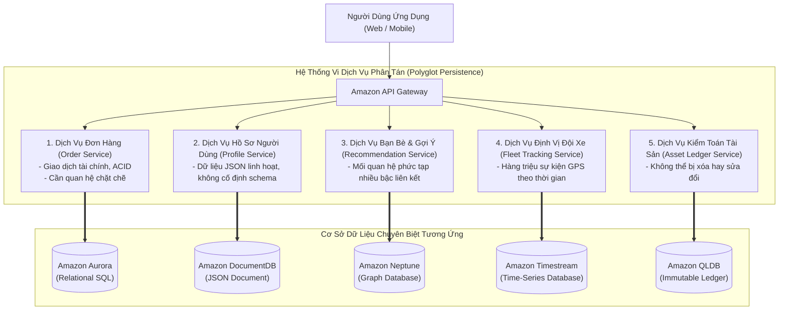
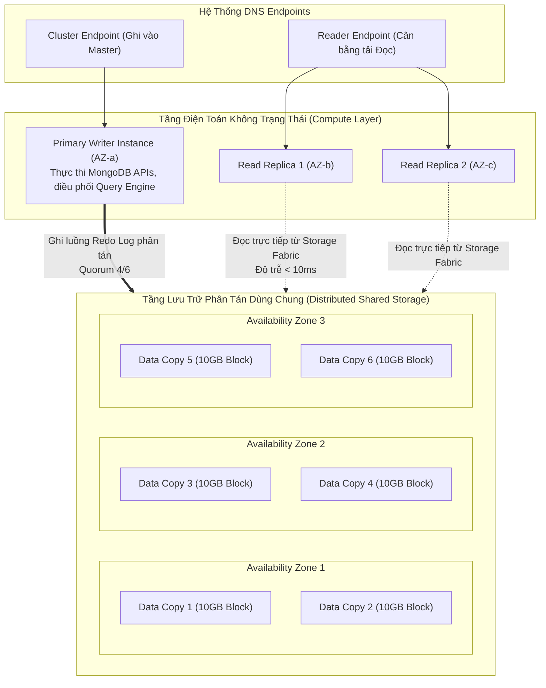
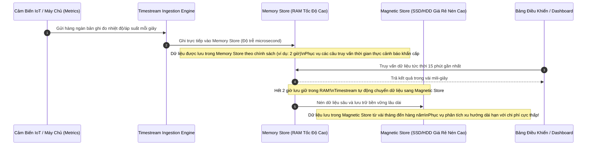
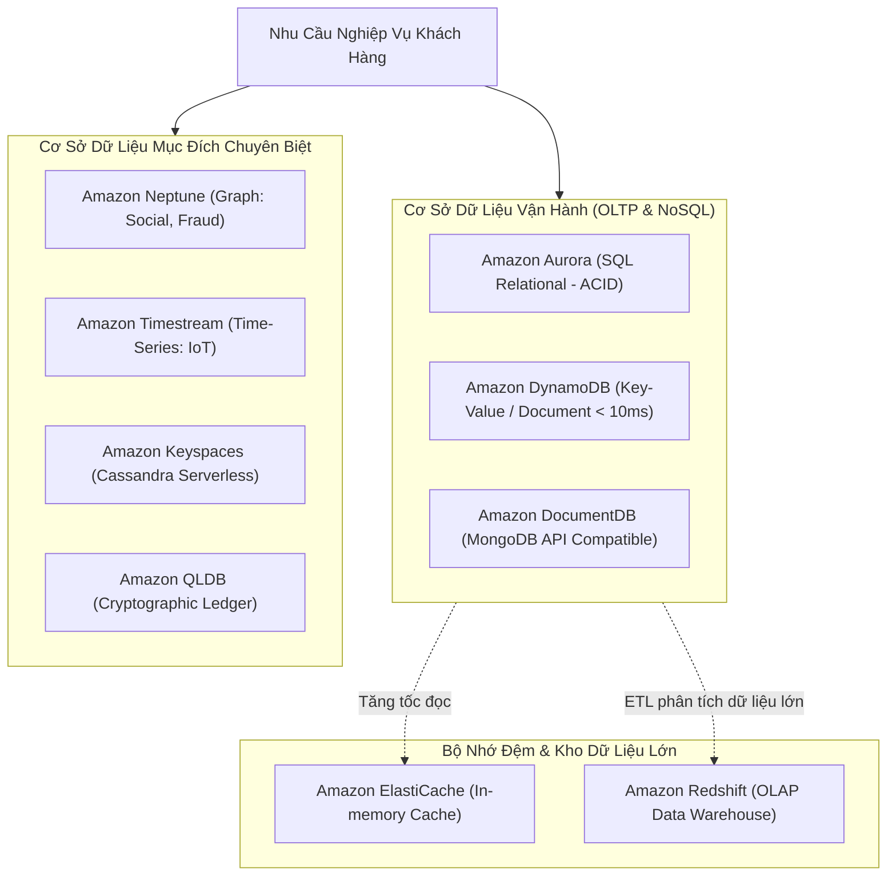

# Ghi Chú Bài Học: Chương 21 - Toàn Cảnh Các Cơ Sở Dữ Liệu Trên AWS (Databases in AWS)

> **Khóa học**: Ultimate AWS Certified Solutions Architect Associate  
> **Chương**: 21 - Databases in AWS (Bài 230 đến Bài 239)  
> **Tài liệu tham chiếu liên quan**: [AWS Service Document: Amazon RDS, Aurora & Databases](../AWS_Services/RDS_Aurora_Databases.md)

---

## 1. Tổng Quan Bài Học (Lesson Overview)

### Chủ đề chính
Chương này cung cấp cái nhìn tổng thể mang tính quyết định kiến trúc (**Architectural Decision Making**) về việc **lựa chọn đúng cơ sở dữ liệu cho đúng bài toán kinh doanh (Right Database for the Right Workload)** trong hệ sinh thái AWS:
- Triết lý kiến trúc đa cơ sở dữ liệu (**Polyglot Persistence**) trong các hệ thống vi dịch vụ (Microservices).
- Cơ sở dữ liệu quan hệ (**Relational - RDS & Aurora**): Tính toàn vẹn giao dịch ACID, quan hệ bảng chặt chẽ, tối ưu truy vấn SQL phức tạp.
- Cơ sở dữ liệu tài liệu **Amazon DocumentDB** (tương thích MongoDB): Kiến trúc tách rời Compute/Storage tương tự Aurora, lưu trữ JSON BSON phân tán.
- Cơ sở dữ liệu đồ thị **Amazon Neptune**: Quản lý các mối quan hệ đa chiều dày đặc (Nodes, Edges, Properties) bằng openCypher, Apache TinkerPop Gremlin, và W3C SPARQL.
- Cơ sở dữ liệu dạng cột phân tán **Amazon Keyspaces** (Serverless, tương thích Apache Cassandra): Quản lý dữ liệu chuỗi thời gian, IoT và ghi khối lượng lớn với ngôn ngữ CQL.
- Cơ sở dữ liệu chuỗi thời gian **Amazon Timestream**: Kiến trúc lưu trữ 2 tầng (Memory Store vs Magnetic Store) chuyên biệt cho dữ liệu viễn trắc (telemetry), số liệu máy chủ và cảm biến IoT.
- Cơ sở dữ liệu sổ cái bất biến **Amazon QLDB** (Quantum Ledger Database): Sổ cái kế toán được bảo vệ bằng cấu trúc cây băm mật mã (Cryptographic Merkle Tree).

### Mục tiêu học tập
1. Nắm vững ma trận ra quyết định kiến trúc lựa chọn cơ sở dữ liệu phù hợp với mô hình dữ liệu (Workload Types).
2. Hiểu sâu kiến trúc phân tán của **Amazon DocumentDB** (nhân bản 6 bản sao trên 3 AZ tương tự Aurora).
3. Thiết kế giải pháp mạng xã hội và phát hiện gian lận tài chính bằng **Amazon Neptune**.
4. Phân biệt được cơ chế lưu trữ 2 tầng tự động của **Amazon Timestream** để tối ưu hóa chi phí nạp hàng tỷ bản ghi IoT mỗi ngày.
5. Hiểu cách triển khai kiến trúc microservices trong đó mỗi dịch vụ sở hữu cơ sở dữ liệu chuyên biệt riêng.

---

## 2. Điểm Cốt Lõi Cần Nhớ (Key Takeaways)

1. **Polyglot Persistence (Không có công cụ vạn năng)**: Kiến trúc hiện đại từ bỏ tư duy dùng duy nhất 1 database quan hệ khổng lồ cho toàn bộ hệ thống; thay vào đó, mỗi microservice sử dụng một loại database tối ưu nhất cho bài toán của nó.
2. **Amazon DocumentDB**: Tương thích hoàn toàn với API và driver MongoDB; sử dụng hạ tầng lưu trữ phân tán thế hệ mới của AWS (tách Compute và Storage, nhân bản 6 bản sao trên 3 AZ, tự động co giãn lên 128 TB); hỗ trợ tự động failover trong 30 giây.
3. **Amazon Neptune**: Dành riêng cho dữ liệu mạng lưới quan hệ (Graph Data). Truy vấn đồ thị với hàng chục bước nhảy liên kết (hops) thực thi trong vài mili-giây, trong khi nếu dùng SQL JOIN truyền thống sẽ gây treo cơ sở dữ liệu; lý tưởng cho phát hiện gian lận (Fraud Detection), mạng xã hội, và đồ thị tri thức (Knowledge Graph).
4. **Amazon Keyspaces**: Dịch vụ Serverless tương thích Apache Cassandra; tự động co giãn dung lượng theo tải; trả tiền theo số lượng đọc/ghi thực tế; loại bỏ hoàn toàn việc phải vận hành cụm Cassandra phức tạp (sửa chữa compaction, tombstones, gossip protocol).
5. **Amazon Timestream**: Xử lý hàng ngàn tỷ sự kiện chuỗi thời gian mỗi ngày; tự động chuyển dữ liệu mới vào **Memory Store** (tối ưu ghi và đọc thời gian thực) và chuyển dữ liệu cũ vào **Magnetic Store** (nén chi phí thấp cho phân tích lịch sử); tích hợp các hàm phân tích cửa sổ thời gian.
6. **Amazon QLDB (Quantum Ledger Database)**: Sổ cái minh bạch, bất biến và có thể kiểm toán bằng mật mã học; mọi thay đổi đều được ghi nối tiếp vào một chuỗi khối không thể sửa đổi (Append-only); dữ liệu được xác thực bằng mã băm SHA-256.

---

## 3. Kiến Trúc & Cơ Chế Hoạt Động Chuyên Sâu (Under-the-Hood Mechanisms & Deep Dive)

### 3.1. Ma Trận Kiến Trúc Polyglot Persistence Trong Hệ Sinh Thái Microservices



---

### 3.2. Cơ Chế Lưu Trữ Phân Tán Của Amazon DocumentDB (Tương Thích MongoDB)



---

### 3.3. Kiến Trúc Lưu Trữ Hai Tầng Của Amazon Timestream



---

## 4. Lệnh, Cấu Hình & Mã Nguồn Thực Tế (Commands, Config & Code)

### 4.1. Khởi Tạo Cụm Amazon DocumentDB Bằng AWS CLI

```bash
# 1. Tao DocumentDB Cluster (Tuong thich MongoDB)
aws docdb create-db-cluster \
    --db-cluster-identifier "production-docdb-cluster" \
    --engine "docdb" \
    --master-username "docdbadmin" \
    --master-user-password "MyStrongDocDbPass2026!" \
    --backup-retention-period 7 \
    --storage-encrypted \
    --kms-key-id alias/aws/rds

# 2. Tao mot Instance trong Cluster DocumentDB
aws docdb create-db-instance \
    --db-instance-identifier "production-docdb-instance-1" \
    --db-cluster-identifier "production-docdb-cluster" \
    --db-instance-class "db.r6g.large"
```

---

### 4.2. Truy Vấn Dữ Liệu Chuỗi Thời Gian Trên Amazon Timestream

```sql
-- Truy van nhiet do trung binh theo tung cua so 5 phut cua cam bien IoT
SELECT 
    bin(time, 5m) as time_window,
    device_id,
    AVG(measure_value::double) as avg_temperature,
    MAX(measure_value::double) as max_temperature
FROM "IoT_Telemetry_DB"."SensorData"
WHERE measure_name = 'temperature'
  AND time between ago(2h) and now()
GROUP BY bin(time, 5m), device_id
ORDER BY time_window DESC;
```

---

### 4.3. Truy Vấn Đồ Thị Mối Quan Hệ Bằng OpenCypher Trên Amazon Neptune

```cypher
// Tim kiem tat ca cac tai khoan co lien he giao dich gian lan voi tai khoan bi khoa
MATCH (fraudster:Account {status: 'BLOCKED'})-[:TRANSFERRED_MONEY_TO*1..3]->(target:Account)
WHERE target.status = 'ACTIVE'
RETURN DISTINCT target.account_number, target.owner_name;
```

---

## 5. Tình Huống Thực Tiễn & Mẫu Kiến Trúc (Real-World Scenarios & Design Patterns)

### Tình huống 1: Phát Hiện Gian Lận Vòng Xoay Tiền (Financial Fraud Ring Detection)
- **Bài toán**: Ngân hàng phát hiện một nhóm tội phạm rửa tiền bằng cách mở hàng trăm tài khoản, chuyển tiền lòng vòng qua 5-7 cấp trung gian nhằm xóa dấu vết. Cơ sở dữ liệu quan hệ SQL chạy câu truy vấn `JOIN` 6 bảng liên tiếp mất tới 45 phút và làm treo máy chủ.
- **Giải pháp**:
  - Chuyển toàn bộ dữ liệu giao dịch tài khoản sang **Amazon Neptune**.
  - Mô hình hóa dữ liệu thành Graph: Mỗi tài khoản là một `Node`, mỗi giao dịch chuyển tiền là một `Edge` có thuộc tính `amount` và `timestamp`.
  - Thực thi câu truy vấn đồ thị tìm các chu trình khép kín (Cycles) hoặc đường đi 6 cấp. Neptune hoàn tất truy vấn đồ thị trong **chưa đầy 100 mili-giây**, lập tức gắn cờ cảnh báo các tài khoản trong đường dây rửa tiền.

### Tình huống 2: Quản Lý Nhật Ký Viễn Trắc Đội Xe Vận Tải Toàn Cầu
- **Bài toán**: Công ty logistics có 50,000 xe container chạy khắp thế giới, mỗi xe gửi tọa độ GPS, mức tiêu hao nhiên liệu và tốc độ xe mỗi 10 giây một lần (hàng tỷ điểm dữ liệu mỗi tháng). Họ cần giám sát xe quá tốc độ ngay lập tức và lưu trữ dữ liệu 3 năm để phân tích định kỳ.
- **Giải pháp**:
  - Sử dụng **Amazon Timestream**.
  - Cấu hình **Memory Store retention = 6 giờ** để phục vụ bảng điều khiển giám sát hành trình thời gian thực.
  - Cấu hình **Magnetic Store retention = 3 năm** để hệ thống tự động nén và đẩy dữ liệu cũ xuống tầng lưu trữ giá rẻ, tiết kiệm tới 85% chi phí so với việc lưu trữ toàn bộ trên RDS hoặc DynamoDB.

---

## 6. Mối Quan Hệ Giữa Các Khái Niệm / Dịch Vụ (Service Relationships & Ecosystem)



---

## 7. Câu Hỏi Ôn Tập, Bẫy Thi & Tự Đánh Giá (Review, Exam Traps & Self-Assessment)

### Câu hỏi:
1. Một công ty thương mại điện tử muốn xây dựng tính năng gợi ý sản phẩm dựa trên đồ thị quan hệ bạn bè, lượt thích và lịch sử mua sắm chéo của người dùng. Dịch vụ cơ sở dữ liệu nào của AWS là sự lựa chọn tối ưu nhất và vì sao không nên dùng cơ sở dữ liệu quan hệ RDS?
2. Doanh nghiệp của bạn đang vận hành một cụm Apache Cassandra On-Premises để lưu trữ số liệu định vị GPS của đội xe tải. Đội ngũ muốn chuyển dịch lên đám mây AWS mà không muốn tốn công quản trị cụm máy chủ và duy trì mã nguồn CQL hiện tại. Bạn nên chọn dịch vụ nào?
3. Kiến trúc lưu trữ của Amazon DocumentDB có điểm gì tương đồng với Amazon Aurora?
4. Một nhà máy sản xuất ô tô muốn lưu trữ hàng tỷ bản ghi đo nhiệt độ và áp suất từ các cảm biến IoT gửi về mỗi giây và phân tích biến thiên theo thời gian. Cơ sở dữ liệu nào của AWS được thiết kế tối ưu nhất cho bài toán này?
5. Sự khác biệt căn bản giữa **Amazon DynamoDB** và **Amazon DocumentDB** là gì khi ứng dụng của bạn làm việc với dữ liệu định dạng JSON?
6. Khi một doanh nghiệp tài chính cần một cơ sở dữ liệu để ghi lại lịch sử giao dịch tiền tệ với yêu cầu tuyệt đối không thể bị sửa đổi, làm sai lệch hay xóa bỏ (kể cả bởi quản trị viên cơ sở dữ liệu) và có thể kiểm chứng tính toàn vẹn bằng toán học mật mã, dịch vụ nào là giải pháp số 1?

---

### Đáp án & Giải thích chi tiết:

<details>
<summary>👉 Nhấp vào đây để xem đáp án và phân tích chi tiết</summary>

1. **Amazon Neptune** (Cơ sở dữ liệu đồ thị Graph Database chuyên biệt). Không nên sử dụng cơ sở dữ liệu quan hệ (RDS) vì khi số bậc liên kết giữa các mối quan hệ tăng lên (ví dụ: bạn của bạn của người mua sản phẩm X), câu lệnh SQL phải thực hiện nhiều phép `JOIN` đệ quy rất phức tạp, tiêu tốn CPU/RAM và thời gian phản hồi tăng theo cấp số nhân. Neptune được thiết kế để điều hướng trực tiếp theo các con trỏ cạnh (Edges) với độ trễ cố định mili-giây.
2. **Amazon Keyspaces (for Apache Cassandra)**. Đây là dịch vụ phi máy chủ (Serverless), tương thích 100% với giao thức mạng và ngôn ngữ truy vấn Cassandra Query Language (CQL), cho phép bạn di chuyển ứng dụng lên AWS mà không cần thay đổi mã nguồn driver kết nối, đồng thời loại bỏ toàn bộ việc cấu hình node, nén dữ liệu và quản trị phần cứng cụm.
3. Cả hai dịch vụ đều chia sẻ chung **kiến trúc điện toán đám mây tách rời tầng Tính toán (Compute) và tầng Lưu trữ (Storage)**:
   - Dữ liệu được chia nhỏ thành các khối 10 GB và nhân bản **6 bản sao xuyên qua 3 Availability Zones**.
   - Tự động co giãn dung lượng lưu trữ lên tới 128 TB mà không làm gián đoạn hệ thống.
   - Hỗ trợ tới 15 Read Replicas đọc chung một hạ tầng lưu trữ với độ trễ nhân bản cực thấp (< 10ms).
4. **Amazon Timestream**. Đây là cơ sở dữ liệu chuỗi thời gian (Time-series) được quản lý hoàn toàn, tự động tối ưu hóa việc phân tầng dữ liệu giữa Memory Store (cho các phép ghi và đọc thời gian thực) và Magnetic Store (cho phân tích xu hướng lịch sử nén chi phí rẻ), tích hợp sẵn các hàm phân tích cửa sổ thời gian mạnh mẽ.
5. So sánh:
   - **Amazon DynamoDB**: Là cơ sở dữ liệu NoSQL Key-Value / Wide-Column quy mô toàn cầu cực lớn; mỗi item tối đa 400 KB; tối ưu hóa cho các thao tác đọc/ghi siêu tốc qua Primary Key với độ trễ < 10ms; không hỗ trợ MongoDB wire protocol.
   - **Amazon DocumentDB**: Là cơ sở dữ liệu Document chuyên biệt tương thích nguyên bản với các API và công cụ của **MongoDB**; hỗ trợ các document JSON (BSON) phức tạp có kích thước lên tới 16 MB; hỗ trợ lập chỉ mục đa dạng trên các trường lồng nhau và thực thi các pipeline tổng hợp phức tạp (Aggregation Pipelines).
6. **Amazon QLDB (Quantum Ledger Database)**. QLDB sử dụng cơ chế sổ cái bất biến (Append-only journal) lưu trữ toàn bộ lịch sử thay đổi của dữ liệu. Mỗi giao dịch được băm mật mã và xâu chuỗi vào cây Merkle (Cryptographic Merkle Tree), cung cấp bằng chứng toán học độc lập chứng minh dữ liệu chưa bao giờ bị can thiệp hay chỉnh sửa bất hợp pháp.
</details>

---

## 8. Nguồn Trích Dẫn Bài Giảng & Tài Liệu Liên Quan (Source References)

- **Source Transcripts**:
  - [230 - Choosing the right database.md](../AWS_Resources/21%20-%20Databases%20in%20AWS/230%20-%20Choosing%20the%20right%20database.md)
  - [236 - DocumentDB.md](../AWS_Resources/21%20-%20Databases%20in%20AWS/236%20-%20DocumentDB.md)
  - [237 - Neptune.md](../AWS_Resources/21%20-%20Databases%20in%20AWS/237%20-%20Neptune.md)
  - [238 - Keyspaces (for Apache Cassandra).md](../AWS_Resources/21%20-%20Databases%20in%20AWS/238%20-%20Keyspaces%20%28for%20Apache%20Cassandra%29.md)
  - [239 - Timestream.md](../AWS_Resources/21%20-%20Databases%20in%20AWS/239%20-%20Timestream.md)
- **Tài liệu chuyên sâu liên quan**:
  - [Chuyên đề Master: Amazon RDS, Aurora & Modern Databases](../AWS_Services/RDS_Aurora_Databases.md)
  - [Chuyên đề Master: Amazon DynamoDB & Cơ Sở Dữ Liệu NoSQL](../AWS_Services/DynamoDB_NoSQL_Databases.md)
