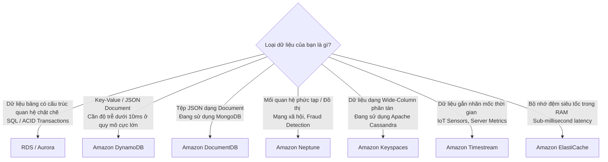

# Ghi Chú Bài Học: Chương 21 - Toàn Cảnh Các Cơ Sở Dữ Liệu Trên AWS (Databases in AWS)

> **Khóa học**: Ultimate AWS Certified Solutions Architect Associate  
> **Chương**: 21 - Databases in AWS (Bài 230 đến Bài 239)  
> **Tài liệu tham chiếu liên quan**: [AWS Service Document: Amazon RDS, Aurora & Databases](file:///n:/AWS_XBrain_Note/AWS_Services/RDS_Aurora_Databases.md)

---

## 4.1. Tổng Quan Bài Học (Lesson Overview)

### Chủ đề chính
Chương này cung cấp cái nhìn tổng thể mang tính quyết định kiến trúc (Architectural Decision Making) về việc **lựa chọn đúng cơ sở dữ liệu cho đúng bài toán kinh doanh** trên AWS: so sánh giữa cơ sở dữ liệu quan hệ (**RDS / Aurora**), cơ sở dữ liệu tài liệu Document (**Amazon DocumentDB** tương thích MongoDB), cơ sở dữ liệu đồ thị Graph (**Amazon Neptune**), cơ sở dữ liệu dạng cột phân tán (**Amazon Keyspaces** tương thích Apache Cassandra), cơ sở dữ liệu chuỗi thời gian Time-Series (**Amazon Timestream**), và bộ nhớ đệm trong RAM (**Amazon ElastiCache**).

### Mục tiêu học tập
1. Nắm được ma trận phân loại cơ sở dữ liệu theo tính chất mô hình dữ liệu (Workload Types).
2. Hiểu đặc thù kiến trúc và kịch bản ứng dụng của **Amazon DocumentDB**.
3. Hiểu các bài toán mạng xã hội và phát hiện gian lận tối ưu nhất với **Amazon Neptune**.
4. Phân biệt được sự khác nhau giữa **Amazon Keyspaces** (Cassandra trên đám mây) và **Amazon Timestream** (dữ liệu viễn trắc IoT).

---

## 4.2. Điểm Cốt Lõi Cần Nhớ (Key Takeaways)

1. **Không có một cơ sở dữ liệu nào giải quyết được mọi bài toán (No One-Size-Fits-All)**: Kỹ sư kiến trúc cần áp dụng tư duy "Polyglot Persistence" (sử dụng kết hợp nhiều loại cơ sở dữ liệu khác nhau cho các microservices khác nhau trong cùng một hệ sinh thái).
2. **Amazon DocumentDB**: Tương thích API MongoDB; kiến trúc tương tự Aurora (tách Compute và Storage, nhân bản 6 bản sao trên 3 AZ); tự động co giãn lên 128TB.
3. **Amazon Neptune**: Dành riêng cho Graph Data (Nodes, Edges, Properties); hỗ trợ ngôn ngữ truy vấn Gremlin, openCypher, SPARQL; tối ưu hóa cho bài toán phân tích mối quan hệ phức tạp có độ sâu liên kết lớn.
4. **Amazon Keyspaces**: Dịch vụ phi máy chủ (Serverless) tương thích Apache Cassandra; tự động co giãn theo tải; hỗ trợ ngôn ngữ CQL (Cassandra Query Language).
5. **Amazon Timestream**: Cơ sở dữ liệu chuyên biệt cho chuỗi thời gian (Time-series); xử lý hàng ngàn tỷ sự kiện mỗi ngày; tích hợp sẵn các hàm phân tích nội suy, cửa sổ thời gian.

---

## 4.3. Giải Thích Khái Niệm Chi Tiết (Detailed Concept Explanations)

### Ma Trận Ra Quyết Định Lựa Chọn Cơ Sở Dữ Liệu (Decision Matrix):

---

## 4.4. Câu Hỏi Ôn Tập và Tự Đánh Giá (Review & Self-Assessment)

### Câu hỏi:
1. Một công ty thương mại điện tử muốn xây dựng tính năng gợi ý sản phẩm dựa trên đồ thị quan hệ bạn bè và sở thích mua sắm của người dùng. Dịch vụ cơ sở dữ liệu nào của AWS là sự lựa chọn tối ưu nhất?
2. Doanh nghiệp của bạn đang vận hành một cụm Apache Cassandra On-Premises để lưu trữ số liệu định vị GPS của đội xe tải. Đội ngũ muốn chuyển dịch lên đám mây AWS mà không muốn tốn công quản trị cụm máy chủ và duy trì mã nguồn CQL hiện tại. Bạn nên chọn dịch vụ nào?
3. Dịch vụ cơ sở dữ liệu nào của AWS được thiết kế tương thích với MongoDB?
4. Một nhà máy sản xuất ô tô muốn lưu trữ hàng tỷ bản ghi đo nhiệt độ và áp suất từ các cảm biến IoT gửi về mỗi giây và phân tích biến thiên theo thời gian. Cơ sở dữ liệu nào phù hợp nhất?

---

### Đáp án (Self-Assessment Answers):

👉 Nhấp vào đây để xem đáp án

1. **Amazon Neptune** (Cơ sở dữ liệu đồ thị Graph Database chuyên biệt).
2. **Amazon Keyspaces (for Apache Cassandra)**.
3. **Amazon DocumentDB (with MongoDB compatibility)**.
4. **Amazon Timestream** (Cơ sở dữ liệu chuỗi thời gian Time-Series được tối ưu hóa cho dữ liệu đo lường IoT).

---

## 4.5. Nguồn Tham Chiếu (Source References)

- **Source Transcripts**:
  - [230 - Choosing the right database.md](file:///n:/AWS_XBrain_Note/AWS_Resources/21%20-%20Databases%20in%20AWS/230%20-%20Choosing%20the%20right%20database.md)
  - [236 - DocumentDB.md](file:///n:/AWS_XBrain_Note/AWS_Resources/21%20-%20Databases%20in%20AWS/236%20-%20DocumentDB.md)
  - [237 - Neptune.md](file:///n:/AWS_XBrain_Note/AWS_Resources/21%20-%20Databases%20in%20AWS/237%20-%20Neptune.md)
  - [238 - Keyspaces (for Apache Cassandra).md](file:///n:/AWS_XBrain_Note/AWS_Resources/21%20-%20Databases%20in%20AWS/238%20-%20Keyspaces%20(for%20Apache%20Cassandra).md)
  - [239 - Timestream.md](file:///n:/AWS_XBrain_Note/AWS_Resources/21%20-%20Databases%20in%20AWS/239%20-%20Timestream.md)
