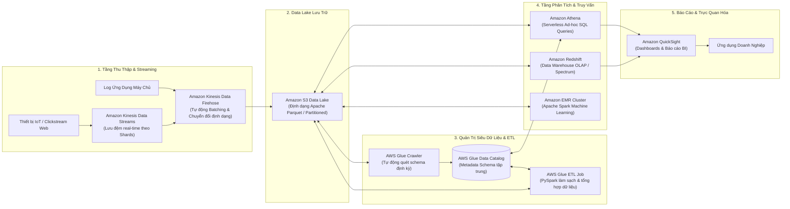
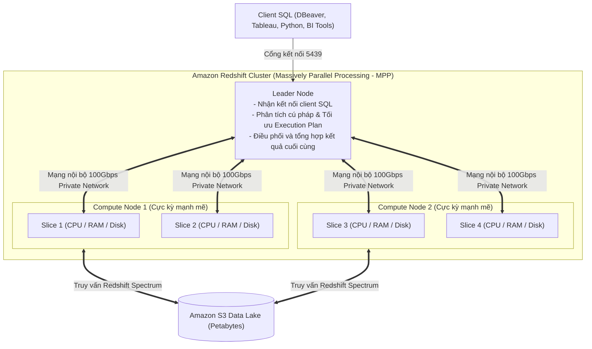
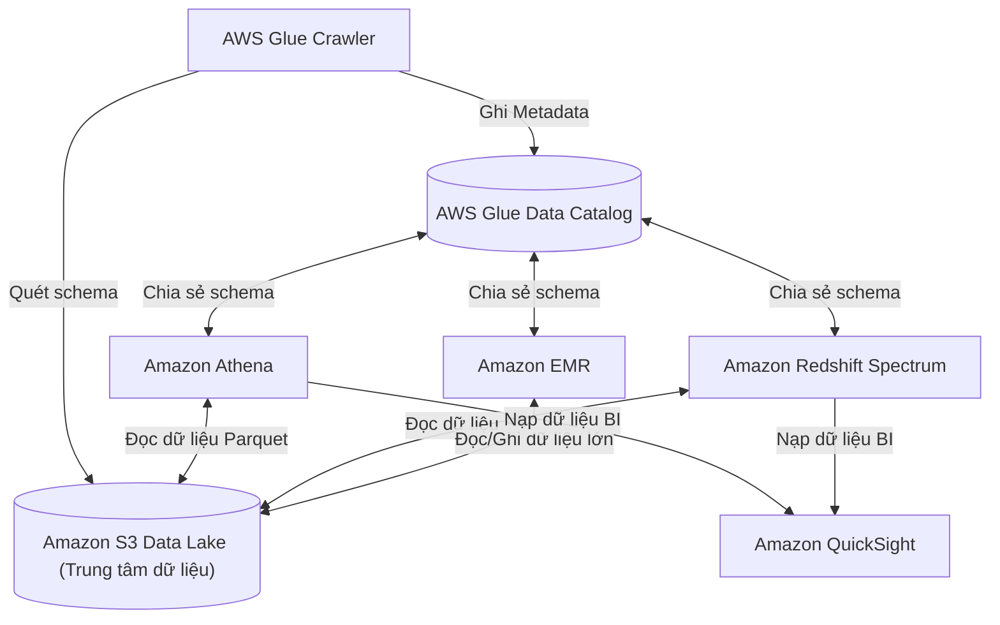

# Ghi Chú Bài Học: Chương 22 - Dữ Liệu Lớn & Nền Tảng Phân Tích (Data & Analytics)

> **Khóa học**: Ultimate AWS Certified Solutions Architect Associate  
> **Chương**: 22 - Data & Analytics (Bài 240 đến Bài 251)  
> **Tài liệu tham chiếu liên quan**: [Bảng Thuật Ngữ Kỹ Thuật (GLOSSARY.md)](../GLOSSARY.md) | [AWS Service Document: RDS & Aurora Databases](../AWS_Services/RDS_Aurora_Databases.md)

---

## 1. Tổng Quan Bài Học (Lesson Overview)

Chương học này trang bị bức tranh toàn diện về hệ sinh thái kiến trúc xử lý dữ liệu lớn (**Big Data**) và phân tích nâng cao (**Analytics**) trên AWS: từ khâu thu thập dữ liệu luồng thời gian thực (**Ingestion**), xây dựng hồ dữ liệu (**Data Lake trên S3**), lập danh bạ và biến đổi dữ liệu (**AWS Glue Catalog & ETL**), truy vấn tương tác phi máy chủ (**Amazon Athena**), kho dữ liệu phân tích dạng cột quy mô Petabyte (**Amazon Redshift**), nền tảng tính toán phân tán cụm Spark/Hadoop (**Amazon EMR**), đến lớp trực quan hóa báo cáo thông minh (**Amazon QuickSight**).

### Mục tiêu học tập cốt lõi
1. Thiết kế và vận hành đường ống thu thập và phân tích dữ liệu lớn thời gian thực (**End-to-End Big Data Pipeline**).
2. Hiểu cơ chế hoạt động của **Amazon Athena**, kỹ thuật phân vùng (**Partitioning**) và định dạng cột (**Parquet/ORC**) để giảm 90% chi phí truy vấn.
3. Nắm vững kiến trúc xử lý song song khối lượng lớn (**MPP**) của **Amazon Redshift**, 4 chiến lược phân phối dữ liệu (**Distribution Styles**), và **Redshift Spectrum**.
4. Khai thác vai trò của **AWS Glue Data Catalog** trong việc quản lý Metadata tập trung và **Glue Crawlers** tự động suy luận Schema.
5. Phân biệt các loại Node trong cụm **Amazon EMR** (Master, Core, Task) và chiến lược tối ưu chi phí bằng Spot Instances.

---

## 2. Điểm Cốt Lõi Cần Nhớ (Key Takeaways)

1. **Amazon Athena (Truy vấn SQL phi máy chủ trên S3)**:
   - Dịch vụ truy vấn tương tác không máy chủ (Serverless Interactive Query Engine) dựa trên Presto/Trino, sử dụng cú pháp chuẩn ANSI SQL.
   - Truy vấn trực tiếp trên các tệp tin lưu tại **Amazon S3** (CSV, JSON, ORC, Parquet, Avro) mà không cần nạp (load) dữ liệu vào bất kỳ database nào.
   - **Mô hình tính phí**: Tính tiền theo số byte dữ liệu được quét (**5 USD / 1 TB dữ liệu quét**).
   - **Mẹo sống còn tối ưu chi phí và hiệu năng**:
     - *Phân vùng thư mục (Partitioning)*: Chia dữ liệu theo cấu trúc đường dẫn S3 (ví dụ: `s3://bucket/logs/year=2026/month=11/day=09/`) để Athena chỉ quét đúng thư mục cần thiết thay vì toàn bộ bucket.
     - *Chuyển đổi sang định dạng dạng cột (Columnar Format)*: Sử dụng **Apache Parquet** hoặc **Apache ORC** kết hợp nén Snappy giúp giảm 80–90% dung lượng quét, tăng tốc độ truy vấn gấp nhiều lần.
2. **Amazon Redshift (Kho dữ liệu đám mây OLAP - Data Warehouse)**:
   - Được tối ưu chuyên biệt cho phân tích dữ liệu lớn phức tạp (**OLAP - Online Analytical Processing**), các câu lệnh tổng hợp `SUM`, `AVG`, `GROUP BY`, và phép nối `JOIN` trên hàng trăm triệu/hàng tỷ bản ghi.
   - **Lưu trữ dạng cột (Columnar Storage)**: Thay vì lưu theo từng hàng như database truyền thống (Postgres/MySQL), Redshift lưu toàn bộ giá trị của cùng một cột kề nhau trên đĩa, giúp nén dữ liệu cực cao và chỉ đọc đúng các cột được gọi trong câu lệnh `SELECT`.
   - **Kiến trúc MPP (Massively Parallel Processing)**: Gồm 1 **Leader Node** (tiếp nhận kết nối client SQL, tối ưu hóa câu truy vấn) và cụm các **Compute Nodes** (thực hiện tính toán song song). Mỗi Compute Node được chia thành các **Slices** độc lập có CPU và bộ nhớ riêng.
   - **4 chiến lược phân phối dữ liệu (Distribution Styles)**:
     - *AUTO*: Redshift tự động chọn (mặc định ban đầu dùng ALL, khi bảng lớn tự chuyển sang EVEN).
     - *EVEN*: Phân bổ đều các hàng theo vòng tròn (Round-Robin) trên các Slices (dùng khi không có cột nối rõ ràng).
     - *KEY*: Phân bổ các hàng có cùng giá trị khóa về cùng một Slice (tối ưu hóa phép `JOIN` giữa 2 bảng lớn).
     - *ALL*: Sao chép toàn bộ bảng lên tất cả các Compute Nodes (chỉ dùng cho bảng danh mục tra cứu nhỏ dưới vài triệu dòng).
   - **Sort Keys**: Sắp xếp dữ liệu vật lý trên đĩa để bỏ qua các khối dữ liệu (Data Blocks) không cần thiết khi quét (`Compound Sort Key` hoặc `Interleaved Sort Key`).
   - **Redshift Spectrum**: Cho phép chạy các truy vấn SQL kết hợp trực tiếp giữa các bảng dữ liệu nằm trong cụm Redshift và hàng Petabyte dữ liệu mở rộng nằm ngoài **Amazon S3** mà không cần load vào cluster.
3. **AWS Glue (Serverless ETL & Data Catalog)**:
   - Dịch vụ trích xuất, biến đổi và nạp dữ liệu hoàn toàn không máy chủ (**Serverless ETL**).
   - **Glue Data Catalog**: Kho lưu trữ siêu dữ liệu (Metadata Repository) tập trung chuẩn Apache Hive Metastore; lưu định nghĩa bảng, kiểu dữ liệu, đường dẫn S3; được chia sẻ chung cho Athena, EMR, Redshift Spectrum.
   - **Glue Crawlers**: Chương trình tự động quét các tệp tin trong S3/RDS định kỳ để suy luận lược đồ (**Schema Inference**) và tự động cập nhật phân vùng mới vào Glue Data Catalog.
4. **Amazon EMR (Elastic MapReduce)**:
   - Cung cấp cụm máy chủ quản lý sẵn để chạy các framework xử lý phân tán mã nguồn mở: **Apache Spark, Hadoop, Presto, Flink, Hive, HBase**.
   - Cấu tạo 3 loại Node:
     - *Master Node*: Quản lý cụm, điều phối tác vụ (bắt buộc chạy On-Demand hoặc Reserved, không dùng Spot).
     - *Core Node*: Vừa xử lý tính toán vừa lưu trữ dữ liệu phân tán **HDFS (Hadoop Distributed File System)** (chạy On-Demand để tránh mất dữ liệu HDFS).
     - *Task Node*: Chỉ thuần túy tính toán, không lưu dữ liệu HDFS (lý tưởng sử dụng **EC2 Spot Instances** để tiết kiệm tới 90% chi phí).
5. **Amazon QuickSight & OpenSearch**:
   - **QuickSight**: Dịch vụ Business Intelligence (BI) không máy chủ, sử dụng công cụ tính toán trong RAM siêu tốc **SPICE** (Super-fast, Parallel, In-memory Calculation Engine), tích hợp Machine Learning phát hiện điểm bất thường (Anomaly Detection).
   - **Amazon OpenSearch Service**: Dành riêng cho tìm kiếm toàn văn (Full-Text Search), tra cứu từ khóa và phân tích trực quan hóa log hệ thống qua OpenSearch Dashboards (trước đây là Kibana).

---

## 3. Kiến Trúc & Cơ Chế Hoạt Động Chuyên Sâu (Under-the-Hood Mechanisms & Deep Dive)

### 3.1. Sơ đồ Luồng Xử lý Dữ liệu Lớn Toàn diện (End-to-End Big Data Ingestion Pipeline)



---

### 3.2. Kiến trúc Xử lý Song song Khối lượng lớn (MPP) của Amazon Redshift Cluster



---

### 3.3. Bảng So sánh 4 Công cụ Phân tích Dữ liệu Chính trên AWS

| Tiêu chí | Amazon Athena | Amazon Redshift | Amazon EMR | Amazon OpenSearch |
| :--- | :--- | :--- | :--- | :--- |
| **Bản chất dịch vụ** | Serverless SQL Query Engine | Cloud Data Warehouse (OLAP) | Managed Hadoop/Spark Platform | Distributed Search & Log Analytics |
| **Mô hình máy chủ** | Hoàn toàn không máy chủ (Serverless) | Provisioned Cluster hoặc Redshift Serverless | Provisioned EC2 Cluster (Master/Core/Task) | Provisioned Cluster hoặc Serverless |
| **Định dạng dữ liệu** | Dữ liệu lưu ngoài S3 (CSV, JSON, Parquet) | Dữ liệu lưu trong cụm đĩa dạng cột (Columnar) | HDFS hoặc S3 (EMRFS) | JSON Documents lập chỉ mục (Inverted Index) |
| **Mô hình tính phí** | **5 USD / 1 TB dữ liệu quét** | Giờ máy Compute Node hoặc RPU-hour | Trả phí EC2 + Phí phần mềm EMR theo giờ | Trả phí instance theo giờ + Dung lượng EBS |
| **Tốc độ truy vấn** | Vài giây đến vài phút (Ad-hoc query) | Sub-second đến vài giây (Truy vấn phân tích nặng) | Vài phút đến hàng giờ (Batch ETL nặng) | Vài mili-giây (Sub-second Search) |
| **Kịch bản tối ưu** | Truy vấn log bất chợt, phân tích khám phá Data Lake | Báo cáo kinh doanh BI phức tạp, JOIN nhiều bảng lớn | Chạy thuật toán học máy phức tạp, ETL phân tán lớn | Tìm kiếm văn bản trên website, giám sát log hệ thống |

---

## 4. Lệnh, Cấu Hình & Mã Nguồn Thực Tế (Commands, Config & Code)

### 4.1. Câu lệnh DDL tạo bảng phân vùng dạng cột Parquet trên Amazon Athena

```sql
-- Tạo database và bảng partitioned tối ưu chi phí trong Athena
CREATE EXTERNAL TABLE IF NOT EXISTS ecommerce_analytics.orders_parquet (
    order_id STRING,
    customer_id STRING,
    total_amount DOUBLE,
    payment_method STRING,
    order_status STRING
)
PARTITIONED BY (
    year STRING,
    month STRING
)
ROW FORMAT SERDE 'org.apache.hadoop.hive.ql.io.parquet.serde.ParquetHiveSerDe'
STORED AS INPUTFORMAT 'org.apache.hadoop.hive.ql.io.parquet.MapredParquetInputFormat'
OUTPUTFORMAT 'org.apache.hadoop.hive.ql.io.parquet.MapredParquetOutputFormat'
LOCATION 's3://my-enterprise-data-lake/processed-orders/'
TBLPROPERTIES ('parquet.compress'='SNAPPY');

-- Tự động quét và cập nhật danh sách các partition mới nạp trên S3
MSCK REPAIR TABLE ecommerce_analytics.orders_parquet;

-- Truy vấn có filter partition: Chỉ quét partition tháng 11 năm 2026 (tiết kiệm 98% chi phí quét)
SELECT payment_method, COUNT(*) AS total_orders, SUM(total_amount) AS revenue
FROM ecommerce_analytics.orders_parquet
WHERE year = '2026' AND month = '11'
GROUP BY payment_method
ORDER BY revenue DESC;
```

---

### 4.2. Câu lệnh DDL tối ưu Redshift với DISTKEY và SORTKEY

```sql
-- Tạo bảng đơn hàng trong Redshift phân phối theo customer_id để tối ưu phép JOIN
CREATE TABLE sales_fact (
    order_id BIGINT NOT NULL,
    customer_id BIGINT NOT NULL,
    sale_date DATE NOT NULL,
    revenue NUMERIC(12,2),
    tax NUMERIC(12,2)
)
DISTSTYLE KEY
DISTKEY(customer_id)        -- Dữ liệu cùng customer_id nằm cùng Slice
COMPOUND SORTKEY(sale_date, customer_id); -- Sắp xếp theo ngày bán để quét theo dải thời gian cực nhanh
```

---

## 5. Tình Huống Thực Tiễn & Mẫu Kiến Trúc (Real-World Scenarios & Design Patterns)

### Tình huống 1: Phân tích 100 TB dữ liệu log truy cập S3 với chi phí rẻ nhất
- **Bối cảnh**: Bộ phận an ninh mạng cần thỉnh thoảng (1 lần/tuần) thực hiện các truy vấn điều tra bảo mật trên 100 TB tệp tin Access Log dạng `.csv` lưu trữ trên S3. Nếu bật cụm Redshift 24/7 sẽ tiêu tốn hàng ngàn USD mỗi tháng trong khi nhu cầu truy vấn rất ít.
- **Giải pháp**:
  1. Sử dụng **AWS Glue ETL Job** chạy hàng tuần để nén và chuyển đổi các tệp `.csv` thô sang định dạng **Apache Parquet** và phân vùng theo `year/month/day`. Dung lượng lưu trữ giảm từ 100 TB xuống còn khoảng 15 TB.
  2. Sử dụng **Amazon Athena** để chạy các câu lệnh SQL điều tra khi cần.
  3. Chi phí: Không tốn tiền duy trì cụm máy chủ. Mỗi truy vấn có điều kiện lọc ngày chỉ quét vài chục GB, chi phí chỉ vài xu (cents).

### Tình huống 2: Tối ưu chi phí cụm Apache Spark trên Amazon EMR
- **Bối cảnh**: Doanh nghiệp chạy tác vụ phân tích dữ liệu Spark hàng đêm kéo dài 6 tiếng trên cụm EMR 50 máy chủ. Chi phí On-Demand rất cao.
- **Giải pháp**:
  - **Master Node (1 instance)**: Chạy On-Demand để đảm bảo tính ổn định của cụm, không bao giờ bị gián đoạn.
  - **Core Nodes (4 instances)**: Chạy On-Demand để lưu trữ an toàn các khối dữ liệu HDFS và metadata của job Spark.
  - **Task Nodes (45 instances)**: Chạy hoàn toàn bằng **EC2 Spot Instances** (giảm giá 70–90%). Vì Task Node không lưu dữ liệu HDFS nên nếu có một vài Spot Instance bị AWS thu hồi, Spark Master chỉ đơn giản chuyển tác vụ tính toán đó sang Task Node khác mà toàn bộ job không bị thất bại.

---

## 6. Mối Quan Hệ Giữa Các Dịch Vụ (Service Relationships & Ecosystem)



---

## 7. Câu Hỏi Ôn Tập, Bẫy Thi & Tự Đánh Giá (Review, Exam Traps & Self-Assessment)

### Câu hỏi:

1. **Một công ty lưu trữ hàng terabyte log máy chủ web trên Amazon S3 dưới định dạng CSV. Các kỹ sư muốn chạy các câu lệnh SQL ad-hoc thỉnh thoảng để kiểm tra lỗi mà không cần quản lý hay khởi tạo bất kỳ máy chủ nào. Họ cũng muốn chi phí truy vấn là thấp nhất có thể. Hai giải pháp nào kết hợp sẽ đáp ứng tốt nhất yêu cầu?**
2. **Một nhà phân tích dữ liệu chạy một truy vấn Amazon Athena trên một bảng lớn và nhận thấy chi phí quét dữ liệu bị tính rất cao (hàng chục USD cho mỗi query). Kỹ thuật kiến trúc nào sau đây giúp giảm mạnh nhất dung lượng dữ liệu quét mà không làm thay đổi kết quả logic của câu truy vấn?**
3. **Bạn đang thiết kế cụm Amazon Redshift cho bảng dữ liệu giao dịch `Orders` (500 triệu dòng) và bảng thông tin khách hàng `Customers` (10 triệu dòng). Hai bảng này thường xuyên được kết nối (JOIN) thông qua cột `customer_id`. Chiến lược phân phối dữ liệu (Distribution Style) nào nên được cấu hình cho bảng `Orders`?**
4. **Một cụm Amazon EMR được cấu hình để xử lý lô dữ liệu lớn vào ban đêm. Đội kỹ sư muốn sử dụng EC2 Spot Instances để tiết kiệm chi phí tối đa. Họ CÓ THỂ sử dụng Spot Instances cho loại Node nào trong cụm EMR mà không gây rủi ro mất dữ liệu HDFS?**
5. **Dịch vụ nào sau đây đóng vai trò là một Apache Hive Metastore tập trung được quản lý hoàn toàn (Fully Managed), cho phép tự động khám phá và suy luận lược đồ dữ liệu trên Amazon S3?**
6. **Điểm khác biệt cốt lõi giữa Amazon Athena và Amazon Redshift là gì?**

---

### Đáp án (Self-Assessment Answers):

<details>
<summary>👉 Nhấp vào đây để xem đáp án và giải thích chi tiết</summary>

1. **Giải thích**: Sử dụng **Amazon Athena** để chạy SQL tương tác không máy chủ, kết hợp với việc chuyển đổi dữ liệu CSV sang định dạng cột nén **Apache Parquet hoặc Apache ORC** có phân vùng (**Partitioning**). Parquet giúp Athena chỉ đọc các cột cần thiết và partition giúp Athena chỉ quét các thư mục liên quan, giảm tới 90% chi phí.
2. **Giải thích**: **Phân vùng dữ liệu (Partitioning)** trên S3 kết hợp lưu trữ dưới định dạng **Apache Parquet/ORC**. Khi câu truy vấn có mệnh đề `WHERE` lọc theo cột phân vùng (ví dụ: ngày tháng), Athena chỉ quét đúng thư mục chứa partition đó thay vì quét toàn bộ dữ liệu trong bucket.
3. **Giải thích**: Cấu hình **DISTSTYLE KEY** với `DISTKEY(customer_id)` trên cả hai bảng. Khi cả 2 bảng đều phân phối theo cùng một khóa `customer_id`, các hàng có cùng ID khách hàng sẽ được đặt trên cùng một Slice vật lý của Compute Node, giúp phép `JOIN` diễn ra cục bộ trong bộ nhớ mà không cần xáo trộn (shuffle) dữ liệu qua mạng giữa các node, tăng tốc độ truy vấn vượt trội.
4. **Giải thích**: **Task Nodes**. Task Nodes chỉ làm nhiệm vụ tính toán mà không lưu trữ dữ liệu HDFS cục bộ. Nếu Spot Instance của Task Node bị thu hồi, EMR chỉ cần phân bổ lại tác vụ tính toán đó cho Task Node khác mà không gây mất mát dữ liệu. Ngược lại, Master Node và Core Node bắt buộc phải dùng On-Demand/Reserved vì Core Node lưu trữ các block dữ liệu HDFS.
5. **Giải thích**: **AWS Glue Data Catalog** (kết hợp với **AWS Glue Crawlers** để tự động quét và cập nhật schema).
6. **Giải thích**:
   - **Athena**: Dịch vụ phi máy chủ (Serverless), không cần cấp phát hạ tầng, đọc dữ liệu trực tiếp tại chỗ trên S3, trả tiền theo số byte quét trong mỗi câu truy vấn; tối ưu cho truy vấn ad-hoc khám phá dữ liệu.
   - **Redshift**: Kho dữ liệu doanh nghiệp (OLAP Data Warehouse) có cụm máy chủ chuyên dụng (hoặc Serverless RPU), lưu trữ dữ liệu tập trung dạng cột trong ổ cứng nội bộ, hỗ trợ tối ưu hóa chỉ mục, sort key, distribution key cho các truy vấn phân tích phức tạp tốc độ cao phục vụ báo cáo BI liên tục.
</details>

---

## 8. Nguồn Trích Dẫn Bài Giảng & Tài Liệu Liên Quan (Source References)

- **Source Transcripts**:
  - [240 - Athena.md](../AWS_Resources/22%20-%20Data%20&%20Analytics/240%20-%20Athena.md)
  - [241 - Athena Hands On.md](../AWS_Resources/22%20-%20Data%20&%20Analytics/241%20-%20Athena%20Hands%20On.md)
  - [242 - Redshift.md](../AWS_Resources/22%20-%20Data%20&%20Analytics/242%20-%20Redshift.md)
  - [243 - OpenSearch %28ex_%20ElasticSearch%29.md](../AWS_Resources/22%20-%20Data%20&%20Analytics/243%20-%20OpenSearch%20%28ex_%20ElasticSearch%29.md)
  - [244 - EMR.md](../AWS_Resources/22%20-%20Data%20&%20Analytics/244%20-%20EMR.md)
  - [245 - QuickSight.md](../AWS_Resources/22%20-%20Data%20&%20Analytics/245%20-%20QuickSight.md)
  - [246 - Glue.md](../AWS_Resources/22%20-%20Data%20&%20Analytics/246%20-%20Glue.md)
  - [251 - Big Data Ingestion Pipeline.md](../AWS_Resources/22%20-%20Data%20&%20Analytics/251%20-%20Big%20Data%20Ingestion%20Pipeline.md)
- **Tài liệu tham chiếu nội bộ**:
  - [Bảng Thuật Ngữ Kỹ Thuật GLOSSARY.md](../GLOSSARY.md)
  - [AWS Service Document: RDS & Aurora Databases](../AWS_Services/RDS_Aurora_Databases.md)
