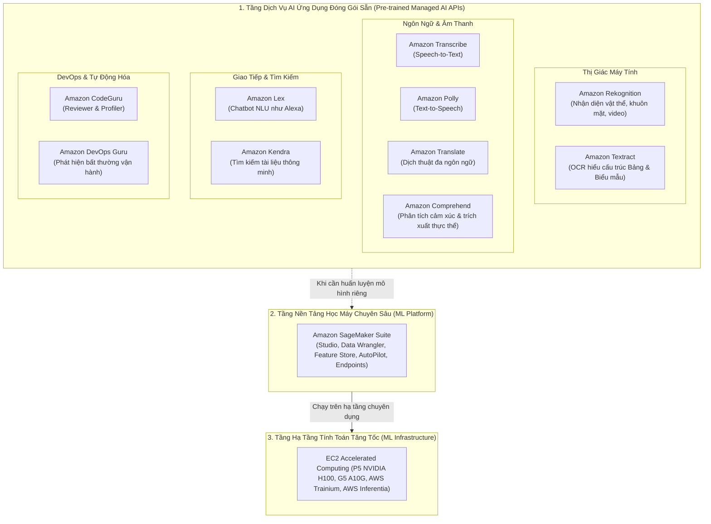
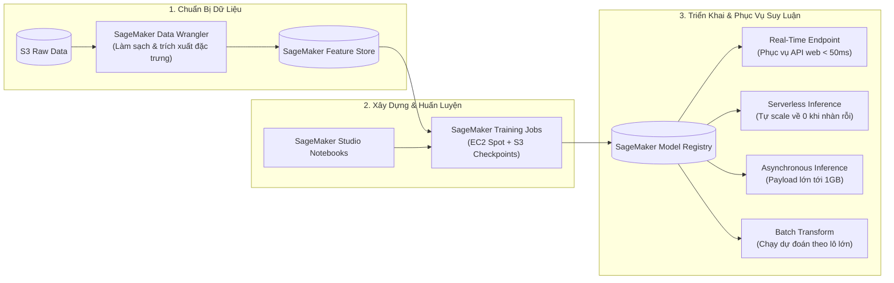
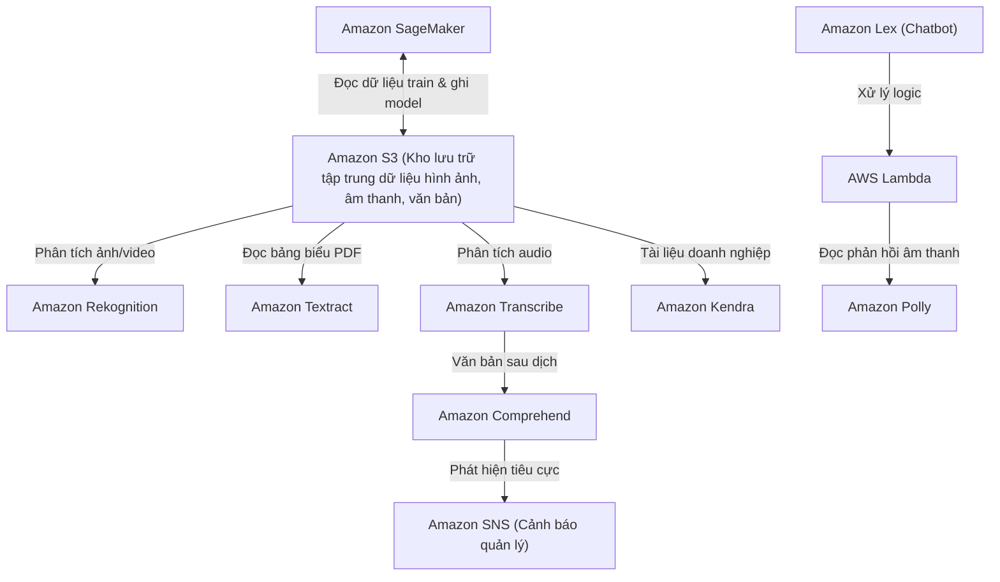

# Ghi Chú Bài Học: Chương 23 - Trí Tuệ Nhân Tạo & Nền Tảng Học Máy (Machine Learning & AI)

> **Khóa học**: Ultimate AWS Certified Solutions Architect Associate  
> **Chương**: 23 - Machine Learning (Bài 252 đến Bài 263)  
> **Tài liệu tham chiếu liên quan**: [Bảng Thuật Ngữ Kỹ Thuật (GLOSSARY.md)](../GLOSSARY.md)

---

## 1. Tổng Quan Bài Học (Lesson Overview)

Chương học này cung cấp cái nhìn toàn diện và có hệ thống về hệ sinh thái Trí tuệ Nhân tạo (**AI**) và Học máy (**Machine Learning - ML**) trên AWS. Trọng tâm của kỳ thi SAA-C03 và thực hành kiến trúc giải pháp là hiểu rõ mục đích chuyên biệt của từng dịch vụ AI ứng dụng có sẵn mô hình (**Managed AI Services**) để lựa chọn chính xác theo yêu cầu bài toán mà không cần phải tự xây dựng hay huấn luyện lại các mô hình phức tạp từ đầu, đồng thời nắm vững kiến trúc nền tảng **Amazon SageMaker**.

### Mục tiêu học tập cốt lõi
1. Phân định chính xác ranh giới sử dụng giữa các dịch vụ AI thị giác máy tính (**Amazon Rekognition** vs **Amazon Textract**).
2. Nắm vững bộ dịch vụ AI xử lý ngôn ngữ và âm thanh (**Amazon Transcribe**, **Amazon Polly**, **Amazon Translate**, **Amazon Comprehend**).
3. Hiểu cơ chế xây dựng Chatbot thông minh với **Amazon Lex** và tìm kiếm doanh nghiệp với **Amazon Kendra**.
4. Ứng dụng AI vào tự động hóa mã nguồn và tối ưu hóa vận hành đám mây (**Amazon CodeGuru** & **Amazon DevOps Guru**).
5. Nắm bắt các thành phần cốt lõi trong chu kỳ phát triển và triển khai mô hình của **Amazon SageMaker**.

---

## 2. Điểm Cốt Lõi Cần Nhớ (Key Takeaways)

1. **Phân tầng dịch vụ AI/ML của AWS**:
   - **Tầng ứng dụng (AI Services - Không cần chuyên môn ML)**: Các API đóng gói sẵn mô hình đã được AWS huấn luyện trên hàng triệu dữ liệu (Rekognition, Textract, Transcribe, Polly, Comprehend, Lex, Kendra). Nhà phát triển chỉ cần gọi REST API là có kết quả ngay.
   - **Tầng nền tảng (ML Platforms - Dành cho Data Scientists & ML Engineers)**: **Amazon SageMaker** cung cấp hạ tầng toàn diện để tự chuẩn bị dữ liệu, viết thuật toán, huấn luyện phân tán và triển khai endpoint suy luận.
2. **Nhóm AI Thị Giác Máy Tính (Computer Vision)**:
   - **Amazon Rekognition**: Nhận diện khuôn mặt, so sánh khuôn mặt (Face Comparison), phát hiện vật thể, nhãn (Label Detection), kiểm duyệt nội dung phản cảm/khiêu dâm (Content Moderation), nhận diện người nổi tiếng, và tính năng *Custom Labels* để nhận diện linh kiện/sản phẩm đặc thù của doanh nghiệp.
   - **Amazon Textract**: **Khác biệt căn bản với OCR thông thường**: Textract không chỉ đọc chữ mà còn hiểu ngữ cảnh để trích xuất chính xác cặp Khóa/Giá trị (**Key-Value Pairs**) trong các mẫu đơn và cấu trúc hàng/cột trong **bảng biểu (Tables)** từ tài liệu PDF, hóa đơn (Invoices), biên lai (Receipts).
3. **Nhóm AI Âm Thanh & Ngôn Ngữ Tự Nhiên (Speech & NLP)**:
   - **Amazon Transcribe**: Chuyển giọng nói thành văn bản (**Speech-to-Text - ASR**), hỗ trợ tách người nói (Speaker Identification), loại bỏ tiếng ồn và tự động che giấu thông tin cá nhân định danh (**PII Redaction**).
   - **Amazon Polly**: Chuyển văn bản thành giọng nói tự nhiên (**Text-to-Speech - TTS**), hỗ trợ chuẩn SSML để tùy chỉnh ngữ điệu, thì thầm, ngắt giọng; cung cấp giọng đọc thế hệ mới **Neural TTS**.
   - **Amazon Translate**: Dịch thuật máy tính thời gian thực chính xác cao giữa hàng chục ngôn ngữ.
   - **Amazon Comprehend**: Xử lý ngôn ngữ tự nhiên (**NLP**), phân tích sắc thái cảm xúc khách hàng (Sentiment: Tích cực/Tiêu cực/Trung tính), trích xuất thực thể (Entities: Tên người, địa danh, tổ chức), nhận diện ngôn ngữ và gom cụm chủ đề (Topic Modeling).
4. **Nhóm AI Đàm Thoại & Tìm Kiếm Thông Minh (Conversational & Search)**:
   - **Amazon Lex**: Nền tảng xây dựng Chatbot và Voicebot thông minh (sử dụng cùng công nghệ NLU và ASR với trợ lý ảo **Amazon Alexa**); dễ dàng tích hợp với Lambda để thực hiện các tác vụ nghiệp vụ (Fulfillment).
   - **Amazon Kendra**: Công cụ tìm kiếm thông minh cấp doanh nghiệp (**Enterprise Intelligent Search**) hoạt động dựa trên học máy; cho phép nhân viên đặt câu hỏi bằng ngôn ngữ tự nhiên (Natural Language Questions) thay vì tìm từ khóa thô sơ; tích hợp bộ kết nối (Connectors) tới S3, SharePoint, Salesforce, Confluence, RDS.
5. **Nhóm AI DevOps & Mã Nguồn**:
   - **Amazon CodeGuru**:
     - *Reviewer*: Quét mã nguồn tĩnh (Static Code Analysis) trên GitHub/CodeCommit để phát hiện lỗ hổng bảo mật và vi phạm best practices.
     - *Profiler*: Phân tích hiệu năng ứng dụng đang chạy ở runtime (CPU/RAM profiling) để tìm các dòng mã gây nghẽn tài nguyên.
   - **Amazon DevOps Guru**: Tự động phân tích các chỉ số CloudWatch, sự kiện CloudTrail và log ứng dụng để cảnh báo sự cố vận hành trước khi người dùng phát hiện.
6. **Amazon SageMaker**:
   - Nền tảng ML quản lý toàn diện: **SageMaker Studio**, **Data Wrangler** (chuẩn bị dữ liệu), **Feature Store** (quản lý đặc trưng), **Training Jobs** (hỗ trợ EC2 Spot Instances + S3 Checkpoints để giảm 90% chi phí huấn luyện), và các tùy chọn triển khai Endpoint: *Real-time Endpoints* (độ trễ thấp), *Serverless Inference* (tự co giãn về 0 khi không có request), *Asynchronous Inference* (xử lý payload lớn tới 1GB), và *Batch Transform* (chạy dự đoán theo lô định kỳ).

---

## 3. Kiến Trúc & Cơ Chế Hoạt Động Chuyên Sâu (Under-the-Hood Mechanisms & Deep Dive)

### 3.1. Sơ đồ Phân tầng Dịch vụ Trí tuệ Nhân tạo & Học máy trên AWS



---

### 3.2. Bảng Ma Trận Phân Định Ranh Giới Dịch Vụ AI Trong Bài Thi SAA-C03

| Nhu cầu bài toán | Lựa chọn ĐÚNG | Phương án SAI / Bẫy thi thường gặp | Lý do phân định |
| :--- | :--- | :--- | :--- |
| **Trích xuất thông tin hóa đơn, bảng lương PDF** | **Amazon Textract** | Amazon Rekognition | Rekognition chỉ phát hiện nhãn ảnh và văn bản đơn giản; chỉ Textract mới giữ nguyên cấu trúc bảng và cặp Key/Value. |
| **Phân tích độ giận dữ/hài lòng của khách hàng từ email** | **Amazon Comprehend** | Amazon Transcribe | Transcribe chuyển âm thanh thành chữ; Comprehend mới phân tích được sắc thái cảm xúc (Sentiment: Negative/Positive). |
| **Xây dựng Chatbot tự động đặt lịch hẹn khám bệnh** | **Amazon Lex** | Amazon Polly | Polly chỉ đọc to văn bản thành file mp3; Lex mới có công cụ hiểu ý định người dùng (Intents, Slots, Utterances) để giao tiếp. |
| **Tìm kiếm hợp đồng nội bộ công ty bằng câu hỏi tự nhiên** | **Amazon Kendra** | Amazon OpenSearch | OpenSearch tìm kiếm dựa trên từ khóa (keyword match); Kendra dùng ML hiểu ngữ nghĩa câu hỏi để trả về câu trả lời trực tiếp. |
| **Tối ưu chi phí huấn luyện mô hình ML trong 2 ngày** | **SageMaker + Spot Instances** | EC2 On-Demand | Huấn luyện với SageMaker Managed Spot kết hợp S3 Checkpoints giúp giảm 90% chi phí mà không sợ mất trạng thái. |

---

### 3.3. Sơ đồ Chu kỳ Vận hành Máy học với Amazon SageMaker



---

## 4. Lệnh, Cấu Hình & Mã Nguồn Thực Tế (Commands, Config & Code)

### 4.1. Lệnh AWS CLI phát hiện nhãn hình ảnh với Amazon Rekognition

```bash
# Phân tích bức ảnh lưu trong S3 để phát hiện các đối tượng với độ tin cậy > 80%
aws rekognition detect-labels \
    --image '{"S3Object":{"Bucket":"my-security-camera-assets","Name":"parking_lot_01.jpg"}}' \
    --min-confidence 80 \
    --query "Labels[].{Name:Name, Confidence:Confidence}" \
    --output table
```

---

### 4.2. Lệnh AWS CLI trích xuất dữ liệu bảng từ hóa đơn với Amazon Textract

```bash
# Phân tích tài liệu PDF hóa đơn để trích xuất cấu trúc bảng và form
aws textract analyze-document \
    --document '{"S3Object":{"Bucket":"finance-invoices-2026","Name":"invoice_nov_09.pdf"}}' \
    --feature-types '["TABLES", "FORMS"]' \
    --output json > textract_extracted_data.json
```

---

### 4.3. Lệnh AWS CLI chuyển đổi văn bản thành giọng nói với Amazon Polly

```bash
# Tạo file âm thanh mp3 giọng đọc tiếng Anh Neural chất lượng cao
aws polly synthesize-speech \
    --engine neural \
    --voice-id Joanna \
    --output-format mp3 \
    --text "Welcome to AWS Cloud Architecture. Today we will explore serverless artificial intelligence services." \
    welcome_audio.mp3
```

---

## 5. Tình Huống Thực Tiễn & Mẫu Kiến Trúc (Real-World Scenarios & Design Patterns)

### Tình huống 1: Tự động hóa Phân loại Hồ sơ Đơn vay Ngân hàng
- **Quy trình nghiệp vụ**: Khách hàng chụp ảnh CMND/CCCD và sao kê lương tải lên ứng dụng di động. Ngân hàng cần trích xuất tự động thông tin họ tên, số định danh, mức lương hàng tháng và đưa ra hạn mức tín dụng trong 30 giây.
- **Kiến trúc giải pháp**:
  ```mermaid
  flowchart LR
      Client["Ứng dụng Mobile Khách hàng"] -->|Upload ảnh giấy tờ| S3["Amazon S3 Bucket"]
      S3 -->|S3 Event Notification| Lambda["AWS Lambda"]
      Lambda -->|Trích xuất ảnh khuôn mặt| Rekog["Amazon Rekognition"]
      Lambda -->|Trích xuất bảng lương & số liệu| Textract["Amazon Textract"]
      Textract -->|Dữ liệu có cấu trúc| SageMaker["SageMaker Serverless Endpoint (Mô hình chấm điểm rủi ro)"]
      SageMaker -->|Phê duyệt/Từ chối| DB[("Amazon DynamoDB")]
  ```

### Tình huống 2: Hệ thống Giám sát & Đánh giá Cuộc gọi Chăm sóc Khách hàng (Call Center AI)
- **Yêu cầu**: Trung tâm chăm sóc khách hàng ghi âm hàng ngàn cuộc gọi mỗi ngày. Ban giám đốc muốn tự động phát hiện các cuộc gọi có khách hàng giận dữ hoặc nhân viên dùng từ ngữ không đúng quy chuẩn mà không cần người nghe thủ công.
- **Giải pháp**:
  1. Tệp ghi âm cuộc gọi được đẩy vào S3.
  2. **Amazon Transcribe** chuyển toàn bộ cuộc gọi thành văn bản, tự động tách riêng kênh của nhân viên và khách hàng (**Channel Identification**), tự động che giấu số thẻ tín dụng/CVV (**PII Masking**).
  3. Đoạn văn bản sau đó được chuyển qua **Amazon Comprehend** để phân tích cảm xúc (Sentiment Analysis). Nếu phát hiện điểm "Negative" vượt ngưỡng 80%, Comprehend gửi cảnh báo qua **Amazon SNS** tới hòm thư của Trưởng bộ phận để xử lý ngay lập tức.

---

## 6. Mối Quan Hệ Giữa Các Dịch Vụ (Service Relationships & Ecosystem)



---

## 7. Câu Hỏi Ôn Tập, Bẫy Thi & Tự Đánh Giá (Review, Exam Traps & Self-Assessment)

### Câu hỏi:

1. **Một ứng dụng tuyển dụng cho phép ứng viên tải lên các bản sao chứng chỉ và sơ yếu lý lịch dưới định dạng hình ảnh và PDF. Công ty muốn tự động đọc và trích xuất thông tin lịch sử làm việc được trình bày dưới dạng bảng biểu phức tạp. Dịch vụ nào cung cấp giải pháp ít tốn công sức phát triển nhất?**
2. **Một tập đoàn đa quốc gia muốn xây dựng một cổng thông tin tìm kiếm nội bộ cho phép nhân viên đặt các câu hỏi như *"Chính sách nghỉ thai sản của công ty kéo dài bao nhiêu tuần?"* và nhận được câu trả lời chính xác trích từ hàng ngàn tài liệu Word, PDF lưu trong SharePoint và Amazon S3. Dịch vụ nào đáp ứng hoàn hảo?**
3. **Một ứng dụng di động cho phép người dùng nhập bài đăng bằng văn bản và muốn người dùng khác có thể nghe bài đăng đó dưới dạng âm thanh với ngữ điệu tự nhiên như người thật đọc. Dịch vụ AWS nào phù hợp nhất?**
4. **Một nhà khoa học dữ liệu cần huấn luyện một mô hình học máy lớn trên Amazon SageMaker kéo dài 3 ngày. Yêu cầu đặt ra là phải tối ưu hóa chi phí huấn luyện tới mức tối đa nhưng vẫn đảm bảo tiến trình huấn luyện không bị mất nếu máy chủ bị gián đoạn. Giải pháp kiến trúc nào nên áp dụng?**
5. **Điểm khác biệt căn bản giữa Amazon CodeGuru Reviewer và Amazon CodeGuru Profiler là gì?**

---

### Đáp án (Self-Assessment Answers):

<details>
<summary>👉 Nhấp vào đây để xem đáp án và giải thích chi tiết</summary>

1. **Giải thích**: **Amazon Textract**. Textract được thiết kế chuyên biệt để phân tích tài liệu và tự động nhận diện cấu trúc phân cấp, bảng biểu (**Tables**) và các cặp khóa/giá trị (**Forms**) mà không cần huấn luyện mô hình. Rekognition chỉ nhận diện đối tượng và chữ thô sơ, không hiểu cấu trúc bảng.
2. **Giải thích**: **Amazon Kendra**. Kendra là công cụ tìm kiếm thông minh cấp doanh nghiệp (Intelligent Search) sử dụng công nghệ Natural Language Processing (NLP) để hiểu câu hỏi tự nhiên và trích xuất câu trả lời trực tiếp từ tài liệu, đồng thời có sẵn các Connector kết nối với SharePoint và S3.
3. **Giải thích**: **Amazon Polly**. Polly là dịch vụ Text-to-Speech (TTS) chuyển đổi văn bản thành âm thanh giọng nói tự nhiên, hỗ trợ công nghệ Neural TTS mang lại giọng đọc truyền cảm như con người.
4. **Giải thích**: Kích hoạt **SageMaker Managed Spot Training** kết hợp lưu trữ **Checkpoints định kỳ trên Amazon S3**. Managed Spot Training sử dụng các máy ảo EC2 Spot Instances giúp giảm tới 90% chi phí huấn luyện; khi instance bị thu hồi, SageMaker tự động khởi động lại instance khác và nạp lại checkpoint từ S3 để tiếp tục huấn luyện mà không phải chạy lại từ đầu.
5. **Giải thích**:
   - **CodeGuru Reviewer**: Quét mã nguồn tĩnh (Static Analysis) trước khi merge code vào kho lưu trữ (CodeCommit/GitHub) để phát hiện lỗ hổng bảo mật, rò rỉ khóa bí mật và sai lệch chuẩn lập trình.
   - **CodeGuru Profiler**: Giám sát hiệu năng của ứng dụng đang chạy thật trong môi trường Runtime để phát hiện dòng lệnh nào đang tiêu tốn CPU/RAM bất thường và đề xuất cách tối ưu thuật toán.
</details>

---

## 8. Nguồn Trích Dẫn Bài Giảng & Tài Liệu Liên Quan (Source References)

- **Source Transcripts**:
  - [252 - Rekognition Overview.md](../AWS_Resources/23%20-%20Machine%20Learning/252%20-%20Rekognition%20Overview.md)
  - [253 - Transcribe Overview.md](../AWS_Resources/23%20-%20Machine%20Learning/253%20-%20Transcribe%20Overview.md)
  - [254 - Polly Overview.md](../AWS_Resources/23%20-%20Machine%20Learning/254%20-%20Polly%20Overview.md)
  - [255 - Translate Overview.md](../AWS_Resources/23%20-%20Machine%20Learning/255%20-%20Translate%20Overview.md)
  - [256 - Lex + Connect Overview.md](../AWS_Resources/23%20-%20Machine%20Learning/256%20-%20Lex%20%2B%20Connect%20Overview.md)
  - [257 - Comprehend Overview.md](../AWS_Resources/23%20-%20Machine%20Learning/257%20-%20Comprehend%20Overview.md)
  - [258 - Comprehend Medical Overview.md](../AWS_Resources/23%20-%20Machine%20Learning/258%20-%20Comprehend%20Medical%20Overview.md)
  - [259 - SageMaker AI Overview.md](../AWS_Resources/23%20-%20Machine%20Learning/259%20-%20SageMaker%20AI%20Overview.md)
  - [260 - Kendra Overview.md](../AWS_Resources/23%20-%20Machine%20Learning/260%20-%20Kendra%20Overview.md)
  - [262 - Textract Overview.md](../AWS_Resources/23%20-%20Machine%20Learning/262%20-%20Textract%20Overview.md)
- **Tài liệu tham chiếu nội bộ**:
  - [Bảng Thuật Ngữ Kỹ Thuật GLOSSARY.md](../GLOSSARY.md)
