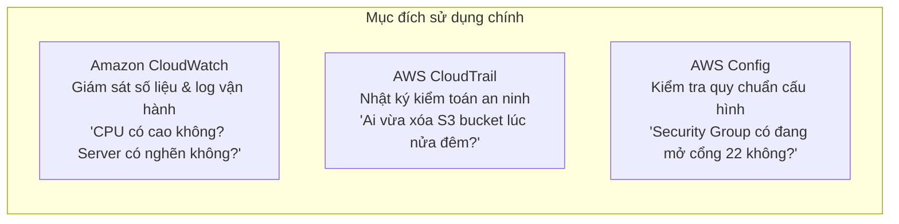

# Ghi Chú Bài Học: Chương 24 - Giám Sát, Kiểm Toán & Quản Trị Tuân Thủ (AWS Monitoring & Audit)

> **Khóa học**: Ultimate AWS Certified Solutions Architect Associate  
> **Chương**: 24 - AWS Monitoring & Audit: CloudWatch, CloudTrail, Config (Bài 264 đến Bài 281)  
> **Tài liệu tham chiếu liên quan**: [AWS Service Document: CloudWatch, CloudTrail & Config](file:///n:/AWS_XBrain_Note/AWS_Services/CloudWatch_CloudTrail_Observability.md)

---

## 4.1. Tổng Quan Bài Học (Lesson Overview)

### Chủ đề chính
Chương này trang bị toàn bộ kỹ năng giám sát vận hành, kiểm toán bảo mật và quản lý tuân thủ trên AWS thông qua bộ 3 công cụ cốt lõi: **Amazon CloudWatch** (Metrics, Logs, Live Tail, Unified CloudWatch Agent, Alarms, Synthetics Canaries, Logs Insights), **AWS CloudTrail** (ghi nhật ký các cuộc gọi API, phân loại Management vs Data Events, CloudTrail Insights, tích hợp EventBridge), và **AWS Config** (ghi lại lịch sử thay đổi cấu hình tài nguyên, kiểm tra tuân thủ bằng Config Rules, tự động vá lỗi bằng SSM Remediation).

### Mục tiêu học tập
1. Nắm vững bản chất dữ liệu chuỗi thời gian của CloudWatch Metrics và cách cấu hình CloudWatch Agent để thu thập số liệu RAM và dung lượng ổ đĩa.
2. Sử dụng CloudWatch Logs Insights để viết câu lệnh truy vấn lọc lỗi ứng dụng trong thời gian thực.
3. Thiết lập CloudWatch Alarms để tự động kích hoạt co giãn ASG hoặc tự phục hồi máy ảo EC2 (**EC2 Auto-Recovery**).
4. Phân biệt được sự khác biệt giữa CloudWatch (giám sát hiệu năng), CloudTrail (kiểm toán API), và AWS Config (tuân thủ cấu hình).
5. Tự động hóa việc phản ứng với các rủi ro bảo mật thông qua sự kết hợp giữa CloudTrail, EventBridge và AWS Lambda.

---

## 4.2. Điểm Cốt Lõi Cần Nhớ (Key Takeaways)

1. **CloudWatch không tự biết RAM**: Muốn đo Memory Utilization và Disk Space của EC2, **bắt buộc phải cài Unified CloudWatch Agent**.
2. **CloudWatch Alarms Actions**: Gửi cảnh báo SNS, kích hoạt co giãn ASG, hoặc thực hiện hành động EC2 (Stop, Terminate, Reboot, Recover).
3. **CloudTrail = "Ai đã làm gì lúc mấy giờ"**: Lưu trữ 90 ngày miễn phí trên Console; tạo Trail xuất ra S3 để lưu vĩnh viễn phục vụ kiểm toán PCI-DSS/ISO.
4. **Data Events bị tắt mặc định**: Thao tác đọc/ghi S3 object (`s3:GetObject`) và gọi Lambda (`lambda:Invoke`) là Data Events, phải chủ động bật và có tính phí bổ sung.
5. **AWS Config = Lịch sử cấu hình & Tự động sửa sai**: Kiểm tra xem tài nguyên có tuân thủ luật không (Compliant vs Non-compliant) và tự động sửa lỗi qua SSM Automation.

---

## 4.3. Giải Thích Khái Niệm Chi Tiết (Detailed Concept Explanations)

### 1. Bảng so sánh toàn diện The Big Three (CloudWatch vs CloudTrail vs Config)

### 2. EC2 Auto-Recovery qua CloudWatch Alarm
- Khi một máy ảo EC2 bị lỗi phần cứng bên dưới của AWS, chỉ số **`StatusCheckFailed_System`** sẽ chuyển sang trạng thái 1 (Failed).
- Thay vì phải có kỹ sư trực ca đêm thức dậy để bấm Stop và Start lại máy ảo, bạn có thể thiết lập một CloudWatch Alarm:
  - Nếu `StatusCheckFailed_System >= 1` trong 2 chu kỳ đánh giá (2 phút).
  - Hành động: Kích hoạt hành động **`Recover this instance`**.
  - AWS Control Plane sẽ tự động di chuyển máy ảo sang một máy chủ vật lý mới lành lặn mà **giữ nguyên toàn bộ địa chỉ IP riêng, Elastic IP, Instance ID và metadata** của máy ảo!

---

## 4.4. Câu Hỏi Ôn Tập và Tự Đánh Giá (Review & Self-Assessment)

### Câu hỏi:
1. Bạn muốn thiết lập một cảnh báo để nhận email bất cứ khi nào dung lượng bộ nhớ RAM của một máy chủ EC2 vượt quá 85%. Bạn cần thực hiện những bước cấu hình nào?
2. Đội ngũ an ninh mạng phát hiện một bảng Amazon DynamoDB quan trọng trong môi trường Production bị ai đó xóa mất vào lúc 3 giờ sáng. Dịch vụ nào của AWS cung cấp bằng chứng rõ ràng nhất về danh tính người thực hiện, thời gian chính xác và địa chỉ IP của họ?
3. Sự khác nhau giữa dịch vụ AWS CloudTrail và AWS Config là gì?
4. Một công ty muốn đảm bảo rằng tất cả các ổ đĩa Amazon EBS mới tạo trong tài khoản bắt buộc phải được mã hóa bằng KMS. Nếu có ai tạo ổ đĩa chưa mã hóa, hệ thống phải tự động phát hiện và cảnh báo vi phạm. Dịch vụ nào giải quyết bài toán này?
5. Tính năng CloudWatch Synthetics Canaries được sử dụng để làm gì?

---

### Đáp án (Self-Assessment Answers):

👉 Nhấp vào đây để xem đáp án

1. Các bước: (1) Cài đặt **Unified CloudWatch Agent** lên máy ảo EC2; (2) Cấu hình file agent JSON để thu thập metric `mem_used_percent` và cấp IAM Role cho EC2 có quyền gửi metric; (3) Tạo một **CloudWatch Alarm** theo dõi metric `mem_used_percent > 85%`; (4) Cấu hình Alarm Action gửi thông báo tới một **Amazon SNS Topic** có đăng ký địa chỉ email của bạn.
2. **AWS CloudTrail** (vào mục Event History hoặc kiểm tra CloudTrail S3 logs, tìm kiếm sự kiện API `DeleteTable`).
3. **CloudTrail** ghi lại **lịch sử các cuộc gọi API** (hành động của con người hoặc dịch vụ tác động lên AWS); trong khi **AWS Config** theo dõi **trạng thái cấu hình của tài nguyên theo thời gian** và đánh giá xem cấu hình đó có tuân thủ các quy tắc an toàn đã đề ra hay không.
4. **AWS Config** (sử dụng Managed Rule `encrypted-volumes` để liên tục quét và gắn cờ Non-compliant cho các ổ đĩa EBS chưa được mã hóa).
5. Dùng để tạo các đoạn mã script tự động chạy định kỳ 24/7 nhằm **mô phỏng thao tác của người dùng** (kiểm tra endpoint API phản hồi có đúng mã 200 không, kiểm tra trang đăng nhập web có tải được form không), giúp phát hiện lỗi trước khi người dùng thực tế gặp phải.

---

## 4.5. Nguồn Tham Chiếu (Source References)

- **Source Transcripts**:
  - [265 - CloudWatch Metrics.md](file:///n:/AWS_XBrain_Note/AWS_Resources/24%20-%20AWS%20Monitoring%20&%20Audit_%20CloudW/265%20-%20CloudWatch%20Metrics.md)
  - [266 - CloudWatch Logs.md](file:///n:/AWS_XBrain_Note/AWS_Resources/24%20-%20AWS%20Monitoring%20&%20Audit_%20CloudW/266%20-%20CloudWatch%20Logs.md)
  - [269 - CloudWatch Agent & CloudWatch Logs Agent.md](file:///n:/AWS_XBrain_Note/AWS_Resources/24%20-%20AWS%20Monitoring%20&%20Audit_%20CloudW/269%20-%20CloudWatch%20Agent%20&%20CloudWatch%20Logs%20Agent.md)
  - [270 - CloudWatch Alarms.md](file:///n:/AWS_XBrain_Note/AWS_Resources/24%20-%20AWS%20Monitoring%20&%20Audit_%20CloudW/270%20-%20CloudWatch%20Alarms.md)
  - [272 - CloudWatch Network Synthetic Monitor.md](file:///n:/AWS_XBrain_Note/AWS_Resources/24%20-%20AWS%20Monitoring%20&%20Audit_%20CloudW/272%20-%20CloudWatch%20Network%20Synthetic%20Monitor.md)
  - [276 - CloudTrail Overview.md](file:///n:/AWS_XBrain_Note/AWS_Resources/24%20-%20AWS%20Monitoring%20&%20Audit_%20CloudW/276%20-%20CloudTrail%20Overview.md)
  - [279 - AWS Config - Overview.md](file:///n:/AWS_XBrain_Note/AWS_Resources/24%20-%20AWS%20Monitoring%20&%20Audit_%20CloudW/279%20-%20AWS%20Config%20-%20Overview.md)
  - [281 - CloudTrail vs CloudWatch vs Config.md](file:///n:/AWS_XBrain_Note/AWS_Resources/24%20-%20AWS%20Monitoring%20&%20Audit_%20CloudW/281%20-%20CloudTrail%20vs%20CloudWatch%20vs%20Config.md)
