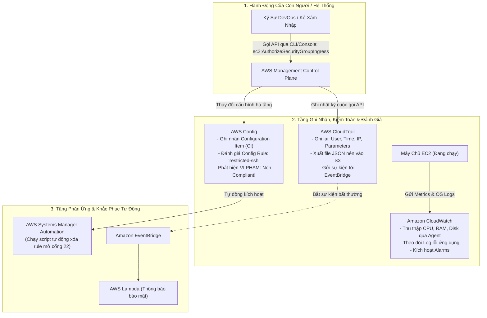
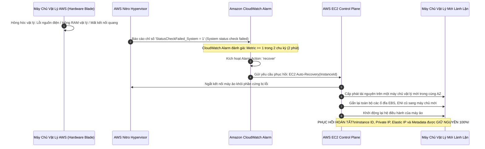
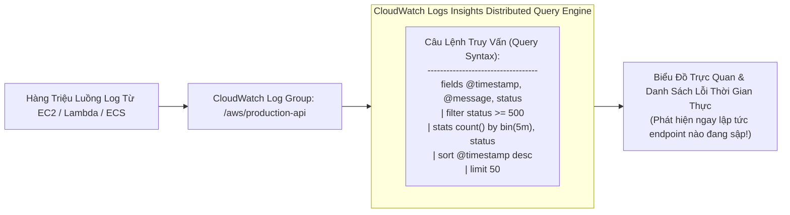
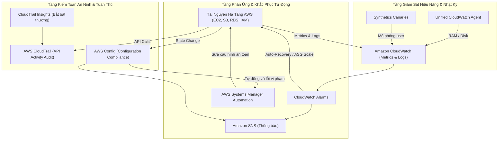

# Ghi Chú Bài Học: Chương 24 - Giám Sát, Kiểm Toán & Quản Trị Tuân Thủ (AWS Monitoring & Audit)

> **Khóa học**: Ultimate AWS Certified Solutions Architect Associate  
> **Chương**: 24 - AWS Monitoring & Audit: CloudWatch, CloudTrail, Config (Bài 264 đến Bài 281)  
> **Tài liệu tham chiếu liên quan**: [AWS Service Document: CloudWatch, CloudTrail & Config](../AWS_Services/CloudWatch_CloudTrail_Observability.md)

---

## 1. Tổng Quan Bài Học (Lesson Overview)

### Chủ đề chính
Chương này trang bị toàn bộ kỹ năng giám sát vận hành, kiểm toán bảo mật và quản trị tuân thủ trên AWS thông qua bộ ba công cụ trụ cột (**The Observability & Compliance Triad**):
- Dịch vụ giám sát số liệu và nhật ký vận hành **Amazon CloudWatch**:
  - Cơ chế thu thập dữ liệu chuỗi thời gian (**Metrics: Standard 5-phút, Detailed 1-phút, High-Resolution 1-giây**).
  - Thu thập nhật ký tập trung **CloudWatch Logs**, tính năng xem trực tiếp **Live Tail**, và công cụ truy vấn phân tán **CloudWatch Logs Insights**.
  - Phần mềm đại lý đa năng **Unified CloudWatch Agent** (thu thập RAM, Disk Space, Netstat).
  - Cảnh báo tự động **CloudWatch Alarms** (Metric Alarms, Composite Alarms, EC2 Auto-Recovery Action).
  - Giám sát trải nghiệm người dùng chủ động **CloudWatch Synthetics Canaries**.
- Dịch vụ ghi nhật ký kiểm toán hành vi người dùng và API **AWS CloudTrail**:
  - Phân loại sự kiện: **Management Events** vs **Data Events** (S3 Objects, Lambda Invocations).
  - Phát hiện bất thường bằng học máy với **CloudTrail Insights**.
  - Bảo vệ tính toàn vẹn nhật ký (**Log File Integrity Validation** với chữ ký RSA/SHA-256).
- Dịch vụ theo dõi lịch sử cấu hình và đánh giá tuân thủ **AWS Config**:
  - Ghi nhận trạng thái tài nguyên (**Configuration Items - CIs**).
  - Bộ quy tắc kiểm tra tuân thủ **Config Rules** (Managed Rules vs Custom Rules).
  - Cơ chế tự động sửa lỗi vi phạm (**Remediation Action via AWS Systems Manager Automation**).

### Mục tiêu học tập
1. Phân biệt được sự khác biệt cốt lõi về vai trò và trách nhiệm giữa **CloudWatch**, **CloudTrail**, và **AWS Config**.
2. Hiểu bản chất tại sao CloudWatch không tự thu thập được thông số RAM/Disk của EC2 và cách triển khai Unified CloudWatch Agent.
3. Thiết lập cơ chế tự phục hồi máy ảo **EC2 Auto-Recovery** dựa trên CloudWatch System Status Check.
4. Sử dụng **CloudWatch Logs Insights** để điều tra nguyên nhân gốc rễ (RCA) của các sự cố sập ứng dụng.
5. Xây dựng quy trình tự động phát hiện và khắc phục các cấu hình sai lệch an ninh (Security Misconfigurations) trong thời gian thực.

---

## 2. Điểm Cốt Lõi Cần Nhớ (Key Takeaways)

1. **CloudWatch không tự biết RAM và Disk Space**: Vì kiến trúc Hypervisor của AWS tôn trọng quyền riêng tư của khách hàng và không thâm nhập vào hệ điều hành của EC2. Muốn đo **Memory Utilization** và **Disk Used Percent**, **bắt buộc phải cài Unified CloudWatch Agent**.
2. **CloudWatch Alarms Actions**: Có thể kích hoạt 3 nhóm hành động:
   - Gửi cảnh báo tới **Amazon SNS Topic** (email, SMS, webhook Slack/PagerDuty).
   - Kích hoạt chính sách tăng/giảm máy của **Auto Scaling Group**.
   - Thực thi hành động trên máy chủ **EC2**: *Stop, Terminate, Reboot*, hoặc **Recover** (di chuyển máy sang host vật lý mới giữ nguyên IP).
3. **CloudTrail = "Ai đã làm gì, vào lúc mấy giờ, từ địa chỉ IP nào, trên tài nguyên nào"**:
   - Ghi lại toàn bộ các cuộc gọi API (thực hiện qua AWS Console, CLI, SDK).
   - Lưu trữ miễn phí 90 ngày trên Event History; muốn lưu vĩnh viễn bắt buộc phải cấu hình một **Trail xuất ra Amazon S3 Bucket**.
4. **Data Events bị tắt mặc định**: Các thao tác đọc/ghi S3 object (`s3:GetObject`, `s3:PutObject`) và gọi hàm Lambda (`lambda:Invoke`) là Data Events; do khối lượng sự kiện cực lớn, chúng bị tắt mặc định để tránh phát sinh chi phí lớn; phải chủ động bật khi cần kiểm toán.
5. **AWS Config = Lịch sử cấu hình & Tự động sửa sai**:
   - Ghi lại dòng thời gian biến đổi cấu hình của tài nguyên (Configuration Timeline).
   - Đánh giá trạng thái tuân thủ: **Compliant (Hợp lệ)** hoặc **Non-Compliant (Vi phạm quy chuẩn)**.
   - Tự động khắc phục (Remediation) thông qua các tài liệu tự động hóa **AWS Systems Manager (SSM Automation Documents)**.
6. **Bộ ba giám sát chuẩn mực**:
   - *CloudWatch*: **Hiệu năng & Vận hành** (CPU có cao không? Ứng dụng có bị lỗi HTTP 500 không?).
   - *CloudTrail*: **Kiểm toán hành vi & An ninh** (Ai vừa xóa bảng database lúc 3 giờ sáng?).
   - *AWS Config*: **Quy chuẩn & Tuân thủ** (Security Group này có đang mở cổng 22 cho cả thế giới không?).

---

## 3. Kiến Trúc & Cơ Chế Hoạt Động Chuyên Sâu (Under-the-Hood Mechanisms & Deep Dive)

### 3.1. Mô Hình Phối Hợp Giữa Bộ Ba: CloudWatch, CloudTrail và AWS Config



---

### 3.2. Cơ Chế Tự Phục Hồi Máy Chủ EC2 Auto-Recovery (Under the Hood)



---

### 3.3. Quy Trình Điều Tra Sự Cố Bằng CloudWatch Logs Insights

Khi ứng dụng gặp sự cố, kỹ sư không cần tải hàng trăm GB log về máy tính cá nhân để grep thủ công, mà sử dụng công cụ truy vấn phân tán song song **CloudWatch Logs Insights**:



---

## 4. Lệnh, Cấu Hình & Mã Nguồn Thực Tế (Commands, Config & Code)

### 4.1. File Cấu Hình Unified CloudWatch Agent Thu Thập RAM và Dung Lượng Ổ Đĩa

```json
{
  "agent": {
    "metrics_collection_interval": 60,
    "run_as_user": "root"
  },
  "metrics": {
    "namespace": "CustomSystemMetrics",
    "metrics_collected": {
      "mem": {
        "measurement": [
          "mem_used_percent",
          "mem_available_percent"
        ],
        "metrics_collection_interval": 60
      },
      "disk": {
        "measurement": [
          "used_percent"
        ],
        "metrics_collection_interval": 60,
        "resources": [
          "/"
        ]
      }
    }
  }
}
```

---

### 4.2. Tạo CloudWatch Alarm Cảnh Báo RAM Vượt Quá 85% Bằng AWS CLI

```bash
# Tao CloudWatch Alarm canh bao neu Memory Utilization > 85% trong 2 chu ky danh gia
aws cloudwatch put-metric-alarm \
    --alarm-name "High-Memory-Utilization-Production-Node" \
    --alarm-description "Canh bao RAM may chu Production vuot qua 85%" \
    --metric-name "mem_used_percent" \
    --namespace "CustomSystemMetrics" \
    --statistic "Average" \
    --period 60 \
    --threshold 85.0 \
    --comparison-operator "GreaterThanThreshold" \
    --evaluation-periods 2 \
    --alarm-actions "arn:aws:sns:ap-southeast-1:123456789012:DevOpsAlertsTopic" \
    --dimensions Name=InstanceId,Value=i-0123456789abcdef0
```

---

### 4.3. Bật Tính Năng Kiểm Tra Tính Toàn Vẹn Của File Log CloudTrail

```bash
# Bat Log File Integrity Validation tren mot Trail de chong sua doi file log
aws cloudtrail update-trail \
    --name "Production-Compliance-Audit-Trail" \
    --enable-log-file-validation

# Xac thuc tinh toan ven cua cac file log da luu tren S3 trong 24 gio qua
aws cloudtrail validate-logs \
    --trail-arn "arn:aws:cloudtrail:ap-southeast-1:123456789012:trail/Production-Compliance-Audit-Trail" \
    --start-time "$(date -u -d '1 day ago' +%Y-%m-%dT%H:%M:%SZ)"
```

---

## 5. Tình Huống Thực Tiễn & Mẫu Kiến Trúc (Real-World Scenarios & Design Patterns)

### Tình huống 1: Tự Động Cách Ly Máy Chủ EC2 Bị Nhiễm Mã Độc
- **Bài toán**: Doanh nghiệp yêu cầu nếu có máy chủ EC2 nào vô tình mở cổng SSH 22 ra toàn bộ Internet (`0.0.0.0/0`), hệ thống an ninh phải tự động phát hiện và thu hồi luật này trong vòng chưa đầy 1 phút để ngăn chặn tin tặc xâm nhập.
- **Giải pháp**:
  - Bật **AWS Config** và kích hoạt Managed Rule **`incoming-ssh-disabled`**.
  - Cấu hình **Automatic Remediation** gắn với Automation Document: `AWS-DisablePublicAccessForSecurityGroup`.
  - Khi một kỹ sư tạo rule mở cổng 22, AWS Config đánh giá trạng thái là `NON_COMPLIANT` và lập tức kích hoạt Systems Manager xóa bỏ ngay lập tức rule mở cổng đó, đồng thời gửi thông báo vi phạm về kênh bảo mật Slack qua Amazon SNS.

### Tình huống 2: Điều Tra Vụ Xâm Nhập Đánh Cắp Dữ Liệu S3 (Forensics Investigation)
- **Bài toán**: Doanh nghiệp phát hiện thông tin khách hàng nhạy cảm bị rò rỉ trên mạng Internet. Đội điều tra pháp y cần tìm ra ai đã tải các tệp tin từ S3 bucket bí mật của công ty trong 30 ngày qua.
- **Giải pháp**:
  - Đội ngũ kiểm tra **CloudTrail S3 Data Events** (đã được bật trước đó).
  - Sử dụng **Amazon Athena** để truy vấn trực tiếp vào thư mục S3 chứa file log của CloudTrail bằng SQL:
    ```sql
    SELECT eventTime, userIdentity.arn, sourceIPAddress, requestParameters
    FROM "cloudtrail_logs_db"."cloudtrail_table"
    WHERE eventName = 'GetObject'
      AND requestParameters LIKE '%confidential-customer-data%'
    ORDER BY eventTime DESC;
    ```
  - Xác định chính xác tài khoản IAM bị lộ khóa Access Key, địa chỉ IP của kẻ tấn công và thời điểm chính xác các tệp tin bị tải về.

---

## 6. Mối Quan Hệ Giữa Các Khái Niệm / Dịch Vụ (Service Relationships & Ecosystem)



---

## 7. Câu Hỏi Ôn Tập, Bẫy Thi & Tự Đánh Giá (Review, Exam Traps & Self-Assessment)

### Câu hỏi:
1. Bạn muốn thiết lập một cảnh báo để nhận thông báo email bất cứ khi nào dung lượng bộ nhớ RAM của một máy chủ EC2 vượt quá 85%. Bạn cần thực hiện những bước cấu hình hạ tầng nào và tại sao CloudWatch mặc định không có số liệu này?
2. Đội ngũ an ninh mạng phát hiện một bảng Amazon DynamoDB chứa dữ liệu sản xuất quan trọng bị ai đó xóa mất vào lúc 3 giờ sáng. Dịch vụ nào của AWS cung cấp bằng chứng rõ ràng nhất về danh tính người thực hiện, thời gian chính xác, địa chỉ IP và giao diện API được sử dụng?
3. Sự khác nhau cốt lõi về bản chất giữa dịch vụ **AWS CloudTrail** và **AWS Config** là gì?
4. Một công ty muốn đảm bảo rằng tất cả các ổ đĩa Amazon EBS mới tạo trong toàn bộ tài khoản bắt buộc phải được mã hóa bằng KMS. Nếu có ai tạo ổ đĩa chưa mã hóa, hệ thống phải tự động phát hiện, gắn cờ vi phạm và kích hoạt quy trình khắc phục. Dịch vụ nào giải quyết bài toán này?
5. Tính năng **CloudWatch Synthetics Canaries** hoạt động như thế nào và mang lại giá trị gì cho việc giám sát tính sẵn sàng của website?
6. Cơ chế **EC2 Auto-Recovery** trong CloudWatch Alarm hoạt động dựa trên chỉ số (Metric) nào, và những thuộc tính nào của máy ảo sẽ được bảo toàn khi quá trình phục hồi diễn ra?

---

### Đáp án & Giải thích chi tiết:

<details>
<summary>👉 Nhấp vào đây để xem đáp án và phân tích chi tiết</summary>

1. **Các bước thực hiện**:
   - (1) Cài đặt **Unified CloudWatch Agent** lên máy ảo EC2.
   - (2) Tạo file cấu hình `amazon-cloudwatch-agent.json` để khai báo thu thập metric `mem_used_percent` và gán một IAM Role cho máy ảo có quyền ghi dữ liệu lên CloudWatch (`CloudWatchAgentServerPolicy`).
   - (3) Tạo một **CloudWatch Alarm** theo dõi metric `mem_used_percent` với ngưỡng `> 85%` trong 2 chu kỳ đánh giá liên tiếp.
   - (4) Cấu hình Alarm Action gửi thông báo tới một **Amazon SNS Topic** có đăng ký địa chỉ email của bạn.  
   *(Giải thích: Hypervisor của AWS chỉ quản lý phần cứng ảo hóa bên ngoài nên chỉ đo được CPU, Network I/O và Disk I/O thô. Dữ liệu RAM nằm bên trong bộ nhớ của Hệ điều hành khách - Guest OS, Hypervisor không có quyền can thiệp vào để đảm bảo tính bảo mật và riêng tư dữ liệu).*
2. **AWS CloudTrail**. Bạn truy cập vào mục **Event History** của CloudTrail (hoặc truy vấn file log của Trail trên S3 bằng Athena), lọc sự kiện API với `EventName = DeleteTable`. Bản ghi sự kiện của CloudTrail sẽ cung cấp đầy đủ: `userIdentity` (ARN người dùng hoặc Role), `eventTime`, `sourceIPAddress`, và `userAgent`.
3. So sánh:
   - **AWS CloudTrail** ghi lại **lịch sử các cuộc gọi API** ("Ai đã làm gì, vào thời điểm nào?"). Nó tập trung vào **hành vi và danh tính của người dùng/dịch vụ**.
   - **AWS Config** theo dõi **trạng thái cấu hình của tài nguyên theo dòng thời gian** ("Tài nguyên trông như thế nào ở thời điểm T và nó có tuân thủ các quy tắc bảo mật đề ra hay không?"). Nó tập trung vào **thuộc tính cấu hình và sự tuân thủ quy chuẩn của tài nguyên**.
4. **AWS Config**. Bạn kích hoạt AWS Config và triển khai Managed Rule **`encrypted-volumes`**. AWS Config sẽ liên tục đánh giá trạng thái cấu hình của mọi ổ đĩa EBS. Khi phát hiện một volume chưa mã hóa, Config sẽ lập tức đánh dấu volume đó là `NON_COMPLIANT`, đồng thời có thể tự động kích hoạt một **Remediation Action** qua Systems Manager Automation để xử lý hoặc gửi cảnh báo SNS cho quản trị viên.
5. **CloudWatch Synthetics Canaries**: Cho phép bạn triển khai các đoạn mã script chạy tự động 24/7 (viết bằng Node.js hoặc Python sử dụng Puppeteer / Playwright) để **mô phỏng chính xác các hành vi của người dùng thực tế** (như mở trang chủ, đăng nhập, thêm hàng vào giỏ, kiểm tra endpoint API). Canaries giúp bạn chủ động phát hiện lỗi ứng dụng hoặc thời gian tải trang bị chậm ngay cả khi không có người dùng nào truy cập vào ban đêm, giúp xử lý sự cố trước khi khách hàng thực tế gặp phải.
6. Cơ chế **EC2 Auto-Recovery** hoạt động dựa trên metric **`StatusCheckFailed_System`** (báo hiệu lỗi xuất phát từ hạ tầng máy chủ vật lý, switch mạng hoặc nguồn điện của AWS). Khi kích hoạt Auto-Recovery, máy ảo được chuyển sang một máy chủ vật lý mới hoàn toàn lành lặn nhưng **bảo toàn 100% các thuộc tính**: **Instance ID, Private IPv4, Elastic IP, EBS Volume IDs, và metadata** của máy ảo mà không cần cấu hình lại mạng.
</details>

---

## 8. Nguồn Trích Dẫn Bài Giảng & Tài Liệu Liên Quan (Source References)

- **Source Transcripts**:
  - [265 - CloudWatch Metrics.md](../AWS_Resources/24%20-%20AWS%20Monitoring%20&%20Audit_%20CloudW/265%20-%20CloudWatch%20Metrics.md)
  - [266 - CloudWatch Logs.md](../AWS_Resources/24%20-%20AWS%20Monitoring%20&%20Audit_%20CloudW/266%20-%20CloudWatch%20Logs.md)
  - [269 - CloudWatch Agent & CloudWatch Logs Agent.md](../AWS_Resources/24%20-%20AWS%20Monitoring%20&%20Audit_%20CloudW/269%20-%20CloudWatch%20Agent%20%26%20CloudWatch%20Logs%20Agent.md)
  - [270 - CloudWatch Alarms.md](../AWS_Resources/24%20-%20AWS%20Monitoring%20&%20Audit_%20CloudW/270%20-%20CloudWatch%20Alarms.md)
  - [272 - CloudWatch Network Synthetic Monitor.md](../AWS_Resources/24%20-%20AWS%20Monitoring%20&%20Audit_%20CloudW/272%20-%20CloudWatch%20Network%20Synthetic%20Monitor.md)
  - [276 - CloudTrail Overview.md](../AWS_Resources/24%20-%20AWS%20Monitoring%20&%20Audit_%20CloudW/276%20-%20CloudTrail%20Overview.md)
  - [279 - AWS Config - Overview.md](../AWS_Resources/24%20-%20AWS%20Monitoring%20&%20Audit_%20CloudW/279%20-%20AWS%20Config%20-%20Overview.md)
  - [281 - CloudTrail vs CloudWatch vs Config.md](../AWS_Resources/24%20-%20AWS%20Monitoring%20&%20Audit_%20CloudW/281%20-%20CloudTrail%20vs%20CloudWatch%20vs%20Config.md)
- **Tài liệu chuyên sâu liên quan**:
  - [Chuyên đề Master: Amazon CloudWatch, CloudTrail & AWS Config](../AWS_Services/CloudWatch_CloudTrail_Observability.md)
  - [Chuyên đề Master: Amazon EC2](../AWS_Services/EC2_Elastic_Compute_Cloud.md)
