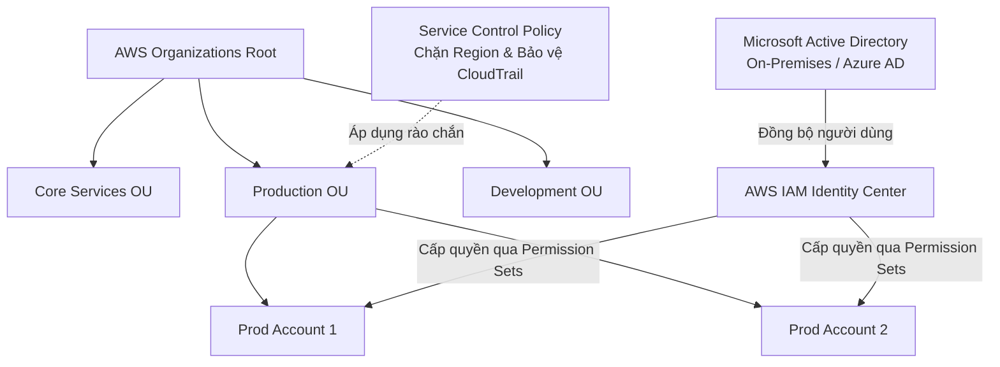

# Ghi Chú Bài Học: Chương 25 - Quản Trị Định Danh Doanh Nghiệp Nâng Cao (Identity and Access Management Advanced)

> **Khóa học**: Ultimate AWS Certified Solutions Architect Associate  
> **Chương**: 25 - Identity and Access Management (Bài 282 đến Bài 291)  
> **Tài liệu tham chiếu liên quan**: [AWS Service Document: IAM & Enterprise Identity](file:///n:/AWS_XBrain_Note/AWS_Services/IAM_Identity_and_Access_Management.md)

---

## 4.1. Tổng Quan Bài Học (Lesson Overview)

### Chủ đề chính
Chương này đi sâu vào các giải pháp quản trị định danh, phân quyền và kiểm soát bảo mật đa tài khoản cho các tổ chức, doanh nghiệp quy mô lớn: **AWS Organizations**, **Service Control Policies (SCPs)**, **Tag Policies**, **Logic đánh giá IAM Policy chuyên sâu**, **Resource-based Policies vs IAM Roles**, **AWS IAM Identity Center (trước đây là AWS SSO)**, **AWS Directory Services**, và **AWS Control Tower**.

### Mục tiêu học tập
1. Nắm vững kiến trúc đa tài khoản bằng **AWS Organizations**, cấu trúc cây thư mục OUs, và lợi ích của **Consolidated Billing**.
2. Hiểu bản chất và cách viết **Service Control Policies (SCPs)** để áp đặt rào chắn an ninh tối đa cho tài khoản con.
3. Làm chủ **Logic đánh giá chính sách (IAM Policy Evaluation Logic)**: Explicit Deny > Explicit Allow > Default Deny.
4. Phân biệt chính xác giữa **Resource-based Policy** và **IAM Role** trong bài toán truy cập chéo tài khoản (**Cross-Account Access**).
5. Hiểu vai trò của **AWS IAM Identity Center** trong việc kết nối hệ thống định danh doanh nghiệp (Active Directory, Okta, Azure AD) với AWS.
6. Nắm được 3 loại hình dịch vụ **AWS Directory Service** (Managed Microsoft AD, AD Connector, Simple AD) và giải pháp thiết lập hạ tầng chuẩn mực **AWS Control Tower**.

---

## 4.2. Điểm Cốt Lõi Cần Nhớ (Key Takeaways)

1. **AWS Organizations**: Quản lý tập trung nhiều tài khoản AWS dưới 1 tài khoản quản trị (Management Account). Cung cấp gộp hóa đơn thanh toán (Consolidated Billing) giúp tích lũy dung lượng sử dụng để giảm giá thành (Volume Discounts) và chia sẻ Savings Plans/Reserved Instances.
2. **SCPs (Service Control Policies)**: **KHÔNG BAO GIỜ trực tiếp cấp quyền (Does NOT grant permissions)**. SCP chỉ đóng vai trò là một bộ lọc hay "rào chắn tối đa" (Guardrail). Một hành động chỉ được phép thực hiện khi nó VỪA được cho phép bởi SCP, VỪA được cấp bởi IAM Policy ở tài khoản con.
3. **SCP không ảnh hưởng tới Management Account**: SCP chỉ áp dụng lên các Member Accounts (tài khoản con), không bao giờ áp dụng lên chính Management Account.
4. **Policy Evaluation Rule**: Một câu lệnh `Deny` rõ ràng (Explicit Deny) ở bất kỳ đâu (SCP, IAM Policy, Permissions Boundary, Resource Policy) sẽ lập tức đè bẹp mọi câu lệnh `Allow`.
5. **Cross-Account: Role vs Resource Policy**: Khi dùng IAM Role, caller từ bỏ quyền cũ để mượn quyền mới; khi dùng Resource-based policy, caller giữ nguyên quyền của mình và gọi trực tiếp.
6. **AWS Control Tower**: Công cụ tự động dựng môi trường đa tài khoản chuẩn mực (Landing Zone) tuân thủ Best Practices, kết hợp sẵn Organizations, SSO, và các quy tắc kiểm soát Guardrails (Preventive qua SCPs, Detective qua AWS Config).

---

## 4.3. Giải Thích Khái Niệm Chi Tiết (Detailed Concept Explanations)

### 1. AWS Organizations & Organizational Units (OUs)
- **Kiến trúc**: 
  - **Root OU**: Điểm gốc của tổ chức.
  - **Organizational Units (OUs)**: Các nhánh thư mục phân cấp theo phòng ban hoặc môi trường (ví dụ: `Core-Services-OU`, `Prod-OU`, `Dev-OU`).
  - **Member Accounts**: Các tài khoản AWS độc lập nằm bên trong từng OU.
- **Tính năng Consolidated Billing**:
  - Toàn bộ chi phí của tất cả tài khoản con được tổng hợp về một hóa đơn duy nhất gửi cho Management Account.
  - Tận dụng mức chiết khấu lũy tiến: ví dụ 50 tài khoản con mỗi tài khoản lưu 1TB trên S3 sẽ được tính gộp thành bậc giá 50TB, rẻ hơn nhiều so với việc 50 tài khoản thanh toán riêng lẻ.
  - Chia sẻ chiết khấu cam kết sử dụng (Reserved Instances & Savings Plans) giữa các tài khoản con trong cùng tổ chức.

### 2. Service Control Policies (SCPs)
- **Bản chất**: Chính sách JSON được gắn vào Root, OU, hoặc trực tiếp vào một Member Account.
- **Cơ chế kế thừa (Inheritance)**: SCP gắn ở Root sẽ tự động áp dụng xuống toàn bộ các OUs và Accounts bên dưới.
- **Ví dụ SCP chặn toàn bộ dịch vụ ngoài Region Singapore**:
```json
{
  "Version": "2012-10-17",
  "Statement": [
    {
      "Sid": "DenyAllOutsideSingapore",
      "Effect": "Deny",
      "NotAction": [
        "iam:*",
        "organizations:*",
        "route53:*",
        "cloudfront:*",
        "support:*"
      ],
      "Resource": "*",
      "Condition": {
        "StringNotEquals": {
          "aws:RequestedRegion": [
            "ap-southeast-1"
          ]
        }
      }
    }
  ]
}
```
*Lưu ý*: Phải loại trừ các dịch vụ Global như IAM, Route 53, CloudFront trong mục `NotAction`, nếu không sẽ làm tê liệt việc quản trị tài khoản!

### 3. Tag Policies
- Cho phép quản trị viên áp đặt chuẩn mực đặt tên nhãn (Tagging Standardization) trên toàn bộ tổ chức (ví dụ: bắt buộc tag `Environment` phải có giá trị là `Production`, `Staging`, hoặc `Development`; phân biệt chữ hoa chữ thường).

### 4. IAM Advanced: Logic Đánh Giá Quyết Định Phân Quyền
Sơ đồ thứ tự đánh giá phân quyền của AWS:
1. Có câu lệnh **Explicit Deny** ở bất kỳ chính sách nào không? -> **Có: TỪ CHỐI (DENY)**.
2. Có câu lệnh cho phép của **Organizations SCP** không? -> **Không: TỪ CHỐI (DENY)**.
3. Có câu lệnh cho phép của **Resource-based Policy** không? -> Nếu cùng tài khoản hoặc khác tài khoản mà thỏa mãn -> **CHO PHÉP (ALLOW)**.
4. Có **Identity-based Policy** cấp quyền rõ ràng (Explicit Allow) không?
5. Có **Permissions Boundary** không? (Nếu có, hành động phải nằm trong ranh giới).
6. Có **Session Policy** không? (Khi mượn quyền Role qua STS).
7. Nếu không có câu lệnh Allow nào -> **Mặc định là TỪ CHỐI (Implicit Deny)**.

### 5. AWS IAM Identity Center (trước đây là AWS Single Sign-On - SSO)
- Cổng quản trị truy cập tập trung một lần cho toàn bộ nhân sự.
- **Tích hợp nguồn định danh (Identity Providers)**:
  - *Internal Identity Store*: Tạo user/group trực tiếp trong IAM Identity Center.
  - *Active Directory*: Kết nối hệ thống Microsoft AD có sẵn.
  - *External IdP (SAML 2.0)*: Okta, Azure Active Directory (Microsoft Entra ID), Ping Identity, Google Workspace.
- **Permission Sets**: Tập hợp các chính sách IAM được quản trị tập trung. Khi gán cho một nhóm nhân sự trên một tài khoản con, IAM Identity Center sẽ tự động triển khai các IAM Role ngắn hạn tương ứng vào tài khoản đó.

### 6. AWS Directory Service (3 Lựa chọn)
1. **AWS Managed Microsoft AD**: Chạy Microsoft Active Directory thật sự trên các máy chủ Windows do AWS quản lý phân tán 2 AZ. Hỗ trợ chuẩn xác thực Kerberos, NTLM, Group Policy Objects (GPOs) và thiết lập quan hệ tin cậy 2 chiều (Two-way Trust) với AD On-Premises.
2. **AD Connector**: Bộ proxy chuyển tiếp thông tin đăng nhập trực tiếp về hệ thống Active Directory On-Premises mà không cần lưu trữ dữ liệu người dùng trên AWS.
3. **Simple AD**: Bản sao giả lập tương thích Active Directory dựa trên công nghệ mã nguồn mở Samba 4, giá rẻ, phù hợp cho các mạng nội bộ nhỏ, không hỗ trợ Trust Relationship với AD On-Prem.

---

## 4.4. Lệnh và Cấu Hình Thực Tế (Commands & Config)

### Kiểm tra tài khoản trong AWS Organizations qua CLI:
```bash
# Liệt kê tất cả các tài khoản con trong tổ chức
aws organizations list-accounts

# Xem danh sách các OUs nằm ngay dưới Root
aws organizations list-organizational-units-for-parent --parent-id r-xxxx

# Liệt kê các chính sách SCP gắn vào một OU cụ thể
aws organizations list-policies-for-target \
    --target-id ou-xxxx-yyyy \
    --filter SERVICE_CONTROL_POLICY
```

---

## 4.5. Ví Dụ Thực Tiễn (Practical Examples)

### Ví dụ từ bài giảng:
Giảng viên Stéphane Maarek trình diễn việc tạo một SCP cấm thao tác trên DynamoDB và gắn vào một Member Account. Sau đó đăng nhập vào Member Account với tư cách là `AdministratorAccess` (toàn quyền admin). Khi cố gắng tạo một bảng DynamoDB mới, bảng điều khiển lập tức báo lỗi `User: ... is not authorized to perform: dynamodb:CreateTable with an explicit deny in a service control policy`. Điều này chứng minh sức mạnh của SCP: ngay cả tài khoản Administrator của tài khoản con cũng không thể vượt rào cản của SCP.

---

## 4.6. Mối Quan Hệ Giữa Các Khái Niệm (Relationships Between Concepts)



---

## 4.7. Câu Hỏi Ôn Tập và Tự Đánh Giá (Review & Self-Assessment)

### Câu hỏi:
1. Nếu một Service Control Policy (SCP) có nội dung từ chối hành động `ec2:RunInstances`, thì tài khoản Root của một Member Account (tài khoản con) có thể khởi chạy máy ảo EC2 được không?
2. Trong AWS Organizations, SCP có áp dụng lên chính tài khoản Management Account không?
3. Khi bạn muốn cho phép một ứng dụng chạy ở Tài khoản A đọc trực tiếp dữ liệu từ S3 Bucket ở Tài khoản B mà ứng dụng không cần phải thực hiện thao tác đổi thông tin đăng nhập (AssumeRole), bạn nên sử dụng cơ chế nào?
4. Đâu là dịch vụ thích hợp nhất nếu doanh nghiệp muốn dựng một cụm Microsoft Active Directory thật sự do AWS quản lý, có khả năng thiết lập quan hệ tin cậy (Trust Relationship) với Domain Controller tại chỗ?
5. AWS Control Tower sử dụng hai cơ chế nào để thực thi các quy tắc kiểm soát an toàn (Guardrails)?

---

### Đáp án (Self-Assessment Answers):

<details>
<summary>👉 Nhấp vào đây để xem đáp án</summary>

1. **KHÔNG THỂ**. SCP là rào chắn an ninh cấp tổ chức. Ngay cả tài khoản Root của Member Account cũng bị ràng buộc bởi SCP và không thể thực hiện hành động đã bị cấm.
2. **KHÔNG**. SCP chỉ áp dụng lên các Member Accounts và các OUs bên dưới. SCP **không bao giờ** áp dụng lên chính Management Account.
3. Sử dụng **Resource-based Policy** (cụ thể là **S3 Bucket Policy** trong Tài khoản B). Cấu hình Bucket Policy cho phép ARN của IAM Role hoặc IAM User thuộc Tài khoản A truy cập.
4. **AWS Managed Microsoft AD**.
5. Sử dụng: (1) **Preventive Guardrails** (Rào chắn phòng ngừa) thông qua các chính sách **Service Control Policies (SCPs)** của AWS Organizations; và (2) **Detective Guardrails** (Rào chắn phát hiện) thông qua các luật giám sát tự động của **AWS Config**.
</details>

---

## 4.8. Nguồn Tham Chiếu (Source References)

- **Source Transcripts**:
  - [282 - Organizations - Overview.md](file:///n:/AWS_XBrain_Note/AWS_Resources/25%20-%20Identity%20and%20Access%20Management/282%20-%20Organizations%20-%20Overview.md)
  - [284 - Organizations - Tag Policies.md](file:///n:/AWS_XBrain_Note/AWS_Resources/25%20-%20Identity%20and%20Access%20Management/284%20-%20Organizations%20-%20Tag%20Policies.md)
  - [285 - IAM - Advanced Policies.md](file:///n:/AWS_XBrain_Note/AWS_Resources/25%20-%20Identity%20and%20Access%20Management/285%20-%20IAM%20-%20Advanced%20Policies.md)
  - [286 - IAM - Resource-based Policies vs IAM Roles.md](file:///n:/AWS_XBrain_Note/AWS_Resources/25%20-%20Identity%20and%20Access%20Management/286%20-%20IAM%20-%20Resource-based%20Policies%20vs%20IAM%20Roles.md)
  - [287 - IAM - Policy Evaluation Logic.md](file:///n:/AWS_XBrain_Note/AWS_Resources/25%20-%20Identity%20and%20Access%20Management/287%20-%20IAM%20-%20Policy%20Evaluation%20Logic.md)
  - [288 - AWS IAM Identity Center.md](file:///n:/AWS_XBrain_Note/AWS_Resources/25%20-%20Identity%20and%20Access%20Management/288%20-%20AWS%20IAM%20Identity%20Center.md)
  - [289 - AWS Directory Services.md](file:///n:/AWS_XBrain_Note/AWS_Resources/25%20-%20Identity%20and%20Access%20Management/289%20-%20AWS%20Directory%20Services.md)
  - [291 - AWS Control Tower.md](file:///n:/AWS_XBrain_Note/AWS_Resources/25%20-%20Identity%20and%20Access%20Management/291%20-%20AWS%20Control%20Tower.md)
