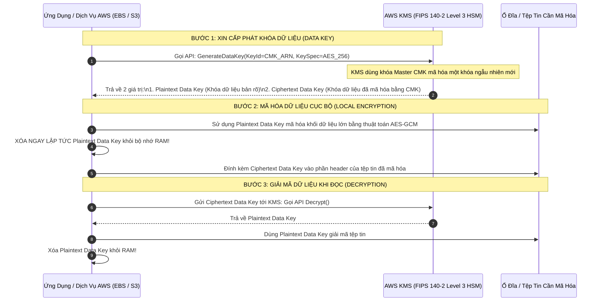
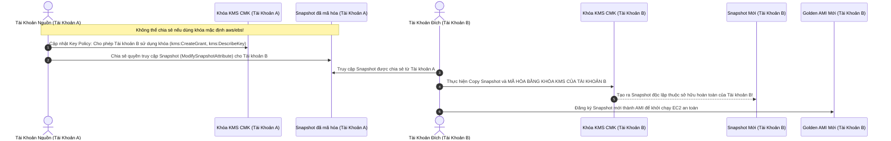
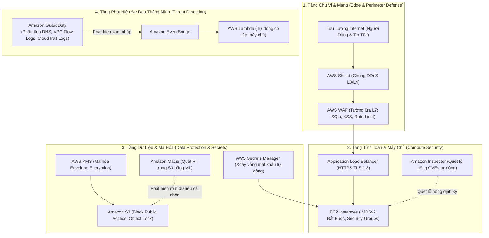
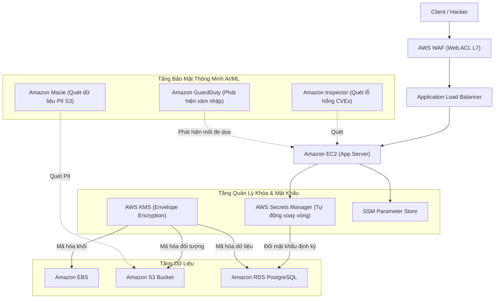

# Ghi Chú Bài Học: Chương 26 - Bảo Mật Đám Mây, Mã Hóa Dữ Liệu & Tường Lửa Ứng Dụng (AWS Security & Encryption)

> **Khóa học**: Ultimate AWS Certified Solutions Architect Associate  
> **Chương**: 26 - AWS Security & Encryption: KMS, SSM, Secrets Manager, WAF (Bài 292 đến Bài 312)  
> **Tài liệu tham chiếu liên quan**: [AWS Service Document: AWS KMS, Security & Encryption](../AWS_Services/KMS_Security_Encryption.md)

---

## 1. Tổng Quan Bài Học (Lesson Overview)

### Chủ đề chính
Chương này trang bị toàn bộ các giải pháp mã hóa dữ liệu, quản lý khóa bảo mật và phòng thủ chu vi an ninh mạng chuyên sâu trên AWS:
- Nguyên lý mật mã học nền tảng (**Encryption 101**): Mã hóa đối xứng (Symmetric) vs Bất đối xứng (Asymmetric), mã hóa khi truyền tải (**In-Transit**) và mã hóa khi lưu trữ (**At-Rest**).
- Dịch vụ quản lý khóa **AWS Key Management Service (AWS KMS)**:
  - Phân loại khóa: **AWS Owned Keys**, **AWS Managed Keys**, và **Customer Managed Keys (CMK)**.
  - Cơ chế mã hóa phong bì (**Envelope Encryption**) giải quyết bài toán mã hóa dữ liệu lớn (> 4 KB).
  - Tầm quan trọng của **KMS Key Policy** và kỹ thuật khóa đa vùng **KMS Multi-Region Keys**.
  - Quy trình chia sẻ máy mẫu đã mã hóa sang tài khoản khác (**Encrypted AMI Sharing Process**).
- Kho tham số cấu hình **AWS Systems Manager Parameter Store** (Standard vs Advanced tiers, kiểu chuỗi bảo mật `SecureString`).
- Dịch vụ tự động luân chuyển khóa bí mật **AWS Secrets Manager** (tích hợp xoay vòng mật khẩu RDS qua Lambda).
- Thiết bị phần cứng bảo mật chuyên dụng **AWS CloudHSM** (chuẩn FIPS 140-2 Level 3).
- Phòng thủ chu vi mạng: Tường lửa ứng dụng web **AWS WAF** (Layer 7), phòng chống từ chối dịch vụ **AWS Shield (Standard & Advanced)**, và quản lý chính sách tập trung **AWS Firewall Manager**.
- Bộ ba dịch vụ bảo mật thông minh ứng dụng AI/ML: **Amazon GuardDuty** (phát hiện xâm nhập), **Amazon Inspector** (quét lỗ hổng CVE), và **Amazon Macie** (quét dữ liệu cá nhân nhạy cảm PII trên S3).

### Mục tiêu học tập
1. Hiểu sâu cơ chế **Envelope Encryption** và bản chất tại sao API `kms:Encrypt` chỉ nhận dữ liệu tối đa 4 KB.
2. Nắm vững quy trình kỹ thuật 4 bước để chia sẻ an toàn một AMI/Snapshot đã mã hóa sang tài khoản AWS khác.
3. So sánh chính xác sự khác nhau giữa **SSM Parameter Store** và **AWS Secrets Manager** để lựa chọn giải pháp phù hợp.
4. Thiết lập các bộ luật Web ACL trên **AWS WAF** (SQL Injection, Cross-Site Scripting, Rate-based limits) và kích hoạt gói bảo vệ chi phí của **AWS Shield Advanced**.
5. Phân định rõ phạm vi hoạt động của bộ ba an ninh AI: GuardDuty, Inspector và Macie.

---

## 2. Điểm Cốt Lõi Cần Nhớ (Key Takeaways)

1. **Giới hạn 4 KB của KMS Encrypt API**: API `kms:Encrypt` của AWS KMS chỉ có thể mã hóa trực tiếp khối dữ liệu có dung lượng tối đa **4 KB**. Muốn mã hóa các tệp tin lớn hơn (video, cơ sở dữ liệu, ổ đĩa EBS), bắt buộc phải sử dụng cơ chế **Envelope Encryption** (Mã hóa phong bì).
2. **KMS Key Policy là tối thượng**: Quyền IAM gán cho User/Role hoàn toàn vô tác dụng nếu **KMS Key Policy** không cho phép. Nếu xóa nhầm quyền quản trị trong Key Policy và không có tài khoản Root ủy quyền, khóa KMS sẽ bị mồ côi (orphaned) và dữ liệu mã hóa vĩnh viễn không thể phục hồi.
3. **Quy trình chia sẻ Encrypted AMI xuyên tài khoản (Bẫy thi lớn nhất)**:
   - **KHÔNG THỂ** chia sẻ trực tiếp Snapshot được mã hóa bằng khóa mặc định của AWS (`aws/ebs`).
   - Bắt buộc phải sao chép Snapshot sang một khóa do khách hàng quản lý (**Customer Managed Key - CMK**).
   - Cập nhật Key Policy của CMK cấp quyền cho tài khoản đích (`kms:DescribeKey`, `kms:CreateGrant`, `kms:Decrypt`).
   - Chia sẻ Snapshot cho tài khoản đích.
   - Tài khoản đích đăng nhập, sao chép Snapshot đó bằng khóa KMS riêng của họ và tạo ra AMI mới.
4. **Secrets Manager vs Parameter Store**:
   - **AWS Secrets Manager**: Được thiết kế riêng cho thông tin bí mật (mật khẩu database, API keys); có tính năng **tự động xoay vòng mật khẩu (Automatic Rotation)** tích hợp với RDS bằng Lambda.
   - **SSM Parameter Store**: Kho lưu trữ tham số cấu hình chung (chuỗi kết nối, endpoint, cờ tính năng); hỗ trợ mã hóa `SecureString` qua KMS nhưng **không có sẵn tính năng tự động xoay vòng mật khẩu**.
5. **AWS WAF vs AWS Shield**:
   - **AWS WAF**: Hoạt động ở **Tầng 7 (Application Layer)**; gắn vào ALB, API Gateway, CloudFront, AppSync; ngăn chặn SQLi, XSS, quét bot, và giới hạn tần suất gọi (Rate-based rules).
   - **AWS Shield Standard**: Tự động kích hoạt miễn phí 100% trên toàn cầu, bảo vệ chống các cuộc tấn công DDoS ở **Tầng 3/4 (Network/Transport Layer)** như SYN floods, UDP reflection.
   - **AWS Shield Advanced**: Gói dịch vụ cao cấp ($3,000/tháng); hỗ trợ 24/7 từ đội ngũ phản ứng nhanh chống DDoS (SRT); có chính sách **bảo hiểm tài chính (Cost Protection)** bồi hoàn chi phí tài nguyên EC2/ALB tự động scale vọt lên do bị tấn công DDoS.
6. **Bộ ba an ninh AI**:
   - **Amazon GuardDuty**: Phân tích VPC Flow Logs, DNS Logs, CloudTrail Logs bằng học máy để phát hiện tài khoản bị xâm nhập, máy ảo đào tiền ảo trái phép.
   - **Amazon Inspector**: Tự động quét tìm các lỗ hổng phần mềm đã biết (**CVEs**) và cấu hình mạng không an toàn trên máy ảo EC2, ảnh ECR, và mã nguồn AWS Lambda.
   - **Amazon Macie**: Tự động quét và phát hiện các thông tin định danh cá nhân nhạy cảm (**PII: số thẻ tín dụng, CCCD, hộ chiếu**) lưu trữ trên **Amazon S3**.

---

## 3. Kiến Trúc & Cơ Chế Hoạt Động Chuyên Sâu (Under-the-Hood Mechanisms & Deep Dive)

### 3.1. Bản Chất Cơ Chế Mã Hóa Phong Bì (Envelope Encryption Deep Dive)



- **Lợi ích kiến trúc**:
  - Tối ưu hiệu năng: Dữ liệu lớn không cần phải truyền tải qua mạng tới KMS; việc mã hóa/giải mã diễn ra cục bộ trên máy chủ ứng dụng với tốc độ phần cứng cực đại.
  - Giảm thiểu chi phí: Ứng dụng chỉ gọi API KMS một lần duy nhất để lấy Data Key cho hàng ngàn tệp tin hoặc phiên làm việc, tránh vượt hạn ngạch (throttling) của KMS.

---

### 3.2. Quy Trình Chia Sẻ AMI Đã Mã Hóa Xuyên Tài Khoản (Cross-Account Encrypted AMI Sharing)



---

### 3.3. Mô Hình Phòng Thủ Đa Tầng Theo Chiều Sâu (Defense-in-Depth Architecture)



---

## 4. Lệnh, Cấu Hình & Mã Nguồn Thực Tế (Commands, Config & Code)

### 4.1. Chính Sách Khóa KMS (KMS Key Policy) Cho Phép Chia Sẻ Sang Tài Khoản Khác

```json
{
  "Version": "2012-10-17",
  "Id": "CrossAccountKMSPolicy",
  "Statement": [
    {
      "Sid": "EnableRootPermissions",
      "Effect": "Allow",
      "Principal": {
        "AWS": "arn:aws:iam::111111111111:root"
      },
      "Action": "kms:*",
      "Resource": "*"
    },
    {
      "Sid": "AllowTargetAccountUseOfKey",
      "Effect": "Allow",
      "Principal": {
        "AWS": "arn:aws:iam::222222222222:root"
      },
      "Action": [
        "kms:DescribeKey",
        "kms:Encrypt",
        "kms:Decrypt",
        "kms:ReEncrypt*",
        "kms:GenerateDataKey*",
        "kms:CreateGrant"
      ],
      "Resource": "*"
    }
  ]
}
```

---

### 4.2. Thao Tác Với Khóa Dữ Liệu KMS (Envelope Encryption) Bằng AWS CLI

```bash
# 1. Yeu cau KMS tao Data Key (tra ve ca Plaintext va Ciphertext)
aws kms generate-data-key \
    --key-id "arn:aws:kms:ap-southeast-1:123456789012:key/xxxx-xxxx-xxxx" \
    --key-spec AES_256 \
    --output json > datakey.json

# 2. Trich xuat Ciphertext Data Key de luu kem voi file
CIPHERTEXT_BLOB=$(jq -r .CiphertextBlob datakey.json)
echo "Ciphertext Key: $CIPHERTEXT_BLOB"

# 3. Khi can doc lai file, gui Ciphertext Data Key ve KMS de giai ma lay lai Plaintext Key
aws kms decrypt \
    --ciphertext-blob fileb://<(echo "$CIPHERTEXT_BLOB" | base64 --decode) \
    --output json
```

---

### 4.3. Cấu Hình Bộ Luật Giới Hạn Tần Suất (Rate-based Rule) Trên AWS WAF

```json
{
  "Name": "LimitRequestsPerIP",
  "Priority": 1,
  "Action": {
    "Block": {}
  },
  "VisibilityConfig": {
    "SampledRequestsEnabled": true,
    "CloudWatchMetricsEnabled": true,
    "MetricName": "LimitRequestsPerIPMetric"
  },
  "Statement": {
    "RateBasedStatement": {
      "Limit": 500,
      "AggregateKeyType": "IP",
      "EvaluationWindowSec": 300
    }
  }
}
```

---

## 5. Tình Huống Thực Tiễn & Mẫu Kiến Trúc (Real-World Scenarios & Design Patterns)

### Tình huống 1: Tự Động Xoay Vòng Mật Khẩu Database Cho Doanh Nghiệp Tài Chính
- **Bài toán**: Tiêu chuẩn bảo mật thanh toán thẻ PCI-DSS yêu cầu mật khẩu kết nối cơ sở dữ liệu Amazon RDS PostgreSQL phải được đổi mới ngẫu nhiên sau mỗi 30 ngày và không được phép lưu trữ mật khẩu trong mã nguồn hay file cấu hình.
- **Giải pháp**:
  - Lưu thông tin tài khoản DB vào **AWS Secrets Manager**.
  - Bật tính năng **Automatic Rotation** với chu kỳ 30 ngày, chỉ định sử dụng template hàm Lambda xoay vòng mật khẩu do AWS cung cấp sẵn.
  - Hàm Lambda tạo mật khẩu mới, cập nhật mật khẩu mới vào RDS thông qua kết nối quản trị, sau đó cập nhật giá trị mới vào Secrets Manager.
  - Ứng dụng trên EC2/Fargate sử dụng IAM Role để truy vấn Secrets Manager lấy mật khẩu mới nhất mỗi khi khởi tạo kết nối.

### Tình huống 2: Ngăn Chặn Mã Độc Tống Tiền (Ransomware) Bằng AWS Backup Vault Lock
- **Bài toán**: Một doanh nghiệp lo ngại tin tặc có thể đánh cắp được thông tin đăng nhập của quản trị viên cấp cao nhất (AWS Administrator) và thực hiện xóa toàn bộ các bản sao lưu (Backups) trước khi tống tiền.
- **Giải pháp**:
  - Thiết lập kho lưu trữ sao lưu **AWS Backup Vault**.
  - Kích hoạt tính năng **AWS Backup Vault Lock** ở chế độ **Compliance Mode**.
  - Cấu hình thời gian ân hạn (cooling-off period) là 3 ngày và thời gian lưu trữ tối thiểu là 90 ngày.
  - Sau thời gian ân hạn, Vault Lock chính thức bị khóa vĩnh viễn theo chuẩn WORM. Không một ai (kể cả tài khoản AWS Root hay đội ngũ hỗ trợ kỹ thuật của AWS) có thể xóa bất kỳ bản sao lưu nào nằm trong kho trước khi hết thời hạn 90 ngày.

---

## 6. Mối Quan Hệ Giữa Các Khái Niệm / Dịch Vụ (Service Relationships & Ecosystem)



---

## 7. Câu Hỏi Ôn Tập, Bẫy Thi & Tự Đánh Giá (Review, Exam Traps & Self-Assessment)

### Câu hỏi:
1. Bạn có một máy chủ EC2 đang sử dụng ổ đĩa EBS được mã hóa bằng khóa mặc định của AWS (`aws/ebs`). Bạn có thể chia sẻ trực tiếp bản chụp Snapshot của ổ đĩa này sang một tài khoản AWS khác được không? Giải thích quy trình xử lý đúng chuẩn.
2. Tại sao API `kms:Encrypt` của dịch vụ AWS KMS lại quy định giới hạn kích thước khối dữ liệu tối đa là 4 KB, và kỹ thuật nào cho phép mã hóa các tệp tin có dung lượng hàng gigabyte?
3. Sự khác nhau cốt lõi về bản chất, cơ chế xoay vòng và chi phí giữa **AWS Systems Manager Parameter Store** và **AWS Secrets Manager** là gì?
4. Đội ngũ an ninh mạng phát hiện một máy chủ EC2 liên tục gửi các truy vấn DNS kỳ lạ ra ngoài Internet tới các máy chủ điều khiển mạng botnet đào tiền ảo. Dịch vụ an ninh nào của AWS có khả năng tự động phát hiện hành vi nguy hiểm này dựa trên học máy?
5. Gói dịch vụ **AWS Shield Advanced** mang lại những giá trị vượt trội nào so với **AWS Shield Standard** miễn phí?
6. Phân biệt phạm vi bảo vệ và chức năng chính của ba dịch vụ an ninh: **Amazon GuardDuty**, **Amazon Inspector**, và **Amazon Macie**?

---

### Đáp án & Giải thích chi tiết:

<details>
<summary>👉 Nhấp vào đây để xem đáp án và phân tích chi tiết</summary>

1. **KHÔNG THỂ**. AWS quy định rõ: các bản chụp Snapshot được mã hóa bằng khóa mặc định do AWS quản lý (`aws/ebs`) **tuyệt đối không thể chia sẻ trực tiếp** sang tài khoản AWS khác.  
   **Quy trình chuẩn**:
   - Bước 1: Sao chép (Copy) Snapshot đó và mã hóa bằng một khóa do khách hàng tự tạo và quản lý (**Customer Managed Key - CMK**).
   - Bước 2: Cập nhật **KMS Key Policy** của khóa CMK để cấp quyền cho ID tài khoản đích được phép sử dụng khóa (`kms:DescribeKey`, `kms:CreateGrant`, `kms:Decrypt`).
   - Bước 3: Chia sẻ quyền truy cập Snapshot đã mã hóa bằng CMK cho tài khoản đích.
   - Bước 4: Tài khoản đích truy cập Snapshot và thực hiện sao chép Snapshot đó bằng một khóa KMS thuộc quyền sở hữu của chính tài khoản đích trước khi tạo AMI.
2. Vì thiết bị phần cứng bảo mật HSM của KMS được thiết kế chuyên biệt để bảo vệ các khóa mật mã gốc và thực hiện các phép toán mật mã tốc độ cao trên các khối dữ liệu nhỏ; việc truyền tải các file lớn qua mạng vào HSM sẽ làm nghẽn băng thông và suy giảm hiệu năng nghiêm trọng. Kỹ thuật giải quyết là **Envelope Encryption (Mã hóa phong bì)**: KMS phát sinh một khóa dữ liệu (**Data Encryption Key - DEK**), ứng dụng sử dụng DEK để mã hóa tệp tin lớn cục bộ, sau đó mã hóa chính DEK đó bằng khóa Master của KMS và lưu kèm với tệp tin.
3. So sánh:
   - **AWS Secrets Manager**: Chuyên dụng lưu trữ thông tin nhạy cảm bí mật (mật khẩu DB, khóa API); có tính năng **tự động xoay vòng mật khẩu (Automatic Rotation)** tích hợp với RDS qua Lambda; chi phí $0.40/secret/tháng.
   - **SSM Parameter Store**: Lưu trữ cấu hình chung và tham số ứng dụng; hỗ trợ kiểu `SecureString` mã hóa qua KMS; **hoàn toàn miễn phí** cho Standard tier (lưu tối đa 10,000 tham số); **không có sẵn tính năng tự động xoay vòng mật khẩu**.
4. **Amazon GuardDuty**. GuardDuty sử dụng các thuật toán học máy và trí tuệ nhân tạo để liên tục phân tích các luồng dữ liệu độc lập: **DNS Logs, VPC Flow Logs, CloudTrail Management Events, và CloudTrail S3 Data Events**. Khi phát hiện máy ảo EC2 gửi truy vấn DNS tới các tên miền độc hại trong danh mục đen (threat intelligence), GuardDuty lập tức tạo một Finding cảnh báo mức độ nghiêm trọng cao (High Severity).
5. Ưu điểm của **AWS Shield Advanced**:
   - Bảo vệ nâng cao cho cả Layer 7 (kết hợp AWS WAF miễn phí giấy phép) và Layer 3/4.
   - Hỗ trợ trực tiếp 24/7 từ đội ngũ kỹ sư phản ứng nhanh chống DDoS của AWS (**AWS Shield Response Team - SRT**).
   - **Chính sách bảo hiểm tài chính (DDoS Cost Protection)**: AWS sẽ hoàn lại toàn bộ các chi phí phát sinh ngoài ý muốn (tiền máy chủ EC2, ALB, CloudFront tự động scale vọt lên để hứng chịu lưu lượng tấn công).
6. Phân biệt:
   - **Amazon GuardDuty**: Giám sát và phát hiện đe dọa xâm nhập thời gian thực (Intrusion Detection) thông qua phân tích nhật ký mạng và API.
   - **Amazon Inspector**: Quét và đánh giá các lỗ hổng phần mềm đã biết (**CVEs**) và các cấu hình mạng không an toàn trên máy ảo EC2, container image trong ECR, và mã nguồn hàm Lambda.
   - **Amazon Macie**: Dịch vụ bảo mật dữ liệu sử dụng học máy để tự động phát hiện, phân loại và cảnh báo việc rò rỉ các thông tin định danh cá nhân nhạy cảm (**PII**) lưu trữ trên **Amazon S3**.
</details>

---

## 8. Nguồn Trích Dẫn Bài Giảng & Tài Liệu Liên Quan (Source References)

- **Source Transcripts**:
  - [293 - Encryption 101.md](../AWS_Resources/26%20-%20AWS%20Security%20&%20Encryption_%20KMS/293%20-%20Encryption%20101.md)
  - [294 - KMS Overview.md](../AWS_Resources/26%20-%20AWS%20Security%20&%20Encryption_%20KMS/294%20-%20KMS%20Overview.md)
  - [296 - KMS - Multi-Region Keys.md](../AWS_Resources/26%20-%20AWS%20Security%20&%20Encryption_%20KMS/296%20-%20KMS%20-%20Multi-Region%20Keys.md)
  - [298 - Encrypted AMI Sharing Process.md](../AWS_Resources/26%20-%20AWS%20Security%20&%20Encryption_%20KMS/298%20-%20Encrypted%20AMI%20Sharing%20Process.md)
  - [299 - SSM Parameter Store Overview.md](../AWS_Resources/26%20-%20AWS%20Security%20&%20Encryption_%20KMS/299%20-%20SSM%20Parameter%20Store%20Overview.md)
  - [301 - AWS Secrets Manager - Overview.md](../AWS_Resources/26%20-%20AWS%20Security%20&%20Encryption_%20KMS/301%20-%20AWS%20Secrets%20Manager%20-%20Overview.md)
  - [304 - AWS CloudHSM.md](../AWS_Resources/26%20-%20AWS%20Security%20&%20Encryption_%20KMS/304%20-%20AWS%20CloudHSM.md)
  - [305 - Web Application Firewall (WAF).md](../AWS_Resources/26%20-%20AWS%20Security%20&%20Encryption_%20KMS/305%20-%20Web%20Application%20Firewall%20%28WAF%29.md)
  - [306 - Shield - DDoS Protection.md](../AWS_Resources/26%20-%20AWS%20Security%20&%20Encryption_%20KMS/306%20-%20Shield%20-%20DDoS%20Protection.md)
  - [310 - Amazon GuardDuty.md](../AWS_Resources/26%20-%20AWS%20Security%20&%20Encryption_%20KMS/310%20-%20Amazon%20GuardDuty.md)
  - [311 - Amazon Inspector.md](../AWS_Resources/26%20-%20AWS%20Security%20&%20Encryption_%20KMS/311%20-%20Amazon%20Inspector.md)
  - [312 - Amazon Macie.md](../AWS_Resources/26%20-%20AWS%20Security%20&%20Encryption_%20KMS/312%20-%20Amazon%20Macie.md)
- **Tài liệu chuyên sâu liên quan**:
  - [Chuyên đề Master: AWS Key Management Service (KMS), Security & Encryption](../AWS_Services/KMS_Security_Encryption.md)
  - [Chuyên đề Master: Identity & Access Management (IAM)](../AWS_Services/IAM_Identity_and_Access_Management.md)
