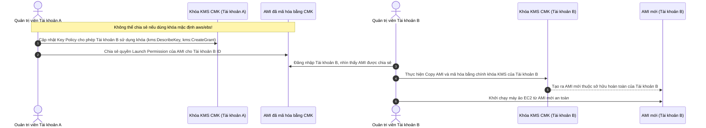

# Ghi Chú Bài Học: Chương 26 - Bảo Mật Đám Mây, Mã Hóa Dữ Liệu & Tường Lửa Ứng Dụng (AWS Security & Encryption)

> **Khóa học**: Ultimate AWS Certified Solutions Architect Associate  
> **Chương**: 26 - AWS Security & Encryption: KMS, SSM, Secrets Manager, WAF (Bài 292 đến Bài 312)  
> **Tài liệu tham chiếu liên quan**: [AWS Service Document: AWS KMS, Security & Encryption](file:///n:/AWS_XBrain_Note/AWS_Services/KMS_Security_Encryption.md)

---

## 4.1. Tổng Quan Bài Học (Lesson Overview)

### Chủ đề chính
Chương này trang bị toàn diện các giải pháp mã hóa dữ liệu và phòng thủ chu vi an ninh mạng trên AWS: nguyên lý mã hóa cơ bản (**Encryption 101**), dịch vụ quản lý khóa **AWS KMS** (Customer Managed Keys, AWS Managed Keys, Multi-Region Keys), quy trình chia sẻ AMI đã mã hóa (**Encrypted AMI Sharing**), kho lưu trữ tham số cấu hình **SSM Parameter Store** (Standard vs Advanced, SecureString), dịch vụ tự động luân chuyển bí mật **AWS Secrets Manager**, chứng chỉ số **AWS Certificate Manager (ACM)**, thiết bị phần cứng bảo mật chuyên dụng **AWS CloudHSM**, tường lửa ứng dụng web **AWS WAF**, bảo vệ chống tấn công từ chối dịch vụ **AWS Shield (Standard & Advanced)**, quản trị tường lửa tập trung **AWS Firewall Manager**, và bộ ba dịch vụ an ninh ứng dụng AI/ML: **Amazon GuardDuty**, **Amazon Inspector**, và **Amazon Macie**.

### Mục tiêu học tập
1. Phân biệt được sự khác nhau giữa mã hóa đối xứng (Symmetric) và bất đối xứng (Asymmetric), mã hóa khi truyền tải (In-Transit) và mã hóa khi lưu trữ (At-Rest).
2. Hiểu cấu trúc và tầm quan trọng tối thượng của **KMS Key Policy**.
3. Nắm được quy trình chia sẻ một AMI đã mã hóa sang tài khoản AWS khác một cách an toàn.
4. So sánh chính xác sự khác nhau giữa **SSM Parameter Store** và **AWS Secrets Manager**.
5. Cấu hình các bộ luật tường lửa **AWS WAF** (SQLi, XSS, Rate-based limits) và hiểu lợi ích của gói bảo hiểm chi phí trong **AWS Shield Advanced**.
6. Phân biệt phạm vi hoạt động của bộ ba AI: **GuardDuty** (xâm nhập), **Inspector** (lỗ hổng phần mềm CVE), và **Macie** (thông tin cá nhân PII trên S3).

---

## 4.2. Điểm Cốt Lõi Cần Nhớ (Key Takeaways)

1. **KMS Key Policy**: Quyền IAM chỉ có tác dụng nếu KMS Key Policy mở cửa; nếu mất khóa KMS thì dữ liệu vĩnh viễn không thể giải mã lại được.
2. **KMS Multi-Region Keys**: Cùng Key ID và Key Material giữa các Region; mã hóa ở Region A và giải mã tại Region B mà không cần gọi API xuyên lục địa.
3. **Secrets Manager = Xoay vòng tự động**: Tự động đổi mật khẩu RDS qua Lambda; Parameter Store không có sẵn tính năng này.
4. **Chia sẻ Encrypted AMI**: Không thể chia sẻ trực tiếp AMI mã hóa bằng khóa mặc định `aws/ebs`. Phải: (1) Copy Snapshot với khóa CMK; (2) Cấp quyền KMS Key Policy cho tài khoản đích; (3) Chia sẻ Snapshot; (4) Tài khoản đích Copy Snapshot với khóa của họ và tạo AMI mới.
5. **IMDSv2 (Instance Metadata Service v2)**: Bắt buộc sử dụng session token tạo qua lệnh `PUT` (header `X-aws-ec2-metadata-token`) để chống lại các lỗ hổng **SSRF (Server-Side Request Forgery)** nhằm đánh cắp IAM Role credentials từ EC2.
6. **AWS IAM Roles Anywhere**: Cấp phát IAM credentials tạm thời cho các máy chủ/ứng dụng on-premises thông qua hạ tầng mã hóa khóa công khai **PKI (X.509 Certificate)**, loại bỏ hoàn toàn nguy cơ rò rỉ long-term Access Keys.
7. **AWS Backup Vault Lock (Compliance Mode)**: Khóa kho lưu trữ sao lưu bất biến (WORM), một khi đã khóa thì **kể cả tài khoản Root của AWS cũng không thể xóa hay sửa bản backup** trước khi hết thời gian retention; phòng vệ hữu hiệu trước mã độc tống tiền (Ransomware).
8. **AWS WAF**: Lọc Tầng 7 (HTTP/HTTPS); Shield Standard miễn phí lọc Tầng 3/4 (DDoS).
9. **GuardDuty (Phát hiện xâm nhập qua log)**, **Inspector (Quét lỗ hổng OS/Container/Lambda)**, **Macie (Quét PII trong S3)**.

---

## 4.3. Giải Thích Khái Niệm Chi Tiết (Detailed Concept Explanations)

### 1. Quy trình chia sẻ AMI đã mã hóa xuyên tài khoản (Encrypted AMI Sharing Process):

### 2. IMDSv1 vs IMDSv2 (Phòng chống SSRF)
- **IMDSv1 (Không an toàn)**: Gọi request `GET http://169.254.169.254/latest/meta-data/` trực tiếp không cần xác thực token. Kẻ tấn công lợi dụng lỗ hổng SSRF trên web app để ép web server đọc URL này và lấy trộm IAM Role secret keys.
- **IMDSv2 (Bắt buộc theo chuẩn hiện đại)**:
  - Bước 1: Gửi `PUT` request kèm header `X-aws-ec2-metadata-token-ttl-seconds: 21600` để lấy Session Token.
  - Bước 2: Dùng Session Token này gửi `GET` request kèm header `X-aws-ec2-metadata-token` để lấy metadata. Các cuộc tấn công SSRF thông thường không thể can thiệp tạo request `PUT` kèm custom header.

### 3. AWS Backup Vault Lock (WORM Defense)
- **Governance Mode**: Cho phép một số người dùng có quyền IAM đặc biệt (`backup:DeleteRecoveryPoint`) được phép xóa bản backup trước hạn nếu cần kiểm thử.
- **Compliance Mode (Đề thi thường hỏi)**: Khóa kho lưu trữ vĩnh viễn theo chuẩn WORM (Write Once, Read Many). Sau thời gian ân hạn (cooling-off period), **không một ai (kể cả AWS Support hay Root Account)** có thể xóa bản backup hay tắt khóa trước hạn. Bảo vệ tối thượng chống lại ransomware và người nội bộ phá hoại.

---

## 4.4. Câu Hỏi Ôn Tập và Tự Đánh Giá (Review & Self-Assessment)

### Câu hỏi:
1. Bạn có một máy chủ EC2 đang sử dụng ổ đĩa EBS được mã hóa bằng khóa mặc định của AWS (`aws/ebs`). Bạn có thể chia sẻ trực tiếp bản chụp Snapshot của ổ đĩa này sang một tài khoản AWS khác được không?
2. Khi một kỹ sư muốn lưu trữ mật khẩu kết nối cơ sở dữ liệu và yêu cầu hệ thống phải tự động đổi mật khẩu này ngẫu nhiên sau mỗi 60 ngày mà không gây gián đoạn ứng dụng, dịch vụ nào của AWS đáp ứng tốt nhất?
3. Sự khác nhau giữa dịch vụ AWS CloudHSM và AWS KMS là gì?
4. Đội ngũ an ninh phát hiện một máy chủ EC2 liên tục gửi các truy vấn DNS kỳ lạ đến các máy chủ điều khiển mã độc đào tiền ảo (Crypto-mining). Dịch vụ an ninh nào của AWS có khả năng tự động phát hiện hành vi này?
5. Một ứng dụng web thường xuyên bị các bot mạng gửi hàng ngàn request mỗi giây vào trang đăng nhập để dò quét mật khẩu. Bạn có thể sử dụng tính năng nào của AWS WAF để ngăn chặn hành vi này?

---

### Đáp án (Self-Assessment Answers):

👉 Nhấp vào đây để xem đáp án

1. **KHÔNG THỂ**. AWS cấm tuyệt đối việc chia sẻ trực tiếp các Snapshot được mã hóa bằng khóa mặc định do AWS quản lý (`aws/ebs`). Để chia sẻ, bạn phải sao chép (Copy) Snapshot đó và mã hóa bằng một khóa do khách hàng quản lý (**Customer Managed Key - CMK**), sau đó cấp quyền trên Key Policy của CMK cho tài khoản đích.
2. **AWS Secrets Manager** (tích hợp sẵn tính năng tự động xoay vòng mật khẩu thông qua hàm AWS Lambda).
3. **AWS KMS** là dịch vụ đa người dùng (Multi-tenant), được quản lý hoàn toàn bởi AWS, đạt chuẩn FIPS 140-2 Level 2; trong khi **AWS CloudHSM** là thiết bị phần cứng chuyên dụng đơn người dùng (Single-tenant), đạt tiêu chuẩn an ninh khắt khe hơn (**FIPS 140-2 Level 3**), và khách hàng nắm toàn quyền sở hữu vật lý của phần cứng mật mã mà AWS không có quyền can thiệp.
4. **Amazon GuardDuty** (nhờ việc liên tục phân tích DNS Logs và VPC Flow Logs bằng các thuật toán học máy).
5. Sử dụng **Rate-based Rule** trong **AWS WAF** (ví dụ: cấu hình nếu một địa chỉ IP gửi quá 100 request trong vòng 5 phút thì lập tức chặn IP đó trong 10 phút tiếp theo).

---

## 4.5. Nguồn Tham Chiếu (Source References)

- **Source Transcripts**:
  - [293 - Encryption 101.md](file:///n:/AWS_XBrain_Note/AWS_Resources/26%20-%20AWS%20Security%20&%20Encryption_%20KMS/293%20-%20Encryption%20101.md)
  - [294 - KMS Overview.md](file:///n:/AWS_XBrain_Note/AWS_Resources/26%20-%20AWS%20Security%20&%20Encryption_%20KMS/294%20-%20KMS%20Overview.md)
  - [296 - KMS - Multi-Region Keys.md](file:///n:/AWS_XBrain_Note/AWS_Resources/26%20-%20AWS%20Security%20&%20Encryption_%20KMS/296%20-%20KMS%20-%20Multi-Region%20Keys.md)
  - [298 - Encrypted AMI Sharing Process.md](file:///n:/AWS_XBrain_Note/AWS_Resources/26%20-%20AWS%20Security%20&%20Encryption_%20KMS/298%20-%20Encrypted%20AMI%20Sharing%20Process.md)
  - [299 - SSM Parameter Store Overview.md](file:///n:/AWS_XBrain_Note/AWS_Resources/26%20-%20AWS%20Security%20&%20Encryption_%20KMS/299%20-%20SSM%20Parameter%20Store%20Overview.md)
  - [301 - AWS Secrets Manager - Overview.md](file:///n:/AWS_XBrain_Note/AWS_Resources/26%20-%20AWS%20Security%20&%20Encryption_%20KMS/301%20-%20AWS%20Secrets%20Manager%20-%20Overview.md)
  - [304 - AWS CloudHSM.md](file:///n:/AWS_XBrain_Note/AWS_Resources/26%20-%20AWS%20Security%20&%20Encryption_%20KMS/304%20-%20AWS%20CloudHSM.md)
  - [305 - Web Application Firewall (WAF).md](file:///n:/AWS_XBrain_Note/AWS_Resources/26%20-%20AWS%20Security%20&%20Encryption_%20KMS/305%20-%20Web%20Application%20Firewall%20(WAF).md)
  - [306 - Shield - DDoS Protection.md](file:///n:/AWS_XBrain_Note/AWS_Resources/26%20-%20AWS%20Security%20&%20Encryption_%20KMS/306%20-%20Shield%20-%20DDoS%20Protection.md)
  - [310 - Amazon GuardDuty.md](file:///n:/AWS_XBrain_Note/AWS_Resources/26%20-%20AWS%20Security%20&%20Encryption_%20KMS/310%20-%20Amazon%20GuardDuty.md)
  - [311 - Amazon Inspector.md](file:///n:/AWS_XBrain_Note/AWS_Resources/26%20-%20AWS%20Security%20&%20Encryption_%20KMS/311%20-%20Amazon%20Inspector.md)
  - [312 - Amazon Macie.md](file:///n:/AWS_XBrain_Note/AWS_Resources/26%20-%20AWS%20Security%20&%20Encryption_%20KMS/312%20-%20Amazon%20Macie.md)
