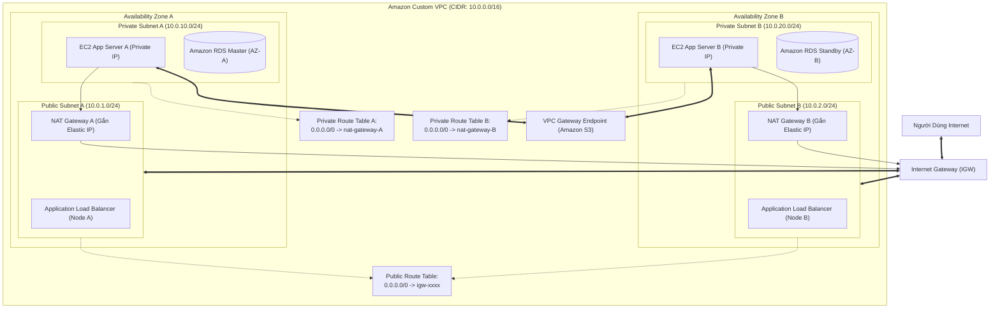
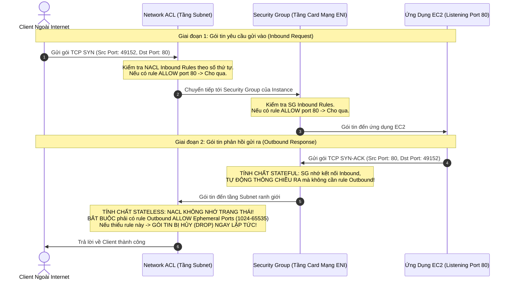
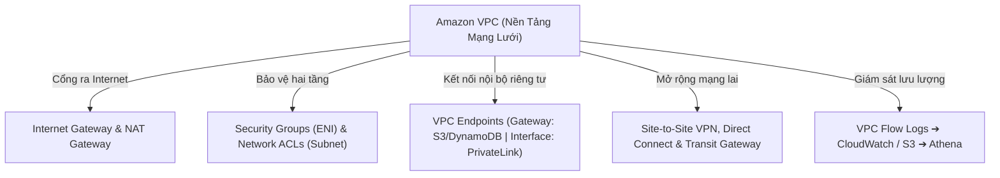

# Ghi Chú Bài Học: Chương 27 - Hạ Tầng Mạng Riêng Ảo Amazon VPC Toàn Tập (Networking - VPC Comprehensive)

> **Khóa học**: Ultimate AWS Certified Solutions Architect Associate  
> **Chương**: 27 - Networking - VPC (Bài 313 đến Bài 350)  
> **Tài liệu tham chiếu liên quan**: [AWS Service Document: VPC & Networking](../AWS_Services/VPC_Networking.md) | [Bảng Thuật Ngữ Kỹ Thuật (GLOSSARY.md)](../GLOSSARY.md)

---

## 1. Tổng Quan Bài Học (Lesson Overview)

Chương học này là trọng tâm cốt lõi về hạ tầng mạng trên AWS: cách thức thiết kế, phân hoạch và vận hành một mạng riêng ảo cô lập hoàn toàn (**Amazon Virtual Private Cloud - VPC**), kiểm soát lưu lượng truy cập bằng hai tầng phòng thủ tường lửa (**Security Groups vs Network ACLs**), thiết lập cổng ra Internet an toàn (**NAT Gateway & Internet Gateway**), kết nối mạng lai doanh nghiệp (**Site-to-Site VPN, AWS Direct Connect, AWS Transit Gateway**), và tối ưu hóa chi phí truyền dẫn dữ liệu.

### Mục tiêu học tập cốt lõi
1. Tính toán chính xác dải địa chỉ IPv4 theo ký pháp CIDR và nắm vững 5 địa chỉ IP bị AWS giữ lại trên mỗi subnet.
2. Xây dựng một Custom VPC hoàn chỉnh gồm Public Subnets và Private Subnets có kết nối Internet an toàn.
3. So sánh chuyên sâu bản chất hoạt động của Security Groups (Stateful) và Network ACLs (Stateless).
4. Khắc phục triệt để các sự cố định tuyến mạng (Routing loops, Blackhole routes, Peering non-transitive).
5. Tích hợp VPC an toàn với mạng On-Premises thông qua Site-to-Site VPN, Direct Connect và Transit Gateway.
6. Sử dụng VPC Flow Logs và Amazon Athena để điều tra các hành vi xâm nhập mạng bất thường.

---

## 2. Điểm Cốt Lõi Cần Nhớ (Key Takeaways)

1. **5 IP dành riêng trong mỗi Subnet**: AWS luôn giữ lại 5 địa chỉ IP đầu và cuối trong mỗi dải mạng con CIDR:
   - `.0`: Network address (Địa chỉ mạng).
   - `.1`: Dành cho VPC Router ảo của AWS.
   - `.2`: Dành cho máy chủ DNS phân giải nội bộ của Amazon (Route 53 Resolver).
   - `.3`: Dành cho mục đích mở rộng tương lai của AWS.
   - `.255`: Network broadcast address (AWS không hỗ trợ broadcast trong VPC nhưng vẫn bảo lưu IP này).
   - *Hệ quả*: Một Subnet `/24` có 256 địa chỉ IP nhưng **chỉ dùng được 251 địa chỉ IP** cho máy ảo EC2.
2. **Public Subnet vs Private Subnet**:
   - *Public Subnet*: Bảng định tuyến (Route Table) có đường đi `0.0.0.0/0 -> igw-xxxx` (Internet Gateway).
   - *Private Subnet*: Bảng định tuyến trỏ `0.0.0.0/0 -> nat-xxxx` (NAT Gateway đặt tại Public Subnet) hoặc không có đường ra Internet.
3. **NAT Gateway**:
   - Do AWS quản lý hoàn toàn, tự động co giãn băng thông từ 5 Gbps lên tới 45 Gbps.
   - **Bắt buộc phải đặt trong Public Subnet** và phải được gán một địa chỉ **Elastic IP (IPv4 công cộng)**.
   - Chỉ cho phép lưu lượng một chiều từ trong Private Subnet đi ra ngoài Internet; chặn 100% mọi kết nối từ ngoài Internet chủ động khởi tạo vào trong.
4. **Security Groups (Tầng ENI) vs Network ACLs (Tầng Subnet)**:
   - **Security Group (Stateful)**: Hoạt động ở cấp độ card mạng ảo ENI. Chỉ có luật **ALLOW**. Nếu lưu lượng vào được cho phép (Inbound Allowed), gói tin phản hồi ra ngoài sẽ **tự động được thông suốt (Outbound Auto-Allowed)** bất kể cấu hình luật ra sao.
   - **Network ACL (Stateless)**: Hoạt động ở ranh giới Subnet. Hỗ trợ cả luật **ALLOW** và **DENY**. Các luật được đánh số thứ tự (Rule Number từ 1 đến 32766) và xét theo thứ tự từ nhỏ đến lớn (gặp luật khớp là dừng lại ngay). **Bắt buộc phải mở cả Inbound và Outbound** (bao gồm dải cổng tạm thời *Ephemeral Ports 1024-65535* cho chiều phản hồi).
5. **VPC Endpoints (Kết nối riêng tư không qua Internet)**:
   - **Gateway Endpoints**: Chỉ hỗ trợ duy nhất 2 dịch vụ: **Amazon S3** và **Amazon DynamoDB**. Hoàn toàn **MIỄN PHÍ**, cấu hình bằng cách thêm dòng định tuyến vào Route Table trỏ tới endpoint ID.
   - **Interface Endpoints (AWS PrivateLink)**: Hỗ trợ hầu hết các dịch vụ AWS khác (CloudWatch, SSM, SQS, KMS...). Cấp phát một card mạng ảo ENI có Private IP nằm trong chính Subnet của bạn; có tính phí theo giờ và phí dữ liệu truyền tải.
6. **AWS Transit Gateway**:
   - Bộ định tuyến trung tâm đám mây (Cloud Router) hoạt động theo mô hình **Hub-and-Spoke**, hỗ trợ định tuyến bắc cầu (**Transitive Routing**), thay thế hoàn toàn mạng lưới kết nối chéo VPC Peering phức tạp khi có hàng chục hay hàng trăm VPCs.
7. **Chi Phí Mạng & Chính Sách Tính Phí Public IPv4**:
   - Dữ liệu truyền trong cùng 1 AZ bằng Private IP là hoàn toàn miễn phí.
   - Dữ liệu truyền xuyên qua 2 AZs khác nhau tốn $0.01 / GB mỗi chiều.
   - Dữ liệu đi qua NAT Gateway tốn thêm $0.045 / GB cước xử lý dữ liệu.
   - **Chính sách Public IPv4 mới**: AWS tính phí **$0.005/giờ** (~$3.6/tháng) cho mỗi địa chỉ Public IPv4. *Best practice ôn thi*: Ưu tiên dùng IPv6 Dual-stack, dùng AWS SSM Session Manager thay cho Bastion Host và chuyển sang VPC Endpoints để giảm chi phí NAT.

---

## 3. Kiến Trúc & Cơ Chế Hoạt Động Chuyên Sâu (Under-the-Hood Mechanisms & Deep Dive)

### 3.1. Sơ đồ Kiến trúc Toàn diện của một Production VPC



---

### 3.2. Cơ chế Luồng Gói Tin: So Sánh Stateful Security Group vs Stateless Network ACL



---

### 3.3. Bảng Chi Tiết 5 Địa Chỉ IP Bị AWS Giữ Lại Trong Subnet (Ví dụ dải `10.0.0.0/24`)

| Địa chỉ IP | Vai trò chức năng của AWS | Khả năng sử dụng của khách hàng |
| :--- | :--- | :--- |
| **`10.0.0.0`** | **Network Address** (Địa chỉ mạng định danh Subnet) | Không thể gán cho máy ảo |
| **`10.0.0.1`** | **VPC Router** (Default Gateway ảo kết nối các Subnet và Route Tables) | Được sử dụng tự động làm Default Gateway |
| **`10.0.0.2`** | **Amazon DNS Server** (Route 53 Resolver phân giải tên miền nội bộ và Internet) | Được cấu hình tự động vào file `/etc/resolv.conf` |
| **`10.0.0.3`** | **Reserved for Future Use** (AWS bảo lưu để mở rộng tính năng) | Không thể gán cho máy ảo |
| **`10.0.0.255`** | **Network Broadcast Address** (Địa chỉ quảng bá mạng) | Không thể gán cho máy ảo (AWS không hỗ trợ broadcast) |

---

## 4. Lệnh, Cấu Hình & Mã Nguồn Thực Tế (Commands, Config & Code)

### 4.1. Khởi tạo VPC hoàn chỉnh với AWS CLI v2

```bash
# 1. Tạo VPC với dải mạng 10.0.0.0/16
VPC_ID=$(aws ec2 create-vpc --cidr-block 10.0.0.0/16 --query "Vpc.VpcId" --output text)
aws ec2 create-tags --resources $VPC_ID --tags Key=Name,Value=Production-VPC

# 2. Tạo Internet Gateway và gắn vào VPC
IGW_ID=$(aws ec2 create-internet-gateway --query "InternetGateway.InternetGatewayId" --output text)
aws ec2 attach-internet-gateway --vpc-id $VPC_ID --internet-gateway-id $IGW_ID

# 3. Tạo Public Subnet (10.0.1.0/24) và bật tính năng tự gán Public IP
PUB_SUBNET_ID=$(aws ec2 create-subnet --vpc-id $VPC_ID --cidr-block 10.0.1.0/24 --availability-zone ap-southeast-1a --query "Subnet.SubnetId" --output text)
aws ec2 modify-subnet-attribute --subnet-id $PUB_SUBNET_ID --map-public-ip-on-launch

# 4. Tạo Route Table cho Public Subnet và định tuyến 0.0.0.0/0 ra Internet Gateway
ROUTE_TABLE_ID=$(aws ec2 create-route-table --vpc-id $VPC_ID --query "RouteTable.RouteTableId" --output text)
aws ec2 create-route --route-table-id $ROUTE_TABLE_ID --destination-cidr-block 0.0.0.0/0 --gateway-id $IGW_ID
aws ec2 associate-route-table --subnet-id $PUB_SUBNET_ID --route-table-id $ROUTE_TABLE_ID

# 5. Tạo VPC Gateway Endpoint cho Amazon S3 (Miễn phí)
aws ec2 create-vpc-endpoint \
    --vpc-id $VPC_ID \
    --service-name com.amazonaws.ap-southeast-1.s3 \
    --route-table-ids $ROUTE_TABLE_ID
```

---

### 4.2. Truy vấn điều tra sự cố mạng bằng VPC Flow Logs trên Amazon Athena

```sql
-- Tạo bảng phân tích log mạng VPC Flow Logs trong Athena
CREATE EXTERNAL TABLE IF NOT EXISTS vpc_flow_logs (
  version INT,
  account_id STRING,
  interface_id STRING,
  srcaddr STRING,
  dstaddr STRING,
  srcport INT,
  dstport INT,
  protocol INT,
  packets BIGINT,
  bytes BIGINT,
  start BIGINT,
  end BIGINT,
  action STRING,
  log_status STRING
)
ROW FORMAT DELIMITED
FIELDS TERMINATED BY ' '
LOCATION 's3://my-enterprise-vpc-flow-logs/AWSLogs/111122223333/vpcflowlogs/ap-southeast-1/'
TBLPROPERTIES ("skip.header.line.count"="1");

-- Tìm kiếm Top 10 IP đang bị từ chối kết nối nhiều nhất (Phát hiện scan cổng hoặc cấu hình sai NACL)
SELECT srcaddr, dstport, action, COUNT(*) as rejected_count
FROM vpc_flow_logs
WHERE action = 'REJECT'
GROUP BY srcaddr, dstport, action
ORDER BY rejected_count DESC
LIMIT 10;
```

---

## 5. Tình Huống Thực Tiễn & Mẫu Kiến Trúc (Real-World Scenarios & Design Patterns)

### Tình huống 1: Chặn một dải địa chỉ IP độc hại đang tấn công DDOS vào Web Server
- **Vấn đề**: Website nhận hàng triệu request tấn công từ địa chỉ IP `203.0.113.55`. Quản trị viên vào Security Group để tìm luật chặn (DENY) nhưng không thấy.
- **Giải pháp**:
  - **Bản chất**: Security Group chỉ hỗ trợ luật `ALLOW`. Mọi IP không nằm trong luật Allow sẽ bị chặn. Tuy nhiên, nếu bạn đang mở cổng 80 cho toàn thế giới (`0.0.0.0/0`) thì bạn **không thể dùng Security Group để loại trừ 1 IP cụ thể**.
  - **Khắc phục**: Truy cập vào **Network ACL (NACL)** của Public Subnet. Thêm một luật Inbound:
    - Rule Number: `50` (nhỏ hơn luật `ALLOW 0.0.0.0/0` đang là 100).
    - Type: All Traffic (hoặc TCP port 80/443).
    - Source: `203.0.113.55/32`.
    - Action: **`DENY`**.
    - Gói tin từ IP này khi vừa tới ranh giới Subnet sẽ bị hủy ngay lập tức mà không bao giờ chạm tới máy chủ.

### Tình huống 2: Kết nối bảo mật giữa 50 VPCs với On-Premises Data Center
- **Vấn đề**: Doanh nghiệp có 50 VPCs cho các môi trường Dev, Test, Prod và muốn kết nối với mạng On-Premises qua AWS Direct Connect. Nếu dùng VPC Peering, số lượng kết nối là $\frac{N(N-1)}{2} = \frac{50 \times 49}{2} = 1.225$ kết nối chéo, không thể quản lý nổi và không hỗ trợ định tuyến bắc cầu sang On-Premises.
- **Giải pháp**:
  - Triển khai **AWS Transit Gateway (TGW)** làm bộ điều phối trung tâm.
  - Gắn (Attach) toàn bộ 50 VPCs vào Transit Gateway.
  - Thiết lập **AWS Direct Connect Gateway** gắn vào Transit Gateway để kết nối đường truyền cáp quang riêng về trung tâm dữ liệu On-Premises. Mọi VPC có thể giao tiếp với nhau và giao tiếp với On-Premises thông qua bảng định tuyến tập trung của Transit Gateway.

---

## 6. Mối Quan Hệ Giữa Các Dịch Vụ (Service Relationships & Ecosystem)



---

## 7. Câu Hỏi Ôn Tập, Bẫy Thi & Tự Đánh Giá (Review, Exam Traps & Self-Assessment)

### Câu hỏi:

1. **Bạn có một VPC với dải mạng `10.0.0.0/16`. Bạn chia thành 4 Subnets với dải `/24`. Mỗi Subnet có thể khởi chạy tối đa bao nhiêu máy chủ EC2?**
2. **Một máy chủ cơ sở dữ liệu nằm trong Private Subnet cần tải bản cập nhật phần mềm từ Internet nhưng tuyệt đối không được phép cho người dùng trên Internet kết nối trực tiếp vào máy chủ này. Bạn cần cấu hình những thành phần mạng nào?**
3. **Tại sao khi bạn cấu hình một luật ALLOW cổng 80 trên Inbound của Network ACL, người dùng vẫn không thể tải được trang web từ máy chủ của bạn?**
4. **Bạn có 3 VPC: VPC-A, VPC-B và VPC-C. Bạn đã thiết lập VPC Peering giữa A và B, và giữa B và C. Máy ảo ở VPC-A có thể kết nối sang VPC-C được không? Vì sao?**
5. **Bạn muốn giảm thiểu chi phí truyền dữ liệu khi hàng ngàn máy ảo EC2 trong Private Subnet liên tục đọc và ghi dữ liệu khổng lồ vào Amazon S3. Giải pháp kiến trúc mạng tối ưu nhất là gì?**
6. **Một kỹ sư muốn ngăn chặn một dải IP cụ thể tấn công vào ứng dụng web đang chạy trên EC2. Kỹ sư này nên cấu hình thành phần nào: Security Group hay Network ACL? Vì sao?**

---

### Đáp án (Self-Assessment Answers):

<details>
<summary>👉 Nhấp vào đây để xem đáp án và giải thích chi tiết</summary>

1. **Giải thích**: Tối đa **251 máy chủ EC2** trên mỗi Subnet. Dải `/24` có tổng cộng 256 địa chỉ IP, nhưng AWS luôn bảo lưu cố định 5 địa chỉ IP trong mỗi Subnet (`.0` network, `.1` router, `.2` DNS, `.3` future use, `.255` broadcast), do đó chỉ còn lại $256 - 5 = 251$ IP khả dụng.
2. **Giải thích**: Cần cấu hình một **NAT Gateway** đặt trong **Public Subnet** (có gắn địa chỉ Elastic IP), sau đó cập nhật bảng định tuyến (Route Table) của Private Subnet có dòng `0.0.0.0/0 -> nat-gateway-id`. NAT Gateway cho phép máy chủ trong Private Subnet khởi tạo kết nối đi ra ngoài nhưng chặn 100% kết nối từ ngoài vào.
3. **Giải thích**: Vì Network ACL có tính chất **Stateless (Phi trạng thái)**: Khi mở chiều Inbound cổng 80, bạn bắt buộc phải mở thêm **chiều Outbound cho dải cổng tạm thời (Ephemeral Ports: từ 1024 đến 65535)** để máy chủ web có thể gửi gói tin phản hồi về cho trình duyệt của client. (Security Group là Stateful nên tự động thông chiều ra mà không cần mở).
4. **Giải thích**: **KHÔNG THỂ**. Vì VPC Peering không hỗ trợ định tuyến bắc cầu (**Non-transitive Routing**). Muốn A kết nối với C, bạn phải tạo thêm một Peering Connection trực tiếp giữa A và C, hoặc chuyển sang sử dụng **AWS Transit Gateway**.
5. **Giải thích**: Tạo một **VPC Gateway Endpoint cho Amazon S3** và liên kết với Route Table của Private Subnet. Lưu lượng truy cập S3 sẽ đi trực tiếp qua mạng ngầm nội bộ của AWS hoàn toàn **MIỄN PHÍ**, không đi qua NAT Gateway và không tốn cước xử lý dữ liệu của NAT Gateway ($0.045/GB).
6. **Giải thích**: Cấu hình trên **Network ACL**. Security Group chỉ hỗ trợ luật `ALLOW` và không thể tạo luật `DENY` cho một IP cụ thể khi cổng đó đã được mở cho `0.0.0.0/0`. Ngược lại, Network ACL hỗ trợ luật `DENY` và xử lý theo số thứ tự (Rule number), cho phép chặn chính xác IP độc hại trước khi xét các luật cho phép phía sau.
</details>

---

## 8. Nguồn Trích Dẫn Bài Giảng & Tài Liệu Liên Quan (Source References)

- **Source Transcripts**:
  - [314 - CIDR, Private vs Public IP.md](../AWS_Resources/27%20-%20Networking%20-%20VPC/314%20-%20CIDR%2C%20Private%20vs%20Public%20IP.md)
  - [318 - Subnet Overview.md](../AWS_Resources/27%20-%20Networking%20-%20VPC/318%20-%20Subnet%20Overview.md)
  - [320 - Internet Gateways & Route Tables.md](../AWS_Resources/27%20-%20Networking%20-%20VPC/320%20-%20Internet%20Gateways%20%26%20Route%20Tables.md)
  - [322 - Bastion Hosts.md](../AWS_Resources/27%20-%20Networking%20-%20VPC/322%20-%20Bastion%20Hosts.md)
  - [326 - NAT Gateways.md](../AWS_Resources/27%20-%20Networking%20-%20VPC/326%20-%20NAT%20Gateways.md)
  - [329 - NACL & Security Groups.md](../AWS_Resources/27%20-%20Networking%20-%20VPC/329%20-%20NACL%20%26%20Security%20Groups.md)
  - [331 - VPC Peering.md](../AWS_Resources/27%20-%20Networking%20-%20VPC/331%20-%20VPC%20Peering.md)
  - [333 - VPC Endpoints.md](../AWS_Resources/27%20-%20Networking%20-%20VPC/333%20-%20VPC%20Endpoints.md)
  - [335 - VPC Flow Logs.md](../AWS_Resources/27%20-%20Networking%20-%20VPC/335%20-%20VPC%20Flow%20Logs.md)
  - [339 - Direct Connect & Direct Connect Gateway.md](../AWS_Resources/27%20-%20Networking%20-%20VPC/339%20-%20Direct%20Connect%20%26%20Direct%20Connect%20Gateway.md)
  - [341 - Transit Gateway.md](../AWS_Resources/27%20-%20Networking%20-%20VPC/341%20-%20Transit%20Gateway.md)
  - [349 - Networking Costs in AWS.md](../AWS_Resources/27%20-%20Networking%20-%20VPC/349%20-%20Networking%20Costs%20in%20AWS.md)
- **Tài liệu tham chiếu nội bộ**:
  - [AWS Service Document: VPC & Networking](../AWS_Services/VPC_Networking.md)
  - [Bảng Thuật Ngữ Kỹ Thuật GLOSSARY.md](../GLOSSARY.md)
