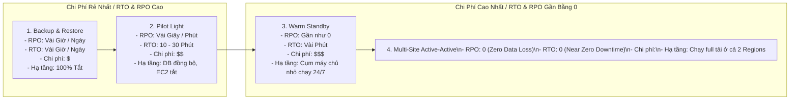
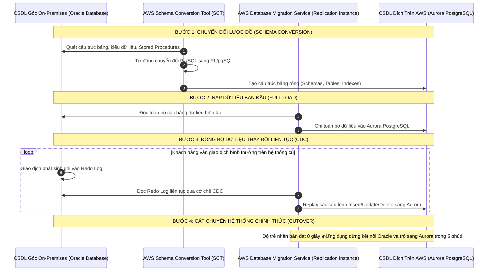
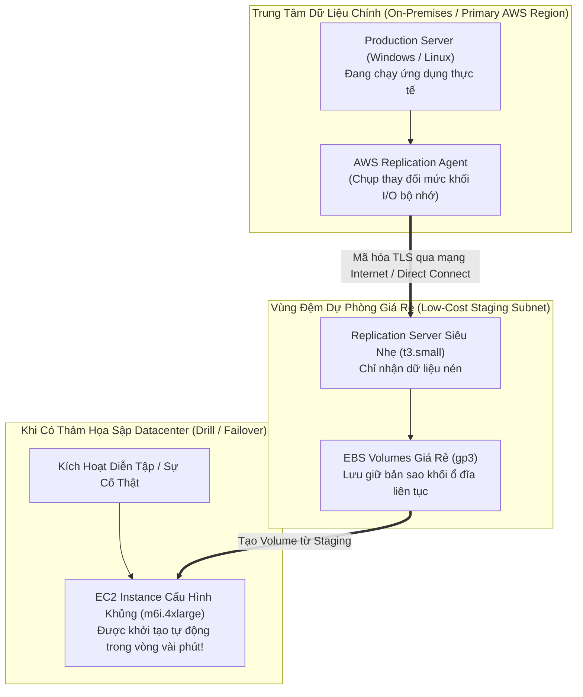
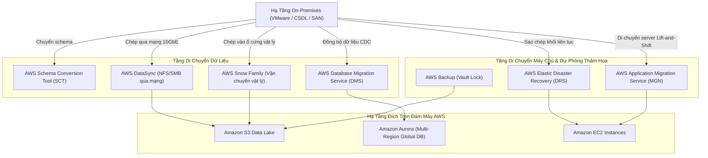

# Ghi Chú Bài Học: Chương 28 - Chiến Lược Khắc Phục Thảm Họa & Di Chuyển Lên AWS (Disaster Recovery & Migrations)

> **Khóa học**: Ultimate AWS Certified Solutions Architect Associate  
> **Chương**: 28 - Disaster Recovery & Migrations (Bài 351 đến Bài 361)  
> **Tài liệu tham chiếu liên quan**: [AWS Service Document: Disaster Recovery & Migration](../AWS_Services/Disaster_Recovery_Migration.md)

---

## 1. Tổng Quan Bài Học (Lesson Overview)

### Chủ đề chính
Chương này đi sâu vào các phương pháp luận, chỉ số đo lường và công nghệ bảo vệ tính liên tục trong hoạt động kinh doanh (**Business Continuity**) cùng chiến lược chuyển dịch hạ tầng quy mô lớn lên AWS:
- Hai chỉ số sống còn của kiến trúc chịu lỗi: **RPO (Recovery Point Objective - Giới hạn mất mát dữ liệu)** và **RTO (Recovery Time Objective - Giới hạn thời gian gián đoạn dịch vụ)**.
- Bốn chiến lược khắc phục thảm họa kinh điển (**The 4 DR Strategies**): **Backup & Restore**, **Pilot Light**, **Warm Standby**, và **Multi-Site Active-Active**.
- Dịch vụ sao chép và tự động phục hồi máy chủ **AWS Elastic Disaster Recovery (AWS DRS)**.
- Dịch vụ chuyển đổi cơ sở dữ liệu **AWS Database Migration Service (AWS DMS)** kết hợp công cụ chuyển đổi lược đồ **AWS Schema Conversion Tool (AWS SCT)** với cơ chế sao chép liên tục (**CDC - Change Data Capture**).
- Dịch vụ di chuyển máy chủ nguyên trạng lên đám mây **AWS Application Migration Service (AWS MGN)** (Lift-and-Shift).
- Quản trị sao lưu tập trung cấp doanh nghiệp với **AWS Backup** và cơ chế bất biến **AWS Backup Vault Lock**.
- Các giải pháp vận chuyển dữ liệu khối lượng lớn: **AWS Snow Family** (Snowcone, Snowball Edge, Snowmobile) và công cụ tăng tốc đồng bộ mạng **AWS DataSync**.

### Mục tiêu học tập
1. Phân biệt chính xác bản chất và cách đo lường giữa hai chỉ số RPO và RTO.
2. So sánh toàn diện 4 chiến lược DR về mặt chi phí, độ phức tạp kỹ thuật và thời gian khôi phục để tư vấn cho doanh nghiệp.
3. Thiết kế quy trình chuyển đổi cơ sở dữ liệu dị thể (Heterogeneous Migration: Oracle sang PostgreSQL) không downtime bằng AWS SCT và DMS.
4. Hiểu sâu cơ chế tối ưu chi phí của AWS DRS thông qua vùng đệm lưu trữ cấp độ khối (Staging Area).
5. Tính toán chính xác thời gian và lựa chọn đúng thiết bị thuộc AWS Snow Family khi cần di chuyển hàng chục tới hàng trăm Terabyte dữ liệu.

---

## 2. Điểm Cốt Lõi Cần Nhớ (Key Takeaways)

1. **RPO vs RTO (Nguyên tắc cốt tử)**:
   - **RPO (Recovery Point Objective)**: Lượng dữ liệu tối đa chấp nhận bị mất tính bằng thời gian lùi về quá khứ (ví dụ: RPO = 1 giờ đồng nghĩa với việc chấp nhận mất tối đa dữ liệu của 1 giờ gần nhất).
   - **RTO (Recovery Time Objective)**: Thời gian tối đa cho phép hệ thống ngừng hoạt động trước khi được khôi phục trở lại (ví dụ: RTO = 15 phút đồng nghĩa với việc sau khi sập, hệ thống phải chạy lại trong vòng 15 phút).
2. **Ma Trận 4 Chiến Lược DR (Từ rẻ nhất/chậm nhất đến đắt nhất/nhanh nhất)**:
   - **Backup & Restore**: Sao lưu dữ liệu vào S3; khi sập thì dựng lại hạ tầng từ đầu; RPO/RTO tính bằng giờ/ngày; chi phí rẻ nhất ($).
   - **Pilot Light**: Dữ liệu DB được đồng bộ liên tục; máy chủ EC2 tắt hoàn toàn (chỉ lưu AMI); khi sập thì bật máy ảo lên; RTO tính bằng phút ($$).
   - **Warm Standby**: Luôn chạy sẵn một cụm máy chủ phiên bản thu nhỏ 24/7 ở Region phụ; khi sập chỉ cần scale-out số lượng máy; RTO cực nhanh tính bằng giây/phút ($$$).
   - **Multi-Site Active-Active**: Chạy full quy mô ở cả 2 Region song song; chia tải thời gian thực qua Route 53; RPO = 0, RTO = 0; chi phí đắt nhất ($$$$).
3. **AWS DMS + AWS SCT**:
   - **AWS SCT (Schema Conversion Tool)**: Dùng để phân tích và dịch cấu trúc bảng, stored procedures, triggers giữa hai hệ quản trị CSDL khác nhau (Heterogeneous: ví dụ Oracle sang Aurora PostgreSQL).
   - **AWS DMS (Database Migration Service)**: Chịu trách nhiệm nạp dữ liệu ban đầu (Full Load) và duy trì đồng bộ liên tục các thay đổi (**CDC - Change Data Capture**) cho đến khi cắt chuyển (Cutover) mà không cần dừng hệ thống.
4. **AWS DRS (Elastic Disaster Recovery)**: Sao chép liên tục ở cấp độ khối ổ đĩa (Block-level replication) từ máy chủ vật lý, VMware hoặc EC2 vào một vùng đệm giá rẻ (**Staging Area**) trên AWS; không tốn tiền chạy máy chủ tính toán đắt đỏ cho đến khi có thảm họa xảy ra.
5. **AWS Snow Family (Di chuyển vật lý khi mạng quá chậm)**:
   - **Snowcone**: 8 TB hoặc 14 TB (nhẹ 2.1 kg, chạy pin, hỗ trợ edge computing).
   - **Snowball Edge**: Storage Optimized (80 TB hoặc 210 TB NVMe) chuyên chở dữ liệu; Compute Optimized (40 vCPU, 100 GB RAM) cho xử lý tại biên.
   - **Snowmobile**: Xe container tải trọng lớn (chở tới 100 PB dữ liệu).

---

## 3. Kiến Trúc & Cơ Chế Hoạt Động Chuyên Sâu (Under-the-Hood Mechanisms & Deep Dive)

### 3.1. Phổ So Sánh 4 Chiến Lược Khắc Phục Thảm Họa (The 4 DR Strategies Spectrum)



---

### 3.2. Quy Trình Chuyển Đổi Database Dị Thể Bằng AWS SCT & AWS DMS (CDC Workflow)



---

### 3.3. Cơ Chế Tiết Kiệm Chi Phí Của AWS Elastic Disaster Recovery (AWS DRS)



- **Lợi ích tài chính**: Doanh nghiệp không cần phải trả tiền thuê máy chủ cấu hình lớn `m6i.4xlarge` chạy nhàn rỗi ở Region phụ 24/7/365. Họ chỉ cần trả tiền cho máy chủ đệm siêu nhỏ `t3.small` và dung lượng ổ cứng EBS trong vùng Staging. Khi thảm họa xảy ra, DRS tự động biến đổi các khối ổ đĩa thành máy chủ mạnh mẽ phục vụ người dùng.

---

## 4. Lệnh, Cấu Hình & Mã Nguồn Thực Tế (Commands, Config & Code)

### 4.1. Tạo Tác Vụ Sao Chép DMS Có Bật Cơ Chế CDC Bằng AWS CLI

```bash
# Tao mot Replication Task tren AWS DMS thuc hien ca Full Load va CDC
aws dms create-replication-task \
    --replication-task-identifier "oracle-to-aurora-cdc-task" \
    --source-endpoint-arn "arn:aws:dms:ap-southeast-1:123456789012:endpoint:ORACLE-SOURCE-ENDPOINT" \
    --target-endpoint-arn "arn:aws:dms:ap-southeast-1:123456789012:endpoint:AURORA-TARGET-ENDPOINT" \
    --replication-instance-arn "arn:aws:dms:ap-southeast-1:123456789012:rep:PRODUCTION-REP-INSTANCE" \
    --migration-type "full-load-and-cdc" \
    --table-mappings '{
        "rules": [
            {
                "rule-type": "selection",
                "rule-id": "1",
                "rule-name": "SelectAllTables",
                "object-locator": {
                    "schema-name": "HR",
                    "table-name": "%"
                },
                "rule-action": "include"
            }
        ]
    }'
```

---

### 4.2. Tạo Tác Vụ Đồng Bộ Dữ Liệu Mạng Tốc Độ Cao Bằng AWS DataSync

```bash
# Tao Task dong bo thu muc NFS On-Premises len Amazon S3 voi kiem tra checksum toan ven
aws datasync create-task \
    --source-location-arn "arn:aws:datasync:ap-southeast-1:123456789012:location/loc-onprem-nfs" \
    --destination-location-arn "arn:aws:datasync:ap-southeast-1:123456789012:location/loc-s3-bucket" \
    --name "Sync-NAS-To-S3-DataLake" \
    --options '{
        "VerifyMode": "POINT_IN_TIME_CONSISTENT",
        "Atime": "BEST_EFFORT",
        "Mtime": "PRESERVE",
        "PosixPermissions": "PRESERVE"
    }'
```

---

## 5. Tình Huống Thực Tiễn & Mẫu Kiến Trúc (Real-World Scenarios & Design Patterns)

### Tình huống 1: Di Chuyển 150 TB Dữ Liệu Video Lên S3 Với Đường Mạng Hạn Chế
- **Bài toán**: Hãng truyền hình sở hữu 150 TB phim lưu trữ trên hệ thống SAN tại văn phòng. Đường truyền Internet của văn phòng có băng thông là 50 Mbps. Nếu tải trực tiếp qua Internet, thời gian truyền tải sẽ mất:
  $$\frac{150 \times 10^{12} \times 8 \text{ bits}}{50 \times 10^6 \text{ bps}} \approx 24,000,000 \text{ giây} \approx 277 \text{ ngày} \text{ (hơn 9 tháng!)}$$
- **Giải pháp**:
  - Đặt hàng **2 thiết bị AWS Snowball Edge Storage Optimized** (mỗi thiết bị dung lượng 80 TB).
  - AWS vận chuyển thiết bị tới văn phòng trong 3 ngày làm việc.
  - Kỹ sư cắm Snowball vào switch mạng nội bộ 10 GbE, sử dụng công cụ nạp dữ liệu tốc độ cao của AWS; nạp đầy 150 TB dữ liệu vào 2 thiết bị trong vòng 2 ngày.
  - Đóng gói gửi ngược lại thiết bị cho AWS; trung tâm dữ liệu AWS nạp dữ liệu trực tiếp vào S3 Bucket trong vòng 24 giờ.
  - Tổng thời gian hoàn tất: **dưới 10 ngày** (thay vì 9 tháng), chi phí rẻ hơn và hoàn toàn không chiếm dụng băng thông Internet của văn phòng.

### Tình huống 2: Triển Khai Chiến Lược Pilot Light Cho Hệ Thống Ngân Hàng
- **Bài toán**: Ngân hàng cần giải pháp dự phòng thảm họa đáp ứng RPO < 1 phút và RTO < 20 phút. Ngân sách yêu cầu tiết kiệm tối đa chi phí tài nguyên máy tính ở vùng phụ (`eu-west-1`).
- **Giải pháp**:
  - Cơ sở dữ liệu chính tại Singapore (`ap-southeast-1`) sử dụng **Aurora Global Database** (hoặc RDS Cross-Region Read Replica) tự động nhân bản dữ liệu sang Ireland (`eu-west-1`) với độ trễ dưới 1 giây (đáp ứng RPO < 1s).
  - Toàn bộ máy chủ ứng dụng web/API ở Ireland được lưu dưới dạng ảnh mẫu **Golden AMI** và kịch bản hạ tầng **AWS CloudFormation / Terraform**. Không chạy bất kỳ máy ảo EC2 nào tại Ireland trong điều kiện bình thường.
  - Khi Singapore gặp sự cố thảm họa, Route 53 Health Check phát hiện lỗi; kích hoạt script tự động thăng cấp (Promote) database tại Ireland thành Master, đồng thời thực thi CloudFormation khởi chạy cụm máy ảo EC2 từ Golden AMI trong 10 phút (đáp ứng RTO < 20 phút).

---

## 6. Mối Quan Hệ Giữa Các Khái Niệm / Dịch Vụ (Service Relationships & Ecosystem)



---

## 7. Câu Hỏi Ôn Tập, Bẫy Thi & Tự Đánh Giá (Review, Exam Traps & Self-Assessment)

### Câu hỏi:
1. Ban giám đốc yêu cầu hệ thống thanh toán cốt lõi phải có thời gian khôi phục dịch vụ (RTO) dưới 5 phút và lượng dữ liệu mất mát (RPO) không quá vài giây khi có thảm họa sập toàn bộ một trung tâm dữ liệu. Tuy nhiên, ngân sách không cho phép chi trả gấp đôi tiền máy chủ chạy full quy mô 24/7 ở hai vùng cùng lúc. Chiến lược DR nào là tối ưu nhất?
2. Bạn cần chuyển đổi một cơ sở dữ liệu Oracle Enterprise tại trung tâm dữ liệu On-Premises sang Amazon Aurora PostgreSQL trên AWS mà không làm gián đoạn các giao dịch đang diễn ra của khách hàng. Bạn sẽ kết hợp những công cụ nào và thứ tự thực hiện ra sao?
3. Một công ty điện ảnh có 80 TB video 8K cần chuyển lên Amazon S3. Văn phòng của họ chỉ có đường truyền mạng Internet 30 Mbps không ổn định. Phương thức nào giúp chuyển toàn bộ dữ liệu lên S3 trong vòng dưới 1 tuần với chi phí tiết kiệm nhất?
4. Dịch vụ AWS Elastic Disaster Recovery (AWS DRS) giúp tối ưu hóa chi phí trong trạng thái hoạt động bình thường (khi thảm họa chưa xảy ra) thông qua cơ chế nào?
5. Sự khác biệt căn bản giữa hai chỉ số **RPO** và **RTO** là gì? Hãy đưa ra ví dụ cụ thể cho từng chỉ số.
6. Cơ chế **Change Data Capture (CDC)** trong dịch vụ AWS DMS hoạt động như thế nào để đảm bảo hệ thống cũ và mới hoàn toàn đồng bộ trước khi cắt chuyển?

---

### Đáp án & Giải thích chi tiết:

<details>
<summary>👉 Nhấp vào đây để xem đáp án và phân tích chi tiết</summary>

1. Chiến lược **Warm Standby**. Trong mô hình này, cơ sở dữ liệu được đồng bộ liên tục thời gian thực sang Region phụ (đáp ứng RPO < vài giây), và một cụm máy chủ phiên bản thu nhỏ (chỉ 10-20% dung lượng) được duy trì chạy sẵn 24/7. Khi sự cố xảy ra, Route 53 chuyển hướng traffic và Auto Scaling Group chỉ mất 2-3 phút để scale-out lên đủ 100% dung lượng máy chủ phục vụ người dùng (đáp ứng RTO < 5 phút), với chi phí tiết kiệm hơn nhiều so với việc duy trì 100% máy chủ chạy song song như Multi-Site Active-Active.
2. Quy trình kết hợp chuẩn:
   - Bước 1: Sử dụng **AWS Schema Conversion Tool (AWS SCT)** để phân tích các bất tương thích giữa Oracle và PostgreSQL, tự động chuyển đổi cấu trúc bảng, views, indexes và dịch mã Stored Procedures (PL/SQL sang PL/pgSQL).
   - Bước 2: Khởi tạo bảng rỗng trên Amazon Aurora PostgreSQL.
   - Bước 3: Sử dụng **AWS Database Migration Service (AWS DMS)** ở chế độ **Full Load and Ongoing Replication (CDC)**. DMS sẽ nạp toàn bộ dữ liệu ban đầu, sau đó liên tục đọc các thay đổi từ transaction redo logs của Oracle để cập nhật sang PostgreSQL.
   - Bước 4: Khi độ trễ đồng bộ (Replication Lag) đạt 0 giây, thực hiện chuyển hướng kết nối của ứng dụng sang Aurora PostgreSQL (Cutover) với thời gian gián đoạn chỉ tính bằng phút.
3. Đặt hàng một thiết bị **AWS Snowball Edge Storage Optimized** (dung lượng 80 TB). Nếu chuyển qua đường mạng 30 Mbps, 80 TB sẽ mất tới hơn 8 tháng truyền tải liên tục. Sử dụng Snowball Edge, thiết bị được giao tận nơi trong vài ngày, nạp dữ liệu qua mạng cục bộ nội bộ 10 GbE trong 1-2 ngày, sau đó gửi trả lại AWS để nạp trực tiếp vào S3 qua đường cáp quang nội bộ, hoàn tất toàn bộ trong vòng dưới 7 ngày.
4. Trong trạng thái hoạt động bình thường, AWS DRS chỉ ghi nhận dữ liệu thay đổi cấp độ khối ổ đĩa vào các ổ đĩa **EBS dung lượng nhỏ giá rẻ nằm trong một vùng đệm (Staging Area Subnet)** với sự điều phối của một máy chủ nhân bản siêu nhẹ (như `t3.small`). DRS **hoàn toàn không khởi chạy bất kỳ máy chủ tính toán đắt tiền nào** (như máy chủ 64 vCPU, 256 GB RAM). Chỉ khi người dùng bấm nút diễn tập (Drill) hoặc xảy ra sự cố thảm họa thật (Failover), DRS mới tự động cấp phát máy ảo EC2 cấu hình cao tương ứng.
5. Phân biệt:
   - **RPO (Recovery Point Objective)**: Đo lường lượng dữ liệu bị mất tối đa được chấp nhận, tính bằng đơn vị thời gian ngược về quá khứ. *Ví dụ*: Bản sao lưu gần nhất được chụp lúc 2:00 sáng, thảm họa xảy ra lúc 3:00 sáng. Toàn bộ dữ liệu phát sinh từ 2:00 đến 3:00 bị mất. RPO ở đây là 1 giờ.
   - **RTO (Recovery Time Objective)**: Đo lường thời gian gián đoạn dịch vụ tối đa được chấp nhận, tính bằng thời gian từ lúc thảm họa xảy ra cho đến khi hệ thống phục hồi sẵn sàng phục vụ. *Ví dụ*: Hệ thống bị sập lúc 3:00 sáng, đội ngũ kỹ sư khôi phục và đưa dịch vụ hoạt động lại lúc 3:30 sáng. RTO ở đây là 30 phút.
6. **Change Data Capture (CDC)**: Thay vì liên tục quét toàn bộ bảng cơ sở dữ liệu (gây suy giảm hiệu năng nghiêm trọng cho hệ thống đang chạy), AWS DMS đọc trực tiếp các tệp nhật ký ghi giao dịch của engine cơ sở dữ liệu nguồn (ví dụ: Binary Logs của MySQL, Write-Ahead Logs của PostgreSQL, Redo Logs của Oracle). Bất kỳ lệnh `INSERT`, `UPDATE`, hay `DELETE` nào vừa được commit trên CSDL nguồn đều được DMS trích xuất ngay lập tức từ file log và áp dụng tương ứng lên CSDL đích, đảm bảo hai bên luôn đồng bộ dữ liệu thời gian thực.
</details>

---

## 8. Nguồn Trích Dẫn Bài Giảng & Tài Liệu Liên Quan (Source References)

- **Source Transcripts**:
  - [351 - Disaster Recovery in AWS.md](../AWS_Resources/28%20-%20Disaster%20Recovery%20&%20Migrations/351%20-%20Disaster%20Recovery%20in%20AWS.md)
  - [352 - Elastic Disaster Recovery (DRS).md](../AWS_Resources/28%20-%20Disaster%20Recovery%20&%20Migrations/352%20-%20Elastic%20Disaster%20Recovery%20%28DRS%29.md)
  - [353 - Database Migration Service (DMS).md](../AWS_Resources/28%20-%20Disaster%20Recovery%20&%20Migrations/353%20-%20Database%20Migration%20Service%20%28DMS%29.md)
  - [355 - RDS & Aurora Migrations.md](../AWS_Resources/28%20-%20Disaster%20Recovery%20&%20Migrations/355%20-%20RDS%20%26%20Aurora%20Migrations.md)
  - [357 - AWS Backup.md](../AWS_Resources/28%20-%20Disaster%20Recovery%20&%20Migrations/357%20-%20AWS%20Backup.md)
  - [359 - Application Migration Service (MGN).md](../AWS_Resources/28%20-%20Disaster%20Recovery%20&%20Migrations/359%20-%20Application%20Migration%20Service%20%28MGN%29.md)
  - [360 - Transferring Large Datasets into AWS.md](../AWS_Resources/28%20-%20Disaster%20Recovery%20&%20Migrations/360%20-%20Transferring%20Large%20Datasets%20into%20AWS.md)
- **Tài liệu chuyên sâu liên quan**:
  - [Chuyên đề Master: Khắc Phục Thảm Họa & Di Chuyển Lên Đám Mây (DR & Migration)](../AWS_Services/Disaster_Recovery_Migration.md)
  - [Chuyên đề Master: Amazon RDS, Aurora & Databases](../AWS_Services/RDS_Aurora_Databases.md)
