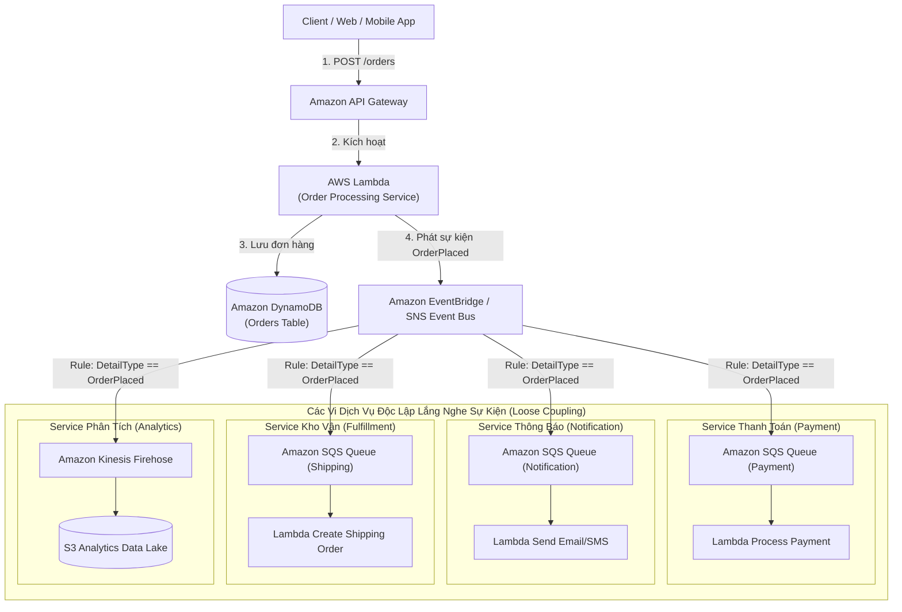
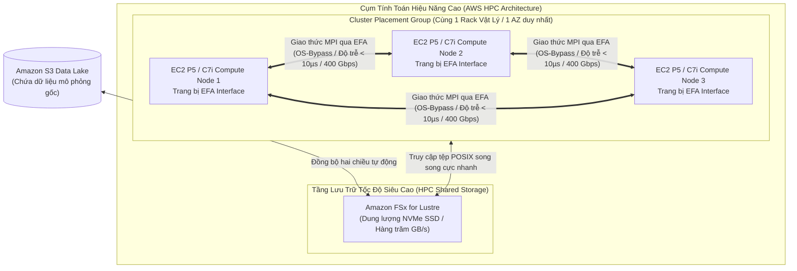
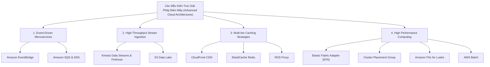

# Ghi Chú Bài Học: Chương 29 - Các Mẫu Kiến Trúc Giải Pháp Chuyên Sâu (More Solution Architectures)

> **Khóa học**: Ultimate AWS Certified Solutions Architect Associate  
> **Chương**: 29 - More Solution Architectures (Bài 360 đến Bài 366)  
> **Tài liệu tham chiếu liên quan**: [AWS Service Document: Decoupling & Messaging](../AWS_Services/SQS_SNS_EventBridge_Decoupling.md) | [AWS Service Document: EBS & EFS Storage](../AWS_Services/EBS_EFS_Storage.md) | [AWS Service Document: Well-Architected Framework](../AWS_Services/AWS_Well_Architected_Framework.md)

---

## 1. Tổng Quan Bài Học (Lesson Overview)

Chương học này tổng hợp các mô hình kiến trúc đám mây nâng cao giải quyết các bài toán kỹ thuật phức tạp nhất trong thực tế sản xuất: kiến trúc vi dịch vụ hướng sự kiện (**Event-Driven Microservices**), đường ống thu nhận dữ liệu lưu lượng cực lớn (**High-Throughput Stream Ingestion**), chiến lược bộ nhớ đệm đa tầng (**Multi-tier Caching Strategies**), và hệ thống điện toán tính toán hiệu năng cao (**High Performance Computing - HPC**).

### Mục tiêu học tập cốt lõi
1. Thiết kế kiến trúc vi dịch vụ tách rời hoàn toàn (**Decoupled Microservices**) bằng Event-Driven Architecture với Amazon EventBridge và Amazon SQS/SNS Fan-out.
2. Xây dựng đường ống nuốt dữ liệu tốc độ cao (hàng trăm ngàn sự kiện/giây) chống nghẽn cho cơ sở dữ liệu.
3. Làm chủ 5 tầng Caching trong hệ thống phân tán để giảm 90% tải cho Database và tối ưu chi phí.
4. Hiểu rõ các thành phần cấu thành cụm tính toán hiệu năng cao (**HPC**) trên AWS: **Elastic Fabric Adapter (EFA)**, **Cluster Placement Groups**, và **Amazon FSx for Lustre**.
5. Phân tích các đánh đổi về độ tin cậy, hiệu năng và chi phí trong các bài toán quy mô lớn.

---

## 2. Điểm Cốt Lõi Cần Nhớ (Key Takeaways)

1. **Kiến trúc Hướng Sự Kiện (Event-Driven Architecture - EDA)**:
   - Các dịch vụ không gọi trực tiếp API đồng bộ (Synchronous HTTP) của nhau để tránh hiện tượng sập dây chuyền (Cascading Failures) khi một service bị quá tải hoặc chết.
   - Thay vào đó, service phát ra một sự kiện (Event) đẩy vào **Amazon EventBridge** hoặc **Amazon SNS**. Các service quan tâm (như Payment, Notification, Shipping, Analytics) tự động đăng ký hàng đợi **Amazon SQS** của riêng mình để nhận và xử lý bất đồng bộ theo tốc độ riêng.
2. **Thu Nhận Dữ Liệu Lưu Lượng Cực Lớn (High-Throughput Ingestion Pipeline)**:
   - Khi có hàng trăm ngàn lượt nhấp chuột hoặc dữ liệu cảm biến gửi về mỗi giây, **tuyệt đối không ghi trực tiếp vào Database quan hệ (RDS)** vì sẽ làm cạn kiệt connection pool và treo CPU.
   - **Mẫu thiết kế chuẩn**: Client ➔ **Amazon Kinesis Data Streams** (hoặc API Gateway tích hợp thẳng vào Kinesis) ➔ **Kinesis Data Firehose** (tự động gom mẻ - batching theo 60 giây hoặc 5MB) ➔ Đẩy vào **Amazon S3 Data Lake** ➔ Xử lý phân tích bằng **Athena/Glue/Redshift**.
3. **Chiến Lược Caching Đa Tầng (5 Tiers of Caching)**:
   - *Tầng 1 (Edge Caching)*: **Amazon CloudFront CDN** & Origin Shield - lưu trữ nội dung tĩnh/động tại 450+ PoP gần người dùng nhất.
   - *Tầng 2 (API Gateway Caching)*: Bật Cache trên Stage của API Gateway để trả kết quả ngay mà không cần kích hoạt Lambda.
   - *Tầng 3 (Web/App Tier Caching)*: Bộ nhớ đệm cục bộ của reverse proxy hoặc Web framework.
   - *Tầng 4 (Distributed In-Memory Cache)*: **Amazon ElastiCache (Redis/Valkey)** - áp dụng mô hình *Cache-Aside* (đọc từ cache trước, nếu miss mới đọc DB rồi ghi vào cache) hoặc *Write-Through*.
   - *Tầng 5 (Database Caching)*: **Amazon RDS Proxy** (tái sử dụng connection pool) và bộ đệm bộ nhớ đệm nội bộ của database engine.
4. **HPC - Điện Toán Hiệu Năng Cao Trên AWS**:
   - Dành cho các bài toán đòi hỏi tính toán đồ sộ: mô phỏng khí động học xe đua F1, dự báo thời tiết, mô phỏng phản ứng hạt nhân, phân tích gien sinh học.
   - **Elastic Fabric Adapter (EFA)**: Card mạng ảo đặc biệt của EC2 có cơ chế **OS-Bypass**, cho phép phần mềm HPC giao tiếp trực tiếp với card mạng mà không phải đi qua nhân hệ điều hành Linux (Linux Kernel), giảm độ trễ giữa các máy chủ tính toán xuống mức microsecond, hỗ trợ thư viện **MPI (Message Passing Interface)**.
   - **Cluster Placement Group**: Đặt tất cả các máy tính toán trong cùng một rack vật lý tại 1 Availability Zone duy nhất để đạt băng thông mạng tối đa (100–400 Gbps).
   - **Amazon FSx for Lustre**: Hệ thống tệp tin phân tán POSIX đọc/ghi dữ liệu song song với thông lượng hàng trăm GB/s kết hợp liền mạch với Amazon S3.
   - **AWS Batch**: Tự động cấp phát và điều phối hàng ngàn job tính toán phân tán trên cụm máy ảo EC2 hoặc Spot Instances.

---

## 3. Kiến Trúc & Cơ Chế Hoạt Động Chuyên Sâu (Under-the-Hood Mechanisms & Deep Dive)

### 3.1. Sơ đồ Kiến trúc Vi Dịch Vụ Hướng Sự Kiện (Event-Driven Microservices with EventBridge & Fan-out)



---

### 3.2. Sơ đồ Kiến trúc Tính toán Hiệu năng cao (HPC Architecture with EFA & FSx Lustre)



---

### 3.3. So sánh chi tiết card mạng mạng EC2: ENA vs EFA

| Tiêu chí | ENA (Elastic Network Adapter) | EFA (Elastic Fabric Adapter) |
| :--- | :--- | :--- |
| **Bản chất hoạt động** | Card mạng ảo tiêu chuẩn cho máy ảo EC2 | ENA được bổ sung thêm phần cứng vi mạch phần mềm tùy biến |
| **Cơ chế truyền gói tin** | Phải đi qua nhân hệ điều hành Linux (TCP/IP Kernel Stack) | **Hỗ trợ OS-Bypass**: Ứng dụng giao tiếp thẳng tới card mạng |
| **Giao thức mạng** | TCP/IP, UDP truyền thống | **SRD (Scalable Reliable Datagram)** độc quyền của AWS + MPI |
| **Độ trễ truyền tin** | Mili-giây (Milliseconds - ms) | **Micro-giây (Microseconds - µs)** |
| **Kịch bản sử dụng tối ưu** | Ứng dụng web, microservices, database, truyền file chuẩn | **Chỉ dùng cho HPC, mô phỏng tính toán song song, phân tán Machine Learning** |

---

## 4. Lệnh, Cấu Hình & Mã Nguồn Thực Tế (Commands, Config & Code)

### 4.1. Cấu hình EventBridge Rule lọc sự kiện JSON Pattern

```json
{
  "source": ["ecommerce.orders"],
  "detail-type": ["OrderPlaced"],
  "detail": {
    "order_status": ["CONFIRMED"],
    "total_amount": [{ "numeric": [ ">=", 100 ] }],
    "currency": ["USD"]
  }
}
```

---

### 4.2. Lệnh AWS CLI tạo Cluster Placement Group và khởi tạo EC2 gắn EFA

```bash
# 1. Tạo một Cluster Placement Group tại Region Singapore
aws ec2 create-placement-group \
    --group-name "hpc-cluster-group-01" \
    --strategy cluster \
    --region ap-southeast-1

# 2. Khởi tạo máy ảo tính toán tối ưu c6in.16xlarge trong Placement Group và kích hoạt EFA
aws ec2 run-instances \
    --image-id ami-0123456789abcdef0 \
    --instance-type c6in.16xlarge \
    --placement "GroupName=hpc-cluster-group-01" \
    --network-interfaces "[{\"DeviceIndex\":0,\"InterfaceType\":\"efa\",\"Groups\":[\"sg-0123efa\"]}]" \
    --key-name "MyHPCKey" \
    --count 4
```

---

## 5. Tình Huống Thực Tiễn & Mẫu Kiến Trúc (Real-World Scenarios & Design Patterns)

### Tình huống 1: Website Bán Vé Concert Tiếp Nhận 200.000 Yêu Cầu Đặt Vé Mỗi Phút
- **Vấn đề**: Khi mở bán vé ca sĩ nổi tiếng, hàng trăm ngàn người cùng bấm nút "Mua vé" trong 1 phút khiến Database truyền thống bị sập ngay lập tức do nghẽn I/O và khóa bảng (Table Locking).
- **Kiến trúc giải pháp**:
  ```mermaid
  flowchart LR
      User["200.000 Người Dùng Mua Vé"] --> CF["CloudFront CDN (Cache trang tĩnh)"]
      CF --> APIGW["API Gateway HTTP"]
      APIGW --> SQS_FIFO["Amazon SQS FIFO Queue\n(Đảm bảo xếp hàng theo thứ tự chính xác)"]
      SQS_FIFO --> Workers["Nhóm Worker EC2 / Lambda có kiểm soát tốc độ\n(Ví dụ chỉ rút 200 đơn/giây)"]
      Workers --> DB[("Amazon DynamoDB / Aurora\n(Xử lý ổn định không bị quá tải)")]
  ```
  - Hàng đợi **SQS FIFO** đóng vai trò là "bể đệm điều tiết" (Buffer), đảm bảo mọi người đều được xếp hàng công bằng theo đúng thứ tự thời gian bấm mà không làm sập tầng cơ sở dữ liệu.

### Tình huống 2: Mô phỏng Động lực học Phân tử (Molecular Dynamics) Khối lượng lớn
- **Yêu cầu**: Nhóm nghiên cứu y sinh cần chạy mô phỏng tương tác protein trên 32 máy chủ tính toán đa lõi. Các máy chủ cần trao đổi dữ liệu vị trí các nguyên tử với nhau sau mỗi micro-giây qua thư viện OpenMPI.
- **Kiến trúc giải pháp**:
  - Triển khai cụm máy chủ trong một **Cluster Placement Group** duy nhất để các node vật lý kề sát nhau.
  - Sử dụng dòng máy chủ hỗ trợ **Elastic Fabric Adapter (EFA)** (ví dụ: `c6in.32xlarge` hoặc `p4de.24xlarge`).
  - Gắn hệ thống tệp tin phân tán **Amazon FSx for Lustre** làm kho dữ liệu dùng chung.
  - Sử dụng **AWS ParallelCluster** hoặc **AWS Batch** để tự động điều phối khởi tạo và hủy cụm tính toán khi hoàn thành tác vụ.

---

## 6. Mối Quan Hệ Giữa Các Dịch Vụ (Service Relationships & Ecosystem)



---

## 7. Câu Hỏi Ôn Tập, Bẫy Thi & Tự Đánh Giá (Review, Exam Traps & Self-Assessment)

### Câu hỏi:

1. **Một ứng dụng vi dịch vụ thương mại điện tử cần xử lý nhiều nghiệp vụ sau khi người dùng đặt hàng thành công: trừ tiền thẻ, gửi email xác nhận, cập nhật kho hàng, và gửi thông tin sang đối tác vận chuyển. Yêu cầu đặt ra là các service phải độc lập hoàn toàn, sự cố ở service gửi email không được làm ảnh hưởng đến việc trừ tiền hay giao hàng. Mẫu kiến trúc nào là chuẩn mực nhất?**
2. **Một công ty công nghệ y sinh chạy các mô hình mô phỏng phản ứng hóa học phân tán trên hàng chục máy chủ EC2 Linux sử dụng giao thức MPI (Message Passing Interface). Các máy chủ yêu cầu giao tiếp giữa các tiến trình với nhau với độ trễ cực thấp (microsecond) và thông lượng mạng tối đa. Hai cấu hình mạng nào kết hợp sẽ đáp ứng bài toán này?**
3. **Một hệ thống đo lường thông minh (Smart Meter) thu nhận 300.000 điểm dữ liệu cảm biến mỗi giây từ các hộ gia đình. Dữ liệu cần được lưu trữ vào S3 để phân tích sau đó, nhưng không được phép mất dữ liệu và kiến trúc phải tự động co giãn theo tải. Giải pháp kiến trúc nào là tối ưu nhất?**
4. **Điểm khác biệt căn bản về mặt kỹ thuật giữa Elastic Network Adapter (ENA) và Elastic Fabric Adapter (EFA) là gì?**
5. **Trong chiến lược Caching đa tầng cho ứng dụng web, dịch vụ nào giúp giải quyết bài toán cạn kiệt Connection Pool của cơ sở dữ liệu quan hệ Amazon RDS khi có hàng ngàn hàm Lambda chạy đồng thời?**

---

### Đáp án (Self-Assessment Answers):

<details>
<summary>👉 Nhấp vào đây để xem đáp án và giải thích chi tiết</summary>

1. **Giải thích**: Áp dụng mô hình **Event-Driven Architecture (EDA) kết hợp SNS/EventBridge Fan-out tới các SQS Queue độc lập**. Service đặt hàng chỉ cần bắn một sự kiện `OrderPlaced` vào Event Bus; mỗi service con (Thanh toán, Email, Kho hàng, Vận chuyển) có một hàng đợi SQS riêng để nhận sự kiện này. Nếu service email bị lỗi, thông điệp vẫn nằm an toàn trong hàng đợi SQS của nó để xử lý lại sau mà không ảnh hưởng tới tiến trình thanh toán hay giao hàng.
2. **Giải thích**: Khởi tạo các máy ảo EC2 có kích hoạt **Elastic Fabric Adapter (EFA)** và đặt toàn bộ chúng vào cùng một **Cluster Placement Group**. Cluster Placement Group đặt các máy chủ trong cùng một rack vật lý cung cấp băng thông cao nhất và độ trễ thấp nhất; trong khi EFA cung cấp cơ chế OS-bypass cho phép các tiến trình MPI trao đổi thông tin trực tiếp với card mạng mà không qua nhân Linux.
3. **Giải thích**: Đẩy dữ liệu trực tiếp vào **Amazon Kinesis Data Streams** (hoặc tích hợp API Gateway HTTP Proxy vào Kinesis), sau đó dẫn luồng dữ liệu sang **Amazon Kinesis Data Firehose** để tự động batching và ghi trực tiếp vào **Amazon S3 Data Lake**.
4. **Giải thích**: **EFA có tính năng OS-bypass**, cho phép ứng dụng HPC bỏ qua tầng nhân hệ điều hành Linux (Linux Kernel TCP/IP stack) để giao tiếp trực tiếp với card mạng, đạt độ trễ mức microsecond cho các thư viện tính toán song song như MPI. ENA thông thường bắt buộc phải đi qua kernel TCP stack và có độ trễ mức millisecond.
5. **Giải thích**: **Amazon RDS Proxy**. RDS Proxy đứng ở giữa ứng dụng (như các hàm Lambda) và cơ sở dữ liệu RDS, duy trì một nhóm các kết nối mở sẵn (**Connection Pool**) và chia sẻ chúng cho hàng ngàn yêu cầu Lambda đồng thời, ngăn chặn việc Lambda tạo quá nhiều kết nối trực tiếp làm sập cơ sở dữ liệu.
</details>

---

## 8. Nguồn Trích Dẫn Bài Giảng & Tài Liệu Liên Quan (Source References)

- **Source Transcripts**:
  - [362 - Event Processing in AWS.md](../AWS_Resources/29%20-%20More%20Solution%20Architectures/362%20-%20Event%20Processing%20in%20AWS.md)
  - [363 - Caching Strategies in AWS.md](../AWS_Resources/29%20-%20More%20Solution%20Architectures/363%20-%20Caching%20Strategies%20in%20AWS.md)
  - [364 - Blocking an IP Address in AWS.md](../AWS_Resources/29%20-%20More%20Solution%20Architectures/364%20-%20Blocking%20an%20IP%20Address%20in%20AWS.md)
  - [366 - EC2 Instance High Availability.md](../AWS_Resources/29%20-%20More%20Solution%20Architectures/366%20-%20EC2%20Instance%20High%20Availability.md)
  - [365 - High Performance Computing %28HPC%29 on AWS.md](../AWS_Resources/29%20-%20More%20Solution%20Architectures/365%20-%20High%20Performance%20Computing%20%28HPC%29%20on%20AWS.md)
- **Tài liệu tham chiếu nội bộ**:
  - [AWS Service Document: Decoupling & Messaging](../AWS_Services/SQS_SNS_EventBridge_Decoupling.md)
  - [AWS Service Document: EBS & EFS Storage](../AWS_Services/EBS_EFS_Storage.md)
  - [AWS Well-Architected Framework](../AWS_Services/AWS_Well_Architected_Framework.md)
