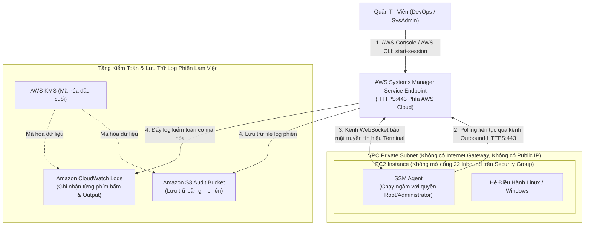
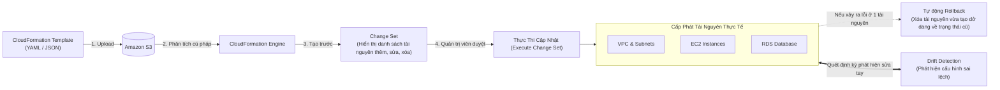
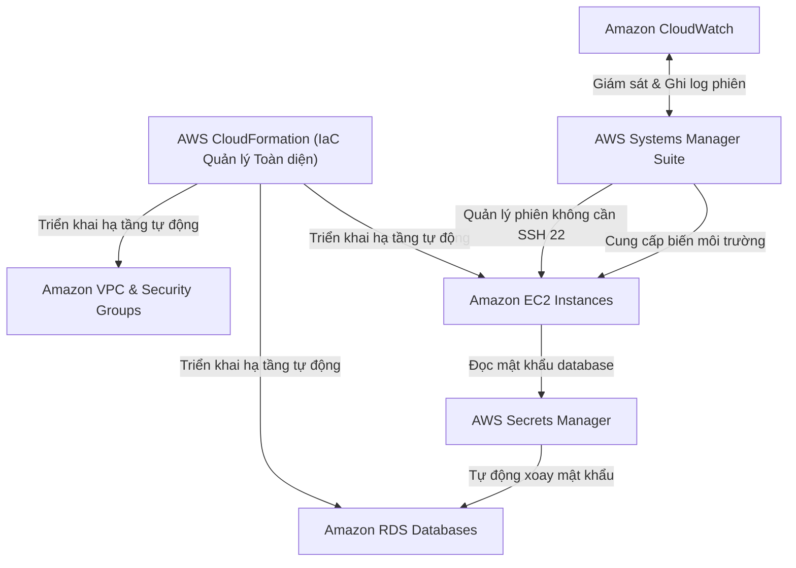

# Ghi Chú Bài Học: Chương 30 - Các Dịch Vụ Bổ Trợ & Tự Động Hóa Hạ Tầng (Other Services)

> **Khóa học**: Ultimate AWS Certified Solutions Architect Associate  
> **Chương**: 30 - Other Services (Bài 367 đến Bài 381)  
> **Tài liệu tham chiếu liên quan**: [Bảng Thuật Ngữ Kỹ Thuật (GLOSSARY.md)](../GLOSSARY.md) | [AWS Service Document: KMS & Cloud Security](../AWS_Services/KMS_Security_Encryption.md)

---

## 1. Tổng Quan Bài Học (Lesson Overview)

Chương học này hoàn thiện bức tranh hệ sinh thái đám mây AWS với các dịch vụ bổ trợ quan trọng: công cụ tự động hóa hạ tầng dưới dạng mã nguồn (**AWS CloudFormation**), bộ công cụ quản trị máy chủ từ xa an toàn tuyệt đối (**AWS Systems Manager - SSM**), dịch vụ truyền thông gửi email và tương tác khách hàng (**Amazon SES** & **Amazon Pinpoint**), bộ công cụ quản trị tài chính và phát hiện bất thường chi phí (**AWS Cost Management**), và các nền tảng tính toán lai/mở rộng (**AWS Outposts**, **AWS Batch**, **Amazon AppFlow**, **AWS Amplify**, **AWS Instance Scheduler**).

### Mục tiêu học tập cốt lõi
1. Nắm vững nguyên lý và cú pháp khai báo hạ tầng **AWS CloudFormation** (Parameters, Mappings, Intrinsic Functions, Change Sets, StackSets, Drift Detection, DeletionPolicy).
2. Hiểu rõ kiến trúc kết nối bảo mật của **SSM Session Manager** (loại bỏ hoàn toàn Bastion Host, không cần mở cổng 22 inbound, không cần Public IP).
3. Phân biệt chính xác **SSM Parameter Store** và **AWS Secrets Manager**.
4. Sử dụng hiệu quả bộ công cụ quản trị chi phí: **AWS Cost Explorer**, **AWS Budgets**, và **AWS Cost Anomaly Detection**.
5. Lựa chọn đúng dịch vụ gửi email giao dịch (**SES**) so với nền tảng tiếp thị truyền thông đa kênh (**Pinpoint**).

---

## 2. Điểm Cốt Lõi Cần Nhớ (Key Takeaways)

1. **AWS CloudFormation (Infrastructure as Code - IaC)**:
   - Dịch vụ khai báo (Declarative) tự động hóa tạo, cập nhật và hủy toàn bộ tài nguyên AWS thông qua tệp tin mã nguồn định dạng **YAML** hoặc **JSON**.
   - **Cấu trúc 8 phần của Template**: `AWSTemplateFormatVersion`, `Description`, `Metadata`, `Parameters` (nhận biến đầu vào), `Mappings` (bảng tra cứu tĩnh), `Conditions` (điều kiện tạo tài nguyên), `Transform` (cho Serverless SAM), `Resources` (**Bắt buộc duy nhất**), và `Outputs` (xuất giá trị trả về để chia sẻ).
   - **Các hàm nội tại quan trọng (Intrinsic Functions)**:
     - `!Ref`: Tham chiếu đến giá trị của Parameter hoặc ID của Resource.
     - `!GetAtt`: Lấy thuộc tính chi tiết của tài nguyên (ví dụ: `!GetAtt MyEC2.PrivateIp`).
     - `!Sub`: Thay thế chuỗi (String substitution), ví dụ `!Sub "https://${MyBucket}.s3.amazonaws.com"`.
     - `!Join`: Nối mảng chuỗi với ký tự phân tách (Delimiter).
     - `!FindInMap`: Tra cứu bảng Mappings (ví dụ: tìm đúng AMI ID theo Region và môi trường).
     - `!ImportValue`: Nhập giá trị được Export từ một Stack khác (Cross-Stack References).
   - **Change Sets**: Cho phép xem trước chính xác những tài nguyên nào sẽ bị thêm mới, sửa đổi hoặc xóa trước khi thực thi cập nhật Stack thật.
   - **StackSets**: Cho phép triển khai một CloudFormation Stack lên **nhiều AWS Accounts** và **nhiều Regions** khác nhau trong cùng một AWS Organization chỉ bằng một thao tác duy nhất.
   - **Drift Detection**: Phát hiện sai lệch cấu hình nếu có ai đó đăng nhập vào AWS Management Console để sửa đổi thủ công tài nguyên nằm ngoài tầm kiểm soát của CloudFormation.
   - **DeletionPolicy**:
     - `Delete` (Mặc định): Xóa tài nguyên khi Stack bị xóa.
     - `Retain`: **Giữ lại tài nguyên khi xóa Stack** (cực kỳ quan trọng để bảo vệ dữ liệu S3 Bucket hoặc RDS Database).
     - `Snapshot`: Tự động tạo bản Snapshot trước khi xóa tài nguyên (hỗ trợ EBS, RDS, ElastiCache, Redshift).
2. **AWS Systems Manager (SSM) Suite**:
   - Bộ công cụ quản trị máy chủ EC2 và môi trường On-Premises tập trung:
   - **SSM Session Manager**:
     - Cho phép quản trị viên đăng nhập vào terminal máy ảo Linux/Windows trực tiếp từ trình duyệt hoặc CLI.
     - **Không cần mở cổng 22 inbound trên Security Group**, không cần Public IP, không cần quản lý SSH Key Pair, không cần dựng Bastion Host.
     - Kiểm soát quyền truy cập tập trung qua IAM; tự động ghi toàn bộ log lệnh terminal đẩy về **CloudWatch Logs** hoặc **Amazon S3** có mã hóa bằng **AWS KMS**.
   - **SSM Parameter Store**:
     - Lưu trữ cấu hình tập trung dạng phân cấp khóa/giá trị (ví dụ: `/ecommerce/prod/db_url`).
     - Hỗ trợ loại dữ liệu `SecureString` mã hóa an toàn bằng AWS KMS.
     - *Bản Standard*: Hoàn toàn miễn phí, tối đa 4 KB mỗi tham số, giới hạn 10.000 tham số.
     - *Bản Advanced*: Tối đa 8 KB mỗi tham số, hỗ trợ Parameter Policies (như ngày hết hạn TTL).
   - **Parameter Store vs Secrets Manager**:
     - *Parameter Store*: Lưu trữ cấu hình chung, chi phí rẻ hơn nhiều, không có tính năng tự động xoay vòng mật khẩu native.
     - *Secrets Manager*: Thiết kế chuyên biệt cho thông tin đăng nhập nhạy cảm (DB password, API tokens), tích hợp sẵn Lambda để **tự động xoay vòng mật khẩu (Automatic Password Rotation)** định kỳ mà không làm gián đoạn ứng dụng.
3. **Các Dịch Vụ Mở Rộng & Quản Trị Khác**:
   - **Amazon SES (Simple Email Service)**: Dịch vụ gửi email hàng loạt quy mô lớn (Transactional Emails như xác thực OTP, biên lai mua hàng; Marketing Emails); chi phí cực rẻ ($0.10 / 1.000 email).
   - **Amazon Pinpoint**: Nền tảng truyền thông tiếp thị đa kênh (Email, SMS, Push Notification, Voice, In-app messaging) hướng tới phân khúc người dùng và theo dõi chiến dịch tiếp thị (Campaigns).
   - **AWS Cost Tools**:
     - *AWS Cost Explorer*: Trực quan hóa dữ liệu chi phí lịch sử lên đến 12 tháng và dự báo chi tiêu trong 12 tháng tới dựa trên các **Cost Allocation Tags**.
     - *AWS Cost Anomaly Detection*: Sử dụng Machine Learning để phân tích mô hình chi tiêu và gửi cảnh báo tức thì qua email/Slack khi có chi phí tăng đột biến ngoài ý muốn.
     - *AWS Budgets*: Đặt ngưỡng ngân sách cố định và gửi cảnh báo trước khi vượt ngưỡng.
   - **AWS Batch**: Tự động cấp phát và điều phối hàng ngàn tác vụ tính toán phân tán (Batch Computing) trên các máy ảo EC2 hoặc Fargate; tự động tắt máy khi tác vụ hoàn thành.
   - **Amazon AppFlow**: Dịch vụ tích hợp dữ liệu không máy chủ (No-code SaaS Integration) chuyển dữ liệu hai chiều an toàn giữa các ứng dụng SaaS (Salesforce, SAP, Zendesk, ServiceNow) và AWS (S3, Redshift).
   - **AWS Amplify**: Bộ công cụ và dịch vụ đám mây trọn gói cho lập trình viên phát triển nhanh ứng dụng Web và Mobile (Frontend hosting, Auth với Cognito, GraphQL API với AppSync, Storage).
   - **AWS Instance Scheduler**: Giải pháp tự động hóa bật/tắt máy ảo EC2 và RDS theo lịch trình định sẵn (ví dụ: tự tắt lúc 19h tối và bật lúc 7h sáng vào ngày làm việc) giúp tiết kiệm tới 70% chi phí cho môi trường Dev/Test.

---

## 3. Kiến Trúc & Cơ Chế Hoạt Động Chuyên Sâu (Under-the-Hood Mechanisms & Deep Dive)

### 3.1. Sơ đồ Kiến trúc Hoạt động của AWS Systems Manager Session Manager



> **Bản chất Under the Hood**: SSM Agent trên máy ảo chủ động tạo kết nối gửi ra ngoài (**Outbound HTTPS 443**) về endpoint của SSM (thông qua NAT Gateway hoặc VPC Endpoint). Do đó, **Security Group Inbound hoàn toàn có thể khóa 100% (không mở bất kỳ port nào)** mà người quản trị vẫn điều khiển được terminal máy ảo.

---

### 3.2. Sơ đồ Vòng Đời Triển Khai Hạ Tầng với AWS CloudFormation



---

### 3.3. So sánh chi tiết: SSM Parameter Store vs AWS Secrets Manager

| Tiêu chí | AWS Systems Manager Parameter Store | AWS Secrets Manager |
| :--- | :--- | :--- |
| **Mục đích chính** | Lưu trữ cấu hình ứng dụng, chuỗi kết nối, cờ tính năng | Lưu trữ mật khẩu, mã khóa API bí mật, chứng chỉ SSL |
| **Hỗ trợ mã hóa KMS** | Có (loại `SecureString`) | Luôn bắt buộc mã hóa bằng KMS Key |
| **Chi phí dịch vụ** | **Bản Standard hoàn toàn MIỄN PHÍ** ($0.00) | **0.40 USD / 1 Secret / tháng** + 0.05 USD / 10.000 API calls |
| **Tự động xoay vòng mật khẩu (Rotation)** | Không có sẵn (phải tự viết Lambda kích hoạt bằng EventBridge) | **Tích hợp sẵn native**: Tự động xoay mật khẩu RDS, Redshift, DocumentDB định kỳ |
| **Giới hạn kích thước** | 4 KB (Standard) hoặc 8 KB (Advanced) | Lên tới 64 KB mỗi secret |
| **Kịch bản lựa chọn chuẩn** | Biến môi trường, URL, cấu hình license, mật khẩu tĩnh | Mật khẩu database sản xuất yêu cầu tuân thủ PCI-DSS, SOC2 phải đổi mật khẩu mỗi 30-90 ngày |

---

## 4. Lệnh, Cấu Hình & Mã Nguồn Thực Tế (Commands, Config & Code)

### 4.1. Mẫu Template CloudFormation hoàn chỉnh với Parameters, Functions và DeletionPolicy

```yaml
AWSTemplateFormatVersion: '2010-09-09'
Description: 'Mẫu hạ tầng chuẩn mực bảo vệ dữ liệu bằng DeletionPolicy'

Parameters:
  EnvironmentType:
    Type: String
    Default: dev
    AllowedValues: [dev, test, prod]
    Description: 'Môi trường triển khai'
  DBPassword:
    Type: String
    NoEcho: true
    Description: 'Mật khẩu Database (không hiển thị trên console)'

Mappings:
  RegionToAMI:
    ap-southeast-1:
      AMI: ami-0123456789abcdef0
    us-east-1:
      AMI: ami-0abcdef1234567890

Conditions:
  IsProduction: !Equals [!Ref EnvironmentType, prod]

Resources:
  # S3 Bucket chứa dữ liệu quan trọng - KHÔNG BAO GIỜ bị xóa mất khi xóa Stack
  CriticalDataBucket:
    Type: AWS::S3::Bucket
    DeletionPolicy: Retain
    Properties:
      BucketName: !Sub "company-audit-data-${EnvironmentType}-${AWS::AccountId}"
      VersioningConfiguration:
        Status: Enabled

  # Database quan trọng - Tự động Snapshot trước khi xóa
  AppDatabase:
    Type: AWS::RDS::DBInstance
    DeletionPolicy: Snapshot
    Properties:
      DBInstanceClass: !If [IsProduction, db.r6g.xlarge, db.t4g.medium]
      AllocatedStorage: '100'
      Engine: postgres
      MasterUsername: app_admin
      MasterUserPassword: !Ref DBPassword

Outputs:
  BucketArn:
    Value: !GetAtt CriticalDataBucket.Arn
    Description: 'ARN của S3 Bucket dùng chung'
    Export:
      Name: !Sub "${AWS::StackName}-AuditBucketArn"
```

---

### 4.2. Thao tác điều khiển máy chủ và lấy mật khẩu qua AWS CLI

```bash
# 1. Đăng nhập terminal vào máy ảo EC2 trong Private Subnet không cần SSH Key
aws ssm start-session --target i-0123456789abcdef0

# 2. Chạy lệnh cập nhật phần mềm hàng loạt trên 50 máy chủ bằng SSM Run Command
aws ssm send-command \
    --document-name "AWS-RunShellScript" \
    --targets "Key=tag:Environment,Values=Production" \
    --parameters 'commands=["dnf update -y"]'

# 3. Đọc giá trị cấu hình mật khẩu đã mã hóa từ SSM Parameter Store
aws ssm get-parameter \
    --name "/ecommerce/prod/db_password" \
    --with-decryption \
    --query "Parameter.Value" \
    --output text
```

---

## 5. Tình Huống Thực Tiễn & Mẫu Kiến Trúc (Real-World Scenarios & Design Patterns)

### Tình huống 1: Doanh nghiệp muốn loại bỏ toàn bộ Bastion Host để giảm bề mặt tấn công
- **Bối cảnh**: Doanh nghiệp duy trì 2 máy chủ Bastion Host (Jump Box) tại Public Subnet và mở cổng SSH 22 cho các dải IP văn phòng. Chi phí duy trì Bastion Host tốn tiền, và tiềm ẩn rủi ro lộ Private Key hoặc bị scan cổng brute-force.
- **Giải pháp**:
  1. Gắn IAM Role chứa chính sách `AmazonSSMManagedInstanceCore` vào Instance Profile của tất cả máy ảo EC2 trong Private Subnet.
  2. Xóa bỏ hoàn toàn 2 máy chủ Bastion Host; đóng toàn bộ cổng inbound 22 trên Security Group.
  3. Đội kỹ sư sử dụng **AWS Systems Manager Session Manager** để kết nối trực tiếp vào máy chủ qua AWS CLI hoặc AWS Console.
  4. Bật ghi log toàn bộ phiên làm việc lên **Amazon CloudWatch Logs** và mã hóa bằng KMS để phục vụ kiểm toán bảo mật.

### Tình huống 2: Ngăn chặn thảm họa mất dữ liệu khách hàng khi vô tình xóa Stack CloudFormation
- **Vấn đề**: Một kỹ sư mới vào dự án vô tình chạy lệnh `aws cloudformation delete-stack` trên môi trường Production, khiến toàn bộ VPC, EC2 và cả S3 Bucket chứa tài liệu của khách hàng bị xóa sạch.
- **Giải pháp phòng thủ**:
  1. Luôn khai báo thuộc tính `DeletionPolicy: Retain` trên tất cả các tài nguyên lưu trữ dữ liệu cốt lõi (Amazon S3 Buckets, Amazon RDS Databases, Amazon DynamoDB Tables, Amazon EFS File Systems).
  2. Bật tính năng **Stack Termination Protection** trên CloudFormation Stack. Khi tính năng này được kích hoạt, không ai có thể xóa Stack trừ khi chủ động vào cấu hình để tắt Termination Protection trước.

---

## 6. Mối Quan Hệ Giữa Các Dịch Vụ (Service Relationships & Ecosystem)



---

## 7. Câu Hỏi Ôn Tập, Bẫy Thi & Tự Đánh Giá (Review, Exam Traps & Self-Assessment)

### Câu hỏi:

1. **Một kỹ sư DevOps muốn kết nối terminal dòng lệnh an toàn vào một máy ảo EC2 Linux đang chạy trong một Private Subnet không có Internet Gateway, không có Public IP và không muốn mở bất kỳ cổng Inbound nào trên Security Group. Dịch vụ nào đáp ứng hoàn hảo yêu cầu này?**
2. **Một công ty sử dụng AWS CloudFormation để quản lý toàn bộ hạ tầng đám mây. Đội bảo mật yêu cầu rằng khi một CloudFormation Stack bị xóa bỏ, toàn bộ dữ liệu lưu trong Amazon S3 Bucket và Amazon RDS DB Instance tuyệt đối KHÔNG ĐƯỢC PHÉP BỊ XÓA THEO. Thuộc tính cấu hình nào phải được khai báo trong template?**
3. **Một ứng dụng yêu cầu lưu trữ mật khẩu cơ sở dữ liệu và yêu cầu mật khẩu này phải được tự động xoay vòng (Automatic Password Rotation) sau mỗi 30 ngày mà không cần can thiệp thủ công. Bạn nên chọn dịch vụ nào?**
4. **Hàm nội tại (Intrinsic Function) nào trong AWS CloudFormation cho phép bạn lấy giá trị ARN hoặc địa chỉ Private IP của một tài nguyên vừa được tạo trong cùng template?**
5. **Bạn muốn tự động tắt toàn bộ các máy ảo EC2 và cơ sở dữ liệu RDS trong môi trường Development vào lúc 19h tối mỗi ngày và tự động bật lại vào lúc 7h sáng hôm sau để tiết kiệm chi phí. Giải pháp nào sẵn có và tối ưu nhất?**
6. **Một kỹ sư muốn triển khai cùng một CloudFormation Template lên 20 tài khoản AWS khác nhau thuộc các Region khác nhau trong cùng một AWS Organization. Tính năng nào của CloudFormation phục vụ chính xác mục đích này?**

---

### Đáp án (Self-Assessment Answers):

<details>
<summary>👉 Nhấp vào đây để xem đáp án và giải thích chi tiết</summary>

1. **Giải thích**: **AWS Systems Manager Session Manager**. Chỉ cần máy ảo có cài SSM Agent và được gán IAM Role có quyền `AmazonSSMManagedInstanceCore`, SSM Agent sẽ chủ động mở kênh outbound HTTPS 443 về SSM Service Endpoint (qua NAT Gateway hoặc Interface VPC Endpoint), cho phép người dùng mở terminal shell an toàn mà không cần mở bất kỳ cổng inbound nào trên Security Group.
2. **Giải thích**: Khai báo thuộc tính **`DeletionPolicy: Retain`** (hoặc `DeletionPolicy: Snapshot` cho cơ sở dữ liệu) bên dưới khối cấu hình của tài nguyên đó trong template.
3. **Giải thích**: **AWS Secrets Manager**. Secrets Manager tích hợp sẵn cơ chế xoay vòng mật khẩu tự động thông qua các hàm AWS Lambda mẫu được thiết kế sẵn cho Amazon RDS, Amazon Aurora, và Amazon DocumentDB. SSM Parameter Store không có tính năng tự động xoay vòng mật khẩu tích hợp sẵn.
4. **Giải thích**: **`!GetAtt`** (ví dụ: `!GetAtt MyEC2Instance.PrivateIp` hoặc `!GetAtt MyS3Bucket.Arn`). `!Ref` chỉ trả về tên hoặc ID của tài nguyên, muốn lấy các thuộc tính nâng cao khác bắt buộc phải dùng `!GetAtt`.
5. **Giải thích**: **AWS Instance Scheduler**. Đây là giải pháp kiến trúc có sẵn do AWS cung cấp (dựa trên CloudFormation, Lambda và DynamoDB) cho phép định nghĩa các khoảng thời gian hoạt động để tự động bật/tắt EC2 và RDS, giúp giảm tới 70% chi phí cho các môi trường thử nghiệm không dùng vào ban đêm và cuối tuần.
6. **Giải thích**: **AWS CloudFormation StackSets**. StackSets cho phép bạn tạo, cập nhật hoặc xóa các Stacks trên hàng trăm tài khoản AWS và các Regions khác nhau trong cùng một tổ chức chỉ bằng một thao tác duy nhất.
</details>

---

## 8. Nguồn Trích Dẫn Bài Giảng & Tài Liệu Liên Quan (Source References)

- **Source Transcripts**:
  - [367 - Other Services Section Introduction.md](../AWS_Resources/30%20-%20Other%20Services/367%20-%20Other%20Services%20Section%20Introduction.md)
  - [368 - CloudFormation Intro.md](../AWS_Resources/30%20-%20Other%20Services/368%20-%20CloudFormation%20Intro.md)
  - [370 - CloudFormation - Service Role.md](../AWS_Resources/30%20-%20Other%20Services/370%20-%20CloudFormation%20-%20Service%20Role.md)
  - [371 - Amazon SES.md](../AWS_Resources/30%20-%20Other%20Services/371%20-%20Amazon%20SES.md)
  - [372 - Amazon Pinpoint.md](../AWS_Resources/30%20-%20Other%20Services/372%20-%20Amazon%20Pinpoint.md)
  - [373 - SSM Session Manager.md](../AWS_Resources/30%20-%20Other%20Services/373%20-%20SSM%20Session%20Manager.md)
  - [374 - SSM Other Services.md](../AWS_Resources/30%20-%20Other%20Services/374%20-%20SSM%20Other%20Services.md)
  - [375 - AWS Cost Explorer.md](../AWS_Resources/30%20-%20Other%20Services/375%20-%20AWS%20Cost%20Explorer.md)
  - [376 - AWS Cost Anomaly Detection.md](../AWS_Resources/30%20-%20Other%20Services/376%20-%20AWS%20Cost%20Anomaly%20Detection.md)
  - [377 - AWS Outposts.md](../AWS_Resources/30%20-%20Other%20Services/377%20-%20AWS%20Outposts.md)
  - [378 - AWS Batch.md](../AWS_Resources/30%20-%20Other%20Services/378%20-%20AWS%20Batch.md)
  - [379 - Amazon AppFlow.md](../AWS_Resources/30%20-%20Other%20Services/379%20-%20Amazon%20AppFlow.md)
  - [380 - AWS Amplify.md](../AWS_Resources/30%20-%20Other%20Services/380%20-%20AWS%20Amplify.md)
  - [381 - Instance Scheduler on AWS.md](../AWS_Resources/30%20-%20Other%20Services/381%20-%20Instance%20Scheduler%20on%20AWS.md)
- **Tài liệu tham chiếu nội bộ**:
  - [Bảng Thuật Ngữ Kỹ Thuật GLOSSARY.md](../GLOSSARY.md)
  - [AWS Service Document: KMS & Cloud Security](../AWS_Services/KMS_Security_Encryption.md)
