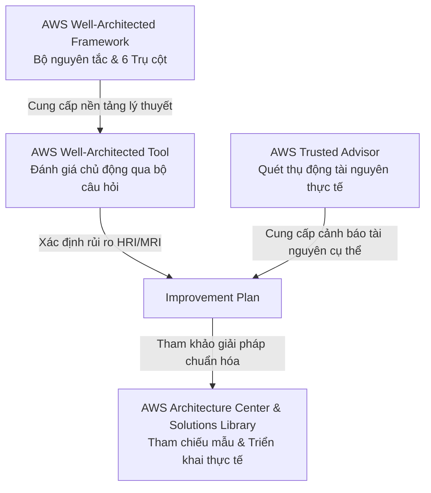

# Ghi Chú Bài Học: Chương 31 - WhitePapers & Kiến Trúc Thực Tế (WhitePapers and Architectures)

> **Khóa học**: Ultimate AWS Certified Solutions Architect Associate  
> **Chương**: 31 - WhitePapers and Architectures  
> **Các bài giảng bao gồm**: 
> - [382 - WhitePaper Section Introduction](file:///n:/AWS_XBrain_Note/AWS_Resources/31%20-%20WhitePapers%20and%20Architectures/382%20-%20WhitePaper%20Section%20Introduction.md)
> - [383 - AWS Well-Architected Framework & Well-Architected Tool](file:///n:/AWS_XBrain_Note/AWS_Resources/31%20-%20WhitePapers%20and%20Architectures/383%20-%20AWS%20Well-Architected%20Framework%20&%20Well-Architecte.md)
> - [384 - AWS Trusted Advisor Overview + Hands-On](file:///n:/AWS_XBrain_Note/AWS_Resources/31%20-%20WhitePapers%20and%20Architectures/384%20-%20AWS%20Trusted%20Advisor%20Overview%20+%20Hands-On.md)
> - [385 - Examples of Architecture - AWS Certified Solutions Architect Associate](file:///n:/AWS_XBrain_Note/AWS_Resources/31%20-%20WhitePapers%20and%20Architectures/385%20-%20Examples%20of%20Architecture%20-%20AWS%20Certified%20Solutio.md)

---

## 4.1. Tổng Quan Bài Học (Lesson Overview)

### Chủ đề chính
Chương này tập trung vào các tài liệu kỹ thuật chuẩn mực (Whitepapers), khuôn khổ thiết kế kiến trúc chuẩn AWS (**AWS Well-Architected Framework**), công cụ đánh giá khối lượng công việc (**AWS Well-Architected Tool**), dịch vụ kiểm tra tối ưu tài khoản tự động (**AWS Trusted Advisor**), và các kho tài nguyên kiến trúc tham chiếu thực tế (**AWS Architecture Center** & **AWS Solutions Library**).

### Mục tiêu học tập
1. Nắm vững **6 Trụ cột (6 Pillars)** của AWS Well-Architected Framework và các nguyên tắc thiết kế chung.
2. Hiểu cách thức hoạt động của **AWS Well-Architected Tool**: cách định nghĩa Workload, áp dụng Lens, trả lời câu hỏi và xuất báo cáo cải thiện (Improvement Plan).
3. Phân biệt rõ các hạng mục kiểm tra của **AWS Trusted Advisor**, sự khác biệt giữa các gói hỗ trợ (Basic/Developer vs Business/Enterprise) và cách tiếp cận qua Support API.
4. Nắm được cách tra cứu và khai thác kho kiến trúc tham chiếu (**AWS Architecture Center**) cùng các giải pháp dựng sẵn kèm mã nguồn CloudFormation (**AWS Solutions Library**) phục vụ công việc thực tế của một Solutions Architect.

### Kiến thức tiên quyết (Prerequisites)
- Hiểu biết tổng quan về các dịch vụ AWS cốt lõi: EC2, S3, RDS, IAM, VPC, CloudWatch.
- Nắm vững khái niệm về tính khả dụng cao (High Availability), sao lưu phục hồi (Disaster Recovery) và tối ưu chi phí (Cost Optimization).

---

## 4.2. Điểm Cốt Lõi Cần Nhớ (Key Takeaways)

1. **6 Trụ cột Well-Architected Framework**:
   - **Vận hành xuất sắc (Operational Excellence)**: Tự động hóa quy trình, cải tiến liên tục, học hỏi từ sự cố.
   - **Bảo mật (Security)**: Áp dụng bảo vệ nhiều lớp (Defense in Depth), đặc quyền tối thiểu, mã hóa mọi nơi.
   - **Độ tin cậy (Reliability)**: Tự động phục hồi khi gặp sự cố, kiểm tra quy trình phục hồi (Game Days).
   - **Hiệu quả hiệu năng (Performance Efficiency)**: Sử dụng công nghệ tiên tiến (Serverless, Cloud-native), theo dõi số liệu hiệu năng.
   - **Tối ưu chi phí (Cost Optimization)**: Đo lường hiệu quả chi phí, ngưng trả tiền cho tài nguyên nhàn rỗi.
   - **Tính bền vững (Sustainability)**: Giảm thiểu tác động môi trường, tối ưu hóa mức tiêu thụ năng lượng của hạ tầng.
2. **Các trụ cột mang tính hiệp đồng (Synergy), không phải đánh đổi đối đầu**: Cải thiện vận hành xuất sắc thường đồng thời tối ưu chi phí và tăng độ tin cậy.
3. **AWS Well-Architected Tool** là công cụ tự đánh giá (Self-assessment tool) miễn phí trên Console giúp phát hiện rủi ro cao (High Risk Issues - HRI) và đưa ra kế hoạch khắc phục có hướng dẫn.
4. **AWS Trusted Advisor** là công cụ đánh giá tự động dựa trên quét tài nguyên thực tế:
   - Gói **Basic & Developer Support**: Chỉ được sử dụng các kiểm tra cốt lõi (Core Checks) về bảo mật (Public S3 Buckets, Open SG Ports, Public Snapshots) và hạn mức dịch vụ (Service Limits).
   - Gói **Business & Enterprise Support**: Mở khóa toàn bộ kiểm tra (Full Checks) trên cả 6 danh mục kèm quyền gọi **AWS Support API**.
5. **Tài nguyên cho Solutions Architect ngoài đời thực**:
   - **AWS Architecture Center**: Hơn 2.000 sơ đồ và tài liệu tham chiếu kiến trúc theo ngành và công nghệ.
   - **AWS Solutions Library**: Các giải pháp kiến trúc đã được kiểm định, kèm template CloudFormation và mã nguồn trên GitHub để triển khai ngay lập tức.

---

## 4.3. Giải Thích Khái Niệm Chi Tiết (Detailed Concept Explanations)

### 1. AWS Well-Architected Framework là gì?
- **Định nghĩa**: Bộ khung các hướng dẫn, nguyên tắc thiết kế và bộ câu hỏi đánh giá chuẩn mực của AWS giúp các kiến trúc sư xây dựng hạ tầng an toàn, hiệu năng cao, linh hoạt và tối ưu chi phí.
- **Vấn đề giải quyết**: Trước đây, các nhóm kỹ thuật thường thiết kế hệ thống theo cảm tính hoặc kinh nghiệm on-premises cũ, dẫn đến việc cấp phát dư thừa lãng phí (Over-provisioning), kiến trúc tĩnh khó nâng cấp (Monolithic), thiếu quy trình phục hồi khi xảy ra sự cố.
- **Tại sao quan trọng**: Đây là tiêu chuẩn vàng trong các kỳ thi AWS Certified Solutions Architect và là ngôn ngữ chung trong thiết kế cloud toàn cầu.
- **Các nguyên tắc thiết kế chung (General Design Principles)**:
  1. *Ngừng phỏng đoán nhu cầu dung lượng (Stop guessing your capacity needs)*: Sử dụng Auto Scaling thay vì mua máy chủ dư thừa.
  2. *Kiểm thử hệ thống ở quy mô production (Test systems at production scale)*: Tận dụng tính co giãn của cloud để dựng môi trường test lớn rồi xóa bỏ sau 1 giờ.
  3. *Tự động hóa để thử nghiệm kiến trúc dễ dàng hơn (Automate to make architectural experimentation easier)*: Sử dụng Infrastructure as Code (CloudFormation, Terraform).
  4. *Cho phép kiến trúc tiến hóa (Allow for evolutionary architectures)*: Bắt đầu từ EC2 đơn giản rồi tiến hóa sang Serverless (Lambda, API Gateway) theo nhu cầu.
  5. *Định hướng kiến trúc bằng dữ liệu (Drive architectures using data)*: Đo lường số liệu thực tế qua log và metric để quyết định nâng cấp.
  6. *Cải tiến thông qua các ngày diễn tập (Improve through game days)*: Giả lập các đợt flash sale hoặc sự cố sập AZ để kiểm tra độ kiên cường của hệ thống.
- **Sai lầm phổ biến**: Nghĩ rằng phải cân bằng và đánh đổi (trade-off) gay gắt giữa 6 trụ cột. Thực tế các trụ cột hỗ trợ tương hỗ cho nhau.

### 2. AWS Well-Architected Tool
- **Cơ chế hoạt động**:
  1. Khởi tạo một **Workload** (định nghĩa tên ứng dụng, môi trường Prod/Non-prod, các AWS Region sử dụng).
  2. Chọn các thấu kính (**Lenses**): Lens mặc định là *Well-Architected Framework Lens*; ngoài ra có thể chọn *Serverless Lens*, *SaaS Lens*, *Foundation Technical Review (FTR) Lens* hoặc tạo *Custom Lens*.
  3. Trả lời bộ câu hỏi theo từng trụ cột.
  4. Hệ thống phân tích và liệt kê các rủi ro: **High Risk Issues (HRI)** và **Medium Risk Issues (MRI)**.
  5. Xuất **Improvement Plan** kèm liên kết hướng dẫn trực tiếp đến các tài liệu giải pháp của AWS.
  6. Lưu các mốc thời gian (**Milestones**) để theo dõi tiến độ hoàn thiện kiến trúc qua các chu kỳ phát triển.

### 3. AWS Trusted Advisor
- **Bản chất**: Cố vấn đám mây tự động liên tục quét tài nguyên hiện có trong tài khoản và so sánh với các quy chuẩn tối ưu của AWS.
- **6 Danh mục đánh giá của Trusted Advisor**:
  1. **Cost Optimization** (Tối ưu chi phí): Phát hiện EC2 nhàn rỗi, Elastic IP không gắn vào máy chủ, RDS DB không có kết nối.
  2. **Performance** (Hiệu năng): Kiểm tra hạn ngạch thông lượng EBS, mức sử dụng kết nối máy chủ.
  3. **Security** (Bảo mật): Phát hiện S3 Bucket mở công khai, Security Group mở cổng 0.0.0.0/0 (như cổng 22, 3389), chưa bật MFA trên tài khoản Root.
  4. **Fault Tolerance** (Khả năng chịu lỗi): Kiểm tra xem EBS có được snapshot định kỳ không, RDS có cấu hình Multi-AZ không, ASG có bao phủ nhiều AZ không.
  5. **Service Limits** (Hạn ngạch dịch vụ): Cảnh báo khi mức sử dụng tài nguyên vượt quá 80% hạn ngạch cho phép.
  6. **Operational Excellence** (Vận hành xuất sắc): Kiểm tra tuân thủ cấu hình và tự động hóa.
- **Ranh giới Support Plan (Cực kỳ quan trọng trong thi cử)**:
  - *Free / Basic / Developer Plan*: Chỉ xem được Core Security Checks và Service Limits Checks.
  - *Business & Enterprise Plan*: Mở khóa 100% các bài kiểm tra chuyên sâu trên cả 6 danh mục, hỗ trợ thông báo tự động qua CloudWatch Events/EventBridge và quyền tích hợp qua AWS Support API.

### 4. AWS Architecture Center & AWS Solutions Library
- **AWS Architecture Center**: Trung tâm tài nguyên tham chiếu với hơn 2.000 sơ đồ thiết kế kiến trúc chuẩn mực được chia theo ngành nghề (Tài chính, Y tế, Bán lẻ) và công nghệ (Serverless, Containers, Machine Learning, Database DR).
- **AWS Solutions Library**: Cung cấp các giải pháp hoàn chỉnh đã được kỹ sư AWS đóng gói và kiểm thử (Vetted Solutions). Mỗi giải pháp đi kèm tài liệu hướng dẫn kỹ thuật, sơ đồ chi tiết, nút "Launch in Console" và mã nguồn mở trên GitHub (CloudFormation/CDK templates).

---

## 4.4. Lệnh, Cấu Hình và Mã Nguồn (Commands, Code, and Configuration)

### 1. Truy vấn Trusted Advisor qua AWS CLI (Yêu cầu Business/Enterprise Support)
Để tự động hóa việc lấy danh sách các kiểm tra bảo mật có rủi ro cao từ Trusted Advisor:

```bash
# Liệt kê các bài kiểm tra khả dụng trong Trusted Advisor
aws support describe-trusted-advisor-checks --language en

# Lấy kết quả kiểm tra cụ thể cho việc kiểm tra Public S3 Buckets
# (Check ID cho S3 Bucket Permissions: eW7HH0l7J9)
aws support describe-trusted-advisor-check-result \
    --check-id "eW7HH0l7J9" \
    --language en \
    --query "result.status" \
    --output text
```

*Giải thích tham số*:
- `--check-id`: Mã định danh duy nhất của bài kiểm tra trong Trusted Advisor.
- `--query "result.status"`: Lọc kết quả trả về (`ok`, `warning`, hoặc `error`).

### 2. Khai báo Workload trong AWS Well-Architected Tool bằng Terraform (Minh họa IaC bổ sung)
Kỹ sư DevOps có thể tự động khai báo Workload để tích hợp vào quy trình CI/CD:

```hcl
resource "aws_wellarchitected_workload" "production_workload" {
  workload_name = "CoreBanking-Production"
  description   = "He thong giao dich ngan hang loi chay tren EKS va Aurora"
  environment   = "PRODUCTION"
  review_owner  = "lead-architect@mycorp.com"
  
  aws_regions = [
    "ap-southeast-1",
    "ap-southeast-2"
  ]
  
  lenses = [
    "wellarchitected"
  ]

  tags = {
    Environment = "Production"
    Team        = "CloudPlatform"
  }
}
```

---

## 4.5. Ví Dụ Thực Tiễn (Practical Examples)

### Ví dụ 1 (Từ bài giảng của giảng viên)
Giảng viên mô tả việc cấu hình một Workload thực tế trong console:
1. Đặt tên là `prod application`, người chịu trách nhiệm đánh giá là `John@example.com`.
2. Lựa chọn triển khai tại 2 Region: `us-east-1` và `us-west-2`.
3. Áp dụng thấu kính `wellarchitected`.
4. Khi trả lời các câu hỏi về phân bổ ưu tiên và cấu trúc tổ chức, hệ thống chỉ ra 3 điểm High Risk: thiếu quy trình đánh giá nhu cầu khách hàng nội bộ và thiếu mô hình phân tích mối đe dọa an ninh (Threat landscape). Nhấp vào từng rủi ro sẽ mở ra trang hướng dẫn khắc phục chính xác trong whitepaper.

### Ví dụ 2 (Bổ sung thực tiễn Cloud DevOps)
Trong một dự án xây dựng dịch vụ Streaming Video thời gian thực:
- Kỹ sư truy cập **AWS Solutions Library**, tìm giải pháp *"Live Streaming on AWS"*.
- Tải template CloudFormation có sẵn tích hợp AWS Elemental MediaLive, MediaStore, CloudFront và Amazon S3.
- Sử dụng **AWS Well-Architected Tool** với thấu kính *Media & Entertainment Lens* để kiểm tra tính sẵn sàng trước khi phát trực tiếp trận đấu thể thao quốc tế.

---

## 4.6. Mối Quan Hệ Giữa Các Khái Niệm (Relationships Between Concepts)



- **Well-Architected Tool vs Trusted Advisor**: 
  - *Well-Architected Tool* là đánh giá mang tính **chủ động, kiến trúc, quy trình và thiết kế** (dựa trên con người trả lời câu hỏi).
  - *Trusted Advisor* là kiểm tra mang tính **tự động, kỹ thuật, đo đạc trực tiếp trên tài nguyên cloud** (CPU, open ports, backup flags).
  - Hai công cụ bổ trợ cho nhau: Trusted Advisor phát hiện sai sót cấu hình tức thời, trong khi Well-Architected Tool định hình tư duy kiến trúc dài hạn.

---

## 4.7. Câu Hỏi Ôn Tập và Tự Đánh Giá (Review and Self-Assessment)

### Câu hỏi
1. Hãy kể tên đầy đủ 6 Trụ cột (6 Pillars) của AWS Well-Architected Framework?
2. Trong các nguyên tắc thiết kế chung, nguyên tắc nào giải thích việc thay thế việc dự đoán dung lượng máy chủ bằng các giải pháp đám mây linh hoạt?
3. Khi sử dụng AWS Well-Architected Tool, thuật ngữ "Lens" có ý nghĩa là gì và kể tên 2 loại Lens ngoài Well-Architected Framework Lens?
4. Khách hàng sử dụng gói Basic Support của AWS có thể truy cập những danh mục kiểm tra nào trong AWS Trusted Advisor?
5. Để có thể truy vấn kết quả của AWS Trusted Advisor bằng AWS CLI hoặc SDK (thông qua AWS Support API), tài khoản của bạn cần có gói hỗ trợ nào?
6. Sự khác biệt cơ bản nhất giữa **AWS Architecture Center** và **AWS Solutions Library** là gì?
7. Trong Trusted Advisor, nếu hệ thống phát hiện một Security Group cho phép truy cập cổng 22 từ `0.0.0.0/0`, bài kiểm tra này thuộc danh mục nào và mức độ cảnh báo là gì?

---

### Đáp án (Self-Assessment Answers)

<details>
<summary>👉 Nhấp vào đây để xem đáp án</summary>

1. **6 Trụ cột gồm**:
   - Vận hành xuất sắc (Operational Excellence)
   - Bảo mật (Security)
   - Độ tin cậy (Reliability)
   - Hiệu quả hiệu năng (Performance Efficiency)
   - Tối ưu chi phí (Cost Optimization)
   - Tính bền vững (Sustainability)
2. Nguyên tắc: **"Stop guessing your capacity needs"** (Ngừng phỏng đoán nhu cầu dung lượng). Thay vì mua sắm máy chủ cố định, sử dụng Auto Scaling Groups và Serverless để tài nguyên tự co giãn theo nhu cầu thực tế.
3. **Lens** (Thấu kính) là bộ câu hỏi và tiêu chuẩn thực hành tốt nhất được điều chỉnh riêng biệt cho một lĩnh vực hoặc loại hình kiến trúc cụ thể. Ví dụ: *Serverless Lens*, *SaaS Lens*, *Foundation Technical Review (FTR) Lens*.
4. Khách hàng sử dụng gói Basic Support chỉ truy cập được **Core Security Checks** (các kiểm tra bảo mật cốt lõi như Public S3, Open Ports) và **Service Limits Checks** (Hạn ngạch dịch vụ). Các danh mục khác (Cost, Performance, Fault Tolerance, Operational Excellence) đều bị khóa.
5. Cần tối thiểu gói hỗ trợ **Business Support** hoặc **Enterprise Support** mới có thể kích hoạt AWS Support API để truy cập Trusted Advisor bằng code hoặc CLI.
6. **AWS Architecture Center** chủ yếu cung cấp sơ đồ tham chiếu và tài liệu phân tích lý thuyết kiến trúc theo ngành; trong khi **AWS Solutions Library** cung cấp các giải pháp hoàn chỉnh đã kiểm định kèm theo template CloudFormation/CDK và source code GitHub để triển khai thực tế chỉ bằng một nút bấm.
7. Thuộc danh mục **Security (Bảo mật)** và được đánh dấu là điều tra khẩn cấp / cảnh báo đỏ (Red flag / Action recommended) do mở SSH ra toàn bộ Internet công cộng.
</details>

---

## 4.8. Nguồn Tham Chiếu (Source References)

- **Source Transcript**: [382 - WhitePaper Section Introduction.md](file:///n:/AWS_XBrain_Note/AWS_Resources/31%20-%20WhitePapers%20and%20Architectures/382%20-%20WhitePaper%20Section%20Introduction.md) [00:00 - 00:53]
- **Source Transcript**: [383 - AWS Well-Architected Framework & Well-Architecte.md](file:///n:/AWS_XBrain_Note/AWS_Resources/31%20-%20WhitePapers%20and%20Architectures/383%20-%20AWS%20Well-Architected%20Framework%20&%20Well-Architecte.md) [00:00 - 06:07]
- **Source Transcript**: [384 - AWS Trusted Advisor Overview + Hands-On.md](file:///n:/AWS_XBrain_Note/AWS_Resources/31%20-%20WhitePapers%20and%20Architectures/384%20-%20AWS%20Trusted%20Advisor%20Overview%20+%20Hands-On.md) [00:00 - 03:18]
- **Source Transcript**: [385 - Examples of Architecture - AWS Certified Solutio.md](file:///n:/AWS_XBrain_Note/AWS_Resources/31%20-%20WhitePapers%20and%20Architectures/385%20-%20Examples%20of%20Architecture%20-%20AWS%20Certified%20Solutio.md) [00:00 - 04:17]
- **Tài liệu chính thức từ AWS**:
  - [AWS Well-Architected Framework Whitepaper](https://aws.amazon.com/architecture/well-architected/)
  - [AWS Trusted Advisor Best Practices](https://aws.amazon.com/premiumsupport/technology/trusted-advisor/)
  - [AWS Solutions Library](https://aws.amazon.com/solutions/)
