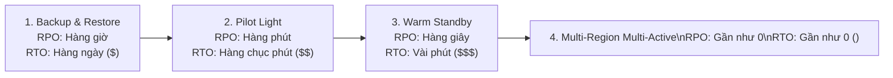

# 📚 Cẩm Nang Từ Vựng & Từ Khóa Giải Mã Đề Thi (Practices Test Exam Vocabulary Index)

> **Mục tiêu**: Bảng tra cứu từ vựng, khái niệm kỹ thuật và từ khóa quyết định (Keyword Clues) được trích xuất trực tiếp từ **1,129+ câu hỏi thực chiến** trong thư mục `Practices_Test`:
> - **Cloud Mentor (PT1 – PT6)**: 390 câu hỏi tình huống chuyên sâu.
> - **Tutorials Dojo (Set 1 – Set 6 & Bonus Set 8)**: 414 câu hỏi với giải thích chi tiết đáp án đúng/sai.
> - **Udemy Stephane Maarek (PT1 – PT4 & PT6)**: 325 câu hỏi chuẩn hóa cấu trúc đề thi SAA-C03.
> 
> **Tài liệu tham khảo song song**: [Bộ từ điển tổng thể (EXAM_VOCABULARY.md)](../EXAM_VOCABULARY.md) | [Bản đồ tri thức (_KNOWLEDGE_MAP.md)](../AWS_Services/_KNOWLEDGE_MAP.md) | [21 Chuyên đề AWS Services](../AWS_Services/)

---

## 📌 Mục Lục Điều Hướng

1. [Bảng Phản Xạ 60 Giây: Từ Khóa Đề Bài $\rightarrow$ Giải Pháp Chuẩn AWS](#1-bảng-phản-xạ-60-giây-từ-khóa-đề-bài--giải-pháp-chuẩn-aws)
2. [Domain 1: Thiết Kế Kiến Trúc Kiên Cường (Resilient Architectures - 26%)](#2-domain-1-thiết-kế-kiến-trúc-kiên-cường-resilient-architectures---26)
3. [Domain 2: Thiết Kế Kiến Trúc Hiệu Năng Cao (High-Performing Architectures - 30%)](#3-domain-2-thiết-kế-kiến-trúc-hiệu-năng-cao-high-performing-architectures---30)
4. [Domain 3: Thiết Kế Kiến Trúc Bảo Mật (Secure Architectures - 30%)](#4-domain-3-thiết-kế-kiến-trúc-bảo-mật-secure-architectures---30)
5. [Domain 4: Thiết Kế Kiến Trúc Tối Ưu Chi Phí (Cost-Optimized Architectures - 14%)](#5-domain-4-thiết-kế-kiến-trúc-tối-ưu-chi-phí-cost-optimized-architectures---14)
6. [Top 15 Cặp Khái Niệm Rất Dễ Nhầm Lẫn Trong Đề Thi](#6-top-15-cặp-khái-niệm-rất-dễ-nhầm-lẫn-trong-đề-thi)

---

## 1. Bảng Phản Xạ 60 Giây: Từ Khóa Đề Bài $\rightarrow$ Giải Pháp Chuẩn AWS

Khi gặp các cụm từ kích hoạt (Trigger Keywords) này trong đề thi, hãy đối chiếu ngay với đáp án mục tiêu:

| Từ khóa trong đề thi (Trigger Keywords) | Dịch vụ / Giải pháp chuẩn AWS (Target Solution) | Nguồn câu hỏi thực chứng | Bẫy thi cần tránh (Distractor Traps) |
| :--- | :--- | :--- | :--- |
| **"Overlapping CIDRs between VPCs"** | **AWS PrivateLink** (Interface VPC Endpoint) | `CM-PT1 Q02`, `TD-Set5 Q03` | ❌ Không chọn VPC Peering hay Transit Gateway (không hỗ trợ IP trùng). |
| **"Access EC2 without opening SSH port 22"** | **AWS Systems Manager Session Manager** | `CM-PT1 Q19`, `TD-Set6 Q54` | ❌ Không chọn Bastion Host trong Public Subnet mở port 22. |
| **"Without changing application code" (NFS/POSIX)** | **Amazon EFS** (Elastic File System) | `CM-PT2 Q01`, `TD-Set1 Q07` | ❌ Không chọn S3 API (`PutObject`) hoặc DynamoDB (phải viết lại code). |
| **"Without changing application code" (SMB/AD)** | **Amazon FSx for Windows File Server** | `TD-Set1 Q10`, `TD-Set1 Q55` | ❌ Không chọn EFS (EFS dùng giao thức NFS Linux, không hỗ trợ SMB/NTFS ACLs). |
| **"Microsecond latency for DynamoDB reads without code change"** | **Amazon DynamoDB Accelerator (DAX)** | `U-PT1 Q06`, `TD-Set2 Q48` | ❌ Không chọn ElastiCache Redis (bắt buộc phải sửa code ứng dụng). |
| **"Multi-region active-active local reads and writes"** | **DynamoDB Global Tables** (Last-writer-wins) | `CM-PT2 Q43`, `U-PT4 Q38` | ❌ Không chọn Aurora Global Database (Aurora chỉ có 1 Writer Region). |
| **"Recover DynamoDB table to a specific second"** | **DynamoDB Point-in-Time Recovery (PITR)** | `TD-Set1 Q25` | ❌ Không chọn On-Demand Backup (chỉ khôi phục về thời điểm chụp snapshot). |
| **"Protect backups from ransomware even against root"** | **AWS Backup Vault Lock ở Compliance Mode** | `CM-PT1 Q22`, `TD-Set6 Q14` | ❌ Không chọn Governance Mode (admin có quyền IAM vẫn có thể gỡ Lock). |
| **"Migrate 50–100 TB with slow internet (10–20 Mbps)"** | **AWS Snowball Edge Storage Optimized (80 TB)** | `TD-Set1 Q41`, `U-PT2 Q35` | ❌ Không chọn DataSync hay VPN (50 TB qua 10 Mbps mất hơn 460 ngày). |
| **"Heterogeneous DB migration (Oracle to Aurora)"** | **AWS SCT** (Schema) + **AWS DMS** (Data) | `CM-PT4 Q15`, `TD-Set2 Q51` | ❌ Không chọn DMS đơn thuần (DMS không convert được stored procedures/PL-SQL). |
| **"Detect compromised credentials & brute force"** | **Amazon GuardDuty** (Machine Learning logs) | `TD-Set1 Q62`, `U-PT3 Q12` | ❌ Không chọn Inspector (Inspector chỉ quét lỗ hổng tĩnh CVE). |
| **"Scan CVE vulnerabilities in EC2, Lambda, ECR"** | **Amazon Inspector** | `TD-Set2 Q31`, `CM-PT3 Q28` | ❌ Không chọn GuardDuty hay Macie (Macie chỉ quét PII trong S3). |
| **"Centralized security posture & CIS benchmark"** | **AWS Security Hub** | `TD-Set1 Q43`, `U-PT2 Q54` | ❌ Không chọn AWS Config đơn thuần (Config không tự tính điểm CIS). |
| **"HPC MPI simulations with lowest inter-node latency"** | **Elastic Fabric Adapter (EFA)** + **Cluster Placement**| `TD-Set4 Q50`, `U-PT3 Q48` | ❌ Không chọn ENA thông thường (ENA không hỗ trợ OS-bypass cho MPI). |
| **"Decommission on-premises tape libraries"** | **AWS Storage Gateway - Tape Gateway (VTL)** | `CM-PT4 Q40`, `TD-Set5 Q11` | ❌ Không chọn S3 File Gateway (không tương thích phần mềm backup iSCSI-VTL). |
| **"SFTP upload to S3 for external partners"** | **AWS Transfer Family** | `TD-Set3 Q40`, `U-PT1 Q28` | ❌ Không chọn DataSync (DataSync không cung cấp SFTP server endpoint). |
| **"Poison pill error handling in Kinesis / Streams"** | Bật **`BisectBatchOnFunctionError = true`** | `TD-Set2 Q35`, `U-PT3 Q42` | ❌ Không tăng bừa batch size hay timeout (làm shard bị tắc nghẽn). |
| **"Stateful 2-way real-time push to clients"** | **API Gateway WebSocket APIs** | `TD-Set4 Q22`, `U-PT1 Q39` | ❌ Không chọn REST API (REST là mô hình request-response một chiều). |
| **"Bypass DNS caching & static Anycast IPs"** | **AWS Global Accelerator** | `TD-Set1 Q48`, `U-PT3 Q15` | ❌ Không chọn Route 53 TTL = 0 (client/ISP vẫn cache bản ghi DNS). |
| **"Zero downtime storage growth for RDS"** | **Amazon RDS Storage Auto Scaling** | `TD-Set2 Q08`, `U-PT1 Q14` | ❌ Không chọn tăng thủ công đĩa từ snapshot (mất downtime chuyển đổi). |
| **"Visual no-code data prep for business analysts"** | **AWS Glue DataBrew** (Recipes & Datasets) | `TD-Set5 Q14`, `U-PT4 Q22` | ❌ Không chọn Glue ETL Jobs (đòi hỏi viết mã Python/PySpark). |
| **"Centralized immutable cryptographically verifiable ledger"** | **Amazon QLDB** (SHA-256 Merkle Tree) | `TD-Set3 Q55`, `U-PT2 Q51` | ❌ Không chọn Managed Blockchain (QLDB là tập trung, không phải Blockchain). |
| **"NoSQL Cassandra migration with CQL compatibility"** | **Amazon Keyspaces (for Apache Cassandra)** | `TD-Set4 Q61`, `U-PT3 Q58` | ❌ Không chọn DynamoDB (DynamoDB không hỗ trợ ngôn ngữ truy vấn CQL). |

---

## 2. Domain 1: Thiết Kế Kiến Trúc Kiên Cường (Resilient Architectures - 26%)

### 2.1. Từ Vựng & Thuật Ngữ Trọng Tâm
* **Multi-AZ Architecture**: Mô hình phân bổ tài nguyên trên tối thiểu 2 (tốt nhất là 3) Availability Zones độc lập về điện, mạng và lũ lụt. Thành phần gồm: Application Load Balancer (Public Subnets) $\rightarrow$ Auto Scaling Group (Private Subnets) $\rightarrow$ Multi-AZ RDS / Aurora DB Cluster.
* **Auto Scaling Lifecycle Hooks**:
  - `Pending:Wait`: Tạm dừng khởi động instance để cài đặt phần mềm, nạp cấu hình, chạy script kiểm tra trước khi nhận traffic từ ELB.
  - `Terminating:Wait`: Tạm dừng quá trình tắt instance lỗi để **thu thập nhật ký ứng dụng (logs)** đẩy về CloudWatch Logs hoặc S3 trước khi đĩa bị hủy.
* **Decoupling (Tách Rời Kiến Trúc)**:
  - **Amazon SQS Standard**: Thông lượng gần như vô hạn, bảo đảm phân phối ít nhất một lần (**At-least-once**), thứ tự ngẫu nhiên (**Best-effort ordering**).
  - **Amazon SQS FIFO**: Đảm bảo thứ tự nghiêm ngặt (**First-In-First-Out**), xử lý đúng một lần (**Exactly-once processing**) qua `MessageGroupId` và `MessageDeduplicationId`, tối đa 3,000 msg/s với batching (300 msg/s không batching).
  - **Visibility Timeout**: Khoảng thời gian một tin nhắn sau khi được consumer nhận sẽ "vô hình" với các consumer khác (mặc định 30 giây, tối đa 12 giờ). Nếu consumer xử lý lâu hơn, phải gọi `ChangeMessageVisibility` để tránh tin nhắn bị consumer khác nhận trùng.
  - **Dead-Letter Queue (DLQ)**: Hàng đợi chứa các tin nhắn xử lý thất bại nhiều lần (vượt quá `maxReceiveCount`), giúp cô lập **Poison Pill** không làm treo toàn bộ worker fleet.
* **Amazon Aurora High Availability**:
  - **Shared Storage Fleet**: Lưu trữ 6 bản sao trên 3 Availability Zones (mỗi AZ 2 bản sao), tự động chịu lỗi mất 2 bản sao mà không ảnh hưởng ghi, mất 3 bản sao mà không ảnh hưởng đọc.
  - **Aurora Replicas**: Tối đa 15 bản sao chỉ đọc (Read Replicas), dùng chung tầng lưu trữ nên replication lag $< 100$ ms, tự động thăng cấp thành Primary trong $< 30$ giây khi Primary gặp sự cố.
  - **Aurora Global Database**: Nhân bản dữ liệu đa vùng ở tầng lưu trữ chuyên dụng (Storage-level replication) với độ trễ $< 1$ giây, hỗ trợ failover xuyên vùng trong $< 1$ phút với zero data loss.

### 2.2. Chiến Lược Disaster Recovery (DR) So Sánh 4 Cấp Độ

| Tiêu chí so sánh | 1. Backup & Restore | 2. Pilot Light | 3. Warm Standby | 4. Multi-Region Multi-Active |
| :--- | :--- | :--- | :--- | :--- |
| **Trạng thái Database ở Region phụ** | Không có DB chạy (chỉ có snapshot/backup trên S3) | **DB luôn CHẠY và đồng bộ liên tục** (Read Replica / Global DB) | **DB luôn CHẠY và đồng bộ liên tục** | **DB luôn CHẠY và nhận GHI/ĐỌC đồng thời** (Global Tables) |
| **Trạng thái Compute (EC2) ở Region phụ** | Hoàn toàn KHÔNG có | **TẮT HOÀN TOÀN (0 instance)**, chỉ có AMI / CloudFormation | **CHẠY 24/7 với quy mô thu nhỏ** (scaled-down minimum fleet) | **CHẠY 24/7 với 100% công suất** ở tất cả các Region |
| **Chi phí vận hành** | Rẻ nhất ($) | Thấp ($$) | Trung bình ($$$) | Đắt nhất ($$$$) |
| **RPO (Mất mát dữ liệu)** | Hàng giờ | Vài phút | Vài giây | Gần bằng 0 |
| **RTO (Thời gian phục hồi)** | 24 giờ+ | Hàng chục phút | Vài phút | Tức thì (vài giây) |

---

## 3. Domain 2: Thiết Kế Kiến Trúc Hiệu Năng Cao (High-Performing Architectures - 30%)

### 3.1. Từ Vựng & Thuật Ngữ Trọng Tâm
* **EC2 Placement Groups**:
  - **Cluster Placement Group**: Gom cụm các máy ảo vào cùng 1 rack mạng trong 1 AZ duy nhất $\rightarrow$ Đạt băng thông 100 Gbps, độ trễ cực thấp cho HPC và tính toán song song.
  - **Spread Placement Group**: Đặt mỗi máy ảo trên một tủ rack phần cứng riêng biệt (tối đa 7 instances mỗi AZ) $\rightarrow$ Tối ưu khả năng chịu lỗi cho các ứng dụng quan trọng sống còn.
  - **Partition Placement Group**: Chia AZ thành nhiều partition (mỗi partition chứa nhiều rack), các partition không dùng chung rack $\rightarrow$ Phù hợp cho cụm phân tán lớn như HDFS, Cassandra, Kafka.
* **Mạng Hiệu Năng Cao (High-Performance Networking)**:
  - **ENA (Elastic Network Adapter)**: Hỗ trợ băng thông lên tới 100 Gbps cho lưu lượng TCP/IP thông thường.
  - **EFA (Elastic Fabric Adapter)**: Bổ sung tính năng **OS-bypass** cho ENA, cho phép ứng dụng bypass nhân Linux để giao tiếp trực tiếp với card mạng, bắt buộc cho các thư viện tính toán song song **MPI** và **NCCL**.
* **Lưu Trữ Tốc Độ Cao**:
  - **EC2 Instance Store**: Ổ đĩa NVMe SSD gắn vật lý trực tiếp vào máy chủ host $\rightarrow$ Hàng triệu IOPS, độ trễ microsecond, miễn phí đi kèm instance, nhưng là bộ nhớ tạm thời (**Ephemeral Storage** - mất dữ liệu khi stop/terminate).
  - **EBS gp3**: 3,000 IOPS và 125 MB/s cơ sở miễn phí, cho phép nâng cấp IOPS (lên 16,000) và Throughput (lên 1,000 MB/s) độc lập với dung lượng đĩa.
  - **EBS io2 Block Express**: Lên tới 256,000 IOPS, 4,000 MB/s throughput, độ bền 99.999%, hỗ trợ Multi-Attach (gắn vào tối đa 16 EC2 trong cùng 1 AZ).
  - **Amazon FSx for Lustre**: Hệ thống tệp POSIX song song cực nhanh, tích hợp trực tiếp với S3 bucket (đọc/ghi thẳng vào S3), phục vụ xử lý dữ liệu lớn, render đồ họa 3D và Machine Learning.

---

## 4. Domain 3: Thiết Kế Kiến Trúc Bảo Mật (Secure Architectures - 30%)

### 4.1. Từ Vựng & Thuật Ngữ Trọng Tâm
* **Bảo Vệ Dữ Liệu Bất Biến (Immutability & WORM)**:
  - **S3 Object Lock**:
    - **Compliance Mode**: Không một ai (kể cả tài khoản Root) có thể xóa hoặc sửa object hay giảm thời gian lưu trữ trước khi hết hạn.
    - **Governance Mode**: Bảo vệ object khỏi bị xóa bởi đa số người dùng, nhưng cho phép tài khoản có quyền `s3:BypassGovernanceRetention` hoặc Root gỡ bỏ/sửa đổi.
    - **Legal Hold**: Khóa vô thời hạn, không có ngày hết hạn; duy trì hiệu lực cho đến khi được gỡ bỏ rõ ràng bằng cờ `OFF`.
  - **AWS Backup Vault Lock**: Khóa WORM cho toàn bộ bản sao lưu trong Vault. Sau thời gian làm nguội (**Cooling-off Period từ 1–72 giờ**), Vault Lock ở Compliance Mode trở thành bất biến vĩnh viễn, không thể hủy bỏ kể cả bởi tài khoản AWS Root.
* **Kiểm Soát Danh Tính & Phân Quyền (IAM & Organizations)**:
  - **Service Control Policies (SCPs)**: Rào chắn an ninh (Guardrails) áp dụng ở cấp Root/OU của AWS Organizations. Lệnh `Deny` trong SCP có quyền lực tối thượng, phủ quyết mọi quyền của Admin/Root tài khoản con. **Ngoại lệ quan trọng**: SCPs **KHÔNG áp dụng** cho Service-Linked Roles, Management Account, và các tác vụ billing/subscription.
  - **IAM Database Authentication**: Sử dụng token ngắn hạn 15 phút do AWS STS sinh ra để đăng nhập vào MySQL/PostgreSQL RDS thay cho mật khẩu tĩnh, bắt buộc kết nối mã hóa SSL/TLS.
  - **IAM Permission Boundaries**: Đặt giới hạn quyền hạn tối đa mà một IAM entity (User hoặc Role) có thể nhận được, ngăn chặn việc Developer tự cấp quyền Administrator cho chính mình.
* **Mạng Riêng Tư & Điểm Cuối (VPC Endpoints & Perimeter)**:
  - **Gateway VPC Endpoint**: Miễn phí $0, cấu hình vào Route Table, chỉ hỗ trợ **Amazon S3** và **Amazon DynamoDB**.
  - **Interface VPC Endpoint (AWS PrivateLink)**: Dùng ENI có IP riêng trong subnet, tính phí theo giờ và phí dữ liệu, hỗ trợ hầu hết các dịch vụ AWS và dịch vụ của đối tác bên thứ 3.
  - **AWS WAF**: Tường lửa Layer 7 (HTTP/HTTPS) bảo vệ chống SQLi, XSS, rate-limiting, IP set allow/block, triển khai trên CloudFront, ALB, API Gateway, AppSync, Cognito.
  - **AWS Shield**: Shield Standard (miễn phí L3/L4 DDoS cho toàn bộ khách hàng); Shield Advanced (DDoS Response Team 24/7, bảo vệ chi phí, giám sát nâng cao).
  - **AWS Network Firewall**: Tường lửa mạng Stateful L3–L7 cho toàn bộ VPC, hỗ trợ lọc tên miền FQDN và quy tắc Suricata IPS.

---

## 5. Domain 4: Thiết Kế Kiến Trúc Tối Ưu Chi Phí (Cost-Optimized Architectures - 14%)

### 5.1. Bảng Quyết Định Tối Ưu Chi Phí Lưu Trữ S3

| Tầng lưu trữ S3 | Thời gian lưu tối thiểu | Phí truy xuất dữ liệu | Tần suất truy cập phù hợp | Kịch bản đề thi điển hình |
| :--- | :---: | :---: | :--- | :--- |
| **S3 Standard** | **0 ngày** (Không phạt) | **$0** (Không mất phí) | Truy cập thường xuyên, dữ liệu mới tạo | File tạm thời xóa sau $< 30$ ngày; file phân tích hàng ngày. |
| **S3 Intelligent-Tiering** | 0 ngày | $0 | **Mô hình truy cập không thể dự đoán** | Dữ liệu không rõ tần suất truy cập, tự động chuyển tầng không phí retrieval. |
| **S3 Standard-IA** | **30 ngày** | Có phí / GB | Ít truy cập (1–2 lần/tháng), cần truy xuất ngay trong mili-giây | File sao lưu hàng tháng, tài liệu cũ cần xem ngay khi có yêu cầu. |
| **S3 One Zone-IA** | **30 ngày** | Có phí / GB | Ít truy cập, **chấp nhận mất dữ liệu khi 1 AZ hỏng** | Dữ liệu thứ cấp có thể tạo lại được dễ dàng, bản sao lưu phụ. |
| **S3 Glacier Instant Retrieval** | **90 ngày** | Có phí / GB | Truy cập 1 quý / 1 lần, cần độ trễ mili-giây | Hồ sơ bệnh án y tế, ảnh lưu trữ cần hiển thị ngay cho bác sĩ. |
| **S3 Glacier Flexible Retrieval** | **90 ngày** | Có phí / GB | Lưu trữ lưu trữ định kỳ, chấp nhận chờ từ vài phút đến 3–5 giờ | Bản sao lưu backup hàng quý, dữ liệu tuân thủ pháp lý ít khi mở. |
| **S3 Glacier Deep Archive** | **180 ngày** | Có phí / GB | Lưu trữ lạnh lâu năm (7–10 năm), chấp nhận chờ 12–48 giờ | Dữ liệu lưu trữ bắt buộc theo luật (HIPAA, SEC), chi phí rẻ nhất ($0.00099/GB). |

> [!WARNING]
> **Bẫy thi chi phí S3 cực kỳ phổ biến**: Nếu đề bài nêu dữ liệu tạm thời bị xóa sau **10 đến 15 ngày**, phương án chọn **S3 Standard-IA là SAI** vì Standard-IA sẽ phạt tính tiền đủ 30 ngày lưu trữ cộng thêm phí xóa sớm! Phương án ĐÚNG là giữ nguyên tại **S3 Standard**.

---

## 6. Top 15 Cặp Khái Niệm Rất Dễ Nhầm Lẫn Trong Đề Thi

| # | Khái Niệm A | Khái Niệm B | Điểm Khác Biệt Cốt Lõi Để Chọn Đúng Trong Đề Thi |
|:---:| :--- | :--- | :--- |
| **1** | **AWS Global Accelerator** | **Amazon CloudFront** | • **Global Accelerator**: 2 Anycast IPs tĩnh, hỗ trợ cả **TCP và UDP** (gaming, VoIP, IoT), bypass DNS cache. • **CloudFront**: Chỉ hỗ trợ **HTTP/HTTPS/WebSocket**, chuyên **caching nội dung tĩnh/động** tại Edge Locations. |
| **2** | **Amazon GuardDuty** | **Amazon Inspector** | • **GuardDuty**: Phát hiện tấn công **runtime** (brute-force, compromised keys, mining) qua phân tích logs (CloudTrail, VPC Flow, DNS). • **Inspector**: Quét lỗ hổng phần mềm tĩnh (**CVE**) và cấu hình mạng hở trên EC2/Lambda/ECR. |
| **3** | **AWS DataSync** | **AWS Transfer Family** | • **DataSync**: Đồng bộ dữ liệu định kỳ tốc độ cao giữa các storage pools (NFS/SMB $\leftrightarrow$ S3/EFS/FSx). • **Transfer Family**: Cung cấp **SFTP/FTPS/FTP/AS2 endpoint** cho client bên ngoài kết nối tải file vào S3/EFS. |
| **4** | **AWS DataSync** | **AWS Storage Gateway** | • **DataSync**: Di chuyển và đồng bộ dữ liệu theo lô hoặc định kỳ. • **Storage Gateway**: Cung cấp **cầu nối lưu trữ liên tục với local cache** (SMB/NFS file share hoặc iSCSI block) cho ứng dụng on-premises. |
| **5** | **Volume Gateway (Cached)** | **Volume Gateway (Stored)** | • **Cached Volumes**: Dữ liệu chính nằm trên **S3** (tới 32 TB), chỉ cache phần thường dùng tại chỗ. • **Stored Volumes**: Dữ liệu chính nằm toàn bộ **tại chỗ on-premise** (1–16 TB), snapshot bất đồng bộ lên S3. |
| **6** | **Pilot Light** | **Warm Standby** | • **Pilot Light**: DB chạy liên tục; máy chủ EC2 **hoàn toàn TẮT (0 instance)**, chỉ có AMI/IaC. • **Warm Standby**: Một cụm máy chủ thu nhỏ (**scaled-down fleet**) luôn **CHẠY 24/7**, sẵn sàng scale up ngay. |
| **7** | **AWS KMS Customer Managed Key** | **AWS KMS AWS Managed Key** | • **Customer Managed Key (CMK)**: Tốn $1/tháng, người dùng toàn quyền kiểm soát Key Policy, cho phép xoay vòng hàng năm hoặc theo yêu cầu. • **AWS Managed Key**: Miễn phí duy trì hàng tháng (`aws/s3`, `aws/rds`), tự động xoay vòng mỗi 1 năm, không thể sửa Key Policy. |
| **8** | **AWS Secrets Manager** | **SSM Parameter Store** | • **Secrets Manager**: Tốn $0.40/secret/tháng, tự động xoay vòng mật khẩu (Rotation qua Lambda), tích hợp RDS. • **Parameter Store**: **Standard Tier miễn phí $0**, dùng lưu cấu hình tĩnh/biến môi trường không cần tự động xoay vòng. |
| **9** | **Route 53 Geolocation** | **Route 53 Geoproximity** | • **Geolocation**: Định tuyến dựa trên **vị trí địa lý của người dùng** (theo lục địa hoặc quốc gia). • **Geoproximity**: Định tuyến dựa trên vị trí của **cả người dùng VÀ tài nguyên**, có tham số **Routing Bias (-99 đến +99)** để mở rộng/thu hẹp vùng phục vụ. |
| **10**| **Route 53 Alias Record** | **Route 53 CNAME Record** | • **Alias Record**: Tính năng độc quyền Route 53, trỏ thẳng vào tài nguyên AWS (ALB, CloudFront, S3 Website), **dùng được cho Root Domain (Zone Apex `example.com`)**, miễn phí truy vấn. • **CNAME Record**: Chuẩn DNS quốc tế, chỉ trỏ domain sang hostname khác, **KHÔNG dùng được cho Zone Apex**. |
| **11**| **SQS Standard** | **SQS FIFO** | • **Standard**: Throughput không giới hạn, At-least-once (có thể trùng), thứ tự ngẫu nhiên. • **FIFO**: Tối đa 300–3,000 msg/s, Exactly-once (chống trùng lặp), thứ tự First-In-First-Out nghiêm ngặt. |
| **12**| **Amazon Kinesis Data Streams** | **Amazon Kinesis Data Firehose** | • **Data Streams**: Tự quản lý Shard (hoặc On-Demand), lưu trữ từ 24h đến 365 ngày, cần tự viết consumer code (KCL/Lambda). • **Data Firehose**: Serverless hoàn toàn, tự động nạp thẳng vào S3, Redshift, OpenSearch, Splunk; không lưu trữ dữ liệu. |
| **13**| **DynamoDB Global Tables** | **Amazon Aurora Global Database** | • **DynamoDB Global Tables**: **Active-Active** (mọi Region đều nhận Write và Read, giải quyết xung đột bằng Last-writer-wins). • **Aurora Global Database**: **Active-Passive** (1 Primary Writer Region duy nhất, các Region khác chỉ nhận Read). |
| **14**| **CloudFront Price Classes** | **CloudFront Geo-Restrictions** | • **Price Classes**: Cắt giảm chi phí bằng cách không kích hoạt Edge Locations ở các vùng đắt đỏ (PriceClass_100/200/All). • **Geo-Restrictions**: Chặn hoặc cho phép người dùng truy cập dựa trên quốc gia của họ (WhiteList / Blacklist). |
| **15**| **Gateway VPC Endpoint** | **Interface VPC Endpoint** | • **Gateway Endpoint**: Miễn phí $0, cấu hình vào Route Table, chỉ dùng cho **S3** và **DynamoDB**. • **Interface Endpoint**: Tính phí theo giờ + dung lượng data, dùng ENI có IP riêng, dùng cho tất cả dịch vụ AWS khác qua PrivateLink. |

