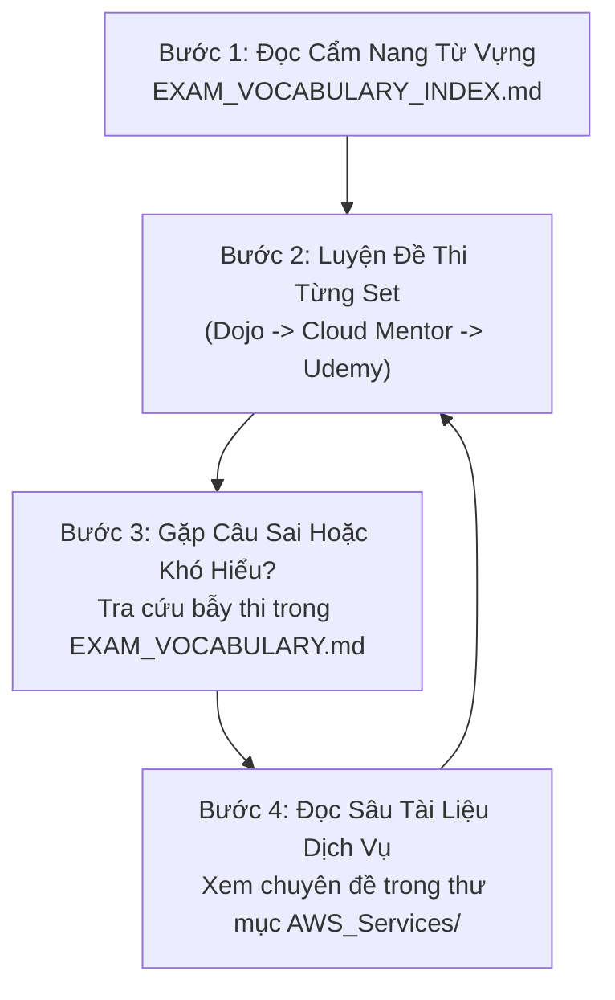

# 🎯 Tổng Kho Đề Thi Thực Hành AWS Certified Solutions Architect (Practices Test Hub)

> **Tổng quan**: Thư mục lưu trữ toàn bộ hệ thống **1,129+ câu hỏi thực chiến** phục vụ luyện thi chứng chỉ **AWS Certified Solutions Architect Associate (SAA-C03)** và **Professional (SAP-C02)**.  
> Toàn bộ câu hỏi đã được chuẩn hóa cấu trúc, dịch thuật và phân tích bẫy thi bằng tiếng Việt chuyên ngành, giữ nguyên thuật ngữ kỹ thuật AWS chuẩn quốc tế.

---

## 📚 Danh Mục Bộ Đề Thi & Tài Liệu Tra Cứu

### 1. 📖 Cẩm Nang Từ Vựng & Bản Đồ Tra Cứu Trọng Tâm
* **[EXAM_VOCABULARY_INDEX.md](./EXAM_VOCABULARY_INDEX.md)**: **Bản đồ từ vựng & bảng phản xạ 60 giây** trích xuất từ 1,129+ câu hỏi, phân loại theo 4 Domain đề thi AWS và Top 15 cặp khái niệm dễ nhầm lẫn nhất.
* **[EXAM_VOCABULARY.md](../EXAM_VOCABULARY.md)**: Bộ từ điển thuật ngữ toàn diện 36 Bẫy thi kinh điển, động từ hành động, danh từ ngữ cảnh và ma trận ánh xạ từ khóa.
* **[_KNOWLEDGE_MAP.md](../AWS_Services/_KNOWLEDGE_MAP.md)**: Bản đồ ánh xạ toàn diện từ kịch bản đề thi sang 21 file chuyên sâu AWS Services.

---

### 2. 📝 Chi Tiết 3 Nguồn Đề Thi Thực Hành Lớn

| Thư mục nguồn | Số đề thi | Tổng số câu | Đặc điểm nổi bật | Liên kết truy cập |
| :--- | :---: | :---: | :--- | :--- |
| **Tutorials Dojo (Jon Bonso)** | 7 Sets (Set 1–6 & Set 8) | **414 câu** | Phân tích sâu từng phương án đúng/sai, sơ đồ kiến trúc chuẩn AWS, cheat sheets liên quan | [📂 Xem thư mục Dojo](./Dojo/) |
| **Cloud Mentor** | 6 Sets (PT1–PT6) | **390 câu** | Các kịch bản tình huống doanh nghiệp phức tạp, kiến trúc hybrid, security & governance | [📂 Xem thư mục Cloud_Mentor](./Cloud_Mentor/) |
| **Udemy (Stephane Maarek)** | 5 Sets (PT1–PT4 & PT6) | **325 câu** | Bám sát cấu trúc ra đề chính thức của AWS, cập nhật các dịch vụ và tính năng mới nhất | [📂 Xem thư mục Udemy](./Udemy/) |
| **Tổng cộng** | **18 đề thi** | **1,129+ câu** | **Độ phủ 100% kiến thức SAA-C03 / SAP-C02** | |

---

## 🧭 Hướng Dẫn Quy Trình Ôn Luyện Hiệu Quả

1. **Trước khi giải đề**: Đọc lướt [Bảng Phản Xạ 60 Giây](./EXAM_VOCABULARY_INDEX.md#1-bảng-phản-xạ-60-giây-từ-khóa-đề-bài--giải-pháp-chuẩn-aws) để ghi nhớ các từ khóa nhận diện nhanh đáp án đúng.
2. **Trong khi giải đề**: Áp dụng **Kỹ thuật loại trừ 4 bước** (Đọc câu hỏi cuối $\rightarrow$ Tìm từ khóa ràng buộc $\rightarrow$ Loại ngay 2 phương án sai hiển nhiên $\rightarrow$ So sánh 2 phương án vào chung kết dựa trên tiêu chí chi phí/vận hành).
3. **Sau khi giải đề**: Đối chiếu các câu làm sai với các chuyên đề tương ứng trong thư mục [`AWS_Services`](../AWS_Services/) để lấp đầy lỗ hổng kiến thức.

