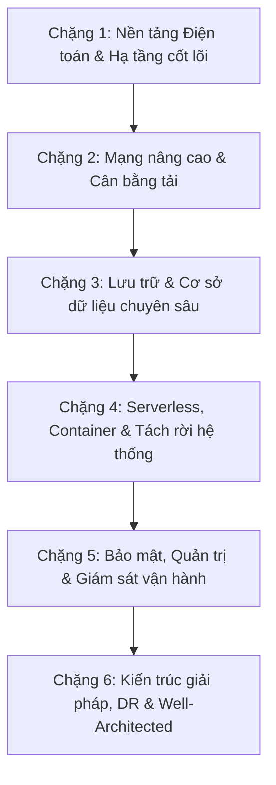

# AWS Certified Solutions Architect Associate (SAA-C03) & Cloud DevOps Knowledge Base

> **Cơ sở tri thức kỹ thuật dài hạn và toàn diện về Điện toán đám mây AWS, Kiến trúc giải pháp (Cloud Solutions Architecture) và Thực hành Cloud DevOps.**
> Tổng hợp, chuẩn hóa và nâng cao từ 389 bài giảng Udemy của giảng viên Stéphane Maarek kết hợp các tài liệu kỹ thuật chính thức từ AWS (AWS Whitepapers, AWS Well-Architected Framework, AWS Documentation).

---

## 📌 1. Giới thiệu tổng quan (Executive Overview)

Kho lưu trữ này được xây dựng với mục tiêu chuyển hóa toàn bộ nguồn dữ liệu thô từ 389 video transcript của khóa học **AWS Certified Solutions Architect Associate (SAA-C03)** thành một hệ thống tài liệu học tập, tra cứu và thiết kế kiến trúc chuẩn mực dành cho Kỹ sư Cloud / DevOps / Solutions Architect.

### Điểm nổi bật của hệ thống tài liệu:
* **Chuẩn hóa ngôn ngữ**: Toàn bộ tài liệu được biên soạn bằng **Tiếng Việt kỹ thuật chuyên sâu**, bảo toàn nguyên vẹn 100% thuật ngữ tiếng Anh tiêu chuẩn, tên dịch vụ AWS, câu lệnh AWS CLI, mã nguồn Infrastructure as Code (Terraform/CloudFormation) và các tham số cấu hình.
* **Cấu trúc 3 trụ cột vững chắc**:
  1. **Master AWS Service Guides (`AWS_Services/`)**: 15 chuyên đề nghiên cứu sâu (Deep-Dive) theo chuẩn kiến trúc cấp cao (đầy đủ sơ đồ kiến trúc Mermaid, ma trận tích hợp, bảo mật, độ tin cậy, giám sát, tối ưu chi phí, xử lý sự cố và bộ câu hỏi đánh giá 10+5+3+5 kèm đáp án chi tiết).
  2. **Structured Lesson Notes (`Lesson_Notes/`)**: 27 tài liệu ghi chú bài học có cấu trúc phân tích theo từng Section khóa học, bám sát các ví dụ thực tiễn, phân tích dòng dữ liệu và câu hỏi ôn tập.
  3. **Master Terminology Glossary (`GLOSSARY.md`)**: Từ điển thuật ngữ chuyên ngành toàn diện bao phủ 10 danh mục cốt lõi từ Điện toán đám mây, Mạng, Bảo mật, Cơ sở dữ liệu, DevOps đến Vận hành độ tin cậy (SRE).
* **Bảo toàn nguồn gốc**: 389 file transcript gốc trong thư mục `AWS_Resources/` được bảo tồn nguyên trạng, làm căn cứ đối soát và trích dẫn bài học.

---

## 🏛️ 2. Sơ đồ cấu trúc kho lưu trữ (Repository Architecture)

```
AWS_XBrain_Note/
├── README.md                      # [Trang chủ] Cổng điều hướng, mục lục tổng thể & lộ trình học tập
├── GLOSSARY.md                    # [Từ điển] Thuật ngữ kỹ thuật Cloud DevOps & AWS (Danh mục A - J)
├── AWS_Resources/                 # [Nguồn gốc] 389 file transcripts gốc từ 31 section Udemy (Read-Only)
├── AWS_Services/                  # [Chuyên đề Master] 15 tài liệu nghiên cứu chuyên sâu từng dịch vụ AWS
│   ├── AWS_Well_Architected_Framework.md
│   ├── CloudWatch_CloudTrail_Observability.md
│   ├── Disaster_Recovery_Migration.md
│   ├── EBS_EFS_Storage.md
│   ├── EC2_Elastic_Compute_Cloud.md
│   ├── ECS_Fargate_Containers.md
│   ├── ELB_and_ASG_High_Availability.md
│   ├── IAM_Identity_and_Access_Management.md
│   ├── KMS_Security_Encryption.md
│   ├── Lambda_Serverless_Architecture.md
│   ├── RDS_Aurora_Databases.md
│   ├── Route53_DNS.md
│   ├── S3_and_CloudFront_Storage.md
│   ├── SQS_SNS_EventBridge_Decoupling.md
│   └── VPC_Networking.md
└── Lesson_Notes/                  # [Ghi chú bài học] 27 tài liệu tổng hợp theo Section khóa học
    ├── 03_Getting_Started_with_AWS.md
    ├── 04_IAM_and_AWS_CLI.md
    ├── 05_EC2_Fundamentals.md
    ├── 06_EC2_Solutions_Architect_Associate.md
    ├── 07_EC2_Instance_Storage.md
    ├── 08_High_Availability_and_Scalability.md
    ├── 09_RDS_Aurora_ElastiCache.md
    ├── 10_Route_53.md
    ├── 11_Classic_Solutions_Architecture.md
    ├── 12_13_14_Amazon_S3_Comprehensive.md
    ├── 15_CloudFront_Global_Accelerator.md
    ├── 16_AWS_Storage_Extras.md
    ├── 17_Decoupling_SQS_SNS_Kinesis.md
    ├── 18_Containers_ECS_Fargate_EKS.md
    ├── 19_20_Serverless_Lambda_APIGW_DynamoDB.md
    ├── 21_Databases_in_AWS.md
    ├── 22_Data_and_Analytics.md
    ├── 23_Machine_Learning.md
    ├── 24_AWS_Monitoring_CloudWatch_CloudTrail_Config.md
    ├── 25_Identity_and_Access_Management_Advanced.md
    ├── 26_AWS_Security_Encryption_KMS.md
    ├── 27_Networking_VPC_Comprehensive.md
    ├── 28_Disaster_Recovery_and_Migrations.md
    ├── 29_More_Solution_Architectures.md
    ├── 30_Other_Services_CloudFormation_SSM.md
    ├── 31_WhitePapers_and_Architectures.md
    └── 32_Preparing_for_the_Exam.md
```

---

## 🧭 3. Mục lục Master AWS Service Deep-Dive Guides (`AWS_Services/`)

Mỗi tài liệu trong thư mục này được xây dựng theo chuẩn cấu trúc gồm 14 phần: *Tổng quan, Khái niệm cốt lõi, Sơ đồ kiến trúc Mermaid, Ma trận tích hợp dịch vụ, Ví dụ cấu hình/CLI/IaC, Bảo mật, Độ tin cậy & Vận hành, Giám sát (Observability), Tối ưu chi phí, Bảng xử lý sự cố (Troubleshooting), Tình huống thực tế (Real-World Use Cases), So sánh giải pháp, Bộ câu hỏi kiểm tra (10 khái niệm + 5 sự cố + 3 kịch bản kiến trúc + 5 câu hỏi phỏng vấn) và Bảng tóm tắt Checklist.*

| Tên tài liệu | Lĩnh vực kiến trúc (Domain) | Trọng tâm công nghệ chính | Liên kết tài liệu |
|---|---|---|---|
| **AWS Well-Architected Framework** | Cloud Architecture & Governance | 6 Trụ cột kiến trúc, AWS WA Tool, Trusted Advisor | [AWS_Well_Architected_Framework.md](./AWS_Services/AWS_Well_Architected_Framework.md) |
| **IAM & Governance** | Identity, Security & Compliance | Users, Roles, Policies, Organizations, SCPs, Identity Center | [IAM_Identity_and_Access_Management.md](./AWS_Services/IAM_Identity_and_Access_Management.md) |
| **Amazon EC2** | Compute & Virtualization | Instance Types, Purchasing Options, Placement Groups, ENI | [EC2_Elastic_Compute_Cloud.md](./AWS_Services/EC2_Elastic_Compute_Cloud.md) |
| **EBS & EFS Storage** | Block & File Storage | gp3, io2 Block Express, Multi-Attach, Snapshots, EFS | [EBS_EFS_Storage.md](./AWS_Services/EBS_EFS_Storage.md) |
| **ELB & Auto Scaling** | High Availability & Scalability | ALB, NLB, GWLB, Target Groups, Scaling Policies | [ELB_and_ASG_High_Availability.md](./AWS_Services/ELB_and_ASG_High_Availability.md) |
| **RDS & Aurora Databases** | Relational Databases & Caching | Multi-AZ, Read Replicas, Aurora Quorum, RDS Proxy, ElastiCache | [RDS_Aurora_Databases.md](./AWS_Services/RDS_Aurora_Databases.md) |
| **Amazon Route 53** | DNS & Traffic Management | Hosted Zones, CNAME vs Alias, 8 Routing Policies, Hybrid Resolver | [Route53_DNS.md](./AWS_Services/Route53_DNS.md) |
| **S3 & CloudFront** | Object Storage & Edge Networking | Storage Classes, Lifecycle, Object Lock, OAC, CDN Edge Caching | [S3_and_CloudFront_Storage.md](./AWS_Services/S3_and_CloudFront_Storage.md) |
| **Decoupling & Messaging** | Asynchronous & Event-Driven | SQS Standard/FIFO, SNS Pub/Sub, EventBridge, Kinesis, MQ | [SQS_SNS_EventBridge_Decoupling.md](./AWS_Services/SQS_SNS_EventBridge_Decoupling.md) |
| **Containers (ECS & Fargate)** | Container Orchestration | Task Definitions, EC2 vs Fargate, Dynamic Port Mapping, ECR, EKS | [ECS_Fargate_Containers.md](./AWS_Services/ECS_Fargate_Containers.md) |
| **Serverless Architecture** | Serverless & Microservices | Lambda Concurrency/Cold Starts, API Gateway, DynamoDB, Cognito | [Lambda_Serverless_Architecture.md](./AWS_Services/Lambda_Serverless_Architecture.md) |
| **VPC Networking** | Networking & Hybrid Connectivity | CIDRs, Subnets, Route Tables, NAT GW, Peering, Endpoints, TGW | [VPC_Networking.md](./AWS_Services/VPC_Networking.md) |
| **Observability & Audit** | Monitoring, Logging & Governance | CloudWatch (Metrics, Logs, Alarms), CloudTrail, AWS Config Rules | [CloudWatch_CloudTrail_Observability.md](./AWS_Services/CloudWatch_CloudTrail_Observability.md) |
| **KMS & Cloud Security** | Data Protection & Threat Defense | KMS Envelope Encryption, Secrets Manager, CloudHSM, WAF, Shield | [KMS_Security_Encryption.md](./AWS_Services/KMS_Security_Encryption.md) |
| **Disaster Recovery & Migration** | Resiliency & Migration Strategy | RPO/RTO, 4 Chiến lược DR, AWS DRS, DMS, DataSync, Snow Family | [Disaster_Recovery_Migration.md](./AWS_Services/Disaster_Recovery_Migration.md) |

---

## 📚 4. Mục lục Ghi chú Bài học theo Section (`Lesson_Notes/`)

Mỗi tài liệu ghi chú tổng hợp các bài học theo cấu trúc chuẩn: *Tổng quan bài học, Kiến thức cốt lõi (Key Takeaways), Giải thích khái niệm chuyên sâu, Lệnh/Mã nguồn/Cấu hình, Ví dụ thực tế, Mối quan hệ giữa các khái niệm, Bộ câu hỏi tự đánh giá (kèm đáp án riêng biệt) và Nguồn trích dẫn bài giảng.*

| Mã Section | Tên Section Khóa học | Số bài giảng | Chủ đề kỹ thuật cốt lõi | Liên kết ghi chú |
|---|---|---|---|---|
| **03** | Getting Started with AWS | 9 | Cloud Computing, AWS Global Infrastructure, Tạo tài khoản & Billing Alarm | [03_Getting_Started_with_AWS.md](./Lesson_Notes/03_Getting_Started_with_AWS.md) |
| **04** | IAM & AWS CLI | 16 | IAM Users, Groups, Policies, Roles, MFA, AWS CLI & CloudShell | [04_IAM_and_AWS_CLI.md](./Lesson_Notes/04_IAM_and_AWS_CLI.md) |
| **05** | EC2 Fundamentals | 16 | EC2 Instances, SSH/PuTTY, Security Groups, Elastic IPs, User Data | [05_EC2_Fundamentals.md](./Lesson_Notes/05_EC2_Fundamentals.md) |
| **06** | EC2 Solutions Architect Associate | 14 | Purchasing Options (Spot, Reserved, Savings Plans), Placement Groups, ENI | [06_EC2_Solutions_Architect_Associate.md](./Lesson_Notes/06_EC2_Solutions_Architect_Associate.md) |
| **07** | EC2 Instance Storage | 13 | EBS Volume Types (gp3, io2), Snapshots, AMI, Instance Store, EFS | [07_EC2_Instance_Storage.md](./Lesson_Notes/07_EC2_Instance_Storage.md) |
| **08** | High Availability & Scalability | 18 | Scalability vs High Availability, ELB (ALB, NLB, GWLB), ASG Auto Scaling | [08_High_Availability_and_Scalability.md](./Lesson_Notes/08_High_Availability_and_Scalability.md) |
| **09** | RDS, Aurora & ElastiCache | 16 | RDS Read Replicas vs Multi-AZ, Aurora Architecture, ElastiCache Redis/Memcached | [09_RDS_Aurora_ElastiCache.md](./Lesson_Notes/09_RDS_Aurora_ElastiCache.md) |
| **10** | Route 53 | 16 | DNS Records, CNAME vs Alias, Routing Policies (Failover, Latency, Geolocation) | [10_Route_53.md](./Lesson_Notes/10_Route_53.md) |
| **11** | Classic Solutions Architecture | 6 | Thiết kế kiến trúc WordPress đa tầng, Stateful sang Stateless web tier | [11_Classic_Solutions_Architecture.md](./Lesson_Notes/11_Classic_Solutions_Architecture.md) |
| **12-14** | Amazon S3 Comprehensive | 28 | S3 Bucket, Storage Classes, Lifecycle Rules, Static Website, Security, KMS | [12_13_14_Amazon_S3_Comprehensive.md](./Lesson_Notes/12_13_14_Amazon_S3_Comprehensive.md) |
| **15** | CloudFront & Global Accelerator | 10 | CloudFront Caching, OAC, Signed URL, AWS Global Accelerator Anycast IP | [15_CloudFront_Global_Accelerator.md](./Lesson_Notes/15_CloudFront_Global_Accelerator.md) |
| **16** | AWS Storage Extras | 7 | Snow Family (Snowcone, Snowball, Snowmobile), FSx (Windows, Lustre), Storage Gateway | [16_AWS_Storage_Extras.md](./Lesson_Notes/16_AWS_Storage_Extras.md) |
| **17** | Decoupling (SQS, SNS, Kinesis) | 16 | SQS Standard/FIFO, Dead-Letter Queues, SNS Pub/Sub, Kinesis Data Streams | [17_Decoupling_SQS_SNS_Kinesis.md](./Lesson_Notes/17_Decoupling_SQS_SNS_Kinesis.md) |
| **18** | Containers (ECS, Fargate, EKS) | 12 | Docker Container, ECS Task Definition, EC2 vs Fargate Launch Type, ECR, EKS | [18_Containers_ECS_Fargate_EKS.md](./Lesson_Notes/18_Containers_ECS_Fargate_EKS.md) |
| **19-20** | Serverless Architecture | 26 | AWS Lambda, API Gateway REST vs HTTP, DynamoDB Partitioning, Cognito User Pools | [19_20_Serverless_Lambda_APIGW_DynamoDB.md](./Lesson_Notes/19_20_Serverless_Lambda_APIGW_DynamoDB.md) |
| **21** | Databases in AWS | 8 | Redshift Data Warehouse, Neptune Graph DB, OpenSearch, Timestream, QLDB | [21_Databases_in_AWS.md](./Lesson_Notes/21_Databases_in_AWS.md) |
| **22** | Data & Analytics | 10 | Athena Presto Queries, EMR Spark/Hadoop, QuickSight BI, AWS Glue ETL | [22_Data_and_Analytics.md](./Lesson_Notes/22_Data_and_Analytics.md) |
| **23** | Machine Learning | 10 | Rekognition, Transcribe, Polly, Translate, Lex, Comprehend, SageMaker | [23_Machine_Learning.md](./Lesson_Notes/23_Machine_Learning.md) |
| **24** | AWS Monitoring & Audit | 12 | CloudWatch Metrics/Logs/Alarms, CloudTrail Event History, AWS Config Compliance | [24_AWS_Monitoring_CloudWatch_CloudTrail_Config.md](./Lesson_Notes/24_AWS_Monitoring_CloudWatch_CloudTrail_Config.md) |
| **25** | Advanced IAM & Governance | 14 | IAM Permission Boundaries, STS AssumeRole, AWS Organizations, SCP, Control Tower | [25_Identity_and_Access_Management_Advanced.md](./Lesson_Notes/25_Identity_and_Access_Management_Advanced.md) |
| **26** | AWS Security & Encryption | 13 | KMS Customer Managed Keys, CloudHSM, Secrets Manager, AWS WAF & Shield | [26_AWS_Security_Encryption_KMS.md](./Lesson_Notes/26_AWS_Security_Encryption_KMS.md) |
| **27** | Networking - VPC | 28 | VPC CIDR, Subnets, IGW, Route Tables, NAT Gateway, NACL, Peering, Endpoints | [27_Networking_VPC_Comprehensive.md](./Lesson_Notes/27_Networking_VPC_Comprehensive.md) |
| **28** | Disaster Recovery & Migrations | 11 | RPO & RTO, 4 Chiến lược DR (Backup, Pilot Light, Warm Standby, Multi-Site), DMS | [28_Disaster_Recovery_and_Migrations.md](./Lesson_Notes/28_Disaster_Recovery_and_Migrations.md) |
| **29** | More Solution Architectures | 10 | Microservices Event-Driven, Caching Strategies, High Throughput Ingestion | [29_More_Solution_Architectures.md](./Lesson_Notes/29_More_Solution_Architectures.md) |
| **30** | Other Services | 8 | CloudFormation Templates/Drift, Systems Manager Parameter Store/Session Manager | [30_Other_Services_CloudFormation_SSM.md](./Lesson_Notes/30_Other_Services_CloudFormation_SSM.md) |
| **31** | WhitePapers & Architectures | 10 | AWS Well-Architected 6 Pillars, Disaster Recovery Whitepaper, Trusted Advisor | [31_WhitePapers_and_Architectures.md](./Lesson_Notes/31_WhitePapers_and_Architectures.md) |
| **32** | Preparing for the Exam & Exam Tricks | 5 | Chiến lược ôn thi SAA-C03, 7 nhóm Core Services, 5 Trick loại trừ thực chiến, Bảng Keyword Triggers | [32_Preparing_for_the_Exam.md](./Lesson_Notes/32_Preparing_for_the_Exam.md) |

---

## 📖 5. Master Technical Terminology Glossary (`GLOSSARY.md`)

Tài liệu [GLOSSARY.md](./GLOSSARY.md) cung cấp từ điển thuật ngữ kỹ thuật chuyên sâu theo chuẩn định dạng:
`| English Term | Full Form / Acronym | Vietnamese Definition | Practical Meaning in Cloud DevOps | Example or Related Terms |`

Gồm 10 danh mục kỹ thuật ưu tiên:
1. **Category A: Cloud Computing Fundamentals** (IaaS, PaaS, SaaS, Scalability, Elasticity, High Availability, Fault Tolerance, Latency, Throughput...)
2. **Category B: AWS Fundamentals & Infrastructure** (AWS Region, Availability Zone, Edge Location, ARN, IAM, Shared Responsibility Model...)
3. **Category C: Networking** (VPC, CIDR, Subnet, Route Table, IGW, NAT GW, Security Group, NACL, ALB, NLB, VPC Endpoint, Direct Connect...)
4. **Category D: Identity & Security** (IAM Role, AssumeRole, Trust Policy, Least Privilege, KMS Envelope Encryption, Secrets Manager, AWS WAF...)
5. **Category E: Compute, Containers & Orchestration** (EC2, AMI, ASG, Lambda, Docker, ECS, Fargate, EKS, Kubernetes, Dynamic Port Mapping...)
6. **Category F: Storage & Databases** (S3, EBS, EFS, RDS, Aurora, DynamoDB, ElastiCache, Redshift, Snapshot, IOPS, Multi-AZ vs Read Replica...)
7. **Category G: DevOps & Infrastructure as Code** (CI/CD, IaC, Terraform, Drift, Idempotency, CloudFormation, Blue/Green, Canary...)
8. **Category H: Monitoring, Logging & Observability** (CloudWatch, CloudTrail, Metric, Log Group, Alarm, Span, Distributed Tracing, X-Ray, SLI/SLO/SLA...)
9. **Category I: Event-Driven Architecture & Integration** (SQS, SNS, EventBridge, DLQ, Exponential Backoff, Kinesis Shard, API Gateway...)
10. **Category J: Reliability, Operations & Cost Optimization** (RPO, RTO, Pilot Light, Warm Standby, AWS DRS, Cost Allocation Tags, Compute Savings Plans...)

---

## 🗺️ 6. Lộ trình Học tập & Ôn thi theo Chuyên đề (Learning Roadmaps)

Để đạt hiệu quả cao nhất trong việc tiếp thu kiến thức và vượt qua kỳ thi SAA-C03 với điểm số xuất sắc, khuyến nghị theo học theo 6 chặng lộ trình dưới đây:



### Chặng 1: Nền tảng Điện toán & Hạ tầng cốt lõi (Core Compute & Infrastructure)
- **Mục tiêu**: Nắm vững mô hình tài nguyên ảo hóa, phương án tính toán và quản lý truy cập cơ bản.
- **Tài liệu học**:
  - Ghi chú: [03_Getting_Started_with_AWS.md](./Lesson_Notes/03_Getting_Started_with_AWS.md), [04_IAM_and_AWS_CLI.md](./Lesson_Notes/04_IAM_and_AWS_CLI.md), [05_EC2_Fundamentals.md](./Lesson_Notes/05_EC2_Fundamentals.md), [06_EC2_Solutions_Architect_Associate.md](./Lesson_Notes/06_EC2_Solutions_Architect_Associate.md).
  - Chuyên đề Master: [EC2_Elastic_Compute_Cloud.md](./AWS_Services/EC2_Elastic_Compute_Cloud.md), [IAM_Identity_and_Access_Management.md](./AWS_Services/IAM_Identity_and_Access_Management.md).

### Chặng 2: Mạng nâng cao & Tính sẵn sàng cao (Networking & High Availability)
- **Mục tiêu**: Thiết kế mạng VPC cô lập an toàn, định tuyến DNS toàn cầu và cân bằng tải đàn hồi.
- **Tài liệu học**:
  - Ghi chú: [08_High_Availability_and_Scalability.md](./Lesson_Notes/08_High_Availability_and_Scalability.md), [10_Route_53.md](./Lesson_Notes/10_Route_53.md), [27_Networking_VPC_Comprehensive.md](./Lesson_Notes/27_Networking_VPC_Comprehensive.md).
  - Chuyên đề Master: [VPC_Networking.md](./AWS_Services/VPC_Networking.md), [ELB_and_ASG_High_Availability.md](./AWS_Services/ELB_and_ASG_High_Availability.md), [Route53_DNS.md](./AWS_Services/Route53_DNS.md).

### Chặng 3: Lưu trữ & Cơ sở dữ liệu chuyên sâu (Storage & Databases)
- **Mục tiêu**: Lựa chọn đúng loại lưu trữ (Block, File, Object) và hệ cơ sở dữ liệu tối ưu theo workload (RDBMS, NoSQL, In-memory Cache, Data Warehouse).
- **Tài liệu học**:
  - Ghi chú: [07_EC2_Instance_Storage.md](./Lesson_Notes/07_EC2_Instance_Storage.md), [09_RDS_Aurora_ElastiCache.md](./Lesson_Notes/09_RDS_Aurora_ElastiCache.md), [12_13_14_Amazon_S3_Comprehensive.md](./Lesson_Notes/12_13_14_Amazon_S3_Comprehensive.md), [15_CloudFront_Global_Accelerator.md](./Lesson_Notes/15_CloudFront_Global_Accelerator.md), [16_AWS_Storage_Extras.md](./Lesson_Notes/16_AWS_Storage_Extras.md), [21_Databases_in_AWS.md](./Lesson_Notes/21_Databases_in_AWS.md).
  - Chuyên đề Master: [S3_and_CloudFront_Storage.md](./AWS_Services/S3_and_CloudFront_Storage.md), [EBS_EFS_Storage.md](./AWS_Services/EBS_EFS_Storage.md), [RDS_Aurora_Databases.md](./AWS_Services/RDS_Aurora_Databases.md).

### Chặng 4: Serverless, Container & Tách rời hệ thống (Serverless & Microservices)
- **Mục tiêu**: Xây dựng kiến trúc bất đồng bộ hướng sự kiện (Event-Driven) không cần quản lý máy chủ, tối ưu khả năng mở rộng tức thời.
- **Tài liệu học**:
  - Ghi chú: [17_Decoupling_SQS_SNS_Kinesis.md](./Lesson_Notes/17_Decoupling_SQS_SNS_Kinesis.md), [18_Containers_ECS_Fargate_EKS.md](./Lesson_Notes/18_Containers_ECS_Fargate_EKS.md), [19_20_Serverless_Lambda_APIGW_DynamoDB.md](./Lesson_Notes/19_20_Serverless_Lambda_APIGW_DynamoDB.md).
  - Chuyên đề Master: [SQS_SNS_EventBridge_Decoupling.md](./AWS_Services/SQS_SNS_EventBridge_Decoupling.md), [Lambda_Serverless_Architecture.md](./AWS_Services/Lambda_Serverless_Architecture.md), [ECS_Fargate_Containers.md](./AWS_Services/ECS_Fargate_Containers.md).

### Chặng 5: Bảo mật, Quản trị & Giám sát vận hành (Security, Governance & Observability)
- **Mục tiêu**: Triển khai phòng thủ đa tầng (Defense in Depth), mã hóa dữ liệu với KMS, kiểm toán và giám sát toàn diện hệ thống.
- **Tài liệu học**:
  - Ghi chú: [24_AWS_Monitoring_CloudWatch_CloudTrail_Config.md](./Lesson_Notes/24_AWS_Monitoring_CloudWatch_CloudTrail_Config.md), [25_Identity_and_Access_Management_Advanced.md](./Lesson_Notes/25_Identity_and_Access_Management_Advanced.md), [26_AWS_Security_Encryption_KMS.md](./Lesson_Notes/26_AWS_Security_Encryption_KMS.md), [30_Other_Services_CloudFormation_SSM.md](./Lesson_Notes/30_Other_Services_CloudFormation_SSM.md).
  - Chuyên đề Master: [KMS_Security_Encryption.md](./AWS_Services/KMS_Security_Encryption.md), [CloudWatch_CloudTrail_Observability.md](./AWS_Services/CloudWatch_CloudTrail_Observability.md).

### Chặng 6: Kiến trúc giải pháp, Phục hồi sau thảm họa & Thi cử (Architecture & Exam Preparation)
- **Mục tiêu**: Tổng hợp thiết kế kiến trúc toàn diện theo 6 trụ cột Well-Architected, xây dựng kế hoạch Disaster Recovery và làm chủ kỹ năng xử lý câu hỏi tình huống thi SAA-C03.
- **Tài liệu học**:
  - Ghi chú: [11_Classic_Solutions_Architecture.md](./Lesson_Notes/11_Classic_Solutions_Architecture.md), [22_Data_and_Analytics.md](./Lesson_Notes/22_Data_and_Analytics.md), [23_Machine_Learning.md](./Lesson_Notes/23_Machine_Learning.md), [28_Disaster_Recovery_and_Migrations.md](./Lesson_Notes/28_Disaster_Recovery_and_Migrations.md), [29_More_Solution_Architectures.md](./Lesson_Notes/29_More_Solution_Architectures.md), [31_WhitePapers_and_Architectures.md](./Lesson_Notes/31_WhitePapers_and_Architectures.md), [32_Preparing_for_the_Exam.md](./Lesson_Notes/32_Preparing_for_the_Exam.md).
  - Chuyên đề Master: [AWS_Well_Architected_Framework.md](./AWS_Services/AWS_Well_Architected_Framework.md), [Disaster_Recovery_Migration.md](./AWS_Services/Disaster_Recovery_Migration.md).

---

## ⚙️ 7. Nguyên tắc Kỹ thuật & Chuẩn tài liệu

1. **Chuẩn ngữ nghĩa (Technical Semantics)**:
   - Các từ khóa kỹ thuật (ví dụ: `Multi-AZ`, `Read Replica`, `Stateless`, `Idempotency`, `Cold Start`, `Envelope Encryption`, `Dynamic Port Mapping`) được giải nghĩa cặn kẽ và đặt trong bối cảnh thực tế của kỹ sư Cloud DevOps.
2. **Quyền riêng tư tối thiểu (Principle of Least Privilege)**:
   - Tất cả các chính sách IAM Policy và cấu hình bảo mật đều tuân thủ nguyên tắc giới hạn quyền hạn tối thiểu, không sử dụng quyền quản trị viên (`*`) trừ khi cần chứng minh lỗi cấu hình.
3. **Phân định rõ ràng nguồn dữ liệu**:
   - `Nội dung từ bài giảng`: Kiến thức do giảng viên Stéphane Maarek giảng dạy trực tiếp trong các video bài học.
   - `Bổ trợ kỹ thuật thực tế`: Các phân tích kiến trúc production, kịch bản sự cố và best practices nâng cao được bổ sung từ kinh nghiệm thực chiến và tài liệu chính thức từ AWS Documentation.

---
*Chúc bạn học tập hiệu quả, xây dựng nền tảng kiến thức đám mây vững chắc và đạt chứng chỉ AWS Certified Solutions Architect Associate (SAA-C03)!*