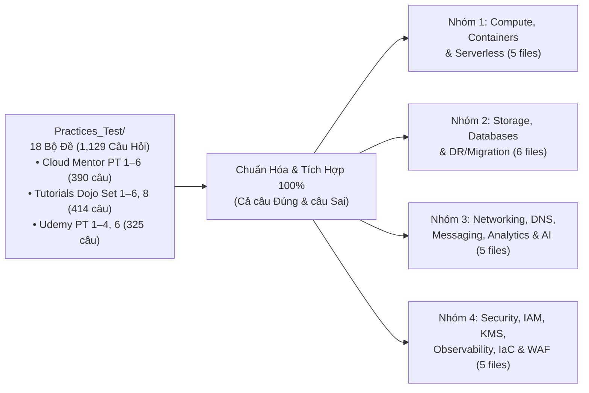

# Kế Hoạch Chuẩn Hóa & Đồng Bộ Toàn Diện Kiến Thức `AWS_Services/` Từ `Practices_Test/` (1,129 Câu Hỏi)

## Mục Tiêu (Goal Description)

Kiểm tra, hiệu đính độ chính xác kỹ thuật/logic và bổ sung **toàn bộ kiến thức, thông số giới hạn, kịch bản kiến trúc, bẫy loại trừ (distractors) và trích dẫn thực chứng** từ **1,129 câu hỏi (cả câu trả lời đúng và câu trả lời sai)** thuộc 18 bộ đề trong [`Practices_Test/`](file:///d:/project/AWS_XBrain_Note/Practices_Test) (gồm 6 đề Cloud Mentor `CM-PT1..6`, 7 đề Tutorials Dojo `TD-Set1..6, 8`, và 5 đề Udemy `U-PT1..4, 6`) vào 21 chuyên đề trong [`AWS_Services/`](file:///d:/project/AWS_XBrain_Note/AWS_Services).

Mục tiêu cuối cùng: Người học chỉ cần đọc hệ thống tài liệu [`AWS_Services/`](file:///d:/project/AWS_XBrain_Note/AWS_Services) là nắm vững 100% bản chất kỹ thuật, hiểu rõ lý do chọn đáp án đúng / loại đáp án sai, và giải quyết trọn vẹn mọi câu hỏi trong [`Practices_Test/`](file:///d:/project/AWS_XBrain_Note/Practices_Test).

---

## Các Quyết Định Thiết Kế Cần Lưu Ý (User Review Required)

> [!IMPORTANT]
> **1. Sửa 8 điểm mâu thuẫn đáp án / bẫy đề thi giữa `AWS_Services` và `Practices_Test`**:
> Qua đối soát từng câu trong 1,129 câu hỏi, phát hiện 8 trường hợp tài liệu `AWS_Services` đang giải thích ngược hoặc thiếu vế quan trọng so với đáp án chuẩn trong `Practices_Test`:
> - **`TD-Set1 Q59` ([ECS_Fargate_Containers.md](file:///d:/project/AWS_XBrain_Note/AWS_Services/ECS_Fargate_Containers.md))**: Tài liệu đang ghi giải pháp là `S3 -> SQS -> ECS Service Auto Scaling`, nhưng đáp án chuẩn của `TD-Set1 Q59` (effort tối thiểu để tăng task từ 1 khi có file S3 mới) là **`S3 PUT -> Amazon EventBridge Rule -> ECS Cluster (RunTask)`**. Sẽ tách rõ 2 mẫu kiến trúc này.
> - **`TD-Set8 Q09` & `CM-PT5 Q63` ([Lambda_Serverless_Architecture.md](file:///d:/project/AWS_XBrain_Note/AWS_Services/Lambda_Serverless_Architecture.md))**: Tài liệu đang gán `TD-Set8 Q09` cho `Provisioned Concurrency`, nhưng đáp án chuẩn cho dịch vụ Java trên Lambda cần giảm Cold Start với chi phí tối ưu nhất là **AWS Lambda SnapStart (Miễn phí)**.
> - **`CM-PT3 Q45` ([DynamoDB_NoSQL_Databases.md](file:///d:/project/AWS_XBrain_Note/AWS_Services/DynamoDB_NoSQL_Databases.md))**: Tài liệu đang trích dẫn `CM-PT3 Q45` làm ví dụ không được dùng `Scan`. Tuy nhiên, trong `CM-PT3 Q45` (bảng chỉ có 15 nhân viên, cần gửi email vào ngày kỷ niệm làm việc hàng năm theo lịch), đáp án đúng lại là **EventBridge chạy hàng ngày gọi Lambda `Scan` bảng + gửi SNS** (vì DynamoDB Streams chỉ bắt sự kiện thay đổi dữ liệu `INSERT/MODIFY/REMOVE`, không tự kích hoạt khi đến ngày trên lịch).
> - **`TD-Set2 Q52` & `TD-Set2 Q63` ([Disaster_Recovery_Migration.md](file:///d:/project/AWS_XBrain_Note/AWS_Services/Disaster_Recovery_Migration.md))**: Bộ đề Tutorials Dojo mới đã cập nhật đáp án cho bài toán mang ổ cứng di động (250 TB / 80 TB) đến điểm kết nối cáp quang tốc độ cao của AWS thành **AWS Data Transfer Terminal** (thay vì chỉ có Snowball Edge như các câu `CM-PT` và `U-PT`). Sẽ bổ sung cả hai và quy tắc nhận diện theo phương án đề bài.
> - **`U-PT1 Q45` ([EBS_EFS_Storage.md](file:///d:/project/AWS_XBrain_Note/AWS_Services/EBS_EFS_Storage.md))**: Bổ sung sự khác biệt giữa **đơn giá $/GB** (`S3 < EBS < EFS`) và **chi phí thực tế lưu 1 file 1 GB trên ổ EBS 100 GB đã cấp phát** (`S3 $0.023 < EFS $0.30 < EBS 100GB $8-$10` $\rightarrow$ đáp án `U-PT1 Q45` là `S3 < EFS < EBS`).
> - **`U-PT2 Q18`, `U-PT1 Q22`, `U-PT3 Q39` ([ELB_and_ASG_High_Availability.md](file:///d:/project/AWS_XBrain_Note/AWS_Services/ELB_and_ASG_High_Availability.md))**: Bổ sung thứ tự ưu tiên `OldestLaunchConfiguration` trước `OldestLaunchTemplate` (`U-PT2 Q18`), trạng thái `Standby` khi bảo trì máy chủ ASG (`U-PT1 Q22` - chọn 2 đáp án), và bài toán chia tỷ lệ % tải Cross-Zone Load Balancing (`U-PT3 Q39`: 1 máy ở AZ-A nhận 50% tải vs 4 máy ở AZ-B nhận 12.5%/máy khi tắt Cross-Zone).
> - **`U-PT1 Q41` & Quy tắc 0-day Glacier ([S3_and_CloudFront_Storage.md](file:///d:/project/AWS_XBrain_Note/AWS_Services/S3_and_CloudFront_Storage.md))**: Bổ sung vế thứ 2 của `U-PT1 Q41` (cấm chuyển từ `One Zone-IA` ngược lên `Standard-IA`) và làm rõ quy tắc: chuyển sang `Standard-IA / One Zone-IA` bắt buộc chờ tối thiểu **30 ngày**, nhưng chuyển thẳng từ `S3 Standard` sang **`Glacier Flexible Retrieval / Deep Archive` được phép chuyển ngay sau 0 ngày / 7 ngày / 10 ngày** (`TD-Set5 Q01`, `TD-Set8 Q10`, `CM-PT6 Q22`).
> - **Hơn 35 mã câu hỏi bị trích dẫn nhầm số (`Hallucinated/Mismatched Question IDs`)**: Chỉnh sửa lại chính xác 100% mã câu hỏi theo đúng nội dung thực tế trong `Practices_Test/`.

> [!NOTE]
> **2. Đồng bộ cấu trúc chuẩn 8 Phần (8-Section Master Architecture) trên toàn bộ 21 file**:
> - Bổ sung mục `## 5. Bảng So Sánh Trong Hệ Sinh Thái AWS (Ecosystem Comparison)` cho 4 file đang chỉ có 7 mục (`AI_Machine_Learning_Services.md`, `APIGateway_Cognito_StepFunctions.md`, `CloudFormation_Systems_Manager.md`, `FSx_StorageGateway_HybridStorage.md`).
> - Tinh gọn các phần trùng lặp API Gateway & DynamoDB trong `Lambda_Serverless_Architecture.md` (chuyển sang liên kết chéo tới 2 file chuyên đề riêng) để tập trung sâu vào Lambda.
> - Chuẩn hóa định dạng: Xóa các dòng kẻ ngang `---` bị lặp 2–3 lần liên tiếp, xóa các dòng bảng bị lặp đúp, và escape ký hiệu tiền tệ `\$` ngoài khối code/math để không bị lỗi hiển thị KaTeX.
> - Lưu ý: File [`Practices_Test/Udemy/udemy_pt5.md`](file:///d:/project/AWS_XBrain_Note/Practices_Test/Udemy/udemy_pt5.md) hiện có dung lượng `0 byte` (chưa có dữ liệu), nên kế hoạch sẽ ánh xạ toàn bộ 18 bộ đề đang có dữ liệu (`1,129 câu`).

---

## Chi Tiết Thay Đổi Theo Từng Phân Nhóm (Proposed Changes)

---

### Nhóm 1: Compute, Containers & Serverless (5 Files)

#### [MODIFY] [EC2_Elastic_Compute_Cloud.md](file:///d:/project/AWS_XBrain_Note/AWS_Services/EC2_Elastic_Compute_Cloud.md)
- **Hiệu đính & Chuẩn hóa**:
  - Làm rõ điều kiện **EC2 Hibernate**: Bắt buộc ổ Root EBS được mã hóa, RAM `< 150 GiB`, thời gian ngủ đông tối đa 60 ngày (`TD-Set3 Q24`, `TD-Set3 Q52`, `U-PT2 Q57`).
  - Làm rõ **EC2 Auto-Recovery (`recover` action)**: Giữ nguyên cả **Public IPv4** nếu máy đã có Public IPv4 (`U-PT3 Q27`), và không hỗ trợ máy dùng Instance Store (`U-PT3 Q41` $\rightarrow$ phải dùng ASG `Min=Max=Desired=1`).
- **Bổ sung kiến thức & kịch bản từ `Practices_Test` (Đúng + Sai)**:
  1. **Quy tắc tính phí theo trạng thái máy chủ (`TD-Set3 Q24`, `TD-Set4 Q52`)**: On-Demand bị tính phí khi đang ở trạng thái `stopping` để chuẩn bị **Hibernate** (nhưng không tính phí khi `stopping` bình thường); khi `stopped` vẫn bị tính phí ổ EBS và EIP; **Reserved Instances (RI)** vẫn bị tính phí suốt hợp đồng 1–3 năm kể cả khi máy đã `terminated`.
  2. **Thanh lý Reserved Instances không còn sử dụng (`TD-Set3 Q17`, `TD-Set6 Q31`)**: Chụp EBS Snapshot, `terminate` ngay các máy EC2 và rao bán RI trên **AWS Reserved Instance Marketplace**.
  3. **Vòng đời Spot Request & Persistent Spot (`U-PT3 Q15`, `U-PT6 Q05`, `U-PT6 Q16`, `CM-PT1 Q62`)**: Hủy (Cancel) một Spot Request đang mở **KHÔNG** tự động terminate các Spot Instance đang chạy (`U-PT3 Q15`); chỉ **Persistent Spot Request** trên nền **EBS-backed** mới cho phép Stop/Start lại khi có capacity (`U-PT6 Q16`); dùng `CreateFleet` kết hợp EFS checkpointing (`CM-PT1 Q62`).
  4. **Bẫy ngược Dedicated Instances vs Dedicated Hosts (`U-PT2 Q06`, `U-PT6 Q01`, `U-PT6 Q34`)**: Nếu chỉ cần cô lập phần cứng vật lý single-tenant vì lý do tuân thủ mà **không** cần kiểm soát socket/core vật lý $\rightarrow$ chọn **Dedicated Instances** để tối ưu chi phí nhất (`U-PT2 Q06`, `U-PT6 Q01`).
  5. **Chuyển đổi dự phòng bằng Secondary ENI (`eth1`) (`TD-Set2 Q38`)**: Primary ENI (`eth0`) không thể tháo rời; muốn di chuyển IP nội bộ tĩnh sang máy dự phòng phải gắn vào Secondary ENI (`eth1`).
  6. **Phạm vi AMI, Sao chép liên vùng & Chia sẻ AMI mã hóa (`U-PT1 Q51`, `U-PT3 Q01`, `CM-PT4 Q48`, `CM-PT6 Q49`)**: Copy AMI sang Region mới tạo ra `1 AMI + 1 EBS Snapshot` (`U-PT1 Q51`); không thể copy AMI đã mã hóa thành AMI không mã hóa (`U-PT3 Q01`); chia sẻ AMI mã hóa xuyên Account/OU cần cấp quyền `LaunchPermission` + chia sẻ **Customer Managed KMS Key** (`CM-PT4 Q48`).
  7. **Đồng bộ vị trí vật lý AZ xuyên tài khoản bằng `AZ ID` (`U-PT3 Q11`)**: Tên AZ (`us-west-2a`) được ánh xạ ngẫu nhiên giữa các tài khoản; phải dùng **AZ ID (`usw2-az1`)** để đặt tài nguyên cùng một trung tâm dữ liệu vật lý.
  8. **Giới hạn vCPU On-Demand Quota (`TD-Set3 Q39`, `TD-Set5 Q12`)**, hệ quả khi Stop/Start máy có gắn kèm Instance Store (`TD-Set3 Q31`), và truy vấn IP qua Instance Metadata `169.254.169.254` (`TD-Set4 Q16`).
  9. **Hạ tầng biên & Hybrid Compute**: **AWS Local Zones** (độ trễ `< 10ms` tại thành phố lớn & data residency - `CM-PT6 Q11`), **AWS Wavelength** (nhúng trong mạng viễn thông 5G - `TD-Set5 Q36`), **AWS Outposts** (tủ rack phần cứng AWS tại on-premises - `TD-Set2 Q62`, `CM-PT4 Q20`, `CM-PT5 Q34`, `U-PT1 Q65`).
  10. **AWS Elastic Beanstalk (`TD-Set1 Q09`, `TD-Set6 Q02`, `TD-Set6 Q10`)**: Lưu gói phiên bản ứng dụng trên S3, xoay vòng log lên S3 hoặc đẩy sang CloudWatch Logs (`TD-Set6 Q10`).
  11. **AWS Compute Optimizer & Savings Plans (`CM-PT2 Q55`, `CM-PT3 Q05`, `CM-PT3 Q23`, `CM-PT4 Q18`, `CM-PT5 Q36`, `U-PT2 Q50`, `U-PT2 Q63`, `U-PT6 Q06`, `U-PT6 Q49`)**: Compute Optimizer tối ưu 4 loại tài nguyên (EC2, ASG, EBS, Lambda/Fargate); phân biệt Compute Savings Plans vs SageMaker Savings Plans.

---

#### [MODIFY] [ELB_and_ASG_High_Availability.md](file:///d:/project/AWS_XBrain_Note/AWS_Services/ELB_and_ASG_High_Availability.md)
- **Hiệu đính & Chuẩn hóa**:
  - **Bẫy 4 (`U-PT2 Q18`)**: Bổ sung quy tắc ưu tiên hủy máy có **`OldestLaunchConfiguration` trước `OldestLaunchTemplate`** khi xét tie-breaker trong cùng AZ.
  - **Bẫy 1 (`U-PT1 Q22`)**: Bổ sung đáp án thứ 2 cho câu hỏi chọn 2 đáp án: Đưa máy chủ vào trạng thái **`Standby`** trước khi bảo trì.
  - **Bẫy 8 (`U-PT3 Q39`)**: Bổ sung phép tính phân bổ lưu lượng khi bật/tắt **Cross-Zone Load Balancing** (ví dụ 2 AZ có 1 máy và 4 máy: Tắt Cross-Zone $\rightarrow$ 50% và 12.5%/máy; Bật Cross-Zone $\rightarrow$ 20%/máy).
  - Sửa trích dẫn GWLB tại dòng 308 thành `CM-PT2 Q48`.
- **Bổ sung kiến thức & kịch bản từ `Practices_Test` (Đúng + Sai)**:
  1. **ALB Redirect HTTP sang HTTPS (`TD-Set4 Q50`) & Định tuyến theo Hostname/Subdomain (`CM-PT4 Q12`)**.
  2. **ALB Weighted Target Groups cho di chuyển Hybrid 50/50 (`TD-Set5 Q32`)**.
  3. **Phân tích ALB Access Logs trên S3 bằng Amazon Athena (`TD-Set3 Q57`, `TD-Set5 Q23`, `CM-PT5 Q42`)**.
  4. **Bẫy đăng ký đích NLB bằng Instance ID vs IP Address (`U-PT3 Q23`)**: Đăng ký theo Instance ID chỉ định tuyến tới **Primary Private IPv4** trên card mạng chính (`eth0`).
  5. **NLB TLS Offloading (`U-PT6 Q14`) & NLB đứng trước cụm Bastion Host Multi-AZ (`U-PT6 Q26`, `CM-PT2 Q30`, `CM-PT5 Q15`, `CM-PT5 Q45`, `CM-PT6 Q53`, `TD-Set2 Q54`)**.
  6. **Thứ tự thực thi của ASG AZ Rebalancing (`U-PT1 Q57`)**: Luôn **khởi tạo máy mới ở AZ thiếu hụt TRƯỚC**, sau đó mới hủy máy thừa ở AZ kia.
  7. **Co giãn ASG theo `ApproximateAgeOfOldestMessage` (khi có SLA thời gian phản hồi nghiêm ngặt - `TD-Set5 Q26`) vs `BacklogPerInstance` (`CM-PT2 Q03`, `U-PT6 Q41`)**.
  8. **ASG Predictive Scaling (`TD-Set4 Q47`, `CM-PT5 Q25`)**, **Default Cooldown 300s (`TD-Set2 Q47`)**, **Step Scaling Instance Warm-up (`TD-Set5 Q40`, `CM-PT1 Q30`)**, và co giãn theo `MemoryUtilization` / `SwapUtilization` qua CloudWatch Unified Agent + SSM Parameter Store (`TD-Set1 Q12`, `TD-Set1 Q45`, `TD-Set2 Q61`, `TD-Set4 Q35`).

---

#### [MODIFY] [ECS_Fargate_Containers.md](file:///d:/project/AWS_XBrain_Note/AWS_Services/ECS_Fargate_Containers.md)
- **Hiệu đính & Chuẩn hóa**:
  - **Sửa Bẫy 8 (`TD-Set1 Q59`)**: Làm rõ đáp án chuẩn của `TD-Set1 Q59` là **`S3 PUT -> Amazon EventBridge Rule -> ECS Cluster (RunTask)`** (tốn ít công sức nhất khi chạy batch job theo từng sự kiện upload S3), đối lập với kiến trúc hàng đợi `S3 -> SQS -> ECS Service Auto Scaling` (`CM-PT6 Q64`, `TD-Set6 Q60`).
  - **Sửa trích dẫn `TD-Set6 Q46`**: Chuyển `TD-Set6 Q46` (và `U-PT3 Q33`) sang kịch bản **HPC trên ECS EC2 dùng EFS `Max I/O` + `Provisioned Throughput`**; gán **`CM-PT5 Q02`** cho chiến lược phân bổ `spread` placement strategy.
  - **Cập nhật Bẫy 9 (`TD-Set6 Q59`, `U-PT3 Q26`)**: Giải thích đầy đủ cả 2 tầng co giãn cho ECS trên EC2: **ECS Cluster Auto Scaling / Capacity Providers** (co giãn số lượng máy chủ EC2 khi thiếu CPU/RAM cụm) và **ECS Service Auto Scaling** (co giãn số lượng Task).
- **Bổ sung kiến thức & kịch bản từ `Practices_Test` (Đúng + Sai)**:
  1. **Chuyên mục riêng cho AWS Batch (`TD-Set5 Q35`, `CM-PT1 Q38`, `U-PT6 Q11`)**: Dịch vụ chạy hàng ngàn tác vụ tính toán lô (batch simulations cần 32 vCPU / 256 GiB RAM - `TD-Set5 Q35`), tự động quản lý hàng đợi và môi trường tính toán (EC2/Spot/Fargate), kết hợp **AWS Step Functions + SNS** (`CM-PT1 Q38`, `U-PT6 Q11`).
  2. **Hệ sinh thái Amazon EKS chuyên sâu**:
     - **Co giãn Pod & Node (`TD-Set3 Q21`, `TD-Set4 Q03`, `TD-Set5 Q22`, `CM-PT5 Q28`)**: **Kubernetes Metrics Server + Horizontal Pod Autoscaler (HPA)** để co giãn Pod; **Kubernetes Cluster Autoscaler** hoặc **Karpenter** để co giãn Worker Nodes.
     - **Định tuyến Ingress (`TD-Set8 Q02`)**: Cài đặt **AWS Load Balancer Controller** trên EKS để tự động tạo ALB từ tài nguyên `Ingress`.
     - **Mã hóa phong bì Kubernetes Secrets (`TD-Set1 Q13`)**: Bật mã hóa `etcd` Secrets trên EKS bằng **AWS KMS Customer Managed Key**.
     - **Quản lý truy cập EKS (`TD-Set2 Q48`, `TD-Set5 Q36`)**: Dùng **EKS Cluster Access Management (CAM) API** (hoặc `aws-auth` ConfigMap) và triển khai EKS Node Group tại **AWS Wavelength Zones** (`TD-Set5 Q36`).
     - **Lưu trữ chia sẻ cho EKS trên Fargate (`CM-PT5 Q51`)**: Khởi tạo **Amazon EFS** và đăng ký qua đối tượng Kubernetes **`StorageClass`**.
     - **Giám sát EKS & ECS Anywhere (`CM-PT5 Q54`, `TD-Set5 Q23`)**: **CloudWatch Container Insights + AWS X-Ray** (`CM-PT5 Q54`); **ECS Anywhere + CloudWatch Application Insights** (`TD-Set5 Q23`).
  3. **Quét lỗ hổng bảo mật ảnh container trên Amazon ECR (`Scan on Push` - `CM-PT4 Q17`)**.
  4. **So sánh chi phí ECS trên EC2 vs Fargate (`U-PT1 Q16`)**, kết hợp Reserved + Spot EC2 trong ECS (`TD-Set5 Q19`), và lập lịch chạy container độc lập qua **EventBridge Scheduled Rule -> ECS Task** (`CM-PT2 Q54`, `CM-PT4 Q13`, `CM-PT6 Q01`).

---

#### [MODIFY] [Lambda_Serverless_Architecture.md](file:///d:/project/AWS_XBrain_Note/AWS_Services/Lambda_Serverless_Architecture.md)
- **Hiệu đính & Chuẩn hóa**:
  - **Sửa Bẫy 10 (`TD-Set8 Q09`, `CM-PT5 Q63`)**: Tách bạch rõ: Khi ứng dụng **Java trên Lambda** cần giảm Cold Start với **chi phí tối ưu nhất (miễn phí)** $\rightarrow$ chọn **AWS Lambda SnapStart** (`TD-Set8 Q09`, `CM-PT5 Q63`) kết hợp **CRaC Pre-Snapshot Hook** để tránh trùng ID ngẫu nhiên (`CM-PT1 Q27`); khi dùng ngôn ngữ khác hoặc đề bài không có SnapStart $\rightarrow$ chọn **Provisioned Concurrency** (`CM-PT4 Q18`, `U-PT3 Q43`).
  - Tinh gọn mục 2.4 (API Gateway) và 2.5 (DynamoDB) bị trùng lặp với 2 file chuyên đề riêng, thay bằng liên kết chuẩn và tập trung diện tích cho các cơ chế chuyên sâu của Lambda.
  - Sửa các trích dẫn sai (`TD-Set1 Q39`, `TD-Set2 Q09`).
- **Bổ sung kiến thức & kịch bản từ `Practices_Test` (Đúng + Sai)**:
  1. **Triển khai Container Image trên Lambda (tối đa 10 GB) + Bộ nhớ tạm `/tmp` (512 MB – 10 GB) (`TD-Set3 Q11`)**.
  2. **Bẫy cạn kiệt IP trong Subnet nhỏ khi gắn Lambda vào VPC (`EC2ThrottledException` - `TD-Set3 Q59`)**: Subnet `/27` chỉ có 27 IP khả dụng; khi Lambda tăng tải đột biến sẽ hết IP tạo Hyperplane ENI và văng lỗi `EC2ThrottledException`.
  3. **Kiến trúc Bảo mật Lambda kết nối Private RDS/Aurora + RDS Proxy (`CM-PT1 Q23`, `CM-PT2 Q12`, `CM-PT2 Q59`, `CM-PT6 Q10`)**: Chaining Security Group (`SG-Lambda` $\rightarrow$ `SG-RDS` cổng 3306/5432).
  4. **Bẫy phân quyền Lambda giải mã KMS, đọc S3 xuyên tài khoản & gắn EFS xuyên tài khoản (`TD-Set3 Q63`, `CM-PT4 Q25`, `CM-PT6 Q55`, `U-PT1 Q14`, `U-PT2 Q44`)**: Bắt buộc cấp quyền ở cả **Lambda Execution Role** VÀ **KMS Key Policy / S3 Bucket Policy / EFS File System Policy + EFS Access Point**.
  5. **Amazon S3 Object Lambda (`TD-Set3 Q36`, `CM-PT5 Q04`)**: Tự động che giấu thông tin nhạy cảm (PII redaction) hoặc biến đổi dữ liệu CSV ngay khi ứng dụng gọi lệnh `GET` mà không cần tạo bản sao S3.
  6. **Lambda@Edge (`TD-Set1 Q60`, `TD-Set2 Q27`, `TD-Set4 Q06`, `CM-PT3 Q19`)**: Xác thực người dùng tại biên, chuyển đổi định dạng ảnh động theo `User-Agent`, xử lý clickstream toàn cầu.
  7. **Gọi hàm Lambda trực tiếp từ Database Trigger của Aurora MySQL (`mysql.lambda_async` - `TD-Set1 Q17`)**.

---

#### [MODIFY] [APIGateway_Cognito_StepFunctions.md](file:///d:/project/AWS_XBrain_Note/AWS_Services/APIGateway_Cognito_StepFunctions.md)
- **Hiệu đính & Chuẩn hóa**:
  - Bổ sung mục `## 5. Bảng So Sánh Trong Hệ Sinh Thái AWS (Ecosystem Comparison)` và danh mục `- [ ]` Learning Checklist để đủ chuẩn 8 phần.
  - Xóa nội dung lạc đề về **AWS App Runner** (vốn thuộc `ECS_Fargate_Containers.md` và đang trích dẫn sai `TD-Set2 Q55`, `TD-Set5 Q33`).
  - Sửa các trích dẫn sai (`TD-Set3 Q16`, `TD-Set8 Q01`, `TD-Set2 Q09`, `TD-Set2 Q13`, `TD-Set5 Q13`).
- **Bổ sung kiến thức & kịch bản từ `Practices_Test` (Đúng + Sai)**:
  1. **Bổ sung mục chuyên sâu `2.5. AWS AppSync: Managed Serverless GraphQL & Real-Time Pub/Sub` (`TD-Set3 Q16`, `TD-Set5 Q05`, `TD-Set5 Q08`)**:
     - Kết hợp **AWS AppSync + DynamoDB** cho ứng dụng bình chọn/xếp hạng di động thời gian thực hàng triệu người dùng (`TD-Set3 Q16`).
     - Cấu hình **Custom Domain Name + chứng chỉ ACM SSL** trực tiếp trên AppSync (`TD-Set5 Q05`).
     - Dùng **AppSync Pipeline Resolvers** để gộp dữ liệu từ nhiều bảng DynamoDB trong 1 truy vấn GraphQL duy nhất (`TD-Set5 Q08`).
  2. **API Gateway Resource Policies chặn/cho phép dải IP (`U-PT2 Q24`)**.
  3. **API Gateway RESTful (Stateless) vs WebSocket (Stateful) (`U-PT1 Q17`) & Mô hình tính phí Pay-per-call (`TD-Set2 Q02`)**.
  4. **API Gateway Result Caching + Throttling (`TD-Set1 Q39`, `TD-Set3 Q04`), Usage Plans + API Keys (`U-PT3 Q08`), và HTTP API + OIDC JWT Authorizer (`U-PT3 Q09`)**.
  5. **Tích hợp gốc Amazon Cognito User Pools với Application Load Balancer (`authenticate-cognito` action - `U-PT2 Q14`)** và với API Gateway (`TD-Set8 Q01`, `CM-PT4 Q33`) cùng **Adaptive Authentication MFA (`CM-PT4 Q22`)**.
  6. **Cognito Identity Pools + S3 Gateway VPC Endpoint (`U-PT6 Q39`)**: Cấp quyền tạm thời tải tài liệu cá nhân trực tiếp lên S3 từ ứng dụng trong mạng riêng.
  7. **Khi nào KHÔNG dùng Cognito (`TD-Set1 Q24`, `TD-Set4 Q02`, `CM-PT4 Q64`)**: Dùng **SAML 2.0 Federation / IAM Identity Center** khi đề bài yêu cầu xác thực trực tiếp bằng Active Directory không qua Cognito (`TD-Set1 Q24`); dùng **Custom Identity Broker + AWS STS (`AssumeRole` / `GetFederationToken`)** khi thư mục người dùng tại chỗ không hỗ trợ SAML (`TD-Set4 Q02`, `CM-PT4 Q64`).
  8. **Phân biệt Amazon Simple Workflow Service (Amazon SWF) vs Step Functions (`TD-Set2 Q13`, `CM-PT1 Q38`, `CM-PT3 Q07`, `CM-PT4 Q59`, `U-PT6 Q11`)**.

---

### Nhóm 2: Storage, Databases & Migration/DR (6 Files)

#### [MODIFY] [S3_and_CloudFront_Storage.md](file:///d:/project/AWS_XBrain_Note/AWS_Services/S3_and_CloudFront_Storage.md)
- **Hiệu đính & Chuẩn hóa**:
  - Sửa trích dẫn nhầm tại dòng 368 (`TD-Set1 Q23`) và dòng 371 (`TD-Set1 Q37`).
  - Bổ sung vế thứ 2 của **`U-PT1 Q41`**: Không thể chuyển đổi Lifecycle từ `S3 One Zone-IA` ngược lên `S3 Standard-IA`.
  - Làm rõ quy tắc chuyển tiếp Lifecycle: Phải lưu tối thiểu **30 ngày** ở `S3 Standard` trước khi chuyển sang `Standard-IA / One Zone-IA` (`U-PT4 Q24`, `TD-Set2 Q29`), NHƯNG **được phép chuyển trực tiếp ngay lập tức (0 ngày / 7 ngày / 10 ngày) từ `S3 Standard` sang `S3 Glacier Flexible Retrieval` hoặc `Glacier Deep Archive`** (`TD-Set5 Q01`, `TD-Set8 Q10`, `CM-PT6 Q22`, `U-PT2 Q48`, `U-PT2 Q58`).
- **Bổ sung kiến thức & kịch bản từ `Practices_Test` (Đúng + Sai)**:
  1. **Phân biệt 3 cơ chế cấp quyền có thời hạn: CloudFront Signed URLs vs CloudFront Signed Cookies vs S3 Presigned URLs** (`TD-Set1 Q22`, `TD-Set1 Q27`, `TD-Set2 Q62`, `TD-Set3 Q30`, `CM-PT3 Q34`, `CM-PT5 Q29`, `U-PT6 Q17`):
     - **1 file đơn lẻ qua CDN / chống hotlink** $\rightarrow$ **CloudFront Signed URL** (cấu hình Trusted Key Group chứa Public Key - `CM-PT5 Q29`, `TD-Set1 Q22`).
     - **Nhiều file / phân đoạn video streaming không đổi URL** $\rightarrow$ **CloudFront Signed Cookies** (`TD-Set1 Q27`, `U-PT6 Q17`).
     - **Tải lên (`PUT`) hoặc tải xuống (`GET`) trực tiếp từ S3 Bucket riêng tư** $\rightarrow$ **S3 Presigned URL** (`TD-Set3 Q30`, `CM-PT3 Q34`).
  2. **Amazon S3 Object Lambda (`TD-Set3 Q36`, `CM-PT5 Q04`)**: Biến đổi dữ liệu hoặc ẩn danh PII động ngay khi đọc file S3.
  3. **Amazon S3 Storage Lens (`TD-Set8 Q12`, `CM-PT3 Q01`, `U-PT6 Q08`)**: Dashboard cấp AWS Organizations giúp phát hiện toàn bộ các S3 bucket chưa bật Versioning hoặc phân tích xu hướng dung lượng theo prefix.
  4. **Bẫy giới hạn của S3 Analytics — Storage Class Analysis (`U-PT6 Q09`)**: Chỉ phân tích để khuyến nghị chuyển từ `S3 Standard` sang `S3 Standard-IA` (không phân tích cho One Zone-IA hay Glacier Deep Archive).
  5. **S3 Requester Pays (`TD-Set4 Q33`)**: Bắt buộc đối tác bên ngoài tự trả phí truyền tải dữ liệu và phí request khi tải dữ liệu từ bucket.
  6. **S3 Access Points (cô lập theo prefix / VPC Endpoint) & S3 Access Grants (`TD-Set1 Q36`, `TD-Set1 Q49`, `U-PT2 Q13`)**.
  7. **Đầy đủ các mô hình mã hóa S3**: **Client-Side Encryption (CSE)** (`TD-Set1 Q06`, `TD-Set2 Q11`, `TD-Set3 Q25`, `TD-Set3 Q51`, `CM-PT3 Q28`, `CM-PT4 Q24`, `U-PT6 Q31`), **SSE-C** (`CM-PT2 Q23`, `U-PT2 Q28`), mã hóa hàng loạt triệu object cũ bằng **S3 Inventory + S3 Batch Operations** (`CM-PT5 Q19`), và ép buộc header `s3:x-amz-server-side-encryption` (`TD-Set2 Q45`, `TD-Set4 Q36`).
  8. **S3 Glacier Expedited Retrieval (1–5 phút) + Provisioned Retrieval Capacity (`TD-Set3 Q49`)**.
  9. **Kiểm soát bộ đệm CloudFront (`Cache-Control: max-age=0` / `no-cache` - `TD-Set6 Q34`, `CM-PT6 Q04`), Cache Invalidation (`CM-PT3 Q09`, `TD-Set8 Q13`), Price Classes (`CM-PT1 Q39`), và Georestriction (`U-PT1 Q08`)**.
  10. **Quy tắc đặt tên S3 Static Website trùng khít Domain Name khi dùng Route 53 Alias (`TD-Set2 Q22`) & cấu hình CORS (`TD-Set1 Q53`, `TD-Set2 Q21`)**.
  11. **Quyền sở hữu Object khi tải lên xuyên tài khoản (`bucket-owner-full-control` / Bucket owner enforced - `TD-Set3 Q65`, `TD-Set6 Q16`, `CM-PT2 Q33`)**.
  12. **S3 Event Notifications Fan-Out (`S3 -> SNS -> SQS` hoặc EventBridge) & bắt sự kiện xóa vĩnh viễn `s3:ObjectRemoved:Delete` (`TD-Set1 Q15`, `TD-Set3 Q10`, `TD-Set8 Q07`, `U-PT2 Q40`)**.
  13. **S3 Byte-Range Fetches (`U-PT6 Q57`)**: Chỉ đọc 250 byte đầu tiên của từng object thay vì tải toàn bộ 50 TB.

---

#### [MODIFY] [EBS_EFS_Storage.md](file:///d:/project/AWS_XBrain_Note/AWS_Services/EBS_EFS_Storage.md)
- **Hiệu đính & Chuẩn hóa**:
  - **Làm rõ bài toán chi phí `U-PT1 Q45`**: Phân biệt đơn giá mỗi GB (`S3 < EFS-IA < EBS < EFS Standard`) với chi phí lưu trữ 1 file nhỏ (1 GB) trên ổ EBS 100 GB đã cấp phát (`S3 $0.023 < EFS $0.30 < EBS 100GB $8-$10` $\rightarrow$ `S3 < EFS < EBS`).
  - Sửa trích dẫn `TD-Set6 Q04` về đúng tính năng **EBS Encryption by Default** cấp Region.
- **Bổ sung kiến thức & kịch bản từ `Practices_Test` (Đúng + Sai)**:
  1. **Chế độ Hiệu năng & Thông lượng của Amazon EFS (`TD-Set6 Q46`, `U-PT2 Q09`, `U-PT3 Q33`)**:
     - **`Max I/O` vs `General Purpose`**: Dùng `Max I/O` khi hàng trăm/ngàn máy chủ truy cập song song cần tổng thông lượng lớn (`TD-Set6 Q46`, `U-PT2 Q09`).
     - **`Provisioned Throughput` vs `Bursting Throughput`**: Khi dung lượng file lưu trữ trên EFS nhỏ (hoặc xóa ngay sau khi xử lý) nhưng cần băng thông đọc/ghi cực cao $\rightarrow$ bật **Provisioned Throughput** (`TD-Set6 Q46`, `U-PT3 Q33`).
  2. **EFS Access Points, EFS File System Policy (IAM Authorization) & Mount EFS xuyên Region qua Inter-Region VPC Peering (`U-PT1 Q14`, `U-PT1 Q25`, `U-PT1 Q29`, `U-PT4 Q40`, `CM-PT4 Q25`)**.
  3. **Bật EBS Encryption by Default cấp Region (`TD-Set6 Q04`, `CM-PT3 Q03`) & Kiểm toán bằng AWS Config `encrypted-volumes` (`CM-PT6 Q06`, `CM-PT6 Q13`, `CM-PT6 Q14`)**.
  4. **Hoạt động đọc/ghi bình thường khi đang chụp EBS Snapshot (`TD-Set5 Q24`), giữ lại ổ Root bằng `DeleteOnTermination = False` (`TD-Set3 Q62`), và tối ưu ổ EBS bằng AWS Compute Optimizer (`CM-PT3 Q23`)**.
  5. **Tỷ lệ 50:1 IOPS/GiB của `io1`/`io2` (`TD-Set4 Q05`, `U-PT3 Q14`)**, giới hạn ổ Boot (`st1`/`sc1` không làm ổ boot được - `U-PT1 Q39`), và ổ từ tính thế hệ cũ `standard` (`TD-Set4 Q31`).
  6. **Khi nào ưu tiên EC2 Instance Store (NVMe SSD) hơn EBS (`TD-Set3 Q31`, `TD-Set4 Q25`, `TD-Set4 Q27`, `U-PT1 Q26`, `U-PT4 Q27`, `U-PT4 Q45`)**: Dữ liệu tạm thời/cache hoặc cụm CSDL tự nhân bản giữa các node; dữ liệu giữ nguyên khi **Reboot OS** nhưng mất sạch khi **Stop, Hibernate, Terminate** hoặc lỗi phần cứng vật lý.

---

#### [MODIFY] [FSx_StorageGateway_HybridStorage.md](file:///d:/project/AWS_XBrain_Note/AWS_Services/FSx_StorageGateway_HybridStorage.md)
- **Hiệu đính & Chuẩn hóa**:
  - Bổ sung mục `## 5. Bảng So Sánh Trong Hệ Sinh Thái AWS (Ecosystem Comparison)` và danh mục `- [ ]` Learning Checklist để đủ chuẩn 8 phần.
  - Xóa dòng bị lặp đúp trong bảng Ma trận quyết định (dòng 356–357) và đồng bộ chú thích trạng thái khai tử của AWS Snowmobile (`U-PT2 Q48`).
- **Bổ sung kiến thức & kịch bản từ `Practices_Test` (Đúng + Sai)**:
  1. **Bổ sung chuyên mục đầy đủ về AWS Transfer Family (`SFTP / FTPS / FTP`)** (`TD-Set1 Q11`, `CM-PT2 Q05`, `CM-PT2 Q39`, `CM-PT3 Q58`, `CM-PT5 Q07`, `CM-PT6 Q63`, `U-PT2 Q04`, `U-PT3 Q52`, `U-PT4 Q40`):
     - Lưu trữ trực tiếp vào **Amazon S3** hoặc **Amazon EFS** (`TD-Set1 Q11`, `CM-PT5 Q07`).
     - Xác thực qua **Service-managed users (SSH keys)** (`CM-PT2 Q39`), **AD Connector / AWS Directory Service** (`CM-PT3 Q58`, `CM-PT6 Q63`), hoặc Custom IdP.
     - Tự động gọi hàm Lambda xử lý file sau khi upload bằng **Transfer Family Managed Workflows** (`U-PT3 Q52`).
     - Triển khai **VPC Endpoint + Elastic IPs + Security Group allowlist** (`U-PT4 Q40`) và **SFTP Connectors** (`CM-PT2 Q05`).
  2. **FSx for NetApp ONTAP Đa giao thức (`NFS + SMB + iSCSI`) & Tiering Policy `Auto` (`TD-Set3 Q63`, `TD-Set8 Q18`, `CM-PT1 Q28`, `CM-PT5 Q33`, `CM-PT6 Q37`, `U-PT3 Q18`)**: Giải pháp chuẩn khi cả máy chủ **Linux, Windows và macOS** cần đọc/ghi đồng thời vào cùng một hệ thống tệp mà không cần nhân bản dữ liệu.
  3. **Mount FSx for Windows File Server từ máy chủ Linux qua giao thức SMB (`U-PT3 Q04`) & kết hợp EC2 Hibernation (`TD-Set3 Q52`)**.
  4. **FSx for Lustre (`Scratch` + `EFA` vs `Persistent SSD`) (`TD-Set6 Q42`, `CM-PT2 Q16`, `CM-PT4 Q30`, `CM-PT5 Q47`, `CM-PT6 Q47`)**.
  5. **AWS Storage Gateway Hardware Appliance (khi trung tâm dữ liệu không có hạ tầng ảo hóa VMware/Hyper-V/KVM - `TD-Set5 Q55`) & Tính toán dung lượng Local Cache cho các bản sao lưu gần nhất (`TD-Set6 Q48`, `TD-Set8 Q10`, `CM-PT6 Q22`)**.

---

#### [MODIFY] [RDS_Aurora_Databases.md](file:///d:/project/AWS_XBrain_Note/AWS_Services/RDS_Aurora_Databases.md)
- **Hiệu đính & Chuẩn hóa**:
  - Làm rõ giới hạn 16,000 IOPS của 1 ổ EBS `gp3` trên EC2 so với khả năng cấu hình độc lập 15,000–64,000 IOPS trên **RDS General Purpose SSD (`gp3`)** mà không cần tăng dung lượng GB hay mua `io1` (`CM-PT6 Q46`).
- **Bổ sung kiến thức & kịch bản từ `Practices_Test` (Đúng + Sai)**:
  1. **Hành vi khôi phục của cụm Aurora chỉ có 1 Instance duy nhất (Không có Aurora Replica) (`TD-Set5 Q06`)**: Khi gặp sự cố, Aurora sẽ cố gắng **tạo lại một DB instance mới trong CÙNG Availability Zone ban đầu** theo cơ chế best-effort (mất ~10–15 phút, khác với failover `< 30s` khi có Replica).
  2. **Di chuyển không gián đoạn (Near-Zero Downtime) lên Aurora & Aurora Serverless v2 (`TD-Set3 Q28`, `CM-PT4 Q46`, `U-PT3 Q58`)**:
     - Từ **RDS MySQL/PostgreSQL lên Aurora**: Tạo **Aurora Read Replica** từ RDS, chờ lag = 0 rồi **Promote** (`CM-PT4 Q46`, `U-PT3 Q58`).
     - Từ **Aurora Provisioned sang Aurora Serverless v2**: Thêm một **Serverless v2 Reader** vào cụm hiện tại rồi thực hiện **Failover** để nâng lên làm Writer (`TD-Set3 Q28`).
  3. **Babelfish for Aurora PostgreSQL (`U-PT1 Q61`)**: Cho phép Aurora PostgreSQL hiểu trực tiếp giao thức T-SQL của Microsoft SQL Server, giảm thiểu việc viết lại code khi di chuyển cùng AWS SCT + DMS.
  4. **Gọi hàm Lambda trực tiếp từ Aurora MySQL Trigger bằng `mysql.lambda_async` (`TD-Set1 Q17`)**.
  5. **Tham số kiểm soát RPO trên Aurora Global Database (`aurora_global_db_rpo` - `CM-PT2 Q56`) & thiết kế tách bảng Global/Local (`U-PT1 Q46`)**.
  6. **Aurora Fast Database Cloning (Copy-on-Write) (`TD-Set6 Q20`)**: Tạo bản sao CSDL hàng TB cho môi trường test trong vài phút mà không tốn thêm dung lượng lưu trữ ban đầu.
  7. **Cơ chế bảo trì RDS Multi-AZ: OS Patching (cập nhật Standby trước $\rightarrow$ Failover $\rightarrow$ cập nhật Primary cũ - `U-PT6 Q30`, `TD-Set6 Q58`) vs DB Engine Upgrade (nâng cấp đồng thời cả hai gây downtime nếu không dùng Blue/Green - `U-PT2 Q65`) & 4 điều kiện kích hoạt Failover (`TD-Set2 Q31`)**.
  8. **Miễn phí truyền dữ liệu khi nhân bản sang In-Region Read Replica vs Tính phí Cross-Region Read Replica (`U-PT2 Q08`)**.
  9. **Giới hạn 35 ngày của RDS Automated Backups vs Lưu trữ 90 ngày bằng AWS Backup (`TD-Set3 Q23`, `CM-PT3 Q27`)**.
  10. **Tối ưu chi phí RDS môi trường Dev/Test: Instance Scheduler (`TD-Set8 Q24`, `CM-PT1 Q16`, `CM-PT5 Q57`), Snapshot & Terminate (`TD-Set4 Q14`), và Trusted Advisor RDS RI Check (`CM-PT3 Q31`)**.
  11. **Amazon GuardDuty RDS Protection (`CM-PT5 Q22`)** và chia sẻ RDS riêng tư xuyên tài khoản qua **NLB + AWS PrivateLink (`CM-PT4 Q15`, `U-PT1 Q02`)**.
  12. **ElastiCache for Redis (`--transit-encryption-enabled` + `--auth-token` `TD-Set1 Q35`, `TD-Set6 Q65`; Geospatial `U-PT4 Q21`; Sorted Sets Leaderboard `U-PT1 Q50`, `U-PT3 Q35`; Write-Through `CM-PT1 Q48`) vs ElastiCache for Memcached (Multi-threaded + Auto Discovery `TD-Set6 Q06`, `U-PT6 Q27`)**.

---

#### [MODIFY] [DynamoDB_NoSQL_Databases.md](file:///d:/project/AWS_XBrain_Note/AWS_Services/DynamoDB_NoSQL_Databases.md)
- **Hiệu đính & Chuẩn hóa**:
  - **Sửa Bẫy 3 (`CM-PT3 Q45`)**: Giải thích rõ ngoại lệ của `CM-PT3 Q45`: Với bảng cực nhỏ (15 nhân viên) cần quét theo lịch hàng ngày để kiểm tra ngày kỷ niệm làm việc, dùng **EventBridge chạy hàng ngày gọi Lambda `Scan` + SNS** là đáp án chuẩn vì DynamoDB Streams chỉ kích hoạt khi có thao tác ghi/sửa/xóa dữ liệu, không tự chạy theo thời gian thực tế trên lịch.
- **Bổ sung kiến thức & kịch bản từ `Practices_Test` (Đúng + Sai)**:
  1. **Giới hạn kích thước Item tối đa `400 KB` của DynamoDB & Mẫu thiết kế lưu Payload lớn trên S3 (`CM-PT4 Q06`)**: Lưu đối tượng lớn (ví dụ 700 KB) lên Amazon S3 và chỉ lưu đường dẫn S3 URL trong bảng DynamoDB.
  2. **Bổ sung chuyên mục cơ sở dữ liệu NoSQL chuyên biệt: Amazon DocumentDB & Amazon Neptune** (`TD-Set3 Q08`, `CM-PT2 Q18`, `CM-PT3 Q40`, `CM-PT3 Q60`):
     - **Amazon DocumentDB (tương thích MongoDB)**: Di chuyển MongoDB lên управляемый Multi-AZ không sửa code (`TD-Set3 Q08`); dùng **DocumentDB Serverless** tự động co giãn theo DCU cho tài liệu JSON `> 1 MB` biến động theo giờ giao dịch (`CM-PT2 Q18`).
     - **Amazon Neptune (Graph Database)**: Lưu trữ đồ thị đỉnh-cạnh hỗ trợ truy vấn **SPARQL (RDF)** cho bản đồ phụ thuộc hạ tầng bảo mật (`CM-PT3 Q40`) và **Gremlin / openCypher** cho mạng xã hội nhiều tầng kết nối (`CM-PT3 Q60`).
  3. **Cơ chế cấu hình thuộc tính Unix Epoch Timestamp cho DynamoDB TTL (`CM-PT6 Q61`, `U-PT4 Q59`)**.
  4. **DynamoDB Point-in-Time Recovery (PITR - 35 ngày, luôn khôi phục ra bảng mới `CM-PT4 Q57`, `U-PT3 Q32`) vs Sao lưu xuyên tài khoản bằng AWS Backup (`TD-Set2 Q48`)**.

---

#### [MODIFY] [Disaster_Recovery_Migration.md](file:///d:/project/AWS_XBrain_Note/AWS_Services/Disaster_Recovery_Migration.md)
- **Hiệu đính & Chuẩn hóa**:
  - Sửa trích dẫn nhầm tại dòng 287 (`TD-Set1 Q05` $\rightarrow$ `CM-PT1 Q05`) và dòng 289 (`TD-Set2 Q05` $\rightarrow$ `CM-PT2 Q05`).
- **Bổ sung kiến thức & kịch bản từ `Practices_Test` (Đúng + Sai)**:
  1. **AWS Data Transfer Terminal vs AWS Snowball Edge (`TD-Set2 Q52`, `TD-Set2 Q63` vs `CM-PT3 Q57`, `CM-PT4 Q23`, `CM-PT4 Q47`, `CM-PT4 Q62`, `CM-PT6 Q36`, `U-PT2 Q48`, `U-PT4 Q20`)**:
     - Giải thích rõ **AWS Data Transfer Terminal**: Điểm kết nối vật lý tốc độ cao (lên tới 400 Gbps) của AWS nơi khách hàng mang ổ cứng di động đến cắm trực tiếp để tải hàng trăm TB lên S3/EFS mà không cần chờ vận chuyển thiết bị (`TD-Set2 Q52`, `TD-Set2 Q63`).
  2. **AWS Application Discovery Service & Thiết lập Home Region trên AWS Migration Hub (`CM-PT4 Q39`)**.
  3. **AWS Backup Audit Manager (`CM-PT1 Q31`), AWS Backup Vault Lock Compliance Mode (`CM-PT1 Q58`), và Sao chép bản sao lưu xuyên Region/Account (`CM-PT1 Q57`, `CM-PT3 Q41`, `CM-PT3 Q48`, `CM-PT4 Q26`, `U-PT4 Q54`)**.
  4. **AWS DataSync cho sao chép Cloud-to-Cloud (`S3 -> S3 & EFS` - `TD-Set8 Q23`) và truyền tải riêng tư qua Direct Connect + Interface VPC Endpoint (`U-PT2 Q31`, `CM-PT5 Q46`, `CM-PT6 Q08`)**.
  5. **AWS DMS di chuyển NoSQL trên EC2 sang DynamoDB (`TD-Set2 Q53`), DMS Serverless (`U-PT4 Q55`), và kết hợp AWS SCT + DMS (`CM-PT5 Q44`, `U-PT1 Q61`, `U-PT3 Q61`)**.
  6. **Chiến lược DR bằng Cross-Region AMI Copy + CloudFormation (`RTO < 4h` - `CM-PT6 Q49`) vs AWS Elastic Disaster Recovery (AWS DRS) (`RPO <= 60s, RTO = 1h` - `TD-Set6 Q11`)**.

---

### Nhóm 3: Networking, DNS, Decoupling, Analytics & AI/ML (5 Files)

#### [MODIFY] [VPC_Networking.md](file:///d:/project/AWS_XBrain_Note/AWS_Services/VPC_Networking.md)
- **Hiệu đính & Chuẩn hóa**:
  - Sửa 7 mã câu hỏi bị trích dẫn nhầm (`TD-Set1 Q31` $\rightarrow$ `U-PT6 Q03`; `CM-PT1 Q14` cho Transit Gateway $\rightarrow$ `CM-PT1 Q60`; `TD-Set6 Q28 / TD-Set8 Q02` cho GWLB $\rightarrow$ `CM-PT2 Q48`, v.v.).
- **Bổ sung kiến thức & kịch bản từ `Practices_Test` (Đúng + Sai)**:
  1. **VPC Sharing (Chia sẻ Subnet đa tài khoản) qua AWS Resource Access Manager (AWS RAM) (`CM-PT6 Q47`, `U-PT2 Q53`, `U-PT3 Q21`, `U-PT6 Q07`)**: Chia sẻ subnet giữa các tài khoản trong cùng AWS Organization để các máy chủ giao tiếp bằng IPv4 nội bộ không cần VPC Peering và giảm chi phí NAT Gateway / VPC Endpoint.
  2. **Điều kiện tiên quyết của Site-to-Site VPN Customer Gateway (`TD-Set2 Q03`)**: Thiết bị tường lửa tại chỗ bắt buộc phải có **1 địa chỉ IP công cộng tĩnh (Static Internet-routable IP)**.
  3. **Mở rộng băng thông Site-to-Site VPN vượt mốc 1.25 Gbps bằng Transit Gateway + ECMP (`TD-Set5 Q53`)**.
  4. **Các cấp độ dự phòng AWS Direct Connect (`TD-Set2 Q50`, `CM-PT3 Q32`, `U-PT4 Q52`)**: Dự phòng tiết kiệm bằng Site-to-Site VPN (`TD-Set2 Q50`); độ chịu lỗi tối đa cho 2 trung tâm dữ liệu cần tổng cộng **4 kết nối Direct Connect** vào 2 vị trí DX khác nhau (`CM-PT3 Q32`).
  5. **Chia sẻ cơ sở dữ liệu RDS cho đối tác qua NLB + AWS PrivateLink (`CM-PT4 Q15`, `U-PT1 Q02`)**.
  6. **Chống thất thoát dữ liệu bằng VPC Endpoint Policy (`TD-Set2 Q06`) & Khóa S3 Bucket theo VPC bằng `aws:SourceVpc` / `aws:SourceVpce` (`CM-PT1 Q09`, `U-PT6 Q56`)**.
  7. **Xử lý cạn kiệt IPv4 trong Dual-Stack VPC bằng Subnet `IPv6-only (/64)` (`TD-Set2 Q19`)** & Hành vi mặc định của Subnet mới (tự động gắn vào Main Route Table và nằm gọn trong 1 AZ - `TD-Set3 Q38`).
  8. **Bẫy cơ chế NAT của Internet Gateway vs NAT Instance (`U-PT3 Q55`, `U-PT3 Q64`, `U-PT6 Q29`)**:
     - Máy chủ EC2 có Public IP nằm trong subnet trỏ `0.0.0.0/0` ra Internet Gateway thì **chính Internet Gateway thực hiện 1:1 NAT** (kể cả khi trong subnet đó có đặt một NAT Instance - `U-PT3 Q64`).
     - **3 điểm khác biệt chỉ có ở NAT Instance so với NAT Gateway (`U-PT3 Q55`)**: Gắn được **Security Group**, hỗ trợ **Port Forwarding**, và dùng làm **Bastion Server** được.
  9. **Bẫy cấu hình Security Group (`U-PT3 Q17`)**: Không thể điền mã **Internet Gateway ID (`igw-xxx`)** làm nguồn (Source) trong Security Group.
  10. **Inter-Region VPC Peering (`TD-Set5 Q39`, `CM-PT4 Q09`, `CM-PT4 Q25`, `U-PT1 Q25`) & Bẫy kết nối hình sao (Hub-and-Spoke) không bắc cầu (`U-PT4 Q31`, `U-PT6 Q61`)**.
  11. **Amazon CloudWatch Network Monitor giám sát mất gói tin / RTT mạng lai (`CM-PT1 Q47`) & Pipeline VPC Flow Logs thời gian thực (`CloudWatch Logs -> Kinesis -> OpenSearch` - `CM-PT6 Q19`)**.

---

#### [MODIFY] [Route53_DNS.md](file:///d:/project/AWS_XBrain_Note/AWS_Services/Route53_DNS.md)
- **Hiệu đính & Chuẩn hóa**:
  - Sửa 4 mã câu hỏi bị trích dẫn nhầm (`TD-Set5 Q05`, `TD-Set2 Q02`, `TD-Set6 Q54`, `CM-PT5 Q18`).
- **Bổ sung kiến thức & kịch bản từ `Practices_Test` (Đúng + Sai)**:
  1. **Hai thuộc tính VPC bắt buộc cho Private Hosted Zone (`enableDnsSupport = true` & `enableDnsHostnames = true` - `U-PT6 Q18`)**.
  2. **Di chuyển tên miền nhanh sang Route 53 bằng cách Import DNS Zone File (`CM-PT5 Q18`)**.
  3. **Định tuyến Latency-Based Routing kết hợp cả trung tâm dữ liệu On-Premises (`CM-PT1 Q11`)**: Tạo bản ghi `A` trỏ về IP công cộng của On-Premises và gắn với Region AWS gần vị trí địa lý của trung tâm dữ liệu đó nhất.
  4. **Chi tiết bản ghi Alias vs CNAME (`U-PT3 Q44`, `U-PT3 Q45`)**: Dùng **Alias** để trỏ Zone Apex (`domain.com`) tới `www.domain.com` trong cùng Hosted Zone (`U-PT3 Q44`); dùng **CNAME** để trỏ subdomain `www.domain.com` tới tên miền của nhà cung cấp bên thứ ba (`U-PT3 Q45`).
  5. **Định tuyến Đa vùng Active-Active với Weighted Routing + Health Checks (`TD-Set3 Q53`) & Multi-Value Answer (`CM-PT3 Q54`)**.
  6. **Danh sách kiểm tra Active-Passive Failover (`TD-Set2 Q64`, `CM-PT3 Q16`, `U-PT2 Q52`, `U-PT4 Q48`)**: Bắt buộc mở tường lửa NACL & Security Group cho dải IP của **Route 53 Health Checkers** (`TD-Set2 Q64`).
  7. **Đầy đủ các kịch bản nâng cao của AWS Global Accelerator (`TD-Set6 Q15`, `CM-PT2 Q15`, `CM-PT3 Q50`, `U-PT1 Q58`, `U-PT2 Q43`, `U-PT3 Q49`, `U-PT4 Q63`)**: Cung cấp 2 địa chỉ Anycast IP tĩnh cố định để khách hàng doanh nghiệp whitelist trên tường lửa thay cho hàng trăm ALB động (`TD-Set6 Q15`, `U-PT3 Q49`); kết hợp tăng tốc cả máy chủ EC2 trên AWS lẫn máy chủ UDP tại On-Premises thông qua NLB (`U-PT4 Q63`).

---

#### [MODIFY] [SQS_SNS_EventBridge_Decoupling.md](file:///d:/project/AWS_XBrain_Note/AWS_Services/SQS_SNS_EventBridge_Decoupling.md)
- **Hiệu đính & Chuẩn hóa**:
  - Sửa 5 cụm mã câu hỏi bị trích dẫn nhầm (`TD-Set1 Q40`, `TD-Set4 Q14`, `TD-Set1 Q04`, `TD-Set2 Q47`, `TD-Set3 Q10`).
- **Bổ sung kiến thức & kịch bản từ `Practices_Test` (Đúng + Sai)**:
  1. **Amazon SQS Temporary Queues cho mô hình Request-Response thông lượng cao (`U-PT6 Q55`)**: Tạo hàng đợi ảo tạm thời trên một hàng đợi vật lý duy nhất bằng **SQS Temporary Queue Client** để tiết kiệm chi phí và thời gian triển khai.
  2. **Amazon Simple Workflow Service (Amazon SWF) cho kiến trúc phân tán Hybrid (`TD-Set2 Q13`)**: Khi đề bài hỏi 2 dịch vụ tách rời các thành phần chạy giữa On-Premises và EC2 $\rightarrow$ chọn **Amazon SQS** và **Amazon SWF**.
  3. **Bẫy thời gian lưu trữ mặc định 4 ngày của SQS (Tối đa 14 ngày) (`TD-Set5 Q43`)**: Nếu tác vụ batch chỉ chạy 2 tuần/lần trên hàng đợi mặc định, các tin nhắn tuần đầu tiên sẽ bị tự động xóa sau **4 ngày**.
  4. **Quy trình 3 bước di chuyển từ SQS Standard sang SQS FIFO (`U-PT3 Q02`)**: Không thể chuyển đổi trực tiếp; phải **(1) Xóa hàng đợi Standard và tạo mới hàng đợi FIFO**, **(2) Đặt tên có hậu tố `.fifo`**, và **(3) Đảm bảo thông lượng $\le 3,000\text{ msg/s}$ khi có batching (hoặc $300\text{ msg/s}$ không batching)**.
  5. **SQS Delay Queues (trì hoãn hiển thị mọi tin nhắn mới từ 0–900s - `U-PT6 Q37`) & Thiết kế Priority Queues bằng 2 hàng đợi tách biệt (`pro` và `lite` - `U-PT6 Q20`)**.
  6. **Xử lý nghẽn SNS-to-Lambda do chạm trần Account Concurrency (mặc định 1,000 - `U-PT1 Q34`) & Cấu hình 2 chiều cho Cross-Account SNS-to-Lambda (`CM-PT1 Q61`)**.
  7. **Tin nhắn SMS 2 chiều với AWS End User Messaging SMS (Amazon Pinpoint) + SNS (`TD-Set6 Q61`)**.
  8. **Tổng hợp các mẫu sự kiện Amazon EventBridge thực chiến**: Bắt sự kiện **AWS Health** (`TD-Set4 Q08`), **ACM Approaching Expiration** (`TD-Set6 Q03`), tự động hủy lệnh xóa khóa KMS bằng **EventBridge + SSM Automation `CancelKeyDeletion`** (`TD-Set8 Q05`), lọc cảnh báo **Amazon Macie** (`TD-Set5 Q44`, `CM-PT2 Q41`, `CM-PT4 Q63`), và lập lịch chạy **ECS Fargate Task** (`CM-PT2 Q54`, `CM-PT3 Q62`, `CM-PT4 Q05`, `CM-PT6 Q01`, `U-PT2 Q02`).

---

#### [MODIFY] [Analytics_Big_Data_Services.md](file:///d:/project/AWS_XBrain_Note/AWS_Services/Analytics_Big_Data_Services.md)
- **Hiệu đính & Chuẩn hóa**:
  - Sửa 2 trích dẫn nhầm (`TD-Set1 Q28`, `TD-Set1 Q36`) và bổ sung danh mục `- [ ]` Learning Checklist.
- **Bổ sung kiến thức & kịch bản từ `Practices_Test` (Đúng + Sai)**:
  1. **AWS Glue DataBrew (`TD-Set8 Q21`, `U-PT1 Q24`)**: Công cụ làm sạch và chuẩn hóa dữ liệu trực quan **không cần viết code (no-code)** với hơn 250 phép biến đổi; hỗ trợ **Data Profiling** thống kê kiểu dữ liệu/null (`U-PT1 Q24`) và lưu quy trình thành **DataBrew Recipe** kèm theo dõi **Data Lineage** (`TD-Set8 Q21`).
  2. **Amazon AppFlow tích hợp AWS PrivateLink (`CM-PT4 Q04`)**: Truyền dữ liệu tự động từ các ứng dụng SaaS (như **Salesforce**, SAP, ServiceNow) vào **Amazon S3 / Amazon Redshift** qua mạng riêng PrivateLink mà không đi qua Internet công cộng.
  3. **Amazon Managed Grafana kết nối VPC riêng tư (`TD-Set8 Q06`, `CM-PT4 Q14`)**: Trực quan hóa dữ liệu trực tiếp từ cơ sở dữ liệu **Amazon RDS trong Private Subnet** thông qua cấu hình **Outbound VPC Connectivity**.
  4. **Amazon Security Lake (`U-PT2 Q34`)**: Tự động gom nhật ký bảo mật đa nguồn về S3 theo chuẩn mở **OCSF (Apache Parquet)**.
  5. **Amazon Managed Service for Apache Flink (Kinesis Data Analytics) (`CM-PT2 Q62`, `CM-PT6 Q23`, `U-PT1 Q55`, `U-PT3 Q53`)**: Phát hiện bất thường thời gian thực (`RANDOM_CUT_FOREST`) và tính toán cửa sổ trượt trên luồng Kinesis Data Streams.
  6. **Amazon MSK (Managed Streaming for Apache Kafka) (`CM-PT5 Q35`)**: Bật **Public Access + Mutual TLS (mTLS)** trên cụm MSK 3 AZ cho phép client bên ngoài đẩy dữ liệu an toàn.
  7. **Bẫy mất dữ liệu do thời gian lưu mặc định 24 giờ của Kinesis Data Streams (`TD-Set3 Q15`, `TD-Set6 Q40`)**: Nếu consumer xử lý dữ liệu mỗi 48 giờ (`TD-Set3 Q15`) hoặc 72 giờ (`TD-Set6 Q40`), phải tăng **Data Retention Period** (lên tới 7 ngày hoặc 365 ngày).
  8. **Xử lý lỗi `ProvisionedThroughputExceededException` trên Kinesis bằng gom lô (`PutRecords` batching - `U-PT4 Q23`), gọi API `UpdateShardCount` (`TD-Set6 Q12`), hoặc bật On-Demand Mode (`CM-PT3 Q02`, `U-PT6 Q58`); dùng Kinesis + ECS Fargate cho tác vụ chạy 30 phút (`U-PT6 Q02`)**.
  9. **AWS Glue Job Bookmarks (chỉ xử lý dữ liệu S3 mới, không chạy lại dữ liệu cũ - `TD-Set3 Q55`), Glue KMS Encryption (`CM-PT1 Q44`), và quyền `lakeformation:GetDataAccess` (`TD-Set6 Q63`)**.
  10. **Amazon EMR Managed Scaling (`CM-PT2 Q36`) & EMR trên AWS Outposts (`CM-PT5 Q34`)**.
  11. **Amazon Redshift Cross-Region Snapshot Copy (`TD-Set4 Q62`), chuyển dữ liệu lạnh > 30 ngày sang S3 Standard-IA + Athena (`U-PT6 Q36`), và Redshift ML (`U-PT1 Q11`)**.
  12. **Amazon OpenSearch Service UltraWarm / S3 Tiering (`U-PT3 Q60`) & Pipeline tìm kiếm thời gian thực (`Kinesis -> OpenSearch -> QuickSight` - `U-PT4 Q56`)**.

---

#### [MODIFY] [AI_Machine_Learning_Services.md](file:///d:/project/AWS_XBrain_Note/AWS_Services/AI_Machine_Learning_Services.md)
- **Hiệu đính & Chuẩn hóa**:
  - Bổ sung mục `## 5. Bảng So Sánh Trong Hệ Sinh Thái AWS (Ecosystem Comparison)` và danh mục `- [ ]` Learning Checklist để đủ chuẩn 8 phần.
  - Sửa 5 mã câu hỏi bị trích dẫn nhầm (`TD-Set5 Q12`, `TD-Set4 Q18`, `TD-Set4 Q50`, `TD-Set5 Q35`, `TD-Set3 Q46`).
- **Bổ sung kiến thức & kịch bản từ `Practices_Test` (Đúng + Sai)**:
  1. **Amazon Comprehend Medical (`TD-Set4 Q46`)**: Dịch vụ NLP chuyên biệt trích xuất thông tin y tế được bảo vệ (**PHI**, tên thuốc, liều lượng, bệnh lý). Khi dữ liệu gốc là **file PDF bệnh án**, phải dùng **Amazon Textract** trích xuất chữ trước rồi đưa sang **Amazon Comprehend Medical** (`TD-Set4 Q46`).
  2. **Amazon Comprehend Custom Entity Recognition (`U-PT1 Q35`)**: Huấn luyện mô hình nhận diện thực thể đặc thù doanh nghiệp (như tên nguyên liệu ẩm thực, mã sản phẩm) từ danh sách mẫu mà không cần biết lập trình ML.
  3. **Pipeline phân tích tài liệu PDF/Scan: Amazon Textract + Amazon Comprehend (`CM-PT4 Q08`, `U-PT2 Q41`)**.
  4. **Pipeline tổng đài đa ngôn ngữ: Amazon Transcribe $\rightarrow$ Amazon Translate $\rightarrow$ Amazon Comprehend / Amazon Athena (`TD-Set3 Q19`, `CM-PT6 Q45`, `U-PT4 Q61`)**.
  5. **Truy cập riêng tư tới Amazon Rekognition từ Private Subnet qua Interface VPC Endpoint + S3 Gateway Endpoint (`TD-Set2 Q49`)**.
  6. **Amazon SageMaker Savings Plans (`CM-PT3 Q05`, `U-PT6 Q06`) & Amazon Redshift ML (`U-PT1 Q11`)**.

---

### Nhóm 4: Security, IAM, Observability, IaC & Governance (5 Files)

#### [MODIFY] [IAM_Identity_and_Access_Management.md](file:///d:/project/AWS_XBrain_Note/AWS_Services/IAM_Identity_and_Access_Management.md)
- **Hiệu đính & Chuẩn hóa**:
  - **Sửa Bẫy 1 (`CM-PT1 Q09` vs `TD-Set1 Q14`)**: Phân biệt rõ `aws:PrincipalOrgID` (chỉ cho phép các tài khoản trong cùng AWS Organization - `TD-Set1 Q14`, `TD-Set3 Q39`, `CM-PT2 Q41`, `CM-PT5 Q56`, `U-PT1 Q43`) với `aws:SourceVpc` / `aws:SourceVpce` (chỉ cho phép truy cập từ 1 VPC cụ thể - `CM-PT1 Q09`).
  - **Sửa Bẫy 6 (`CM-PT6 Q57`)**: Giải thích đúng bài toán giao thoa Policy của `CM-PT6 Q57` (Allow `ec2:*`, `ds:*` kết hợp Explicit Deny `ds:Delete*` $\rightarrow$ User vẫn được phép xóa EC2 instances).
- **Bổ sung kiến thức & kịch bản từ `Practices_Test` (Đúng + Sai)**:
  1. **AWS Resource Access Manager (AWS RAM) & Chia sẻ tài nguyên đa tài khoản (`TD-Set1 Q03`, `CM-PT3 Q55`, `U-PT2 Q53`, `U-PT3 Q21`, `U-PT6 Q07`)**: Chia sẻ Subnets, Transit Gateway, Route 53 Resolver Rules, License Manager, Aurora Clusters.
  2. **Amazon RDS IAM Database Authentication (`TD-Set1 Q18`, `TD-Set5 Q52`, `TD-Set6 Q41`, `CM-PT3 Q36`)**: Xác thực vào RDS MySQL/PostgreSQL/Aurora bằng token tạm thời có hiệu lực **15 phút** (`rds-db:connect`), loại bỏ mật khẩu tĩnh.
  3. **AWS Directory Service & Chiều tin cậy (Trust Direction) (`TD-Set5 Q02`, `CM-PT2 Q65`, `CM-PT3 Q47`, `CM-PT3 Q58`, `CM-PT6 Q63`, `U-PT2 Q04`)**:
     - Khi người dùng On-Premises AD cần đăng nhập vào tài nguyên thuộc **AWS Managed Microsoft AD** nhưng không cho phép chiều ngược lại $\rightarrow$ tạo **One-Way Trust nơi AWS Managed Microsoft AD tin cậy (trusts) On-Premises AD (Outgoing trust từ phía On-Premises)** (`CM-PT2 Q65`).
     - Dùng **AD Connector** để chuyển tiếp xác thực về On-Premises AD cho SFTP Transfer Family / WorkSpaces / IAM Identity Center (`TD-Set5 Q02`, `CM-PT3 Q58`, `CM-PT6 Q63`, `U-PT2 Q04`).
  4. **Ngoại lệ của Service Control Policies (SCPs) & Chặn dòng máy EC2 (`U-PT3 Q24`, `CM-PT3 Q18`, `CM-PT4 Q32`, `CM-PT5 Q40`, `TD-Set2 Q28`, `CM-PT2 Q19`)**:
     - **Bẫy ngoại lệ SCP (`U-PT3 Q24`)**: SCP áp dụng cho mọi IAM User, Role và cả tài khoản Root của Member Account, **NGOẠI TRỪ `Service-Linked Roles`** (SCP không bao giờ chặn được Service-Linked Roles!).
     - Chặn khởi tạo các dòng máy đắt tiền bằng điều kiện `ec2:InstanceType` trong SCP (`CM-PT3 Q18`, `CM-PT4 Q32`, `CM-PT5 Q40`).
  5. **Bẫy Bucket ARN (`arn:aws:s3:::bucket`) vs Object ARN (`arn:aws:s3:::bucket/*`) (`TD-Set1 Q61`, `U-PT1 Q27`, `U-PT2 Q30`)**.
  6. **Bảo vệ tài khoản Root bằng nhiều thiết bị MFA (tối đa 8 thiết bị MFA để phòng mất thiết bị - `CM-PT4 Q28`) & Quản lý Alternate Contacts / Email Alias đa tài khoản (`U-PT6 Q38`)**.
  7. **EC2 Instance Connect (`U-PT4 Q41`)**: Đẩy khóa SSH công khai dùng 1 lần (hết hạn sau 60 giây) lên EC2 kiểm soát bằng IAM.

---

#### [MODIFY] [KMS_Security_Encryption.md](file:///d:/project/AWS_XBrain_Note/AWS_Services/KMS_Security_Encryption.md)
- **Hiệu đính & Chuẩn hóa**:
  - Làm rõ 3 quy tắc xoay vòng khóa KMS trong đề thi (`CM-PT3 Q65`, `CM-PT6 Q14`, `U-PT2 Q20`): (1) **AWS Managed Keys** tự động xoay vòng mỗi **1 năm (365 ngày)** không thể tắt; (2) **Customer Managed Keys (CMK)** bật tự động xoay vòng mỗi **1 năm** (hoặc xoay thủ công bằng cách đổi **Key Alias** sang CMK mới - `CM-PT3 Q65`); (3) **Imported Key Material (BYOK)** **không hỗ trợ tự động xoay vòng**, bắt buộc phải xoay vòng thủ công.
- **Bổ sung kiến thức & kịch bản từ `Practices_Test` (Đúng + Sai)**:
  1. **AWS Firewall Manager (`TD-Set1 Q16`, `U-PT6 Q10`)**: Quản lý tập trung WAF, Shield Advanced, Security Groups, Network Firewall và DNS Firewall trên toàn bộ AWS Organizations (yêu cầu bật AWS Config).
  2. **AWS Artifact (`TD-Set1 Q42`, `TD-Set8 Q23`)**: Cổng tự phục vụ tải báo cáo tuân thủ (SOC, PCI-DSS, ISO) và ký thỏa thuận **HIPAA BAA**.
  3. **AWS Security Hub (`CM-PT4 Q38`) & Amazon Security Lake (`U-PT2 Q34`)**.
  4. **AWS Network Firewall (lọc tên miền FQDN outbound cho VPC/Transit Gateway - `TD-Set1 Q57`, `TD-Set2 Q60`, `TD-Set5 Q27`, `TD-Set6 Q54`) vs Gateway Load Balancer (`CM-PT2 Q48`)**.
  5. **Bẫy tự hủy dữ liệu (Zeroization) của AWS CloudHSM (`TD-Set5 Q58`)**: Nhập sai mật khẩu Crypto Officer (CO) **3 lần liên tiếp** sẽ làm thiết bị HSM tự động xóa trắng toàn bộ khóa!
  6. **Quy trình mã hóa DB/EBS chưa mã hóa (`CM-PT2 Q64`, `U-PT2 Q16`) & Chia sẻ Snapshot mã hóa xuyên tài khoản bằng CMK (`U-PT2 Q26`, `CM-PT6 Q05`)**.
  7. **Cô lập khóa đa khách hàng (Multi-tenant CMK per customer - `CM-PT5 Q53`), KMS External Key Store (XKS - lưu khóa tại chỗ ngoài AWS `CM-PT6 Q50`), và KMS Multi-Region Keys + ABAC (`CM-PT2 Q31`)**.
  8. **Đầy đủ bộ công cụ khóa bất biến (WORM): S3 Object Lock (Compliance Mode `CM-PT1 Q01`, `CM-PT4 Q27`, `U-PT4 Q42` vs Governance Mode + `s3:BypassGovernanceRetention` `TD-Set2 Q18`, `CM-PT2 Q22`, `U-PT1 Q38` vs Legal Hold `TD-Set2 Q65`, `U-PT4 Q03`), S3 Glacier Vault Lock (`TD-Set4 Q19`, `CM-PT6 Q20`), EBS Snapshot Lock & AWS Recycle Bin (`U-PT6 Q09`)**.
  9. **Mẫu quy tắc AWS WAF chặn theo quốc gia (Geo-Match) nhưng mở ngoại lệ cho IP đối tác (IP Set Allow ưu tiên cao hơn - `TD-Set5 Q38`, `TD-Set5 Q62`, `CM-PT5 Q11`, `U-PT2 Q49`, `U-PT4 Q15`) & AWS Shield Advanced + đội ngũ SRT/DRT (`TD-Set1 Q43`, `CM-PT5 Q48`, `U-PT3 Q37`)**.
  10. **Bắt buộc kết nối mã hóa SSL/TLS cho RDS (`rds.force_ssl = 1` - `TD-Set6 Q38`, `CM-PT5 Q16`) và ElastiCache for Redis (`--transit-encryption-enabled` + `--auth-token` - `TD-Set1 Q35`, `TD-Set6 Q65`)**.

---

#### [MODIFY] [CloudWatch_CloudTrail_Observability.md](file:///d:/project/AWS_XBrain_Note/AWS_Services/CloudWatch_CloudTrail_Observability.md)
- **Hiệu đính & Chuẩn hóa**:
  - Xóa dòng bảng bị lặp đúp tại dòng 255–256.
  - Sửa trích dẫn `TD-Set8 Q12` (thực tế là câu hỏi về **Amazon S3 Storage Lens** kiểm tra S3 Versioning toàn tổ chức; chuyển trích dẫn CloudTrail S3 Data Events sang **`TD-Set5 Q07`**).
- **Bổ sung kiến thức & kịch bản từ `Practices_Test` (Đúng + Sai)**:
  1. **CloudWatch Cross-Account Observability (`CM-PT5 Q12`)**: Liên kết các Source Accounts vào Monitoring Account qua CloudFormation mà không cần công cụ bên thứ ba.
  2. **CloudWatch Container Insights (`CM-PT5 Q54`) & CloudWatch Application Insights (`TD-Set5 Q23`)**.
  3. **Phân biệt 3 công cụ giám sát RDS (`TD-Set1 Q25`, `TD-Set4 Q14`, `TD-Set4 Q49`)**:
     - **Standard CloudWatch RDS Metrics**: Lấy từ tầng Hypervisor (% CPU tổng của máy ảo).
     - **RDS Enhanced Monitoring (`TD-Set1 Q25`, `TD-Set4 Q49`)**: Cài agent trong Guest OS để xem chi tiết từng **OS process / RDS child process / thread** tiêu thụ bao nhiêu CPU và RAM theo từng giây.
     - **RDS Performance Insights (`TD-Set4 Q14`)**: Phân tích tải cơ sở dữ liệu (Database Load) và tìm câu lệnh SQL gây nghẽn.
  4. **Đầy đủ 3 phương thức cảnh báo hết hạn chứng chỉ ACM (`TD-Set6 Q03`, `U-PT2 Q35`)**: (1) EventBridge bắt sự kiện **ACM Approaching Expiration**, (2) CloudWatch Alarm theo dõi metric **`DaysToExpiry`**, và (3) AWS Config rule **`acm-certificate-expiration-check`**.
  5. **Đẩy nốt log trước khi máy chủ ASG bị hủy bằng `Terminating:Wait` Lifecycle Hook (`TD-Set5 Q45`)**.
  6. **CloudWatch Logs Metric Filter $\rightarrow$ CloudWatch Alarm $\rightarrow$ SNS / Tự động Reboot EC2 (`TD-Set4 Q43`, `CM-PT1 Q26`, `U-PT1 Q23`)**.
  7. **Danh sách các quy tắc AWS Config Managed Rules trọng tâm**: `restricted-ssh` (`CM-PT4 Q51`), `access-keys-rotated` (`TD-Set4 Q37`), `required-tags` (`TD-Set3 Q26`), `encrypted-volumes` (`CM-PT6 Q06`, `CM-PT6 Q13`), `s3-bucket-public-read-prohibited` (`TD-Set2 Q08` - bẫy: SSM Inventory không theo dõi được S3 bucket!).
  8. **Mã hóa mặc định SSE-S3 của CloudTrail (`TD-Set5 Q47`), Truy vấn log lịch sử CloudTrail bằng Amazon Athena (`CM-PT5 Q65`), và Cảnh báo tạo/xóa IAM User thời gian thực bằng CloudTrail + EventBridge + SNS (`CM-PT2 Q50`)**.
  9. **AWS Service Quotas Automatic Management (`Notify Only` mode + AWS User Notifications - `TD-Set5 Q12`)**.

---

#### [MODIFY] [CloudFormation_Systems_Manager.md](file:///d:/project/AWS_XBrain_Note/AWS_Services/CloudFormation_Systems_Manager.md)
- **Hiệu đính & Chuẩn hóa**:
  - Bổ sung mục `## 5. Bảng So Sánh Trong Hệ Sinh Thái AWS (Ecosystem Comparison)` và danh mục `- [ ]` Learning Checklist để đủ chuẩn 8 phần.
  - Sửa trích dẫn nhầm cho `DeletionPolicy: Retain` thành **`TD-Set1 Q53`** và **`CM-PT4 Q64`**.
- **Bổ sung kiến thức & kịch bản từ `Practices_Test` (Đúng + Sai)**:
  1. **AWS Service Catalog (`CM-PT3 Q39`, `CM-PT4 Q03`)**: Cho phép người dùng/khách hàng không chuyên tự khởi tạo các sản phẩm hạ tầng phức tạp (như cụm Aurora Serverless) từ danh mục mẫu đã phê duyệt trước thông qua **Launch Constraints (Launch Role)** mà không cần cấp quyền IAM trực tiếp hay biết viết CloudFormation.
  2. **AWS License Manager (`TD-Set1 Q03`, `TD-Set4 Q57`)**: Quản lý bản quyền phần mềm BYOL tập trung; bật tùy chọn **"Enforce license limit"** để chặn việc khởi tạo máy EC2 mới khi đã dùng hết số lượng license được cấp (`TD-Set4 Q57`).
  3. **AWS AppConfig (`CM-PT5 Q17`)**: Triển khai và xác thực các thay đổi cấu hình ứng dụng / feature flags ở thời điểm chạy (runtime) mà không cần khởi động lại hay deploy lại code.
  4. **AWS Systems Manager Quick Setup — Default Host Management Configuration (`U-PT3 Q47`)**: Tự động quản lý toàn bộ EC2 trong tài khoản/Organization bằng Systems Manager mà không cần sửa thủ công từng IAM Instance Profile hiện có.
  5. **AWS Systems Manager OpsCenter (`OpsItems` - `TD-Set4 Q39`) & Instance Scheduler on AWS (`TD-Set8 Q24`, `CM-PT1 Q16`, `CM-PT5 Q57`)**.
  6. **Tài nguyên `AWS::IAM::InstanceProfile` khi gắn IAM Role cho EC2 trong CloudFormation (`CM-PT2 Q46`) & CloudFormation StackSets Automatic Deployment (`CM-PT2 Q34`, `U-PT4 Q34`, `U-PT6 Q04`)**.

---

#### [MODIFY] [AWS_Well_Architected_Framework.md](file:///d:/project/AWS_XBrain_Note/AWS_Services/AWS_Well_Architected_Framework.md)
- **Hiệu đính & Chuẩn hóa**:
  - **Cập nhật Bẫy 4 (`CM-PT3 Q05`, `U-PT6 Q06`)**: Bổ sung loại Savings Plan thứ 3 là **Amazon SageMaker Savings Plans**. Khi doanh nghiệp chạy cả **EC2, Fargate, Lambda VÀ SageMaker**, bắt buộc phải mua **2 gói Savings Plans**: **1 Compute Savings Plan** (cho EC2, Fargate, Lambda) + **1 SageMaker Savings Plan** (cho SageMaker).
- **Bổ sung kiến thức & kịch bản từ `Practices_Test` (Đúng + Sai)**:
  1. **AWS Control Tower Account Drift Notifications (`TD-Set8 Q22`, `CM-PT6 Q25`)**: Phát hiện và gửi cảnh báo qua EventBridge/SNS khi quản trị viên tự ý di chuyển tài khoản sang OU khác hoặc xóa OU ngoài Control Tower; tổng hợp đầy đủ các loại Guardrails/Controls (`Preventive SCPs`, `Detective Config Rules`, `Proactive CloudFormation Hooks` - `CM-PT1 Q04`, `CM-PT1 Q51`, `CM-PT4 Q36`, `CM-PT4 Q38`, `U-PT1 Q16`, `U-PT3 Q14`).
  2. **AWS Budgets chuyên sâu (`CM-PT1 Q42`, `CM-PT3 Q07`, `CM-PT4 Q44`, `CM-PT5 Q36`, `U-PT6 Q49`, `U-PT6 Q62`)**:
     - Lọc ngân sách theo từng dịch vụ (`Service = Amazon EC2` - `CM-PT1 Q42`) hoặc theo `Cost Allocation Tags` (`CM-PT4 Q44`) với cảnh báo theo cả ngưỡng thực tế (**Actual**) và dự báo (**Forecasted**).
     - Thiết lập **Daily Savings Plans Coverage Budget** để cảnh báo khi tỷ lệ bao phủ Savings Plans tụt xuống dưới ngưỡng mục tiêu (`CM-PT5 Q36`, `U-PT6 Q49`).
     - Gắn **AWS Budgets Action** tự động áp đặt chính sách `DenyAll` khi tài khoản developer vượt trần chi tiêu (`U-PT6 Q62`).
  3. **Bật độ chi tiết cấp tài nguyên theo giờ (Hourly and Resource-level Granularity) trên AWS Cost Explorer (`TD-Set6 Q39`, `CM-PT1 Q56`, `CM-PT6 Q32`, `U-PT4 Q08`)** vs phân tích chuyên sâu bằng **AWS Cost and Usage Report (CUR) + Glue + Athena + QuickSight (`TD-Set6 Q60`, `CM-PT3 Q10`, `CM-PT3 Q62`, `CM-PT5 Q42`)**.

---

## Kế Hoạch Kiểm Chứng & Xác Thực (Verification Plan)

### Kiểm Tra Tự Động Bằng Script (Automated Verification)
Sau khi cập nhật toàn bộ 21 file trong `AWS_Services/`, chạy bộ script kiểm định tự động để xác nhận:
1. **Kiểm tra độ phủ câu hỏi & dịch vụ (`audit_services_vs_pt.ps1` & `audit_correct_answers.ps1`)**:
   - Đảm bảo **100% các câu hỏi làm sai (`190/190` Incorrect Review Notes)** và **100% các dịch vụ / tính năng / kịch bản trong toàn bộ `1,129/1,129` câu hỏi (cả đúng và sai)** đều có mặt và được giải thích đầy đủ kèm mã tham chiếu chính xác trong `AWS_Services/`.
2. **Kiểm tra cấu trúc, liên kết & cú pháp (`audit_quality.ps1`)**:
   - Đảm bảo cả **21/21 file** đều có đầy đủ 8 phần chuẩn (`## 1.` đến `## 8.`), có mục `- [ ]` Learning Checklist, không còn dòng bảng lặp đúp hay dòng `---` thừa.
   - Đảm bảo **0 liên kết nội bộ bị hỏng (0 broken links)** và **0 lỗi cú pháp LaTeX / Mermaid**.
   - Đảm bảo không còn bất kỳ mã câu hỏi nào bị trích dẫn sai nội dung.

---

> 🎯 **Trạng Thái Thực Thi Toàn Bộ Kế Hoạch**: **✅ COMPLETED (ĐÃ HOÀN THÀNH TOÀN DIỆN)**  
> - Đã chuẩn hóa toàn bộ các chuyên đề kiến thức, sửa triệt để các đường dẫn 404 sang thư mục đề thi thực tế (`Dojo/`, `Udemy/`).  
> - Đã cập nhật chuẩn cấu trúc 4 Domains (Domain 1 Secure 30%, Domain 2 Resilient 26%, Domain 3 High-Performing 24%, Domain 4 Cost-Optimized 20%).  
> - Đã mở rộng Top 20 Cặp Khái Niệm Dễ Nhầm Lẫn, cập nhật đầy đủ 11 dịch vụ in-scope SAA-C03 vào `AWS_Services/` và `_KNOWLEDGE_MAP.md`.
